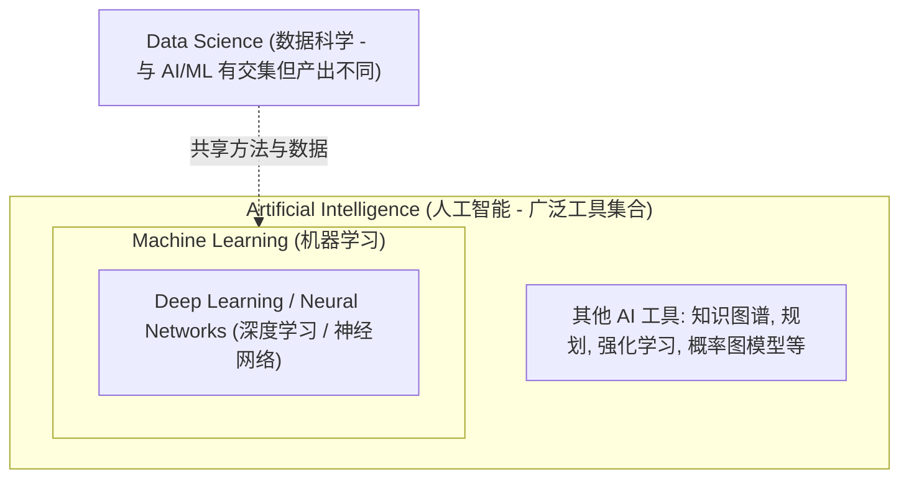
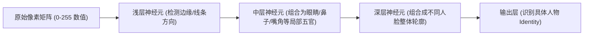

# Week 1：What is AI

%% learning-vault-navigation:v1 %%
> [!abstract]- 笔记导航
> 目录：[[AI learning/AI for everyone/AI for Everyone导航|AI for Everyone 导航]]
> 下一章：[[AI learning/AI for everyone/Week 2/Week-2 Building AI Projects|Week 2：Building AI Projects]]

> [!abstract] 本周学习概览与原始资料
> 本周由吴恩达（Andrew Ng）从零祛魅人工智能，系统厘清 ==ANI / AGI / Generative AI==、监督学习（$A \to B$ 映射）、数据本质与质量陷阱、AI 核心术语层级、真正 AI 企业的组织特征、机器学习的能力边界，以及深度学习（神经网络）的直观工作原理。
> - 原始课件：[[AI learning/AI for everyone/Week 1/W1.pdf|W1.pdf]]（38 页）
> - 配套测验：[[AI learning/AI for everyone/Week 1/Week-1_Quiz|Week-1 Quiz]]（10 题）

---

## 1. 祛魅人工智能：ANI、AGI 与生成式 AI

根据 McKinsey 预测，到 2033 年人工智能将创造 **13–22 万亿美元**的经济价值（其中生成式 AI 贡献约 **3–4 万亿美元**）。要理性评估 AI 价值，必须先区分当前落地技术与科幻想象之间的边界：

| 类别 | 全称与核心定义 | 典型代表 | 当前成熟度 |
| :--- | :--- | :--- | :--- |
| **ANI** | **弱人工智能（Artificial Narrow Intelligence）**：专注于单一明确任务的 AI 系统 | 智能音箱、自动驾驶、搜索引擎、农业/工厂视觉质检、垃圾邮件过滤 | **高速进步，商业价值的核心来源** |
| **Generative AI** | **生成式人工智能（Generative Artificial Intelligence）**：能生成高质量文本、图像、音频等内容的 AI | ChatGPT、Bard、Midjourney、DALL-E | **近年爆发，已进入大规模商用** |
| **AGI** | **通用人工智能（Artificial General Intelligence）**：能够完成人类所能做的一切智能任务 | 暂无成熟系统 | **仍处于早期探索，距离实用可能需数十年甚至更久** |

> [!important] 区分 ANI 与 AGI 的现实意义
> 当今媒体关于“AI 毁灭人类”的过度炒作往往源于将 **ANI 的飞速进展误判为 AGI 的临近**。现实中绝大多数落地系统（包括垃圾邮件过滤、语音识别等）都属于 **ANI**，而非 AGI。

---

## 2. 机器学习的核心：监督学习（Supervised Learning）

近年来创造绝大多数商业价值的机器学习范式是 ==监督学习（Supervised Learning）==——即让算法从成对样本中学习从 **输入 $A$ 到输出 $B$ 的映射关系（$A \to B$ Mapping）**。

### 2.1 常见 $A \to B$ 映射场景

| 输入 $A$（Input） | 输出 $B$（Output） | 应用领域（Application） |
| :--- | :--- | :--- |
| 电子邮件 | 是否垃圾邮件（0/1） | 垃圾邮件过滤（Spam filtering） |
| 语音音频 | 文本转录（Text transcripts） | 语音识别（Speech recognition） |
| 英文文本 | 中文文本 | 机器翻译（Machine translation） |
| 广告与用户信息 | 用户是否点击（0/1） | 在线广告（Online advertising） |
| 图像、雷达信息 | 周边车辆的位置 | 自动驾驶（Self-driving car） |
| 手机外观照片 | 是否存在瑕疵（0/1） | 视觉质检（Visual inspection） |
| 一段词序列 | 下一个词（The next word） | 聊天机器人 / 大语言模型（Chatbot / LLM） |

### 2.2 大语言模型（LLM）如何用监督学习工作

课件第 8 页用一句生动的例子解释了 LLM（如 ChatGPT）的底层训练逻辑：对于句子 `"My favorite drink is lychee bubble tea."`，将其拆解为一系列 ==“预测下一个词”的监督学习样本==：

| 输入 $A$（已有前缀） | 输出 $B$（下一个词） |
| :--- | :--- |
| `My favorite drink` | `is` |
| `My favorite drink is` | `lychee` |
| `My favorite drink is lychee` | `bubble` |
| `My favorite drink is lychee bubble` | `tea` |

当我们在海量语料（数千亿级别词元）上训练一个超大规模神经网络，反复执行“预测下一个词”的 $A \to B$ 监督学习，就诞生了具备强大对话与生成能力的大语言模型。

### 2.3 为什么是现在？（Why Now?）

机器学习与神经网络的概念早在数十年前就已提出，为何近十年才迎来爆发？核心驱动力在于 **数字化带来的海量数据** 与 **算力（GPU）支撑下的大型神经网络** 共同作用：

- **传统 AI 算法（Traditional AI）**：数据量增加到一定程度后，性能很快遇到平台期（Plateau），继续喂数据收益递减。
- **小型 / 中型神经网络**：相比传统方法能吸收更多数据并提升性能，但仍会受限于模型容量。
- **大型神经网络（Large Neural Network）**：==只有在“大数据集 + 大型神经网络”的双重条件下，模型性能才会持续攀升==，达到最佳表现（对应 [[AI learning/AI for everyone/Week 1/Week-1_Quiz|Week-1 Quiz]] 第 3 题）。

---

## 3. 什么是数据？（What is Data?）

数据是机器学习的燃料。以房价数据集为例，表格中的每一行是一个样本，列包含房屋面积（square feet）、卧室数量（# of bedrooms）和价格（price in 1000\$）。我们可以根据任务自由定义输入 $A$ 与输出 $B$（例如由面积预测房价，或由房价与面积预测卧室数）。

### 3.1 获取数据的三种主要途径

1. **人工标注（Manual Labeling）**：例如收集图片并让标注员逐张标注 `cat` / `not cat`；注意这**不是**获取监督学习数据的唯一途径。
2. **观察用户行为或设备运行（Observing User Behaviors / Operations）**：
   - 用户在电商平台是否点击/购买商品、点击广告，天然产生 0/1 标签；
   - 工业设备记录温度（$^\circ\text{C}$）、压力（psi）与是否发生故障（Y/N），天然形成故障预测数据集。
3. **网站下载与数据合作（Download from Websites / Partnerships）**：利用公开数据集或与第三方建立数据合作。

### 3.2 结构化数据 vs. 非结构化数据

| 数据类型 | 特征 | 典型例子 | 处理难度与历史演进 |
| :--- | :--- | :--- | :--- |
| **结构化数据（Structured Data）** | 规整的二维表格（行=样本，列=明确属性） | 房价表、滑板车最高时速、过去一年每周销量 | 人类与计算机都容易分析，传统统计与 ML 长期擅长 |
| **非结构化数据（Unstructured Data）** | 无固定表格模式，富含高维感知信息 | 滑板车照片、引擎音频文件、自然语言文本 | 人类直觉极易理解，过去计算机难以处理；**深度学习使其成为近年最大突破口** |

### 3.3 数据的误区与“脏数据”现实

> [!warning] 常见数据陷阱
> 1. **“先攒三年 IT 数据再请 AI 团队”是典型误区**：不要把未经规划的数据直接抛给 AI 团队并幻想它天然有价值。不同类型数据的价值差异极大，==应尽早让 AI 团队介入，共同决定采集哪些数据（例如采样频率、关键传感器字段）==。
> 2. **Garbage in, garbage out（垃圾进，垃圾出）**：真实数据往往极其杂乱（Data is messy），常见问题包括：
>    - **错误标签 / 异常值（Incorrect labels）**：如房价表中出现 `0.001`（\$1 美元的房子）；
>    - **缺失值（Missing values）**：面积、卧室数或价格记为 `unknown`；
>    - **多源异构（Multiple types of data）**：图像、音频、文本与表格混杂，需要大量数据清洗与预处理。

---

## 4. AI 术语辨析（The Terminology of AI）

商业沟通中常混淆 AI、机器学习、深度学习与数据科学。课件第 17–20 页给出了清晰的概念边界与层级关系：

### 4.1 核心定义与辨析

- **机器学习（Machine Learning）**：Arthur Samuel（1959）经典定义——“让计算机无需显式编程即获得学习能力的研究领域”。==其典型产出是一个持续运行的 AI 软件系统==（如嵌入在网站/App 中的实时房价预测器）。
- **数据科学（Data Science）**：从数据中提取知识与洞察的科学。==其典型产出是一份面向管理层的商业洞察报告或 PPT 演示文稿==（例如分析发现“同面积 3 居室比 2 居室更贵”、“新装修房屋溢价 15%”，或针对猫粮网站给出不同猫种的精准营销与定价调整方案）。
- **深度学习（Deep Learning）与神经网络（Neural Networks）**：二者在日常与工程语境中**几乎可以互换使用**；所有深度学习算法都属于机器学习，但并非所有 AI 算法都是深度学习。

> [!note] 破除对“神经网络”的拟人误解
> 人工神经网络本质上是一个**大型数学方程（big mathematical equation）**。尽管最初受生物大脑启发，但==其具体计算机制与人类生物大脑的工作原理几乎完全无关==。

---

## 5. 什么造就了一家真正的 AI 公司？

互联网时代的经验早已证明：`传统购物中心 + 一个官网 ≠ 互联网公司`。真正的互联网公司围绕互联网重构了组织机制——大规模 **A/B 测试**、极短的产品迭代周期、将决策权下放给工程师与产品经理等专业岗位。

同样地，在 AI 时代，==`任意传统公司 + 几个深度学习模型 ≠ AI 公司`==。真正的 AI 先锋企业（如 Google、百度等）具备四项系统能力：

1. **战略性数据获取（Strategic Data Acquisition）**：有意识地推出免费/低价产品或设计交互，以合规且低成本地沉淀高价值数据资产。
2. **统一数据仓库（Unified Data Warehouse）**：打破部门数据孤岛（Silos），将分散在各业务线的数据库汇总至统一数仓，以便跨维度关联分析与建模。
3. **无处不在的自动化意识（Pervasive Automation）**：持续识别业务流程中可以用监督学习自动化的环节。
4. **新岗位与新分工（New Roles & Division of Labor）**：设立机器学习工程师（MLE）、数据工程师等新角色，建立跨职能协作流程。

> [!tip] 提前预告：AI 转型五步法（AI Transformation Playbook）
> 本周已简要列出企业迈向 AI 公司的 5 个阶段（将在 [[AI learning/AI for everyone/Week 3/Week-3 AI in Your Company|Week 3]] 深度展开）：
> 1. 执行试点项目以积累势能（Execute pilot projects to gain momentum）
> 2. 组建内部 AI 团队（Build an in-house AI team）
> 3. 开展全员分层 AI 培训（Provide broad AI training）
> 4. 制定 AI 战略（Develop an AI strategy）
> 5. 做好内外部沟通（Internal and external communication）

---

## 6. 机器学习能做什么，不能做什么？

在立项评估前，必须建立对当前机器学习能力的务实直觉。

### 6.1 “一秒钟思考”经验法则

> [!important] Andrew Ng 经验法则（Rule of Thumb）
> **“任何人类只需不到 1 秒钟思考就能完成的脑力任务，我们现在或不久的将来很可能都能用监督学习实现自动化。”**
> 例如：看到一张人脸照片判断是否在微笑、判断客服邮件是否投诉、识别照片中是否有其他车辆。

但该法则只是**必要而非绝对充分**的粗略判断，实际可行性取决于两大核心条件：
1. **学习的概念是否相对“简单”**（存在稳定、可归纳的映射规律）；
2. **是否有足够规模且高质量的数据可用**。

### 6.2 典型案例对比：能做 vs. 不能做

| 领域 | 机器学习**擅长（Can do）** | 机器学习**难以做到（Cannot do）** | 背后原因 |
| :--- | :--- | :--- | :--- |
| **自动驾驶** | 基于海量行车数据检测前方车辆位置与距离 | 仅凭少量样本理解路边交警复杂手势（停车、搭便车、骑行者左转手势） | 罕见手势数据极度稀缺，且安全场景要求近乎极致的准确率 |
| **胸片 X 光诊断** | 借助约 **10,000 张标注影像**诊断肺炎 | 仅凭医学教材里的 **10 张插图 + 一章文字说明**学会诊断肺炎 | 现有监督学习依赖大数据归纳，无法像人类医生那样通过少量样本+抽象文本推理泛化 |
| **股票预测** | —— | 仅凭历史股价曲线（如 \$5 → \$14 → \$17）准确预测明日股价 | 金融市场受海量外部突发信息驱动、噪声极大，不存在简单的历史价格映射规律 |

### 6.3 优劣势总结

- **机器学习表现优异的场景**：学习相对“简单”的映射函数 + 拥有大量训练数据。
- **机器学习表现糟糕的场景**：
  1. 试图从**极少数据**中学习**复杂函数**；
  2. 被要求在**与训练集分布截然不同的新型数据**（Data shift / Out-of-distribution）上进行泛化（例如在某医院旧设备拍的胸片上训练，直接部署到成像风格迥异的另一家医院）。

---

## 7. 选修：深度学习的直观解释（Intuitive Explanation of Deep Learning）

无需复杂微积分，通过两个具体例子即可直觉理解神经网络的分层特征表达：

### 7.1 示例一：T 恤需求预测（结构化数据）

1. **单神经元模型**：输入单一特征 `price`（价格），经过一个简单非线性曲线（价格越高需求越低，降至 0 后不再为负）输出 `demand`（需求），这一映射单元即一个“神经元（neuron）”。
2. **多层神经网络**：同时输入 4 个特征——`price`（价格）、`shipping cost`（运费）、`marketing`（营销投入）、`material`（面料质量）。
   - **隐藏层神经元**自动学会组合输入形成高阶抽象概念：
     - 价格 + 运费 $\to$ **可负担性（Affordability）**
     - 营销投入 $\to$ **知名度（Awareness）**
     - 营销 + 面料 $\to$ **感知质量（Perceived quality）**
   - **输出层**再综合这三个隐藏概念预测最终需求量。
   - **关键直觉**：我们**不需要**人工告诉神经网络隐藏层要学“可负担性”或“知名度”，只需提供足够多的 `(输入 A, 输出 B)` 样本，神经网络会自动反向调整内部数学权重来发现最优中间特征。

### 7.2 示例二：人脸识别（非结构化图像数据）

在计算机眼中，一张照片并不是“人脸”，而是一个由 `0–255` 灰度/像素值构成的巨大数字矩阵（如课件第 37 页展示的像素网格）。深层神经网络逐层将像素矩阵抽象为身份（`identity`）：

---

## 8. 测验复盘与自测

> [!question]- Week 1 核心考点自检（对应 Week-1 Quiz）
> 1. **为什么垃圾邮件过滤和语音识别属于 ANI 而非 AGI？**
>    - 它们只能在特定窄领域执行预定义任务，无法像人类一样跨领域迁移并完成任意智能工作。
> 2. **人工标注是获取监督学习数据的唯一方式吗？**
>    - **否（False）**。还可以通过观察用户行为/设备故障日志、网站下载或数据合作等方式获取。
> 3. **滑板车厂商的数据中，哪些属于非结构化数据？**
>    - **滑板车照片、引擎音频文件**属于非结构化数据；而最高时速、每周销量属于表格化的结构化数据。
> 4. **猫粮电商网站的数据科学项目应产出什么？**
>    - 产出**业务洞察与决策建议**（如按猫种优化营销策略、调整定价以提升销量的 PPT 方案），而非搭建一个神经网络或只整理图片集。
> 5. **Deep Learning 与 Neural Network、Machine Learning、AI 的关系？**
>    - Deep Learning 与 Neural Network 几乎同义；Deep Learning $\subset$ Machine Learning $\subset$ AI；但 Machine Learning 与 Data Science 不可互换。
> 
> 完整原题见：[[AI learning/AI for everyone/Week 1/Week-1_Quiz|Week-1 Quiz]]
