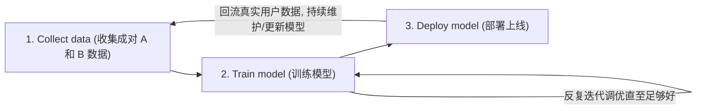
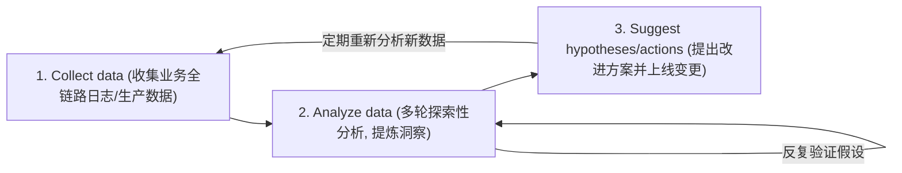

# Week 2：Building AI Projects

%% learning-vault-navigation:v1 %%
> [!abstract]- 笔记导航
> 目录：[[AI learning/AI for everyone/AI for Everyone导航|AI for Everyone 导航]]
> 上一章：[[AI learning/AI for everyone/Week 1/Week-1 What is AI|Week 1：What is AI]] · 下一章：[[AI learning/AI for everyone/Week 3/Week-3 AI in Your Company|Week 3：AI in Your Company]]

> [!abstract] 本周学习概览与原始资料
> 本周聚焦“如何把 AI 从概念真正做成落地项目”，拆解 ==机器学习项目与数据科学项目的标准工作流==、跨部门业务场景落地案例、AI 项目的立项头脑风暴与双维度尽职调查（技术尽调 + 商业尽调）、自研与外购决策、与 AI 团队协作的验收标准与数据集划分，以及主流开源工具栈与硬件基础设施。
> - 原始课件：[[AI learning/AI for everyone/Week 2/W2.pdf|W2.pdf]]（33 页）
> - 配套测验：[[AI learning/AI for everyone/Week 2/Week-2_Quiz|Week-2 Quiz]]（10 题）

---

## 1. 机器学习项目工作流（Workflow of a Machine Learning Project）

机器学习项目**绝非一次成型的瀑布流**，而是一个高度 ==迭代（Iterative）== 的工程循环——团队通常需要反复试验多个模型架构、超参数与数据清洗方案，才能达到可用标准。

### 1.1 典型案例拆解

1. **智能音箱语音识别（Amazon Echo/Alexa、Google Home、Apple Siri、Baidu DuerOS）**：
   - **Collect data**：收集大量唤醒词音频与环境噪声样本；
   - **Train model**：不断迭代算法以降低误唤醒率与漏检率；
   - **Deploy & Maintain**：上线后可能遇到新口音、新词或麦克风老化导致的分布漂移，需持续收集回流数据并更新模型。
2. **自动驾驶车辆检测**：
   - **Collect data**：采集道路图像与标注出的周边车辆位置；
   - **Train model**：反复优化检测精度与实时性；
   - **Deploy & Maintain**：真实路况出现新车型（如新型电动滑板车、特殊工程车）时，持续采集长尾数据迭代更新。

---

## 2. 数据科学项目工作流（Workflow of a Data Science Project）

与交付“在线运行软件”的 ML 项目不同，数据科学项目的核心目标是**通过分析发现隐藏规律，驱动商业决策与流程优化**。其三步工作流同样是持续迭代的：

### 2.1 两个经典业务案例

| 案例 | 业务流程与数据字段 | 分析洞察与行动方向 |
| :--- | :--- | :--- |
| **电商销售漏斗优化（Sales Funnel）** | `访问网站 → 商品页 → 购物车 → 结账`；记录 `User ID, Country, Time, Webpage` | 定位高流失环节（例如某国用户在购物车页因运费骤增大量弃单），提出改版/定价假设并跟踪转化率变化 |
| **陶瓷杯生产线良率分析（Manufacturing Line）** | `混泥 → 塑形 → 上釉 → 入窑烧制 → 终检`；关联泥料批次表（供应商、搅拌时长）与烧制批次表（地区、湿度、窑温、时长） | 交叉分析发现某供应商原料在特定湿度与窑温下开裂率显著偏高，调整工艺参数或更换配方后持续复检 |

---

## 3. 每个职能部门都需要学会用数据（ML vs. DS 跨职能矩阵）

无论身处销售、制造、招聘、市场还是农业，每个岗位都可以同时寻找 **机器学习（自动化 $A \to B$ 任务）** 与 **数据科学（分析洞察优化流程）** 两类机会：

| 业务职能 | 机器学习应用（自动化软件系统） | 数据科学应用（业务洞察与流程优化） |
| :--- | :--- | :--- |
| **销售（Sales）** | **线索自动分级（Automated lead sorting）**：输入客户姓名、职位、公司规模、邮箱，输出优先级（high/medium/low） | **销售漏斗优化（Optimize sales funnel）**：分析网站到结账各环节转化瓶颈 |
| **制造产线管理（Manufacturing）** | **自动视觉质检（Automated visual inspection）**：输入产品图片，输出 `ok / defect` | **工艺全链路优化**：分析混泥、塑形、上釉、窑烧各环节参数对良品率的影响 |
| **招聘（Recruiting）** | **自动简历筛选（Automated resume screening）**：输入候选人简历信息，预测是否推进面试（Yes/No） | **招聘漏斗优化（Optimize recruiting funnel）**：分析外联→电面→现场面→Offer 的转化与流失原因 |
| **市场营销（Marketing）** | **个性化商品推荐（Customized product recommendation）**：向不同用户精准推送课程或商品 | **A/B 测试（A/B testing）**：对比不同落地页/文案版本（A vs. B）的转化效果 |
| **农业（Agriculture）** | **精准除草（Precision weed killing）**：视觉识别杂草并定向喷洒/清除 | **作物数据分析（Crop analytics）**：结合土壤、气候与产量数据优化种植决策 |

---

## 4. 如何选择合适的 AI 项目？（How to Choose an AI Project）

最具价值且可落地的 AI 项目，必然位于 **“AI 技术能做什么（AI Experts）”** 与 **“什么对你的业务有价值（Domain Experts）”** 的交集之中。

### 4.1 跨职能头脑风暴框架

1. **思考自动化“任务（Tasks）”，而非替代整个“岗位（Jobs）”**：
   - 例如客服中心不应急于替代所有客服，而是先自动化**来电路由分发（Call center routing）**；
   - 放射科医生工作包含读片、会诊、医患沟通等，可先自动化读片中的特定影像筛查任务。
2. **业务价值驱动提问**：
   - 驱动业务增长的核心杠杆是什么（Main drivers of business value）？
   - 当前业务最大的痛点或瓶颈在哪里（Main pain points）？

> [!tip] 没有“大数据（Big Data）”也能启动 AI 项目
> - 更多数据几乎总是有益的，且数据能为搜索等业务构建强护城河；
> - 但认为“没有大数据就不值得做 ML/DS 项目”是**错误的**（参见 [[AI learning/AI for everyone/Week 2/Week-2_Quiz|Week-2 Quiz]] 第 5 题）。即使只有几百或上千条高质量数据，往往也能做出有价值的探索与改进。

### 4.2 项目立项双重尽职调查（Due Diligence）

在正式投入大量预算之前，必须同步完成两项尽调：

| 维度 | 负责视角 | 核心审查清单 |
| :--- | :--- | :--- |
| **技术尽调（Technical Diligence）** | 确认技术**是否可行（Feasible）** | 1. AI 系统能否达到业务期望的性能指标？ 2. 需要多少规模的数据，能否合法且经济地获取到？ 3. 工程研发时间表（Engineering timeline）是否合理？ |
| **商业尽调（Business Diligence）** | 确认做成后**是否有价值（Valuable）** | 1. 能否降低成本（Lower costs）？ 2. 能否提升营收（Increase revenue）？ 3. 能否支撑推出新产品或开拓新业务（既适用于现有业务，也适用于新业务）？ |

> [!warning] 测验高频区分点
> 评估项目 ROI、是否提升营收属于**商业尽调**，而非技术尽调；制定工程时间表、评估所需数据量和模型能否达标属于**技术尽调**。此外，商业尽调往往需要数周甚至跨部门深入评估，不可能在一天内草率完成。

### 4.3 自研还是外购？（Build vs. Buy）

- **机器学习（ML）项目**：既可以自研（In-house），也可以外包或采购成熟方案（Outsourced）。
- **数据科学（DS）项目**：通常更适合**内部团队自研**，因为需要深度绑定企业独有业务上下文并持续迭代洞察。
- **行业通用能力避免重复造轮子**：例如通用语音转文字、通用 OCR、基础云端翻译等已成为行业标准件，应优先直接购买 API/服务，把稀缺的自研精力集中在企业独有的差异化优势上。

---

## 5. 与 AI 团队高效协作（Working with an AI Team）

非技术管理者或业务方与 AI 团队合作时，最关键的沟通抓手是 ==明确可量化的验收标准（Acceptance Criteria）== 与 ==规范使用训练集/测试集==。

### 5.1 明确验收标准与提供评估数据

- 不能只给模糊目标（“帮我把质检做好”），而应明确为具体指标，例如：**“在提供的测试集上，缺陷检测准确率达到 95%”**。
- 业务方需要向 AI 团队提供贴近真实生产环境的样本数据集用于衡量效果。

### 5.2 AI 团队如何看待数据：训练集 vs. 测试集

| 数据集 | 包含内容 | 核心用途 | 严禁违反的原则 |
| :--- | :--- | :--- | :--- |
| **训练集（Training Set）** | 成对的输入 $A$ 与期望输出 $B$（如简历 + 是否推进面试） | 供 AI 团队训练监督学习算法、学习 $A \to B$ 映射 | 严禁与测试集使用同一批数据 |
| **测试集（Test Set）** | 同样必须包含成对的输入 $A$ 与真实输出 $B$ | 独立、公正地评估训练后模型的泛化性能 | 若测试集与训练集重合，模型只是“死记硬背”，评估指标会严重虚高 |

### 5.3 避坑指南：为何不要期待 100% 准确率？

> [!warning] 期待 100% 准确率是不切实际的（四大原因）
> 1. **机器学习本身的局限性（Limitations of ML）**：任何统计学习模型都存在误差下界；
> 2. **数据量不足（Insufficient data）**：难以覆盖所有边界情况与长尾分布；
> 3. **数据标注错误（Mislabeled data）**：人工或系统采集过程中混入错误标签；
> 4. **标签本身存在歧义（Ambiguous labels）**：例如陶瓷杯上的微小划痕，两位质检专家可能一人判 `ok`、一人判 `defect`，模型自然无法同时满足矛盾标准。

---

## 6. 选修：AI 团队常用技术工具栈（Technical Tools for AI Teams）

了解 AI 团队日常使用的开源生态与算力设施，有助于非技术同事顺畅沟通预算与选型：

| 类别 | 代表工具 / 概念 | 核心作用 |
| :--- | :--- | :--- |
| **开源机器学习框架** | **PyTorch**、**TensorFlow**、**Hugging Face**、**PaddlePaddle**、**Scikit-learn**、**R** | 构建、训练与部署深度学习/传统 ML/大模型的核心软件库 |
| **开源代码托管** | **GitHub** | 共享开源模型代码、复现前沿项目、团队协作开发 |
| **前沿论文预印本** | **arXiv** | AI 领域最快发布与获取最新学术成果的开放平台 |
| **计算芯片** | **CPU**（中央处理器） vs. **GPU**（图形处理器） | CPU 擅长通用串行逻辑；GPU 擅长大规模并行矩阵运算，是训练深度学习模型的核心算力 |
| **部署架构** | **Cloud（云端）** vs. **On-premises（本地机房）** | 云端弹性扩缩容、前期投入低；本地部署利于极高数据隐私合规或长期大规模固定算力成本控制 |

---

## 7. 测验复盘与自测

> [!question]- Week 2 核心考点自检（对应 Week-2 Quiz）
> 1. **自动销售线索分级的正确 ML 工作流顺序是？**
>    - `收集含 A 和 B 的数据 → 训练 A→B 模型 → 部署模型并回流用户数据`。
> 2. **为什么机器学习被称为迭代（Iterative）过程？**
>    - AI 团队很少一次就做出理想模型，通常需要多轮尝试不同特征、数据与算法直至达标。
> 3. **简历自动筛选项目中，训练集和测试集有什么共同点与区别？**
>    - **共同点**：二者都必须同时包含输入 $A$（简历）与目标输出 $B$（是否推进）；
>    - **区别**：训练集用于“学”，测试集用于“考”，二者必须严格分离，绝不能相同。
> 4. **没有 Big Data 是否就不值得做 ML/DS？**
>    - **否（False）**，小数据集依然可以产出有价值的模型或洞察。
> 5. **哪四类原因导致 ML 系统很难做到 100% 准确？**
>    - ML 固有局限、数据不足、标注错误、标签本身有歧义。
> 
> 完整原题见：[[AI learning/AI for everyone/Week 2/Week-2_Quiz|Week-2 Quiz]]
