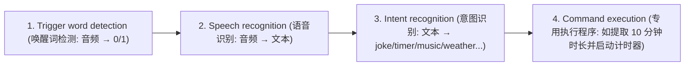
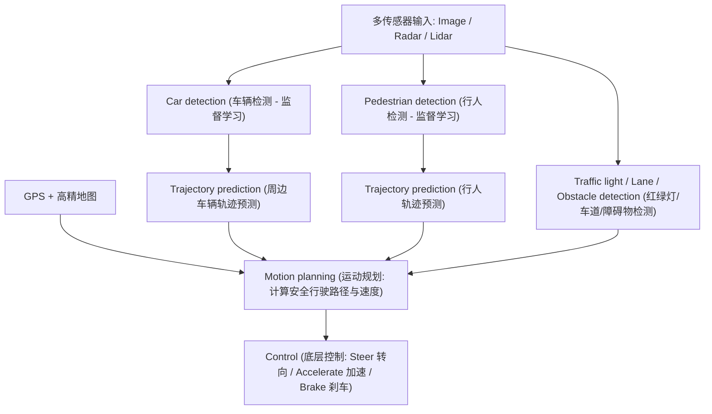
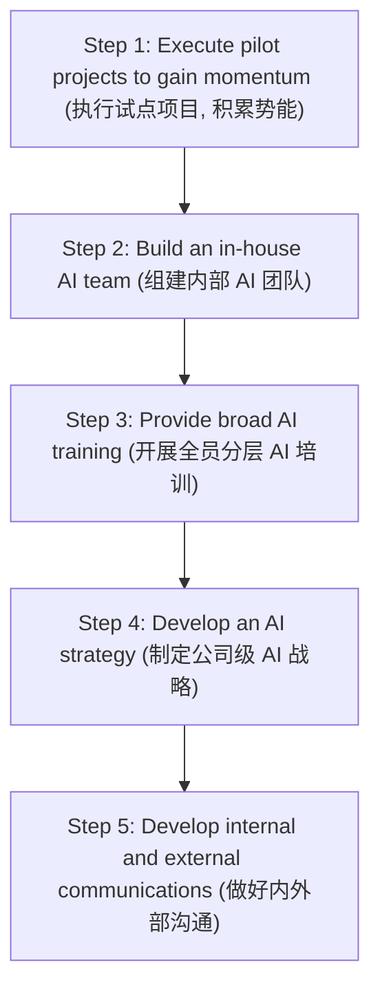

# Week 3：AI in Your Company

%% learning-vault-navigation:v1 %%
> [!abstract]- 笔记导航
> 目录：[[AI learning/AI for everyone/AI for Everyone导航|AI for Everyone 导航]]
> 上一章：[[AI learning/AI for everyone/Week 2/Week-2 Building AI Projects|Week 2：Building AI Projects]] · 下一章：[[AI learning/AI for everyone/Week 4/Week-4 AI and Society|Week 4：AI and Society]]

> [!abstract] 本周学习概览与原始资料
> 本周从单个 AI 项目升级到**企业级 AI 落地与组织转型**：通过智能音箱与自动驾驶两大复杂产品案例，揭示“多模块 AI + 传统软件”的系统工程架构；系统梳理 AI 团队核心岗位分工、吴恩达经典的 ==AI 转型五步手册（AI Transformation Playbook）==、企业常见 AI 踩坑清单与起步行动建议；并在选修部分全景扫盲六大 AI 应用领域与五大核心技术范式。
> - 原始课件：[[AI learning/AI for everyone/Week 3/W3.pdf|W3.pdf]]（44 页）
> - 配套测验：[[AI learning/AI for everyone/Week 3/Week-3_Quiz|Week-3 Quiz]]（10 题）

---

## 1. 复杂 AI 产品拆解（Case Studies）

真实世界中的复杂 AI 产品通常**不是单一“万能模型”**，而是由多个专职的 ANI 机器学习组件与传统软件工程模块串联组成的流水线。

### 1.1 案例一：智能音箱（Smart Speaker）

以“Hey device, tell me a joke”或“Hey device, set timer for 10 minutes”为例，尽管智能音箱能执行讲笑话、定闹钟、放音乐、查天气、单位换算等多种功能，它依然是 **ANI（而非 AGI）**，因为每个功能都依赖专门编写的流水线与执行模块：



- **步骤 1–3**：分别对应独立的监督学习模块（唤醒词检测、语音转文本、意图分类）；
- **步骤 4**：由**传统软件工程师**编写专用代码执行动作（如播放笑话音频、解析时长参数启动定时器、调用天气 API）。

### 1.2 案例二：自动驾驶汽车（Self-Driving Car）

自动驾驶是更为庞大、强安全约束的多模块系统。简化版本由三大核心环节构成，而完整工程架构进一步融合了多传感器与环境预测：



> [!important] 测验重点
> 自动驾驶中的**行人检测（Pedestrian detection）**与**车辆检测**组件通常采用 ==监督学习（Supervised learning）== 构建，而不是靠强化学习或 GAN 凭空学出来；运动规划（Motion planning）则综合所有感知与地图输出生成路径。

---

## 2. AI 团队的核心角色分工（Roles of an AI Team）

大型企业往往需要精细分工，但在起步阶段无需等招齐全部岗位：

| 岗位名称 | 核心职责 | 典型任务示例 |
| :--- | :--- | :--- |
| **软件工程师（Software Engineer）** | 构建可靠、可扩展的传统软件与产品外壳 | 编写音箱笑话/计时器执行程序、保障自动驾驶系统工程可靠性 |
| **机器学习工程师（Machine Learning Engineer, MLE）** | 利用成熟 AI 技术构建、训练、优化并上线 $A \to B$ 模型软件 | 构建唤醒词检测系统（输入音频 → 输出是否包含唤醒词） |
| **机器学习研究员（ML Researcher）** | 拓展机器学习前沿技术边界，发表论文或研发新算法 | 提出全新网络架构或训练范式（介于研究员与 MLE 之间常有 **Applied ML Scientist**） |
| **数据科学家（Data Scientist）** | 深入分析数据并提炼商业洞察，向团队与高管汇报决策建议 | 销售漏斗诊断、定价策略实验分析与 PPT 汇报 |
| **数据工程师（Data Engineer）** | 搭建并维护数据基础设施，确保数据**易获取、安全且低成本** | 管理 GB/TB/PB 级数仓（$1\text{ GB}=10^3\text{ MB}$，$1\text{ TB}=10^6\text{ MB}$，$1\text{ PB}=10^9\text{ MB}$） |
| **AI 产品经理（AI Product Manager）** | 站在技术与业务交汇点，决定“做什么”——识别既可行又有价值的产品方向 | 规划产品路线图、定义验收标准、协调算法与业务团队 |

> [!tip] 小团队起步完全可行
> 课件第 15 页明确强调：启动 AI 并不需要豪华班底，哪怕只有 **1 名软件工程师**、**1 名 MLE/数据科学家**，甚至 **只有你自己**，也可以迈出第一步。

---

## 3. AI 转型五步手册（AI Transformation Playbook）

将传统企业真正转型为 AI 驱动型公司，吴恩达总结出经过大量企业验证的**五步路线图**——注意步骤顺序至关重要：



### Step 1：执行试点项目以积累势能（Execute Pilot Projects to Gain Momentum）
- **第一原则**：==首个试点项目“能够成功并展示成效”比“追求最高商业价值”更重要==；
- **周期要求**：应在 **6–12 个月**内看到明显进展（Show traction），以便为组织建立信心；
- **执行方式**：初期可内部自研，也可借助外部团队快速跑通。

### Step 2：组建内部 AI 团队（Build an In-House AI Team）
- 建议组建**集中式 AI 中台团队**（置于 CTO、CIO、CDO 或新设的 **CAIO 首席人工智能官**之下），采用矩阵模式向各个业务单元（BU, Business Unit）输送人才与技术标准，同时沉淀公司级统一基础设施与数据规范。

### Step 3：开展全员分层 AI 培训（Provide Broad AI Training）
- 聪明的 CLO（首席学习官）懂得**筛选整合优质现成课程（curate）**，而非从零闭门造车（create）。培训必须覆盖管理层与执行层，而不仅是工程师：

| 受训对象 | 必须学习的核心内容 |
| :--- | :--- |
| **高管与高级商业领袖（Executives & Senior Leaders）** | AI 能为企业创造什么价值、AI 战略框架、资源配置决策 |
| **AI 项目涉及的业务部门负责人（Division Leaders）** | 设定项目方向（技术尽调与商业尽调）、资源分配、项目进度监控 |
| **AI 工程师培养对象（AI Engineer Trainees）** | 构建并交付 AI 软件、采集与清洗数据、落地执行具体 AI 项目 |

### Step 4：制定 AI 战略（Develop an AI Strategy）
- **为何战略排在第四步而不是第一步？** ==在缺乏实际 AI 项目经验、尚未亲身体验构建 AI 流程之前，企业通常缺乏足够认知去制定切实可行的 AI 战略==（对应 [[AI learning/AI for everyone/Week 3/Week-3_Quiz|Week-3 Quiz]] 第 8 题）。
- **AI 战略四大支柱**：
  1. **打造垂直行业专属壁垒**：利用 AI 在本行业细分赛道建立难以复制的优势；
  2. **围绕“AI 良性循环（Virtuous Cycle of AI）”设计飞轮**：
     ```mermaid
     flowchart LR
         A["Better product (更好的产品)"] --> B["More users (更多用户)"]
         B --> C["More data (更多数据)"]
         C --> A
     ```
  3. **建立配套数据战略**：包括战略性数据获取（Strategic data acquisition）与统一数据仓库（Unified data warehouse）；
  4. **放大网络效应与平台优势**：在具备“赢家通吃（Winner-take-all）”特征的行业中，AI 可作为关键加速器。

### Step 5：制定内外部沟通策略（Internal & External Communications）
- **外部沟通**：投资者关系（Investor relations）、政府与监管关系（Government relations）、客户/用户教育（Customer/user education）、人才招聘品牌（Talent/recruitment）；
- **内部沟通**：消除员工对“AI 抢饭碗”的恐慌，对齐转型愿景与协作机制。

---

## 4. 企业落地 AI 常见避坑清单与起步建议

### 4.1 五大常见陷阱（Don't vs. Do）

| ❌ 避免踩坑（Don't） | ✅ 正确做法（Do） |
| :--- | :--- |
| 期待 AI 解决一切问题 | 基于技术、数据与工程资源的现实边界，理性评估 AI 能做什么、不能做什么 |
| 招 2–3 名 ML 工程师并把寻找业务场景的责任全丢给他们 | **将工程人才与业务人才配对**，跨职能协同发掘既可行又有价值的项目 |
| 期待 AI 项目第一次尝试就成功上线 | 将 AI 研发规划为**多轮迭代过程**，允许并预算多次试错直至达标 |
| 原封不动照搬传统软件的项目规划流程 | 与 AI 团队共同重新定义时间预估、里程碑与阶段性 KPI |
| 认为必须先招到“超级明星 AI 工程师”才能动手 | 边建设团队边行动，先用现有团队跑起小而美的项目 |

### 4.2 个人与企业可以立刻采取的初始行动
1. 拉上身边的同事朋友一起学习 AI（如共学本课程、组建读书/论文分享小组）；
2. 启动项目头脑风暴——**没有哪个项目因为太小而不值得做（No project is too small）**；
3. 招募少量 ML/DS 人才协助推进；
4. 聘任或内部任命 AI 负责人（VP AI、CAIO 等）；
5. 与 CEO/董事会探讨 AI 转型的战略可能：“如果我们变得擅长 AI，公司价值或效率会提升多少？”

---

## 5. 选修全景扫描：主要 AI 应用领域与核心技术

### 5.1 六大主要 AI 应用领域

| 应用领域 | 核心子任务 | 典型例子 |
| :--- | :--- | :--- |
| **计算机视觉（Computer Vision）** | 图像分类/物体识别（含人脸识别）、目标检测、图像分割、目标追踪 | 猫咪识别、人脸考勤注册、自动驾驶障碍物框选与像素级分割 |
| **自然语言处理（NLP）** | 文本分类（含情感分析）、信息检索、命名实体识别（NER）、机器翻译 | 垃圾邮件分类、电商商品类目归类、情感评判（好/差评）、识别句子中的人名/地名、英日互译（`AI is the new electricity` ↔ `AIは、新たな電気だ`） |
| **语音技术（Speech）** | 语音识别（STT）、唤醒词检测、说话人识别（Speaker ID）、语音合成（TTS） | 智能音箱唤醒、语音转字幕、声纹认证、文本朗读 |
| **生成式 AI（Generative AI）** | 文本生成、图像生成、音频生成（语音/音乐） | 创意命名文案（巧克力冰淇淋取名）、文生图（“吃冰淇淋的紫色友好机器人”）、生成 140 bpm 鼓点独奏 |
| **机器人（Robotics）** | 感知（Perception）、运动规划（Motion planning）、控制（Control） | 识别周围环境 → 规划运动轨迹 → 向电机发送控制指令 |
| **通用机器学习（General ML）** | 同时覆盖**非结构化数据**（图/音/文）与**结构化表格数据** | 房价预测、制造产线泥料批次良率分析 |

### 5.2 五大扩展 AI 技术范式

| 技术名称 | 核心思想 | 课件典型示例 |
| :--- | :--- | :--- |
| **无监督学习（Unsupervised Learning）** | 给定**无标签数据**，让算法自主发现数据内部结构（如聚类 Clustering） | 从无标签 YouTube 视频中自动发现猫；薯片单价与销量聚簇分析 |
| **迁移学习（Transfer Learning）** | 从数据充沛的**任务 A** 学到知识，迁移并助力数据稀缺的**任务 B** | 用 **100,000 张汽车图**学到的检测知识，仅用 **100 张高尔夫球车图**即可做好高尔夫球车检测 |
| **强化学习（Reinforcement Learning）** | 通过**奖励信号（Reward signal）**反馈表现好坏，让 AI 在交互试错中自主学会最大化长期累计奖励 | 结合 GPS/加速度计/罗盘控制无人机或直升机特技飞行、下棋与游戏 AI |
| **生成对抗网络（GANs）** | 通过生成器与判别器对抗博弈，从零合成高度逼真的新图像 | Karras et al. (2018) 渐进式增长 GAN 生成不存在的人脸照片 |
| **知识图谱（Knowledge Graph）** | 以“实体—属性/关系”网络结构化组织世界知识 | 人物卡片（Ada Lovelace 生卒与简介）、酒店信息卡片（地址、电话、Wi-Fi、泳池） |

---

## 6. 测验复盘与自测

> [!question]- Week 3 核心考点自检（对应 Week-3 Quiz）
> 1. **智能音箱处理语音指令的正确 4 步顺序是？**
>    - `Trigger word detection（唤醒词检测）→ Speech recognition（语音识别）→ Intent recognition（意图识别）→ Command execution（指令执行）`。
> 2. **招谁来基于现有 AI 技术开发唤醒词检测软件最合适？**
>    - **机器学习工程师（Machine Learning Engineer）**（不是数据工程师、产品经理或专注前沿理论的研究员）。
> 3. **AI 转型手册第一步是什么？首个试点项目最重要的特质是什么？**
>    - 第一步是**执行试点项目以积累势能**；最重要特质是**在 6–12 个月内取得成功并展现进展**，而非盲目追求最高商业价值。
> 4. **AI 良性循环（Virtuous Circle of AI）的正确闭环方向？**
>    - `更好产品 → 更多用户 → 更多数据 → 更好产品`。
> 5. **为什么制定 AI 战略不是第一步？**
>    - 企业在亲手实践过 AI 项目之前，缺乏足够一线经验与体感，无法制定靠谱的战略。
> 
> 完整原题见：[[AI learning/AI for everyone/Week 3/Week-3_Quiz|Week-3 Quiz]]
