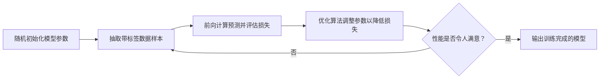
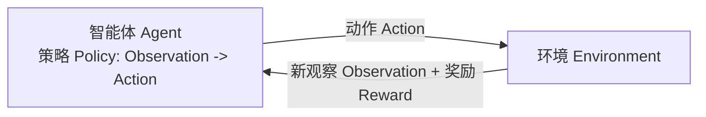

# 01. 引言

%% learning-vault-navigation:v1 %%
> [!abstract]- 笔记导航
> 目录：[[AI learning/D2L-李沐/动手学深度学习导航|动手学深度学习导航]]
> 下一章：[[AI learning/D2L-李沐/笔记/02. 预备知识|02. 预备知识]]

> [!abstract] 本章导读
> 本章从传统规则驱动软件的局限出发，建立==用数据编程（Programming with Data）==的核心心智模型：系统拆解机器学习的四大组件（数据、模型、目标函数、优化算法），梳理监督学习、无监督学习与强化学习的问题谱系，回溯深度学习从统计与神经科学起源到算力/数据驱动复兴的脉络，并提炼深度学习==多级表示学习==与==端到端训练==的本质特征。

---

## 1. 为什么需要机器学习：从规则编程到用数据编程

传统软件工程依靠开发者显式编写“业务逻辑”覆盖各种边界条件；然而面对天气预测、自然语言问答、图像行人轮廓识别、个性化商品推荐等任务时，规则本身可能随时间演变，或输入（如像素、原始声波）到抽象语义的映射过于复杂而无法手工枚举。

以“唤醒词识别”（如 `Alexa`、`Hey Siri`、`小爱同学`）为例：麦克风每秒采样约 $44{,}000$ 次声波振幅，人脑能轻松识别唤醒词，却无法写出一套显式 `if-else` 规则。机器学习的范式转变在于：

- **参数（Parameter）**：决定程序行为的可调“旋钮”；
- **模型（Model）**：给定一组参数值后对应的具体输入–输出映射程序；
- **模型族（Model Family）**：通过调节参数可生成的所有程序集合；
- **学习算法（Learning Algorithm）**：根据数据集自动搜索最优参数集的元程序。

这种通过观测数据或环境交互来自动确定程序行为的方式，即==用数据编程（Programming with Data）==。

---

## 2. 机器学习的四大核心组件

无论面对哪一类机器学习任务，都围绕以下四个核心组件展开：

| 组件 | 英文 | 核心定义与关注点 | 典型实例 / 风险提示 |
| :--- | :--- | :--- | :--- |
| **数据** | Data | 由若干**样本（Example / Sample）**组成，通常假设独立同分布（i.i.d.）；每个样本包含**特征 / 协变量（Features / Covariates）**，监督任务还包含**标签 / 目标（Label / Target）** | 固定长度向量（表格）vs 变长数据（文本、不同分辨率图像）；警惕 *Garbage in, garbage out*、样本分布不均衡与历史社会偏见放大 |
| **模型** | Model | 将输入数据转换为预测输出的函数映射；深度学习采用多层线性与非线性变换交错构成的深度神经网络 | 浅层线性模型 vs 深度神经网络（CNN、RNN、Transformer 等） |
| **目标函数** | Objective / Loss Function | 量化模型优劣的可优化度量；惯例上最小化**损失函数（Loss / Cost Function）** | 回归常用平方误差；分类的错误率不可微，通常优化**替代目标（Surrogate Objective）**如交叉熵 |
| **优化算法** | Optimization Algorithm | 在参数空间搜索使目标函数最小化的参数组合 | 深度学习主力为**梯度下降（Gradient Descent）**及其随机小批量变体（SGD、Adam 等） |

> [!warning] 泛化与过拟合（Overfitting）
> 必须在**训练集（Training Set）**上拟合参数，并在未见过的**测试集（Test Set）**上评估真实泛化能力。若模型在训练集表现优异（类似“刷熟了模拟考”），却无法推广到测试集（“期末考试失利”），则发生了==过拟合==。

---

## 3. 机器学习问题谱系

### 3.1 监督学习（Supervised Learning）

给定带有真实标签的“特征–标签”样本对，目标是估计条件概率 $P(y \mid \mathbf{x})$ 或直接学习映射 $\mathbf{x} \mapsto y$。工业界绝大多数成功落地应用属于监督学习，涵盖多种形态：

| 子任务 | 核心问题 | 输出形态 | 典型损失 / 关键细节 |
| :--- | :--- | :--- | :--- |
| **回归（Regression）** | “有多少？”（房价、降雨量、电影评分、住院时长） | 连续实数值 | 平方误差损失（Squared Error） |
| **分类（Classification）** | “哪一个？”（二分类如猫/狗；多分类如手写数字 0–9） | 互斥类别的离散概率分布 | **交叉熵（Cross-Entropy）**；注意决策应结合**预期风险**而非仅看最大概率；复杂场景还可引入**层次分类（Hierarchical Classification）** |
| **标记问题（Multi-label）** | 同一对象同时拥有多个不互斥标签（博客标签、PubMed MeSH 术语、含多种动物的图像） | 多个独立标签的集合 | 类别之间不相互排斥 |
| **搜索与排序（Search / Ranking）** | 从海量候选中返回**有序**子集（搜索引擎） | 相关性分数与排序列表 | 结果相同但顺序不同即视为不同输出（如早期 PageRank 与现代学习排序） |
| **推荐系统（Recommender）** | 个性化估计“用户–物品”匹配度（评分或购买概率） | 显式反馈（评分）或隐式反馈（跳过歌曲） | 存在**审查反馈偏差**（极端评价多、中等少）与**反馈循环（Feedback Loop）** |
| **序列学习（Sequence Learning）** | 输入和/或输出为可变长、具时序依赖的序列 | 序列标注、序列到序列（Seq2Seq） | 需具备“记忆”能力，覆盖词性/命名实体标注、ASR（输出远短于输入）、TTS（输出远长于输入）、机器翻译（需处理词序重排，如德译英动词后置） |

> [!example] 决策不等同于取最高概率：死帽蕈（Death Cap）示例
> 假设毒蘑菇分类器判断某蘑菇为死帽蕈的概率为 $0.2$（80% 概率无毒）。虽然“无毒”概率更高，但按**预期风险（Expected Risk）**计算：
> - 食用损失：$0.2 \times \infty + 0.8 \times 0 = \infty$
> - 丢弃损失：$0.2 \times 0 + 0.8 \times 1 = 0.8$
>
> 由此可见，高风险场景必须将预测概率与代价矩阵结合决策。

### 3.2 无监督学习（Unsupervised Learning）

数据中不包含显式目标标签，模型需自发挖掘数据的内在结构与分布规律，典型任务包括：

- **聚类（Clustering）**：无标签情况下按相似性划分簇（如照片自动分组、用户行为分群）；
- **主成分分析（PCA）与表示发现**：用少量低维参数捕捉线性相关结构，或在欧氏空间学习具有语义线性关系的表示（如“罗马”$-$“意大利”$+$“法国”$=$“巴黎”）；
- **因果关系与概率图模型（Causality & PGM）**：从观测数据中推断变量间的底层因果与统计依赖结构；
- **生成对抗网络（GAN）**：学习数据生成分布以合成逼真的图像、音频等非结构化数据。

### 3.3 与环境互动与强化学习（Reinforcement Learning）

监督与无监督学习大多属于**离线学习（Offline Learning）**：预先收集数据并训练模型，推理过程不改变环境。但当智能体置身动态环境时，会面临两大新挑战：

1. **分布偏移（Distribution Shift）**：未来数据分布随时间自然变化，或因自动化系统介入而发生改变；
2. **动作反作用于环境**：当前决策会改变后续观测状态。

强化学习旨在学习一个最大化长期累积奖励的**策略（Policy）**，其核心难点包括：

- **信用分配（Credit Assignment）**：奖励往往严重延迟（如国际象棋终局才给 $+1/-1$），需判断历史中哪些关键动作促成了胜负；
- **部分可观测性（Partial Observability）**：当前观测不足以唯一确定状态（如清洁机器人在相似壁橱中需结合历史轨迹定位）；
- **探索与利用权衡（Exploration vs. Exploitation）**：在利用当前已知最优策略与探索未知策略空间之间取得平衡。

强化学习的重要特例层级：
- **马尔可夫决策过程（MDP）**：环境完全可观测；
- **上下文赌博机（Contextual Bandit）**：状态不依赖于历史动作；
- **多臂赌博机（Multi-Armed Bandit）**：无状态，仅在未知回报的若干动作间选择。

---

## 4. 深度学习的起源、复兴与关键突破

### 4.1 多学科源头

1. **统计学与估计理论**：伯努利分布、高斯分布与最小均方（LMS）、克贝尔 16 人脚长均值估计（含去除极值的最早修剪均值思想）、费舍尔（LDA、费舍尔信息矩阵、鸢尾花数据集；同时警示统计工具的伦理误用风险）。
2. **信息论与计算理论**：香农（信息论）、图灵（《计算机器与智能》与图灵测试）。
3. **神经科学与心理学**：赫布学习（Hebb, 1949，神经元通过正强化建立连接，启发 Rosenblatt 感知器与 SGD）；贝恩（1873）与谢林顿（1890）的生物神经元计算电路构想。

现代神经网络延续的两条核心原则：
- **线性与非线性处理单元交替堆叠**（即“层”）；
- **基于链式法则的反向传播（Backpropagation）**一次性联合更新全网参数。

### 4.2 从 1995–2005 停滞到 2010s 复兴：数据、内存与算力的演进

20 世纪末因数据量小（MNIST 6 万样本已算“大数据集”）且算力昂贵，核方法、决策树与概率图模型在理论与实证上更具优势。2010 年前后，互联网大规模数据集、廉价存储（克莱德定律）与 GPU 算力（摩尔定律）共同触发了深度神经网络复兴：

| 年代 | 数据规模 | 内存 | 每秒浮点运算（FLOPS） |
| :--- | :--- | :--- | :--- |
| 1970 | $100$（鸢尾花卉） | $1\text{ KB}$ | $100\text{ KF}$（Intel 8080） |
| 1980 | $1\text{ K}$（波士顿房价） | $100\text{ KB}$ | $1\text{ MF}$（Intel 80186） |
| 1990 | $10\text{ K}$（光学字符识别） | $10\text{ MB}$ | $10\text{ MF}$（Intel 80486） |
| 2000 | $10\text{ M}$（网页） | $100\text{ MB}$ | $1\text{ GF}$（Intel Core） |
| 2010 | $10\text{ G}$（广告） | $1\text{ GB}$ | $1\text{ TF}$（Nvidia C2050） |
| 2020 | $1\text{ T}$（社交网络） | $100\text{ GB}$ | $1\text{ PF}$（Nvidia DGX-2） |

> [!important] 关键结构性洞察
> 对比上表可见：**内存增长滞后于数据规模增长，而算力增长快于数据规模增长**。这迫使模型转向更高的内存效率（通过多层非线性复用表示），同时允许用更充裕的计算预算反复迭代优化参数——深度神经网络（MLP、CNN、LSTM、Q-Learning）由此被重新发现并大放异彩。

### 4.3 近十年的算法与系统突破

- **容量控制与正则化**：暂退法（Dropout, 2014）通过训练期注入噪声有效缓解过拟合；
- **注意力机制（Attention, 2014）**：以可学习的“指针”访问历史中间状态，在不显著增加参数量的前提下极大增强长序列建模与记忆能力；
- **多阶段推理架构**：Memory Networks、Neural Programmer-Interpreters 支持迭代修改内部状态；
- **生成对抗网络（GAN, 2014）**：以可微生成器替代显式采样，通过判别器执行双样本检验，推动图像生成跨越式发展；
- **大规模分布式并行训练**：超大批量 SGD 与多 GPU 并行将 ImageNet 上 ResNet-50 的训练从数天压缩至 7 分钟以内；
- **仿真驱动的深度强化学习**：AlphaGo、Atari、星际争霸与 MuJoCo 物理仿真提供海量（状态、动作、奖励）交互样本；
- **现代深度学习框架演进**：从第一代（Caffe、Torch、Theano）→ 第二代静态图/高级封装（TensorFlow/Keras、MXNet、CNTK）→ 第三代**命令式框架**（Chainer 率先提出，PyTorch、Gluon、JAX 广泛采纳），使研究者以类 NumPy 语法在数行代码内完成建模。

---

## 5. 深度学习的本质特点

1. **多级表示学习（Multi-level Representation Learning）**：浅层捕捉低级感知细节（边缘、声学频谱），深层逐级抽象出高层语义概念。
2. **端到端训练（End-to-End Training）**：不再依赖人工特征工程（如 CV 中的 Canny 边缘检测器、SIFT 特征提取器）与浅层分类器拼接，而是联合优化从原始输入到最终目标的全链路参数，统一了 CV、NLP、语音等领域的建模工具。
3. **从参数化强假设走向大数据驱动的灵活建模**：当数据充裕时，用高容量非线性模型替代过度简化的参数假设，以更高拟合精度换取一定程度的可解释性折中。
4. **经验主义与开源生态**：接受非凸优化中的次优解，敢于先实验再补足理论，并依托学术界与工业界共享的开源框架、预训练模型与免费教材加速进步。

> [!note] 对 AI 风险的务实视角
> 相比尚遥远的“通用人工智能奇点”，本章指出更紧迫的现实问题是：**自动化对就业结构的冲击**（如物流司机、店员、农业采摘），以及数据偏见在招聘、信贷、司法保释等敏感决策中被算法自动放大的**公平性风险**。

---

## 6. 配套材料与 Notebook

> 本章 `index.ipynb` 保留了原版时间戳（`2023-08-19`），为纯概念导论阅读材料，不含可执行代码单元格。

| 材料 | 路径 | 说明 |
| :--- | :--- | :--- |
| 第 1 章原版 Notebook | [[AI learning/D2L-李沐/pytorch/chapter_introduction/index.ipynb\|chapter_introduction/index.ipynb]] | 引言全文（仅阅读未编辑） |
| 中文版教材 PDF | [[AI learning/D2L-李沐/d2l-zh-pytorch.pdf\|d2l-zh-pytorch.pdf]] | 完整教材对照阅读 |
| 课程术语表 | [[AI learning/D2L-李沐/pytorch/TERMINOLOGY.ipynb\|TERMINOLOGY.ipynb]] | 中英文深度学习核心术语速查 |
| 基础课件归档 | [[AI learning/D2L-李沐/PPT/Part0_深度学习基础/part-0_1.pdf\|part-0_1.pdf]] · [[AI learning/D2L-李沐/PPT/Part0_深度学习基础/part-0_2.pdf\|part-0_2.pdf]] | 课程安排与深度学习导论课件 |

---

> [!question]- 章节自测与思考
> 1. 为什么在分类任务中不能直接将“分类错误率”作为梯度下降的损失函数，而需要交叉熵这类替代目标？
> 2. 对比离线监督学习与强化学习，在数据来源、反馈信号形式以及“动作是否改变环境”三方面有哪些根本差异？
> 3. 结合 1970–2020 年数据量、内存与 FLOPS 的演进，说明为什么深度神经网络在 2010 年后取代了核方法成为主流？
> 4. 什么叫“端到端训练”？它为什么能同时取代传统机器学习流水线中的特征工程与浅层模型？
