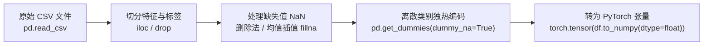

# 02. 预备知识

%% learning-vault-navigation:v1 %%
> [!abstract]- 笔记导航
> 目录：[[AI learning/D2L-李沐/动手学深度学习导航|动手学深度学习导航]]
> 上一章：[[AI learning/D2L-李沐/笔记/01. 引言|01. 引言]] · 下一章：[[AI learning/D2L-李沐/笔记/03. 线性神经网络|03. 线性神经网络]]

> [!abstract] 本章导读
> 本章建立 PyTorch 深度学习工程与数学地基，涵盖七个模块：==张量操作（Tensor）==、==Pandas 表格预处理==、==线性代数与范数==、==微积分与链式法则==、==自动微分（Autograd）==、==概率论与贝叶斯推断==以及==API 文档检索==。其中前五节（2.1–2.5）均在 2026-09-20 至 09-21 完成代码运行与课后练习实操，概率论与文档查阅两节以阅读为主。

---

## 1. 数据操作：PyTorch 张量（2.1 `ndarray`）

深度学习框架中的**张量（Tensor）**与 NumPy `ndarray` 类似，但具备两大关键优势：**原生 GPU 加速**与**自动微分支持**。

### 1.1 创建、形状与运算速查

| 类别 | 常用 PyTorch API | 核心要点 |
| :--- | :--- | :--- |
| 创建 | `torch.arange(12)`、`torch.zeros((2,3,4))`、`torch.ones(...)`、`torch.randn(3,4)`、`torch.tensor([[...]])` | 默认在 CPU 创建；`randn` 从标准正态分布 $\mathcal{N}(0,1)$ 采样 |
| 形状与元素数 | `x.shape`、`x.numel()`、`x.reshape(3, -1)` | `-1` 表示自动推断该轴长度；`reshape` 不改变总元素数 |
| 按元素运算 | `+`、`-`、`*`、`/`、`**`、`torch.exp(x)`、逻辑比较 `X == Y` / `X > Y` | 要求形状一致或满足广播规则 |
| 拼接与聚合 | `torch.cat((X, Y), dim=0)`、`X.sum()` | 沿指定 `dim` 端对端拼接，其余维度须一致 |
| 索引与切片 | `X[-1]`、`X[1:3]`、`X[0:2, :] = 12` | 与 Python/NumPy 一致，支持切片写入 |
| 类型互转 | `X.numpy()`、`torch.tensor(A)`、`a.item()`、`float(a)` | `X.numpy()` 与原 CPU 张量**共享底层内存**；单元素张量可用 `.item()` 转 Python 标量 |

### 1.2 广播机制（Broadcasting）

当两个张量形状不同时，PyTorch 会按规则虚拟扩展长度为 1 的轴以完成按元素运算。

> [!important] 广播三条核心规则（个人练习总结）
> **从右到左（尾轴对齐）逐维检查**，每一维都必须满足以下三条之一，否则报错：
> 1. 两个张量在该维的长度相同；
> 2. 其中一个张量在该维的长度为 `1`；
> 3. 某个张量缺少该高位维度（等价视为长度 `1`）。
>
> 例如在 `ndarray.ipynb` 实操中：`a.shape = (2, 4, 5)` 与 `b.shape = (3, 1, 1, 1)` 相加，对齐为 `(1, 2, 4, 5)` 与 `(3, 1, 1, 1)`，最终广播输出形状为 `(3, 2, 4, 5)`。

### 1.3 原地操作与内存管理

直接写 `Y = Y + X` 会为结果分配新内存并让 `Y` 指向新地址（`id(Y)` 改变），在大参数量高频更新时既浪费显存，又可能令持有旧引用的对象失效。节省内存的**原地操作（In-place）**写法：

```python
Z = torch.zeros_like(Y)
Z[:] = X + Y   # 原地覆写，id(Z) 不变
X += Y         # 等价于 X[:] = X + Y，id(X) 不变
```

---

## 2. 数据预处理：Pandas 到张量（2.2 `pandas`）

现实世界的原始数据常以 CSV 表格存在（如 [[AI learning/D2L-李沐/pytorch/data/house_tiny.csv|house_tiny.csv]]）。标准预处理流水线如下：



1. **处理缺失值**：常见策略为**插值法**（数值列用均值填充 `inputs.fillna(inputs.mean(numeric_only=True))`）和**删除法**（删除缺失值最多的列，如个人练习中用 `data.drop(columns=['Alley'])` 删去缺失 3 行的 `Alley` 列）。
2. **离散特征编码**：`pd.get_dummies(inputs, dummy_na=True)` 将类别列（含 `NaN` 本身作为一个类别）展开为 `0/1` 指示列（One-Hot 编码）。
3. **转张量**：通过 `.to_numpy(dtype=float)` 或 `.values` 转为 NumPy 数组，再用 `torch.tensor(...)` 包装。

> [!warning] 实操易错点提醒
> - 新版 Pandas 中 `inputs.mean()` 遇到字符串列会报错，必须显式传 `numeric_only=True`（在 `pandas.ipynb` 实操中已正确使用）。
> - 使用 `data.drop(columns=['Alley'])` 生成 `inputs` 时，若未同时剔除目标列 `Price`，会导致标签泄漏进特征矩阵 `X`，实际建模时应写 `data.drop(columns=['Alley', 'Price'])` 或先用 `iloc[:, 0:2]` 切分再删列。

---

## 3. 线性代数（2.3 `linear-algebra`）

### 3.1 数学对象层级与维度辨析

- **标量（0 阶张量）**：$x \in \mathbb{R}$，单个数值；
- **向量（1 阶张量）**：$\mathbf{x} \in \mathbb{R}^n$，数学上默认列向量；
- **矩阵（2 阶张量）**：$\mathbf{A} \in \mathbb{R}^{m \times n}$，表格数据中习惯每行表示一个样本、每列表示一个特征，便于沿第 0 轴切分小批量；转置满足 $(\mathbf{A}^\top)_{ij} = a_{ji}$，对称矩阵满足 $\mathbf{A} = \mathbf{A}^\top$；
- **高阶张量**：如图像张量包含通道、高、宽等轴。

> [!tip] “维度（Dimension）”一词的二义性
> - **向量的维度 / 轴的维数**：指该向量或该轴包含的元素个数（长度）；
> - **张量的维度（阶 / Rank）**：指张量拥有的轴数（`X.ndim`）；
> - `len(X)` 始终返回**第 0 轴（`axis=0`，最外层维度）的长度**（个人练习 4、5 已验证）。

### 3.2 核心运算与降维

| 运算 | 数学公式 | PyTorch API | 说明 |
| :--- | :--- | :--- | :--- |
| **Hadamard 积（按元素乘）** | $(\mathbf{A} \odot \mathbf{B})_{ij} = a_{ij} b_{ij}$ | `A * B` | 切勿与矩阵乘法混淆 |
| **点积（Dot Product）** | $\mathbf{x}^\top \mathbf{y} = \sum_{i=1}^d x_i y_i$ | `torch.dot(x, y)` | 仅用于一维向量；等价于 `torch.sum(x * y)` |
| **矩阵–向量积** | $[\mathbf{A}\mathbf{x}]_i = \mathbf{a}_i^\top \mathbf{x}$ | `torch.mv(A, x)` | 将 $\mathbb{R}^n \to \mathbb{R}^m$ 线性变换 |
| **矩阵–矩阵乘法** | $c_{ij} = \mathbf{a}_i^\top \mathbf{b}_j$ | `torch.mm(A, B)` / `A @ B` | $(n \times k) \cdot (k \times m) \to (n \times m)$ |
| **按轴降维** | $\sum_i a_{ij}$ | `A.sum(axis=0)`、`A.mean(axis=1)` | 指定轴会从结果形状中消失；传 `axis=[0, 1]` 可同时消去多轴 |
| **非降维求和** | 保持原轴数（对应轴长为 1） | `A.sum(axis=1, keepdims=True)` | **配合广播做归一化**（如 `A / sum_A`）的关键技巧 |
| **累积求和** | 沿轴前缀和 | `A.cumsum(axis=0)` | 不改变张量形状 |

> [!warning] 广播陷阱（个人练习 6 解析）
> 若对矩阵 `A`（例如 $5 \times 4$）直接执行 `A / A.sum(axis=1)`：因未加 `keepdims=True`，`A.sum(axis=1)` 形状为 `(5,)`，在 $5 \times 4$ 上按右对齐广播会报错；即使 `A` 是 $5 \times 5$ 方阵不报错，也会错把**行和向量按列广播**（除到了错误的维度上）！因此做行归一化必须加 `keepdims=True`。

### 3.3 范数（Norm）与优化目标

向量范数满足四条公理：齐次性 $f(\alpha\mathbf{x}) = |\alpha|f(\mathbf{x})$、三角不等式 $f(\mathbf{x}+\mathbf{y}) \le f(\mathbf{x}) + f(\mathbf{y})$、非负性 $f(\mathbf{x}) \ge 0$、正定性 $f(\mathbf{x}) = 0 \Leftrightarrow \mathbf{x}=\mathbf{0}$。

- **$L_2$ 范数（欧氏距离）**：$\|\mathbf{x}\|_2 = \sqrt{\sum_{i=1}^n x_i^2}$，对应 `torch.norm(u)`；
- **$L_1$ 范数（曼哈顿距离）**：$\|\mathbf{x}\|_1 = \sum_{i=1}^n |x_i|$，对应 `torch.abs(u).sum()`，对异常值更鲁棒；
- **一般 $L_p$ 范数**：$\|\mathbf{x}\|_p = \left(\sum_{i=1}^n |x_i|^p\right)^{1/p}$；
- **矩阵 Frobenius 范数**：$\|\mathbf{X}\|_F = \sqrt{\sum_{i=1}^m \sum_{j=1}^n x_{ij}^2}$。

在 `linear-algebra.ipynb` 练习 8 中通过 `torch.linalg.norm(A)` 实测可见：对 3 阶或 4 阶张量直接调用 `torch.linalg.norm`，默认把张量展平为向量计算所有元素的平方和开方，因此形状 `(2, 2, 2, 5)` 与 `(2, 4, 5)` 的结果完全相同（`143.3178`）。

---

## 4. 微积分（2.4 `calculus`）

深度学习中拟合模型可分解为两大核心问题：
- **优化（Optimization）**：最小化训练损失，用模型拟合观测数据；
- **泛化（Generalization）**：使模型在未见过的数据上保持良好预测性能。

### 4.1 导数、偏导数与梯度

单变量导数定义为瞬时变化率（几何上为切线斜率）：

$$
f'(x) = \lim_{h \to 0} \frac{f(x+h) - f(x)}{h}
$$

多元标量函数 $f:\mathbb{R}^n \to \mathbb{R}$ 对所有自变量的偏导数组成**梯度向量（Gradient）**：

$$
\nabla_{\mathbf{x}} f(\mathbf{x}) = \left[\frac{\partial f(\mathbf{x})}{\partial x_1}, \frac{\partial f(\mathbf{x})}{\partial x_2}, \ldots, \frac{\partial f(\mathbf{x})}{\partial x_n}\right]^\top
$$

常用矩阵微积分公式（后续推导线性回归、正则化、反向传播高频出现）：

- $\nabla_{\mathbf{x}} (\mathbf{A}\mathbf{x}) = \mathbf{A}^\top$（$\mathbf{A} \in \mathbb{R}^{m \times n}$）
- $\nabla_{\mathbf{x}} (\mathbf{x}^\top \mathbf{A}) = \mathbf{A}$（$\mathbf{A} \in \mathbb{R}^{n \times m}$）
- $\nabla_{\mathbf{x}} (\mathbf{x}^\top \mathbf{A} \mathbf{x}) = (\mathbf{A} + \mathbf{A}^\top)\mathbf{x}$（$\mathbf{A} \in \mathbb{R}^{n \times n}$）
- $\nabla_{\mathbf{x}} \|\mathbf{x}\|_2^2 = 2\mathbf{x}$，且对矩阵有 $\nabla_{\mathbf{X}} \|\mathbf{X}\|_F^2 = 2\mathbf{X}$

### 4.2 多元链式法则（Chain Rule）

深度神经网络本质上是多层复合函数。若 $y = f(u_1, \ldots, u_m)$ 且每个 $u_j = g_j(x_1, \ldots, x_n)$，则：

$$
\frac{\partial y}{\partial x_i} = \sum_{j=1}^{m} \frac{\partial y}{\partial u_j} \frac{\partial u_j}{\partial x_i}
$$

> [!note] `d2l` 绘图工具封装
> 本节通过 `#@save` 标记定义了 `use_svg_display()`、`set_figsize()`、`set_axes()` 和 `plot()` 四个通用绘图辅助函数，后续章节的损失曲线与精度可视化均直接复用了 `d2l.plot`。

---

## 5. 自动微分（2.5 `autograd`）

手动推导深层网络导数繁琐且极易出错。PyTorch 通过动态构建==计算图（Computational Graph）==记录张量运算历史，再执行==反向传播（Backpropagation）==自动填充各叶子参数的偏导数。

### 5.1 标准四步流程

```python
x = torch.arange(4.0, requires_grad=True)  # 1. 声明需要追踪梯度（分配梯度槽 x.grad）
y = 2 * torch.dot(x, x)                    # 2. 前向计算，自动构建计算图（y 附带 grad_fn）
y.backward()                               # 3. 反向传播计算偏导数
print(x.grad)                              # 4. 读取梯度：tensor([0., 4., 8., 12.]) == 4 * x
```

### 5.2 四大核心机制与避坑要点

1. **梯度默认累积，必须手动清零**：PyTorch 不会在每次 `backward()` 前自动清空 `x.grad`（这有利于梯度累积和大批量模拟），因此在开启新一次求导前必须调用 `x.grad.zero_()`。
2. **非标量输出的反向传播**：当 `y` 是向量/张量（如一个 batch 中各样本的损失向量）时，深度学习通常不计算完整雅可比矩阵，而是求各样本偏导之和。需要先聚合成标量再反向传播：`y.sum().backward()`（等价于 `y.backward(torch.ones_like(y))`）。
3. **分离计算（`detach()`）**：调用 `u = y.detach()` 返回与 `y` 数值相同但脱离计算图的新张量，梯度不会经由 `u` 回传至 `x`（将 `y` 视为常数）。这在需要冻结部分子网络或固定目标值（如强化学习 Target Network、GAN 判别器/生成器交替更新）时极为常用。
4. **支持 Python 控制流**：PyTorch 采用动态计算图（Define-by-Run），即便前向过程包含依赖输入值的 `while` 循环和 `if-else` 分支，每次运行也会忠实记录本次实际执行的运算路径并准确求导。

> [!example] `autograd.ipynb` 个人思考与实践亮点
> 在 2026-09-21 的练习记录中，整理了三个极易踩坑的机制问题并完成了绘图验证：
> - **二阶导为何开销更大**：不仅一阶求导本身要计算梯度，为了继续求二阶导，一阶求导过程本身也必须构建并保留计算图（`create_graph=True`），随后再遍历一次更大的计算图。
> - **为何不能连续调用两次 `backward()`**：PyTorch 默认在第一次 `backward()` 后立即释放中间激活值与计算图以节省显存（除非显式设置 `retain_graph=True`）。
> - **控制流输入改为向量/矩阵会怎样**：输出 `d` 同步变为非标量张量，直接调 `d.backward()` 会因缺少 `gradient` 参数而报错。
> - **无解析公式绘制 $\sin(x)$ 导数**：对 `x = torch.linspace(-2*torch.pi, 2*torch.pi, 1000, requires_grad=True)` 执行 `torch.sin(x).sum().backward()`，直接绘制 `x.grad` 即可精确复现 $\cos(x)$ 曲线（绘图前须对 `x`、`y` 调用 `.detach()`）。

---

## 6. 概率论基础（2.6 `probability`）与文档查阅（2.7 `lookup-api`）

### 6.1 概率论核心概念

- **不确定性的两种来源**：一类来自信息缺失/观测模糊（如低分辨率猫狗图，真相确定但认知不确定），另一类来自事件本身随机性（如天气、掷骰子）。
- **大数定律与多项分布采样**：使用 `torch.distributions.multinomial.Multinomial(n, probs).sample()` 可高效并行模拟多次独立抽样；随着试验次数增加，相对频率收敛于真实概率（如公平骰子各面收敛于 $1/6 \approx 0.167$）。
- **柯尔莫哥洛夫公理**：非负性 $P(\mathcal{A}) \ge 0$、规范性 $P(\mathcal{S})=1$、互斥事件的可数可加性 $P(\bigcup_i \mathcal{A}_i) = \sum_i P(\mathcal{A}_i)$。
- **离散 vs 连续随机变量**：连续变量取某单点的概率为 $0$，需用**概率密度（Density）**对区间积分刻画概率。

### 6.2 多随机变量关系与贝叶斯定理

- **条件概率与乘法法则**：$P(B \mid A) = \frac{P(A, B)}{P(A)} \implies P(A, B) = P(B \mid A)P(A)$
- **边际化（求和法则）**：$P(B) = \sum_A P(A, B)$
- **贝叶斯定理（Bayes' Theorem）**：

$$
P(A \mid B) = \frac{P(B \mid A) P(A)}{P(B)}
$$

- **独立与条件独立**：$A \perp B \iff P(A,B)=P(A)P(B)$；$A \perp B \mid C \iff P(A,B \mid C)=P(A \mid C)P(B \mid C)$。
- **期望与方差**：

$$
\mathbb{E}[X] = \sum_x x P(X=x), \qquad \mathrm{Var}[X] = \mathbb{E}\!\left[(X-\mathbb{E}[X])^2\right] = \mathbb{E}[X^2] - (\mathbb{E}[X])^2
$$

> [!example] 贝叶斯定理反直觉案例：低发病率下的 HIV 检测
> 设人群患病先验 $P(H=1)=0.0015$。测试 $D_1$ 灵敏度 $100\%$、假阳性率仅 $1\%$：
> - **单次阳性后验**：$P(H=1 \mid D_1=1) = \frac{1 \times 0.0015}{1 \times 0.0015 + 0.01 \times 0.9985} \approx 13.06\%$（因为健康基数极大，假阳性绝对数远超真阳性）。
> - **联合第二次条件独立测试 $D_2$**（灵敏度 $98\%$、假阳性率 $3\%$，精度甚至低于 $D_1$）：两次均阳性时后验飙升至 $P(H=1 \mid D_1=1, D_2=1) \approx 83.07\%$！前提是两次检测在给定 $H$ 下**条件独立**（因此不能简单重复跑同一机制的 $D_1$）。

### 6.3 PyTorch API 查阅技巧（2.7 `lookup-api`）

- `dir(module)`：列出模块内所有类与函数（忽略 `__xxx__` 魔术方法与 `_xxx` 内部函数）；
- `help(torch.ones)`：打印函数签名、参数说明与示例；
- Jupyter 快捷方式：`func?` 弹出文档窗口，`func??` 直接查看 Python 源码。

> [!note] 延伸数学基础
> 更系统的概率论、随机过程与数理统计推导见 [[Math Learning/数学学习导航|数学学习导航]]。

---

## 7. 配套材料与 Notebook

| 小节 | Notebook | 学习状态（按修改时间） | 核心内容 |
| :--- | :--- | :--- | :--- |
| 章目录 | [[AI learning/D2L-李沐/pytorch/chapter_preliminaries/index.ipynb\|index.ipynb]] | 原版（2023-08-19，仅阅读） | 预备知识目录与导言 |
| 2.1 | [[AI learning/D2L-李沐/pytorch/chapter_preliminaries/ndarray.ipynb\|ndarray.ipynb]] | 已运行并改写练习（2026-09-20） | 张量创建、拼接、四维广播规则总结、原地操作 |
| 2.2 | [[AI learning/D2L-李沐/pytorch/chapter_preliminaries/pandas.ipynb\|pandas.ipynb]] | 已运行并改写练习（2026-09-20） | CSV 读取、删缺失列/均值插值、`get_dummies`、转张量 |
| 2.3 | [[AI learning/D2L-李沐/pytorch/chapter_preliminaries/linear-algebra.ipynb\|linear-algebra.ipynb]] | 已运行并完成 8 题验证（2026-09-20） | 标量/向量/矩阵/张量、降维与 `keepdims`、范数 |
| 2.4 | [[AI learning/D2L-李沐/pytorch/chapter_preliminaries/calculus.ipynb\|calculus.ipynb]] | 已运行（2026-09-20） | 导数极限、`d2l.plot` 封装、梯度、链式法则 |
| 2.5 | [[AI learning/D2L-李沐/pytorch/chapter_preliminaries/autograd.ipynb\|autograd.ipynb]] | 已运行并作答/绘图（2026-09-21） | 计算图、梯度清零、非标量求导、`detach`、控制流求导 |
| 2.6 | [[AI learning/D2L-李沐/pytorch/chapter_preliminaries/probability.ipynb\|probability.ipynb]] | 原版（2023-08-19，仅阅读） | 多项采样、大数定律、贝叶斯定理与 HIV 检测案例 |
| 2.7 | [[AI learning/D2L-李沐/pytorch/chapter_preliminaries/lookup-api.ipynb\|lookup-api.ipynb]] | 原版（2023-08-19，仅阅读） | `dir`、`help`、`?` / `??` 查文档方法 |
| 示例数据 | [[AI learning/D2L-李沐/pytorch/data/house_tiny.csv\|house_tiny.csv]] | 配套数据 | 2.2 节生成的小型 CSV 数据集 |

---

> [!question]- 章节自测与思考
> 1. 形状为 `(2, 3, 4)` 的张量沿 `axis=1` 求和时，加与不加 `keepdims=True` 的输出形状分别是什么？为什么做行归一化时必须加 `keepdims=True`？
> 2. 为什么 PyTorch 在 `backward()` 前要求显式调用 `x.grad.zero_()`？什么场景下反而需要利用默认的梯度累积特性？
> 3. 调用 `u = y.detach()` 后，修改 `u` 的值是否会影响 `y`？为什么 `z = u * x` 反向传播后 `x.grad` 不包含经由 `y` 的梯度路径？
> 4. 在 HIV 双次检测案例中，为什么宁可用灵敏度略低但机制独立的第二次检测 $D_2$，也不直接把更准确的 $D_1$ 重复做两次？
