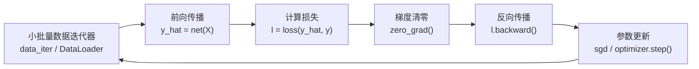

# 03. 线性神经网络

%% learning-vault-navigation:v1 %%
> [!abstract]- 笔记导航
> 目录：[[AI learning/D2L-李沐/动手学深度学习导航|动手学深度学习导航]]
> 上一章：[[AI learning/D2L-李沐/笔记/02. 预备知识|02. 预备知识]] · 下一章：[[AI learning/D2L-李沐/笔记/04. 多层感知机|04. 多层感知机]]

> [!abstract] 本章导读
> 本章通过**线性回归（连续数值预测）**与**Softmax 回归（多类别分类）**两个最经典的单层全连接神经网络，完整跑通深度学习的端到端训练闭环：数据流水线 $\to$ 模型与参数初始化 $\to$ 损失函数（从极大似然与信息论推导） $\to$ 小批量随机梯度下降 $\to$ 训练与评估。本章全部 7 份正文 Notebook 及两份个人练习脚本（[[AI learning/D2L-李沐/Practice/Linear Regression.py|Linear Regression.py]]、[[AI learning/D2L-李沐/Practice/Softmax.py|Softmax.py]]）均在 2026-09-21 至 09-22 完成实操与练习推导。

---

## 1. 线性回归的数学原理（3.1 `linear-regression`）

### 1.1 仿射模型与平方损失

线性回归假设目标 $y$ 是输入特征 $\mathbf{x} \in \mathbb{R}^d$ 的**仿射变换（Affine Transformation）**加观测噪声：

$$
\hat{y} = \mathbf{w}^\top \mathbf{x} + b, \qquad \hat{\mathbf{y}} = \mathbf{X}\mathbf{w} + b
$$

其中 $\mathbf{X} \in \mathbb{R}^{n \times d}$ 每行为一个样本，偏置 $b$ 通过广播加到每个样本上。以单层神经网络视角来看，线性回归仅有 1 个计算层（输入层不计入层数），所有输入与输出全连接，即**全连接层 / 稠密层（Fully-Connected / Dense Layer）**。

整个训练集上的均方误差（MSE）损失定义为：

$$
L(\mathbf{w}, b) = \frac{1}{n}\sum_{i=1}^{n} l^{(i)}(\mathbf{w}, b) = \frac{1}{n}\sum_{i=1}^{n} \frac{1}{2}\left(\mathbf{w}^\top \mathbf{x}^{(i)} + b - y^{(i)}\right)^2
$$

### 1.2 解析解 vs 小批量随机梯度下降（Minibatch SGD）

将偏置 $b$ 吸收进权重向量（在 $\mathbf{X}$ 末尾附加全 1 列），令梯度 $\nabla_{\mathbf{w}} J(\mathbf{w}) = \mathbf{X}^\top(\mathbf{X}\mathbf{w}-\mathbf{y}) = \mathbf{0}$，可得**正规方程（Normal Equation）**解析解：

$$
\mathbf{w}^* = (\mathbf{X}^\top \mathbf{X})^{-1}\mathbf{X}^\top \mathbf{y}
$$

而在绝大多数深度模型中不存在解析解，需使用==小批量随机梯度下降（Minibatch SGD）==迭代更新：

$$
(\mathbf{w}, b) \leftarrow (\mathbf{w}, b) - \frac{\eta}{|\mathcal{B}|}\sum_{i \in \mathcal{B}} \partial_{(\mathbf{w}, b)} l^{(i)}(\mathbf{w}, b)
$$

其中批量大小 $|\mathcal{B}|$ 与学习率 $\eta$ 是需预先设定的**超参数（Hyperparameters）**。

| 维度 | 解析解（正规方程） | 小批量随机梯度下降（SGD） |
| :--- | :--- | :--- |
| 适用场景 | 特征数 $d$ 较小/中等、数据可整块装入内存、期望一次得精确最优解且免调学习率 | 样本数极大、高维/稀疏特征、流式数据、任意非凸深度学习模型 |
| 局限与失效情形 | 特征共线性致 $\mathbf{X}^\top\mathbf{X}$ 不可逆；矩阵病态数值误差大；$d$ 极大时求逆 $O(d^3)$ 不可行；仅限线性平方损失 | 需要调节学习率与批量大小；有限步数内通常只逼近最优解 |

> [!tip] 矢量化加速的重要性
> 在 `linear-regression.ipynb` 基准测试中，对 $n=10{,}000$ 维向量逐元素相加：Python `for` 循环耗时 `0.03333 sec`，而张量矢量化 `a + b` 仅耗时 `0.00036 sec`（加速近 **92 倍**）。深度学习中应始终利用底层线性代数库进行批处理矢量化计算。

### 1.3 概率解释：高斯噪声下的极大似然估计（MLE）

若假设观测噪声服从零均值正态分布 $y = \mathbf{w}^\top\mathbf{x} + b + \epsilon,\; \epsilon \sim \mathcal{N}(0, \sigma^2)$，则负对数似然为：

$$
-\log P(\mathbf{y} \mid \mathbf{X}) = \sum_{i=1}^{n} \frac{1}{2}\log(2\pi\sigma^2) + \frac{1}{2\sigma^2}\left(y^{(i)} - \mathbf{w}^\top\mathbf{x}^{(i)} - b\right)^2
$$

去掉与 $(\mathbf{w}, b)$ 无关的常数项后，==在高斯噪声假设下，最小化均方误差等价于极大似然估计==（且最优解不依赖 $\sigma$）。

> [!example] 个人练习延伸：拉普拉斯（指数）噪声与 $L_1$ 损失（`linear-regression.ipynb` 练习 3）
> 若噪声改为 $p(\epsilon) = \frac{1}{2}\exp(-|\epsilon|)$，负对数似然最小化对应 **$L_1$ 绝对误差损失** $\min_{\mathbf{w}} \sum_i |y_i - \mathbf{x}_i^\top\mathbf{w}|$：
> - 常数回归时最优偏置为样本**中位数** $b^* = \mathrm{median}(y_1, \ldots, y_n)$（而非均值），对异常值更鲁棒；
> - 梯度为 $\nabla \ell_i(\mathbf{w}) = \mathbf{x}_i\,\mathrm{sign}(\mathbf{x}_i^\top\mathbf{w}-y_i)$，在残差接近 $0$ 时梯度幅值不衰减而直接由 $+\mathbf{x}_i$ 跳变至 $-\mathbf{x}_i$，固定学习率会导致参数在最优点附近震荡；
> - 改进策略：递减学习率（$\eta_t = \eta_0/\sqrt{t+1}$）、平滑近似 $\sqrt{r^2+\delta^2}$、或改用 **Huber 损失**（残差小时二次、大时线性）。

---

## 2. 线性回归的从零实现 vs 简洁实现（3.2–3.3 与个人练习对照）

深度学习训练循环遵循高度统一的标准范式：



### 2.1 三种实现的逐项对照

| 组件 | 3.2 从零实现（`linear-regression-scratch`） | 3.3 简洁实现（`linear-regression-concise`） | 个人练习（`Practice/Linear Regression.py`） |
| :--- | :--- | :--- | :--- |
| **数据输入** | 手写生成器 `data_iter`（`random.shuffle` + `yield`） | `TensorDataset` + `DataLoader(shuffle=True)` | 4 样本玩具数据，从 1D `[1,2,3,4]` 改为 2D `[[1],[2],[3],[4]]` 以匹配 `nn.Linear` 输入规范 |
| **模型定义** | 手动 `w = torch.normal(...)`, `b = torch.zeros(...)`; `torch.matmul(X, w) + b` | `nn.Sequential(nn.Linear(2, 1))`；用 `normal_` / `fill_` 原地初始化 | 注释保留了手写 `w*x`，切换为 `nn.Linear(input_size, output_size)` |
| **损失函数** | `squared_loss`: `(y_hat - y.reshape(y_hat.shape)) ** 2 / 2` | `nn.MSELoss()`（默认求均值，不含 $1/2$） | 注释保留 `((y_hat-y)**2).mean()`，切换为 `nn.MSELoss()` |
| **优化更新** | 手写 `sgd`: `with torch.no_grad(): param -= lr * param.grad / batch_size; param.grad.zero_()` | `torch.optim.SGD(net.parameters(), lr=0.03)`；先 `zero_grad()` 再 `backward()`、`step()` | 注释保留 `with torch.no_grad()` 与 `w.grad.zero_()`，切换为 `optimizer.step()` + `optimizer.zero_grad()` |

> [!important] 关键工程细节（结合个人练习与课后题总结）
> 1. **损失归约与学习率缩放关系**（3.3 练习 1）：若将批量总损失改为批量平均损失，梯度缩小 $B$ 倍，要保持等价更新步长，学习率需相应放大为 $\eta_{\text{mean}} = B \cdot \eta_{\text{sum}}$。
> 2. **为何 `squared_loss` 必须 `y.reshape(y_hat.shape)`**（3.2 练习 5）：防止 `(batch_size, 1)` 与 `(batch_size,)` 相减时触发广播变成 `(batch_size, batch_size)` 矩阵，导致静默错误！
> 3. **访问简洁模型的参数与梯度**（3.3 练习 3）：通过 `net[0].weight.data` / `net[0].bias.data` 访问数值，通过 `net[0].weight.grad` / `net[0].bias.grad` 访问反向传播后的梯度。
> 4. **零初始化对线性回归有效，但对深层网络无效**（3.2 练习 1）：线性回归是凸单层模型，全零初始化仍能正常收敛；而多层网络全零初始化会引发“对称性无法打破”问题（见第 4 章）。

---

## 3. Softmax 回归与多分类（3.4 `softmax-regression`）

### 3.1 独热编码、仿射 Logits 与 Softmax 变换

对于无自然序关系的 $q$ 分类问题，标签采用**独热编码（One-Hot Encoding）** $\mathbf{y} \in \{0,1\}^q$（真实类为 1，其余为 0）。对小批量输入 $\mathbf{X} \in \mathbb{R}^{n \times d}$，权重 $\mathbf{W} \in \mathbb{R}^{d \times q}$，偏置 $\mathbf{b} \in \mathbb{R}^{1 \times q}$：

$$
\mathbf{O} = \mathbf{X}\mathbf{W} + \mathbf{b}, \qquad \hat{\mathbf{Y}} = \mathrm{softmax}(\mathbf{O}), \qquad \hat{y}_j = \frac{\exp(o_j)}{\sum_{k=1}^{q}\exp(o_k)}
$$

- **仍是线性模型**：尽管 Softmax 非线性，但决策边界由未规范化预测（Logits）$\mathbf{o} = \mathbf{W}^\top\mathbf{x} + \mathbf{b}$ 的仿射变换决定，且 Softmax 单调保序：$\operatorname*{argmax}_j \hat{y}_j = \operatorname*{argmax}_j o_j$。
- **全连接参数开销**：输入维 $d$、输出类 $q$ 时参数量为 $\mathcal{O}(dq)$。
- **概率校准（Calibration）**：不仅输出非负且和为 1，还期望预测概率反映真实置信度。

### 3.2 交叉熵损失、梯度性质与信息论视角

由最大似然估计（最小化负对数似然）推出**交叉熵损失（Cross-Entropy Loss）**：

$$
l(\mathbf{y}, \hat{\mathbf{y}}) = -\sum_{j=1}^{q} y_j \log \hat{y}_j = \log\sum_{k=1}^{q}\exp(o_k) - \sum_{j=1}^{q} y_j o_j
$$

对任意未规范化输出 $o_j$ 求偏导，得到极为简洁优雅的梯度形式（指数族分布的共性）：

$$
\frac{\partial l(\mathbf{y}, \hat{\mathbf{y}})}{\partial o_j} = \mathrm{softmax}(\mathbf{o})_j - y_j = \hat{y}_j - y_j
$$

即**预测概率与真实独热标签之差**，与线性回归中 $(\hat{y}-y)$ 的梯度形式高度呼应。

从**信息论**视角看：
- **熵（Entropy）**：$H[P] = -\sum_j P(j)\log P(j)$，刻画按真实分布 $P$ 编码数据的最小平均信息量（以 $e$ 为底单位为 nat，$1\text{ nat} \approx 1.44\text{ bit}$）；
- **信息量（Surprisal）**：$-\log P(j)$，事件越罕见，发生时越“惊异”；
- **交叉熵（Cross-Entropy）**：$H(P, Q) = -\sum_j P(j)\log Q(j)$，表示用主观预测分布 $Q$ 编码真实分布 $P$ 时的期望惊异，当且仅当 $Q = P$ 时取得下界 $H(P)$。

---

## 4. Fashion-MNIST 与 Softmax 的数值稳定性（3.5–3.7）

### 4.1 图像分类数据集与数据加载瓶颈（3.5 `image-classification-dataset`）

- **Fashion-MNIST**：10 类服装灰度图（T-shirt、Trouser、Pullover、Dress、Coat、Sandal、Shirt、Sneaker、Bag、Ankle boot），训练 60,000 张、测试 10,000 张，单图经 `transforms.ToTensor()` 转为形状 `(1, 28, 28)`、值域 $[0, 1]$ 的 `float32` 张量。
- 封装了 `get_fashion_mnist_labels`、`show_images` 和 `load_data_fashion_mnist(batch_size, resize=None)`（后者支持通过 `transforms.Resize` 缩放以适配 AlexNet/VGG/ResNet 等大模型）。

> [!warning] 实测数据加载性能（3.5 练习 1）
> 在 `image-classification-dataset.ipynb` 中将 `batch_size` 设为 `1`（`num_workers=1`）实测遍历一轮训练集耗时飙升至 **`115.75 sec`**（正常 `batch_size=256` 仅需约 `3 sec`）。过小的批量会使 Python/DataLoader 逐样本调度与拼接开销成为严重瓶颈，训练加速必须兼顾数据吞吐。

### 4.2 从零实现与通用训练框架 `train_ch3`（3.6 `softmax-regression-scratch`）

本节搭建了贯穿第 3–4 章的通用训练脚手架（标记 `#@save` 存入 `d2l`）：
- **向量化交叉熵**：利用高级索引 `-torch.log(y_hat[range(len(y_hat)), y])` 避免循环；
- **`Accumulator(n)`**：跨小批量累加训练总损失、正确预测数与总样本数；
- **`accuracy` 与 `evaluate_accuracy`**：在 `net.eval()` + `with torch.no_grad():` 下无梯度评估分类精度；
- **`train_epoch_ch3` 与 `train_ch3`**：兼容内置 `torch.optim.Optimizer`（调 `l.mean().backward()`）和自定义 `updater`（调 `l.sum().backward()`），并用 `Animator` 实时绘制 `train loss`、`train acc`、`test acc`。

### 4.3 数值稳定性与 LogSumExp 技巧（3.7 `softmax-regression-concise`）

直接按定义写 `exp(o_j) / sum(exp(o_k))` 再取 `-log` 存在双重数值风险：
1. **上溢（Overflow）**：若 $o_k$ 很大（如 $\exp(50)$ 乃至更大），产生 `inf`，进而出现 `nan`；
2. **下溢（Underflow）**：先减去最大值 $M = \max_k o_k$ 虽消除了上溢，但若 $o_j - M$ 为极大负数，$\exp(o_j - M)$ 仍可能下溢为 `0`，随后 `log(0)` 变为 `-inf` 并在反向传播中引发 `nan`。

**正确做法（LogSumExp 合并计算）**：将 `softmax` 与 `log` 融合，利用 $\log(\exp(\cdot))$ 抵消：

$$
\log \hat{y}_j = o_j - \max_k o_k - \log\!\left(\sum_k \exp(o_k - \max_k o_k)\right)
$$

PyTorch 的 **`nn.CrossEntropyLoss()`** 内部即采用此融合策略（`LogSoftmax + NLLLoss`），因此==网络最后一层直接输出未规范化 Logits，绝不要在送入 `nn.CrossEntropyLoss` 前手动套一层 Softmax==！

```python
# 简洁实现核心：展平 + 线性层（输出 raw logits）+ CrossEntropyLoss
net = nn.Sequential(nn.Flatten(), nn.Linear(784, 10))
loss = nn.CrossEntropyLoss(reduction='none')  # 配合 d2l.train_ch3 时需 reduction='none'
trainer = torch.optim.SGD(net.parameters(), lr=0.1)
```

> [!example] 个人练习对照：`Practice/Softmax.py` 与 `softmax-regression-concise.ipynb`
> - 在 [[AI learning/D2L-李沐/Practice/Softmax.py|Practice/Softmax.py]] 中，直接将原始未归一化 logits `Y_pred_good` 与 `Y_pred_bad` 喂入 `nn.CrossEntropyLoss()` 对比损失值大小，并用 `torch.max(Y_pred, 1)` 获取预测类别索引，直观验证了“损失内置 Softmax、预测直接取 logits 最大值”两大原则。
> - 在 `softmax-regression-concise.ipynb` 中将 `num_epochs` 提高到 `100` 观察测试精度变化并总结：训练后期测试精度下降源于**过拟合**以及**固定学习率 + 小批量噪声导致在最优点附近震荡**，可通过**验证集早停、学习率衰减、权重衰减正则化**加以缓解。
> - 在 `softmax-regression-scratch.ipynb` 练习 4–5 中进一步思考了业务边界：医疗诊断等非对称代价场景不能只按最高概率决策；超大词表语言模型中直接做全词表 Softmax 会面临计算复杂度高、显存占用大及低频词稀疏瓶颈（呼应后续分层 Softmax / 负采样等优化）。

---

## 5. 配套材料、Notebook 与个人练习

| 小节 / 类型 | 文件 | 修改时间 | 核心内容与实操记录 |
| :--- | :--- | :--- | :--- |
| 章目录 | [[AI learning/D2L-李沐/pytorch/chapter_linear-networks/index.ipynb\|index.ipynb]] | 2023-08-19 | 本章导言与目录 |
| 3.1 | [[AI learning/D2L-李沐/pytorch/chapter_linear-networks/linear-regression.ipynb\|linear-regression.ipynb]] | 2026-09-21 | 线性模型、矢量化测速、MLE；完整手推正规方程与拉普拉斯/$L_1$ 次梯度 |
| 3.2 | [[AI learning/D2L-李沐/pytorch/chapter_linear-networks/linear-regression-scratch.ipynb\|linear-regression-scratch.ipynb]] | 2026-09-21 | 从零实现数据生成、迭代、平方损失、SGD 及 7 题练习作答 |
| 3.3 | [[AI learning/D2L-李沐/pytorch/chapter_linear-networks/linear-regression-concise.ipynb\|linear-regression-concise.ipynb]] | 2026-09-22 | `DataLoader`、`nn.Linear`、`nn.MSELoss`、`SGD` 及梯度读取练习 |
| 3.4 | [[AI learning/D2L-李沐/pytorch/chapter_linear-networks/softmax-regression.ipynb\|softmax-regression.ipynb]] | 2026-09-22 | 独热编码、Softmax、交叉熵导数与信息论基础 |
| 3.5 | [[AI learning/D2L-李沐/pytorch/chapter_linear-networks/image-classification-dataset.ipynb\|image-classification-dataset.ipynb]] | 2026-09-22 | Fashion-MNIST 读取封装；实测 `batch_size=1` 耗时飙升至 `115.75s` |
| 3.6 | [[AI learning/D2L-李沐/pytorch/chapter_linear-networks/softmax-regression-scratch.ipynb\|softmax-regression-scratch.ipynb]] | 2026-09-22 | 从零实现 Softmax、`train_ch3` 脚手架与 5 题练习作答 |
| 3.7 | [[AI learning/D2L-李沐/pytorch/chapter_linear-networks/softmax-regression-concise.ipynb\|softmax-regression-concise.ipynb]] | 2026-09-22 | `nn.Flatten` + LogSumExp 数值稳定性；`num_epochs=100` 过拟合分析 |
| 个人练习 | [[AI learning/D2L-李沐/Practice/Linear Regression.py\|Practice/Linear Regression.py]] | 2026-09-22 | 从手动梯度更新逐步重构为 `nn.Linear` + `nn.MSELoss` + `SGD` |
| 个人练习 | [[AI learning/D2L-李沐/Practice/Softmax.py\|Practice/Softmax.py]] | 2026-09-22 | `nn.CrossEntropyLoss` 直接输入 Logits 对比实验与 `torch.max` 预测 |

---

> [!question]- 章节自测与思考
> 1. 为什么说最小化均方误差（MSE）对应高斯噪声下的极大似然估计，而最小化绝对误差（$L_1$）对应拉普拉斯噪声下的极大似然估计？
> 2. 为什么在 PyTorch 中使用 `nn.CrossEntropyLoss()` 时，网络末尾**不能**再接一层 `nn.Softmax()`？LogSumExp 技巧是如何同时避免上溢与下溢的？
> 3. 在 `d2l.train_ch3` 的 `train_epoch_ch3` 中，为什么 `nn.CrossEntropyLoss(reduction='none')` 需要指定 `reduction='none'`？如果用默认的 `reduction='mean'` 传入 `train_ch3` 会影响哪一行统计指标？
> 4. 当线性回归改用小批量平均损失而非总损失时，学习率应如何调整才能保持每步参数更新量不变？
