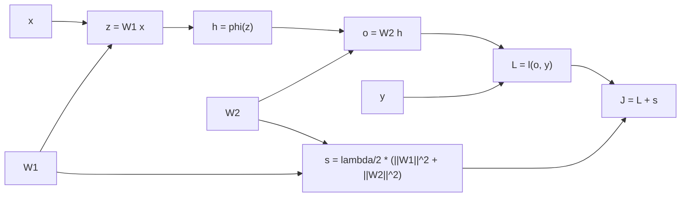

# 04. 多层感知机

%% learning-vault-navigation:v1 %%
> [!abstract]- 笔记导航
> 目录：[[AI learning/D2L-李沐/动手学深度学习导航|动手学深度学习导航]]
> 上一章：[[AI learning/D2L-李沐/笔记/03. 线性神经网络|03. 线性神经网络]] · 下一章：[[AI learning/D2L-李沐/笔记/05. 深度学习计算|05. 深度学习计算]]

> [!abstract] 本章导读
> 本章从线性模型的“单调性假设”局限切入，正式迈入真正的**深度神经网络**——==多层感知机（MLP）==。全章完整覆盖四大核心脉络：① 隐藏层与非线性激活函数（ReLU / Sigmoid / Tanh）；② 泛化理论、欠拟合/过拟合与正则化双支柱（==权重衰减 $L_2$== 与 ==暂退法 Dropout==）；③ 训练深度网络的数学机理（==前向/反向传播计算图==、==梯度消失/爆炸==与 ==Xavier 初始化==）；④ 真实部署挑战（==分布偏移==）与 ==Kaggle 房价预测==完整实战。本章除 `backprop.ipynb` 与 `environment.ipynb` 为纯阅读外，其余 8 份 Notebook 及两份个人练习（[[AI learning/D2L-李沐/Practice/MLP.py|MLP.py]]、[[AI learning/D2L-李沐/Practice/Dropout.py|Dropout.py]]）均在 2026-09-25 至 09-26 完成实操。

---

## 1. 多层感知机与激活函数（4.1–4.3 `mlp`）

### 1.1 为什么必须引入非线性激活函数？

线性模型隐含强烈的**单调性假设**（无法直接刻画体温偏离 $37^\circ\text{C}$ 的死亡率，更无法处理像素间存在复杂上下文交互的猫狗分类）。若仅堆叠全连接层而不加激活函数：

$$
\mathbf{O} = (\mathbf{X}\mathbf{W}^{(1)} + \mathbf{b}^{(1)})\mathbf{W}^{(2)} + \mathbf{b}^{(2)} = \mathbf{X}(\mathbf{W}^{(1)}\mathbf{W}^{(2)}) + (\mathbf{b}^{(1)}\mathbf{W}^{(2)} + \mathbf{b}^{(2)})
$$

多层仿射变换的复合仍会==坍缩为等价的单层线性模型==。因此在隐藏层仿射变换后必须施加按元素的非线性**激活函数（Activation Function）** $\sigma$：

$$
\mathbf{H} = \sigma(\mathbf{X}\mathbf{W}^{(1)} + \mathbf{b}^{(1)}), \qquad \mathbf{O} = \mathbf{H}\mathbf{W}^{(2)} + \mathbf{b}^{(2)}
$$

> [!note] 通用近似定理（Universal Approximation Theorem）
> 理论上，只要隐藏单元足够多，单隐藏层 MLP 就能以任意精度逼近任意连续函数（如同 C 语言可表达任意可计算程序）。但实践中，**更深而非极宽**的网络往往能以少得多的参数更高效地学习层次化表示。

### 1.2 三大经典激活函数对比

| 激活函数 | 数学定义 | 值域 | 导数公式与最大值 | 核心特性与适用场景 |
| :--- | :--- | :--- | :--- | :--- |
| **ReLU** | $\max(x, 0)$ | $[0, +\infty)$ | $x>0$ 为 $1$，$x<0$ 为 $0$（$x=0$ 默认取 $0$） | 分段线性、求导极快、==显著缓解梯度消失==；现代隐藏层默认首选；变体 **pReLU**：$\max(0,x)+\alpha\min(0,x)$ 保留负半轴信息 |
| **Sigmoid** | $\dfrac{1}{1+e^{-x}}$ | $(0, 1)$ | $\sigma(x)(1-\sigma(x))$，在 $x=0$ 取最大值 $0.25$ | 挤压函数，输入绝对值大时梯度趋零易致梯度消失；隐藏层已少用，多用于二分类输出概率与 RNN 门控 |
| **Tanh** | $\dfrac{1-e^{-2x}}{1+e^{-2x}}$ | $(-1, 1)$ | $1-\tanh^2(x)$，在 $x=0$ 取最大值 $1$ | 关于原点**中心对称**（满足 $\tanh(x)+1 = 2\,\mathrm{sigmoid}(2x)$），两侧同样存在饱和梯度消失 |

### 1.3 从零实现 vs 简洁实现 vs 个人练习 `Practice/MLP.py`

以 Fashion-MNIST（$784 \to 256 \to 10$）为例（宽度常取 2 的幂次以利硬件内存对齐）：

- **从零实现（`mlp-scratch.ipynb`）**：使用 `nn.Parameter` 声明 `W1, b1, W2, b2`，手写 `relu(X) = torch.max(X, torch.zeros_like(X))` 与 `H = relu(X@W1 + b1)`，配合 `nn.CrossEntropyLoss(reduction='none')` 和 `d2l.train_ch3`。
- **简洁实现（`mlp-concise.ipynb`）**：`nn.Sequential(nn.Flatten(), nn.Linear(784, 256), nn.ReLU(), nn.Linear(256, 10))`，通过 `net.apply(init_weights)` 统一初始化线性层权重。
- **个人练习（[[AI learning/D2L-李沐/Practice/MLP.py|Practice/MLP.py]]）**：独立复现了从零实现并调用 `d2l.train_ch3` / `d2l.predict_ch3` 与 `plt.show()`。

> [!warning] 个人练习代码细节复盘（`MLP.py` & `Dropout.py`）
> 1. `d2l.train_ch3` 内部的 `train_epoch_ch3` 期望逐样本损失向量（调用 `l.mean().backward()` 并记录 `float(l.sum()) / y.numel()`），因此教材传入 `nn.CrossEntropyLoss(reduction='none')`。而在个人脚本 `MLP.py` 与 `Dropout.py` 中直接用了默认的 `nn.CrossEntropyLoss()`（默认 `reduction='mean'`），虽然梯度完全等价（对标量 `.mean()` 不变），但统计显示的 `train_loss` 会额外除以一次 `batch_size`（比真实值缩小 256 倍）。
> 2. 写法 `nn.Parameter(torch.randn(..., requires_grad=True) * 0.01)` 在功能上可行，但因 `nn.Parameter` 默认自带 `requires_grad=True`，内层 `torch.randn` 其实无需重复设 `requires_grad=True`。

---

## 2. 模型选择、欠拟合与过拟合（4.4 `underfit-overfit`）

- **训练误差（Training Error）** vs **泛化误差（Generalization Error）**：泛化误差是潜在真实分布上的期望误差，实际中通过独立**测试集**估计；用于调参和模型选择的应是独立的**验证集（Validation Set）**（切忌反复在测试集上调参导致过拟合测试集）。
- **$K$ 折交叉验证（$K$-Fold Cross-Validation）**：数据稀缺时将训练集均分为 $K$ 份，轮流以 $K-1$ 份训练、1 份验证，取 $K$ 次误差均值。
- **决定模型复杂性的三大核心因素**：① 可调参数量（自由度）；② 参数取值范围；③ 训练样本规模（以及训练轮数/早停）。

| 诊断现象 | 训练误差 | 验证误差 | 本质原因 | 多项式拟合实验（4.4 实测） |
| :--- | :--- | :--- | :--- | :--- |
| **欠拟合（Underfitting）** | 高 | 高（与训练接近） | 模型容量不足，无法捕获真实模式 | 用 1 阶线性模型拟合 3 阶多项式，训练与测试损失均居高不下 |
| **正常拟合** | 低 | 低 | 模型复杂度与数据规模匹配 | 3 阶多项式精确恢复真实系数 `[5.00, 1.21, -3.39, 5.58]` |
| **过拟合（Overfitting）** | 极低 | 高（泛化差距大） | 模型容量过大，记住了训练噪声 | 20 阶多项式（特征按 $x^i/i!$ 缩放防梯度爆炸）拟合噪声，高阶系数非零、测试误差反弹 |

---

## 3. 正则化双支柱：权重衰减与暂退法（4.5–4.6）

### 3.1 权重衰减（Weight Decay / $L_2$ 正则化，4.5 `weight-decay`）

与其生硬删减特征或阶数，不如通过连续超参数 $\lambda \ge 0$ 惩罚权重向量的平方 $L_2$ 范数（概率视角等价于对权重施加零均值高斯先验）：

$$
J(\mathbf{w}, b) = L(\mathbf{w}, b) + \frac{\lambda}{2}\|\mathbf{w}\|_2^2
$$

代入小批量 SGD 得到参数更新式：

$$
\mathbf{w} \leftarrow (1 - \eta\lambda)\mathbf{w} - \frac{\eta}{|\mathcal{B}|}\sum_{i \in \mathcal{B}} \partial_{\mathbf{w}} l^{(i)}(\mathbf{w}, b)
$$

每步先将权重按系数 $(1 - \eta\lambda)$ 向零收缩（即“权重衰减”），再沿负梯度更新。

- **$L_2$（岭回归 Ridge）vs $L_1$（套索回归 Lasso）**：$L_2$ 严厉惩罚大权重，倾向将权重**均匀分散**到多个特征，提升抗噪声稳定性；$L_1$ 倾向将部分权重压至精确为 $0$，起到**稀疏特征选择**作用。
- **PyTorch 工程写法**：权重衰减已集成在优化器中，通常**只对 `weight` 衰减、不对 `bias` 衰减**（通过参数组分别指定）：

```python
trainer = torch.optim.SGD([
    {"params": net[0].weight, "weight_decay": wd},
    {"params": net[0].bias}
], lr=lr)
```

在 `weight-decay.ipynb` 的高维过拟合实验（$d=200,\; n_{\text{train}}=20$）中实测：`lambd=0` 时 $\|\mathbf{w}\|_2 \approx 13.91$（简洁实现 `12.61`），严重过拟合；设为 `lambd=3` 后 $\|\mathbf{w}\|_2$ 降至 `0.36`（简洁实现 `0.45`），测试误差大幅下降。

### 3.2 暂退法（Dropout，4.6 `dropout`）

**理论直觉**：深度神经网络位于偏差–方差权衡的低偏差、高方差一端（甚至可以 100% 记住随机乱标的图像标签）。受 Bishop（1995，输入加噪等价 Tikhonov 正则化）与有性繁殖打破基因共适应启发，Srivastava 等人（2014）提出在训练期前向传播的隐藏层中以概率 $p$ 随机丢弃神经元，迫使网络不依赖任意少数特定神经元（打破**共适应性 Co-adaptation**），增强映射平滑性。

为保证注入噪声**无偏（Unbiased）**，即 $\mathbb{E}[h'] = h$，现代框架普遍采用**反向暂退（Inverted Dropout）**：

$$
h' = \begin{cases} 0 & \text{以概率 } p \\[4pt] \dfrac{h}{1 - p} & \text{以概率 } 1 - p \end{cases}
$$

- **训练期启用，推理期关闭**：测试时调用 `net.eval()` 不再丢弃节点、也不需额外缩放（直接保持期望一致）；少数研究会在推理时开启 MC-Dropout 多次采样以估计预测不确定性。
- **分层设置经验**：通常在**靠近输入层的隐藏层设置较低的暂退概率**（如 `dropout1=0.2`），较深层设置较高概率（如 `dropout2=0.5`）。
- **个人练习（[[AI learning/D2L-李沐/Practice/Dropout.py|Practice/Dropout.py]]）**：独立实现 `dropout_layer` 与双隐藏层 `Net(nn.Module)`，并在实验中选择 `dropout1=0.0, dropout2=0.5` 探索取消首层暂退的影响；简洁实现只需在 `nn.ReLU()` 后插入 `nn.Dropout(p)`。

---

## 4. 前向/反向传播与数值稳定性（4.7–4.8）

### 4.1 单隐藏层 MLP 的前向与反向传播计算图（4.7 `backprop`）

考虑无偏置、带 $L_2$ 正则化的单隐藏层网络：



按计算图逆序应用链式法则，依次求得全部参数梯度：

$$
\begin{aligned}
\frac{\partial J}{\partial \mathbf{o}} &= \frac{\partial L}{\partial \mathbf{o}}, &
\frac{\partial J}{\partial \mathbf{W}^{(2)}} &= \frac{\partial J}{\partial \mathbf{o}}\mathbf{h}^\top + \lambda \mathbf{W}^{(2)}, \\
\frac{\partial J}{\partial \mathbf{h}} &= {\mathbf{W}^{(2)}}^\top \frac{\partial J}{\partial \mathbf{o}}, &
\frac{\partial J}{\partial \mathbf{z}} &= \frac{\partial J}{\partial \mathbf{h}} \odot \phi'(\mathbf{z}), \\
\frac{\partial J}{\partial \mathbf{W}^{(1)}} &= \frac{\partial J}{\partial \mathbf{z}}\mathbf{x}^\top + \lambda \mathbf{W}^{(1)}.
\end{aligned}
$$

> [!important] 为什么训练比推理消耗多得多的显存？
> 反向传播计算梯度时必须复用前向传播产生的中间激活值（如 $\mathbf{z}, \mathbf{h}$），直到反向传播结束才能释放。这些中间张量的显存占用大致与**网络层数 $\times$ 批量大小**成正比，因此大 `batch_size` 训练深层网络极易触发 OOM（Out of Memory）。

### 4.2 梯度消失、梯度爆炸与参数初始化（4.8 `numerical-stability-and-init`）

对 $L$ 层深度网络，第 $l$ 层权重的梯度由 $L-l$ 个雅可比矩阵连乘构成：

$$
\partial_{\mathbf{W}^{(l)}} \mathbf{o} = \mathbf{M}^{(L)} \cdots \mathbf{M}^{(l+1)} \mathbf{v}^{(l)}
$$

- **梯度消失（Gradient Vanishing）**：若每层特征值/激活导数远小于 1（如 Sigmoid 在饱和区导数接近 0，最大也仅 $0.25$），连乘后底层梯度趋近于 0，浅层参数几乎停滞。改用 ReLU 可显著缓解。
- **梯度爆炸（Gradient Exploding）**：若权重尺度过大，矩阵连乘指数级发散——`numerical-stability-and-init.ipynb` 实测 100 个 $\mathcal{N}(0, 1)$ 的 $4 \times 4$ 随机矩阵连乘后，元素飙升至 $10^{22}\sim 10^{23}$ 量级，优化完全失稳。
- **打破对称性（Symmetry Breaking）**：若将隐藏层全部权重初始化为同一常数 $c$，同层所有隐藏单元在前向产生完全相同的激活、在反向收到完全相同的梯度，SGD 永远无法区分它们，整层退化为 1 个神经元！因此==必须随机初始化权重==（Dropout 也能打破对称性，但不能替代随机初始化）。

### 4.3 Xavier 初始化（Glorot & Bengio, 2010）

设线性层有 $n_{\mathrm{in}}$ 个输入、$n_{\mathrm{out}}$ 个输出，输入与权重独立且均值为 0、方差分别为 $\gamma^2$ 和 $\sigma^2$，则输出方差为 $\mathrm{Var}[o_i] = n_{\mathrm{in}}\sigma^2\gamma^2$。为使前向信号方差不变需 $n_{\mathrm{in}}\sigma^2=1$，为使反向梯度方差不变需 $n_{\mathrm{out}}\sigma^2=1$；折中取两者平均即得 **Xavier 初始化**：

$$
\frac{1}{2}(n_{\mathrm{in}} + n_{\mathrm{out}})\sigma^2 = 1 \implies \sigma = \sqrt{\frac{2}{n_{\mathrm{in}} + n_{\mathrm{out}}}}
$$

- **正态分布形式**：$w \sim \mathcal{N}\!\left(0,\; \dfrac{2}{n_{\mathrm{in}} + n_{\mathrm{out}}}\right)$
- **均匀分布形式**（利用 $U(-a,a)$ 方差为 $a^2/3$）：$w \sim U\!\left(-\sqrt{\dfrac{6}{n_{\mathrm{in}} + n_{\mathrm{out}}}},\; \sqrt{\dfrac{6}{n_{\mathrm{in}} + n_{\mathrm{out}}}}\right)$

---

## 5. 环境、分布偏移与部署伦理（4.9 `environment`）

训练分布 $q(\mathbf{x}, y)$ 与真实部署分布 $p(\mathbf{x}, y)$ 不一致称为**分布偏移（Distribution Shift）**。实践中最小化的是**经验风险**，而真正关心的是目标分布上的**真实风险**。

| 偏移类型 | 数学特征 | 典型案例 | 纠正思路 |
| :--- | :--- | :--- | :--- |
| **协变量偏移（Covariate Shift）** | $q(\mathbf{x}) \neq p(\mathbf{x})$，但 $P(y \mid \mathbf{x})$ 不变（常对应 $\mathbf{x} \to y$ 因果） | 照片猫狗训练、卡通猫狗测试；用大学生血样做老年病健康对照；游戏渲染路沿用于真实自动驾驶 | **重要性加权** $\beta_i = p(\mathbf{x}_i)/q(\mathbf{x}_i)$：用无标签测试集与训练集训练二分类器（Logistic Regression）估计 $\beta_i = \exp(h(\mathbf{x}_i))$（常截断 $\min(\cdot, c)$）并加权最小化经验风险 |
| **标签偏移（Label Shift）** | $q(y) \neq p(y)$，但 $P(\mathbf{x} \mid y)$ 不变（常对应 $y \to \mathbf{x}$ 因果） | 疾病流行率随季节变化，但给定疾病后的症状分布不变 | 重要性权重 $\beta_i = p(y_i)/q(y_i)$：利用验证集混淆矩阵 $\mathbf{C}$ 与测试集平均预测 $\mu(\hat{\mathbf{y}})$ 求解线性系统 $\mathbf{C}p(\mathbf{y}) = \mu(\hat{\mathbf{y}})$ |
| **概念偏移（Concept Shift）** | 标签定义 $P(y \mid \mathbf{x})$ 本身随时间/地域改变 | 美国不同地区对软饮称呼（pop/soda/coke）；新流行词、广告兴趣漂移 | 难以静态纠正；对缓慢漂移持续用新数据微调更新权重 |

此外，本节梳理了**批量学习 $\to$ 在线学习 $\to$ 老虎机 $\to$ 控制（PID）$\to$ 强化学习**的问题谱系，并警示**模型部署反作用于环境**引发的**失控反馈循环**（如贷款“牛津鞋效应”、预测性警务强化特定社区巡逻偏差）与算法公平性/责任问题。

---

## 6. 实战：Kaggle 房价预测（4.10 `kaggle-house-price`）

本节在 Ames 房价数据集（[[AI learning/D2L-李沐/pytorch/data/kaggle_house_pred_train.csv|训练集]] 1460×81、[[AI learning/D2L-李沐/pytorch/data/kaggle_house_pred_test.csv|测试集]] 1459×80）上走完端到端表格数据竞赛流程：

1. **下载缓存机制**：实现基于 SHA-1 校验的 `DATA_HUB`、`download`、`download_extract`，贯穿全书后续章节。
2. **特征工程与预处理**：
   - 剔除无预测意义的 `Id` 列，拼接训练/测试特征统一处理；
   - **连续数值特征标准化**：$x \leftarrow \frac{x-\mu}{\sigma}$（统一尺度利优化且避免正则化不公），随后均值已归零，缺失值直接填 `0`（在 Notebook 实操中针对新版 Pandas 改为 `select_dtypes(include='number')`）；
   - **离散特征独热编码**：`pd.get_dummies(all_features, dummy_na=True)`，特征维数从 79 扩至 **330** 维，再通过 `.to_numpy(dtype='float32')` 转为 PyTorch 张量。
3. **相对误差与对数均方根误差（Log RMSE）**：房价关心相对误差而非绝对差值，官方评估指标为：

$$
\text{Log RMSE} = \sqrt{\frac{1}{n}\sum_{i=1}^{n}\left(\log y_i - \log \hat{y}_i\right)^2}
$$

代码中用 `torch.clamp(net(features), 1, float('inf'))` 截断小于 1 的预测值防对数数值异常。

4. **基线模型与 5 折交叉验证实测结果**：
   - 模型：线性基线 `nn.Sequential(nn.Linear(in_features, 1))` + `nn.MSELoss()` + `Adam` 优化器；
   - 超参数：`k=5, num_epochs=100, lr=5, weight_decay=0, batch_size=64`；
   - **5 折验证输出**：平均训练 log RMSE **`0.165491`**，平均验证 log RMSE **`0.170717`**；
   - **全量训练与提交**：使用全部 1460 条训练样本重新训练，最终训练 log RMSE **`0.162396`**，导出 [[AI learning/D2L-李沐/pytorch/chapter_multilayer-perceptrons/submission.csv|submission.csv]]。

---

## 7. 配套材料、Notebook 与个人练习

| 小节 / 类型 | 文件 | 修改时间 | 核心内容与实操记录 |
| :--- | :--- | :--- | :--- |
| 章目录 | [[AI learning/D2L-李沐/pytorch/chapter_multilayer-perceptrons/index.ipynb\|index.ipynb]] | 2023-08-19 | 本章导言与目录 |
| 4.1 | [[AI learning/D2L-李沐/pytorch/chapter_multilayer-perceptrons/mlp.ipynb\|mlp.ipynb]] | 2026-09-25 | 隐藏层原理、ReLU/Sigmoid/Tanh 曲线与导数绘制 |
| 4.2 | [[AI learning/D2L-李沐/pytorch/chapter_multilayer-perceptrons/mlp-scratch.ipynb\|mlp-scratch.ipynb]] | 2026-09-25 | 从零实现单隐藏层 MLP（784→256→10）与 Fashion-MNIST 预测 |
| 4.3 | [[AI learning/D2L-李沐/pytorch/chapter_multilayer-perceptrons/mlp-concise.ipynb\|mlp-concise.ipynb]] | 2026-09-25 | `nn.Sequential` 简洁实现 MLP |
| 4.4 | [[AI learning/D2L-李沐/pytorch/chapter_multilayer-perceptrons/underfit-overfit.ipynb\|underfit-overfit.ipynb]] | 2026-09-25 | 欠拟合/正常/过拟合多项式回归完整实验 |
| 4.5 | [[AI learning/D2L-李沐/pytorch/chapter_multilayer-perceptrons/weight-decay.ipynb\|weight-decay.ipynb]] | 2026-09-26 | 高维过拟合中 $L_2$ 惩罚（从零实现与优化器 `weight_decay`） |
| 4.6 | [[AI learning/D2L-李沐/pytorch/chapter_multilayer-perceptrons/dropout.ipynb\|dropout.ipynb]] | 2026-09-26 | 反向暂退法从零实现与 `nn.Dropout` 简洁实现 |
| 4.7 | [[AI learning/D2L-李沐/pytorch/chapter_multilayer-perceptrons/backprop.ipynb\|backprop.ipynb]] | 2023-08-19（原版仅阅读） | 前向传播、反向传播公式推导与计算图 |
| 4.8 | [[AI learning/D2L-李沐/pytorch/chapter_multilayer-perceptrons/numerical-stability-and-init.ipynb\|numerical-stability-and-init.ipynb]] | 2026-09-26 | 梯度消失/爆炸实验、对称性破坏与 Xavier 初始化推导 |
| 4.9 | [[AI learning/D2L-李沐/pytorch/chapter_multilayer-perceptrons/environment.ipynb\|environment.ipynb]] | 2023-08-19（原版仅阅读） | 协变量/标签/概念偏移纠正、反馈循环与部署伦理 |
| 4.10 | [[AI learning/D2L-李沐/pytorch/chapter_multilayer-perceptrons/kaggle-house-price.ipynb\|kaggle-house-price.ipynb]] | 2026-09-26 | Kaggle 房价 5 折交叉验证与提交文件生成（[[AI learning/D2L-李沐/pytorch/chapter_multilayer-perceptrons/submission.csv\|submission.csv]]） |
| 个人练习 | [[AI learning/D2L-李沐/Practice/MLP.py\|Practice/MLP.py]] | 2026-09-25 | 独立手写单隐藏层 MLP 并训练预测 Fashion-MNIST |
| 个人练习 | [[AI learning/D2L-李沐/Practice/Dropout.py\|Practice/Dropout.py]] | 2026-09-26 | 独立手写 `dropout_layer` 与双隐藏层网络（实测 `dropout1=0.0, dropout2=0.5`） |

---

> [!question]- 章节自测与思考
> 1. 为什么在多层感知机中，所有隐藏层权重不能初始化为相同的常数（例如全 0）？而在第 3 章的单层线性回归中初始化为全 0 却仍能收敛？
> 2. 反向暂退法（Inverted Dropout）为什么在训练阶段要将保留下来的激活值除以 $(1-p)$？若不在训练期除 $(1-p)$，推理阶段需要做什么补偿？
> 3. 推导 Xavier 初始化时，为什么需要在 $n_{\mathrm{in}}\sigma^2 = 1$ 和 $n_{\mathrm{out}}\sigma^2 = 1$ 之间取折中？如果使用 ReLU（截断了一半激活分布），权重方差应如何调整（提示：Kaiming/He 初始化）？
> 4. 对比**协变量偏移**与**标签偏移**：在医学“由症状预测疾病”场景中，为什么通常更适合做标签偏移假设而非协变量偏移假设？
