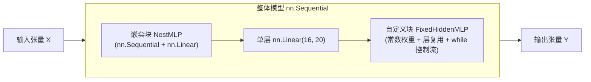

# 05. 深度学习计算

%% learning-vault-navigation:v1 %%
> [!abstract]- 笔记导航
> 目录：[[AI learning/D2L-李沐/动手学深度学习导航|动手学深度学习导航]]
> 上一章：[[AI learning/D2L-李沐/笔记/04. 多层感知机|04. 多层感知机]] · 下一章：[[AI learning/D2L-李沐/笔记/06. 卷积神经网络|06. 卷积神经网络]]

> [!abstract] 本章导读
> 本章不引入新算法或数据集，而是聚焦 PyTorch 深度学习框架的底层工程机制，帮助你从“调包基础用户”进阶为“架构定制高级用户”。内容围绕六大核心能力展开：==块（`nn.Module`）的递归抽象==、==参数访问/初始化/共享==、==延后初始化==、==自定义层==、==模型持久化读写==以及==GPU 设备管理与数据传输避坑==。其中前两节与自定义层（5.1、5.2、5.4）在 2026-10-02 完成实操运行，其余三节以阅读掌握 API 范式为主。

---

## 1. 层和块：`nn.Module` 的递归抽象（5.1 `model-construction`）

如同硬件设计从晶体管抽象到逻辑门再抽象到功能模块，现代神经网络（如 ResNet-152）往往由重复的**块（Block）**递归堆叠而成。在 PyTorch 中，单个层、多层的组合块乃至整个模型本身，统一抽象为 **`nn.Module` 的子类**。



### 1.1 `nn.Module` 子类必须提供的核心能力

1. `__init__` 中调用 `super().__init__()`，并将子层注册为实例属性（或加入 `_modules` / `nn.ModuleList`）；
2. 实现 `forward(self, X)` 定义前向计算（`net(X)` 实际触发 `net.__call__(X)`，内部会调用钩子函数并转发至 `forward`）；
3. 反向传播由 Autograd 自动生成，只需关注前向计算与参数声明。

### 1.2 剖析 `Sequential` 与 `_modules` 的底层机制

教材通过手写 `MySequential` 揭示了 `nn.Sequential` 的本质：

```python
class MySequential(nn.Module):
    def __init__(self, *args):
        super().__init__()
        for idx, module in enumerate(args):
            # 必须存入 OrderedDict 类型的 self._modules，而非普通 Python list
            self._modules[str(idx)] = module

    def forward(self, X):
        for block in self._modules.values():
            X = block(X)
        return X
```

> [!warning] 为什么不能把子层放进普通 Python `list`？（5.1 练习 1 核心）
> PyTorch 仅会递归扫描 `self._modules`（由属性赋值 `self.layer = ...`、`nn.Sequential`、`nn.ModuleList`、`nn.ModuleDict` 自动注册）中的子模块。如果把层直接存进普通 Python 列表 `self.layers = [nn.Linear(...), ...]`，则 **`net.parameters()` 找不到这些参数、`net.to(device)` 不会搬运它们、`net.state_dict()` 也不会保存它们**！

### 1.3 灵活前向控制流与混合嵌套

当架构不再是简单流水线时，自定义 `nn.Module` 可在前向中无缝融入：
- **常数参数**（如 `FixedHiddenMLP` 中 `requires_grad=False` 的随机矩阵，不参与梯度更新）；
- **层复用 / 权重共享**（在 `forward` 中多次调用同一个 `self.linear`）；
- **Python 控制流**（如 `while X.abs().sum() > 1: X /= 2`）；
- **任意递归嵌套**：`nn.Sequential` 与自定义 `nn.Module` 可自由互相嵌套（如 `chimera = nn.Sequential(NestMLP(), nn.Linear(16, 20), FixedHiddenMLP())`）。

---

## 2. 参数管理：访问、初始化与绑定（5.2 `parameters`）

### 2.1 参数访问 API 速查

| 目标 | 常用 PyTorch 写法 | 说明 |
| :--- | :--- | :--- |
| 查看单层参数字典 | `net[2].state_dict()` | 返回 `OrderedDict({'weight': ..., 'bias': ...})` |
| 获取参数对象 / 底层数值 / 梯度 | `net[2].bias` / `net[2].bias.data` / `net[2].weight.grad` | 参数类型为 `nn.Parameter`；反向传播前 `.grad` 为 `None` |
| 递归遍历全网参数 | `net.named_parameters()` | 键名带层级路径前缀，如 `'0.weight'`, `'2.bias'` |
| 按名称索引参数 | `net.state_dict()['2.bias'].data` | 适用于跨嵌套块精确定位 |
| 嵌套块索引 | `rgnet[0][1][0].bias.data` | `nn.Sequential` 配合 `add_module` 支持类列表逐层索引，且 `print(rgnet)` 可直观打印完整结构树 |

### 2.2 参数初始化策略（`net.apply` 模式）

PyTorch 的 `module.apply(fn)` 会对模块树中的**每一个子模块递归调用 `fn`**，这是全局或局部初始化的标准范式：

```python
# 1. 内置正态/常数/Xavier初始化
def init_normal(m):
    if type(m) == nn.Linear:
        nn.init.normal_(m.weight, mean=0, std=0.01)
        nn.init.zeros_(m.bias)

net.apply(init_normal)

# 2. 对不同层分别施加不同初始化
net[0].apply(lambda m: nn.init.xavier_uniform_(m.weight) if type(m) == nn.Linear else None)
net[2].apply(lambda m: nn.init.constant_(m.weight, 42) if type(m) == nn.Linear else None)

# 3. 自定义分段分布初始化（1/4 U(5,10), 1/2 0, 1/4 U(-10,-5)）
def my_init(m):
    if type(m) == nn.Linear:
        nn.init.uniform_(m.weight, -10, 10)
        m.weight.data *= m.weight.data.abs() >= 5
```

### 2.3 参数绑定 / 共享（Parameter Tying）

在构建 `nn.Sequential` 时将**同一个层实例**传入多个位置，即可实现参数共享：

```python
shared = nn.Linear(8, 8)
net = nn.Sequential(nn.Linear(4, 8), nn.ReLU(),
                    shared, nn.ReLU(),
                    shared, nn.ReLU(),
                    nn.Linear(8, 1))
```

- `net[2]` 与 `net[4]` 指向**同一内存张量对象**（修改 `net[2].weight.data[0, 0] = 100` 会同步反映到 `net[4]`）；
- **反向传播时的梯度行为**：同一参数在计算图中被多处使用时，PyTorch 会将各处回传的梯度==自动相加累积==到该共享参数的 `.grad` 中。

---

## 3. 延后初始化（5.3 `deferred-init`）

构建深层 CNN 或复杂网络时，输入图像分辨率经多层卷积/池化后的展平维度往往难以手算。**延后初始化（Deferred Initialization）**的核心思想是：

1. 定义网络时无需提前声明输入维度；
2. 此时框架尚未为权重分配确定形状；
3. 当**第一批数据首次执行前向传播**时，框架沿网络顺序动态推断每层输入/输出维度，并自动完成参数形状确定与初始化。

> [!tip] PyTorch 中的对应 API
> PyTorch 提供 `nn.LazyLinear(out_features)`、`nn.LazyConv2d(out_channels, kernel_size)` 等惰性层实现延后初始化。使用 `Lazy` 层时，务必先喂入一个 dummy 输入张量完成参数实例化，再将 `net.parameters()` 传给优化器或做权重统计/分布式封装。

---

## 4. 自定义层（5.4 `custom-layer`）

自定义层与自定义块本质完全相同——同样继承 `nn.Module`：

- **无参数层**：如 `CenteredLayer`，只需在 `forward` 中写 `return X - X.mean()`，即可无缝嵌入 `nn.Sequential(nn.Linear(8, 128), CenteredLayer())`。
- **带参数层**：通过 **`nn.Parameter(...)`** 注册可学习参数，框架即自动接管其访问、初始化、梯度追踪与序列化保存：

```python
class MyLinear(nn.Module):
    def __init__(self, in_units, units):
        super().__init__()
        self.weight = nn.Parameter(torch.randn(in_units, units))
        self.bias = nn.Parameter(torch.randn(units,))

    def forward(self, X):
        # 注：教材示例写了 self.weight.data，实战训练中建议直接用 self.weight / self.bias 以确保梯度图完整追踪
        linear = torch.matmul(X, self.weight) + self.bias
        return F.relu(linear)
```

> [!warning] `self.weight` vs `self.weight.data` 工程提醒
> 在 `custom-layer.ipynb` 的 `MyLinear.forward` 中使用了 `self.weight.data` 和 `self.bias.data` 仅作前向演示；在实际反向传播训练中，访问 `.data` 会绕过 Autograd 追踪（梯度无法流回 `self.weight`），因此自定义层的前向运算中**务必直接使用 `self.weight` 和 `self.bias`**。

---

## 5. 读写文件与模型持久化（5.5 `read-write`）

训练耗时长的模型需要定期保存 Checkpoint 防止断电丢失，也需要在推理或迁移学习中复用权重。

| 场景 | 保存代码 | 加载代码 |
| :--- | :--- | :--- |
| 单张量 / 张量列表 / 字典 | `torch.save(obj, 'file')` | `obj = torch.load('file')` |
| **模型参数（推荐标准做法）** | `torch.save(net.state_dict(), 'mlp.params')` | `clone = MLP()`<br>`clone.load_state_dict(torch.load('mlp.params'))`<br>`clone.eval()` |

> [!important] 为什么只保存 `state_dict()` 而不直接保存整个模型对象？
> 网络架构本质上包含任意 Python 类与控制流代码，难以跨版本/跨环境可靠序列化。PyTorch 推荐**代码定义架构 + `state_dict()` 仅存参数字典**的方式，并在恢复预测前调用 `clone.eval()` 正确切换 Dropout / BatchNorm 等层的推理状态。

---

## 6. GPU 计算与性能避坑（5.6 `use-gpu`）

### 6.1 设备管理与通用辅助函数

PyTorch 默认在 CPU 上创建张量。`cpu` 设备代表全部 CPU 核心与主内存，而 `cuda:i` 仅代表第 $i$ 块 GPU 及其显存（`cuda` 等价于 `cuda:0`）。全书通用的设备选择工具函数（`#@save`）：

```python
def try_gpu(i=0):
    """若存在第 i 块 GPU 则返回 cuda:i，否则回退至 cpu"""
    if torch.cuda.device_count() >= i + 1:
        return torch.device(f'cuda:{i}')
    return torch.device('cpu')

def try_all_gpus():
    """返回所有可用 GPU 列表，若无则返回 [cpu]"""
    devices = [torch.device(f'cuda:{i}') for i in range(torch.cuda.device_count())]
    return devices if devices else [torch.device('cpu')]
```

常用设备操作：
- 创建时指定：`X = torch.ones(2, 3, device=try_gpu())`；
- 查询设备：`X.device`、`net[0].weight.data.device`；
- 跨设备复制：`Z = X.cuda(1)` 或 `X.to(device)`（若已在目标设备上，如 `Z.cuda(1) is Z` 返回 `True`，**不会重复拷贝分配显存**）；
- 模型迁移：`net = net.to(device=try_gpu())`。

### 6.2 两大黄金铁律

> [!warning] GPU 编程两大避坑铁律
> 1. **同设备铁律**：参与同一运算的所有张量及模型参数**必须位于同一设备上**，否则直接抛出设备不匹配异常（跨卡运算前须显式复制至同一张卡）。
> 2. **警惕隐式跨设备传输与同步阻塞**：CPU$\leftrightarrow$GPU 之间的 PCIe 数据拷贝远慢于 GPU 计算本身。一个极其常见的新手性能杀手是：**在每个小批量迭代内频繁 `print(loss)`、调用 `.item()` 或转 `.numpy()`**——这会强制触发 GPU 同步并拷贝回主内存，还受制于 Python GIL，导致极快的 GPU 长时间空等 CPU！正确做法是在 GPU 上累加指标张量，仅在每个 epoch 结束或间隔较大步数时传输一次日志。

---

## 7. 配套材料与 Notebook

| 小节 | Notebook | 学习状态（按修改时间） | 核心内容 |
| :--- | :--- | :--- | :--- |
| 章目录 | [[AI learning/D2L-李沐/pytorch/chapter_deep-learning-computation/index.ipynb\|index.ipynb]] | 原版（2023-08-19） | 本章导言与目录 |
| 5.1 | [[AI learning/D2L-李沐/pytorch/chapter_deep-learning-computation/model-construction.ipynb\|model-construction.ipynb]] | 已运行实操（2026-10-02） | `nn.Module`、`MySequential`、`_modules`、`FixedHiddenMLP`、嵌套块 |
| 5.2 | [[AI learning/D2L-李沐/pytorch/chapter_deep-learning-computation/parameters.ipynb\|parameters.ipynb]] | 已运行实操（2026-10-02） | `state_dict`、`named_parameters`、`apply` 初始化、共享参数绑定 |
| 5.3 | [[AI learning/D2L-李沐/pytorch/chapter_deep-learning-computation/deferred-init.ipynb\|deferred-init.ipynb]] | 原版（2023-08-19，仅阅读） | 延后初始化机制与动态维度推断 |
| 5.4 | [[AI learning/D2L-李沐/pytorch/chapter_deep-learning-computation/custom-layer.ipynb\|custom-layer.ipynb]] | 已运行实操（2026-10-02） | 无参 `CenteredLayer` 与带参 `MyLinear` 自定义层 |
| 5.5 | [[AI learning/D2L-李沐/pytorch/chapter_deep-learning-computation/read-write.ipynb\|read-write.ipynb]] | 原版（2023-08-19，仅阅读） | `torch.save/load` 与 `state_dict()` 参数持久化 |
| 5.6 | [[AI learning/D2L-李沐/pytorch/chapter_deep-learning-computation/use-gpu.ipynb\|use-gpu.ipynb]] | 原版（2023-08-19，仅阅读） | `try_gpu`、跨卡拷贝、模型迁移与传输阻塞规避 |

---

> [!question]- 章节自测与思考
> 1. 在自定义 `nn.Module` 中，如果把若干个 `nn.Linear` 放进普通 Python 列表 `self.layers = [...]` 而不是 `nn.ModuleList` 或 `self._modules`，训练时会发生什么严重后果？
> 2. 当两个层共享同一个 `nn.Linear` 实例时，反向传播中该层权重的梯度是如何计算的？这种机制在哪些经典网络（如 RNN、孪生网络、词嵌入绑定）中非常有用？
> 3. 为什么在 GPU 上训练循环里每步都把损失转成 NumPy 或打印出来会大幅拖慢训练速度？应该如何改进？
> 4. 如果只想复用一个预训练模型的前两层权重并加载到新网络中，应该如何操作 `state_dict()`？
