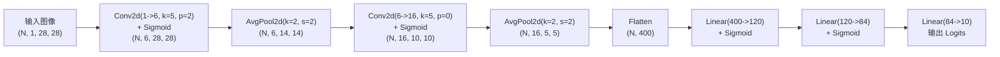

# 06. 卷积神经网络

%% learning-vault-navigation:v1 %%
> [!abstract]- 笔记导航
> 目录：[[AI learning/D2L-李沐/动手学深度学习导航|动手学深度学习导航]]
> 上一章：[[AI learning/D2L-李沐/笔记/05. 深度学习计算|05. 深度学习计算]] · 下一章：[[AI learning/D2L-李沐/笔记/07. 现代卷积神经网络|07. 现代卷积神经网络]]

> [!abstract] 本章导读
> 本章从全连接网络处理高维图像的“参数量爆炸”困境出发，以==平移不变性==和==局部性==两条空间归纳偏置为第一性原理推导出卷积层；随后系统拆解二维互相关运算、感受野、填充与步幅的输出尺寸公式、多输入/多输出通道与 $1\times 1$ 卷积、以及汇聚层（Pooling）；最后实现历史上首个成功落地的卷积神经网络 ==LeNet-5==，并建立后续视觉章节共用的 GPU 训练脚手架 `train_ch6`。本章全部 6 节正文 Notebook 均于 2026-10-02 至 10-03 在本地 GPU 上完成实操验证。

---

## 1. 从全连接层到卷积：两大空间归纳偏置（6.1 `why-conv`）

将一张百万像素（$10^6$）图像直接展平送入仅含 $1000$ 个隐藏单元的 MLP，单层权重数就高达 $10^9$（十亿参数），既难以训练又彻底丢弃了像素的二维邻域拓扑结构。将全连接层改写为四阶权重张量形式：

$$
[\mathbf{H}]_{i,j} = [\mathbf{U}]_{i,j} + \sum_a \sum_b [\mathsf{V}]_{i,j,a,b}\,[\mathbf{X}]_{i+a, j+b}
$$

受“寻找沃尔多（Where's Waldo）”启发，施加自然图像的两条==归纳偏置（Inductive Bias）==：

1. **平移不变性（Translation Invariance）**：无论目标出现在图像何处，卷积核应以相同权重响应，即权重与绝对位置 $(i, j)$ 无关：$[\mathsf{V}]_{i,j,a,b} = [\mathbf{V}]_{a,b}$，$[\mathbf{U}]_{i,j} = u$（大幅参数共享）。
2. **局部性（Locality）**：底层特征提取只需关注 $(i, j)$ 附近的局部窗口，超出 $|a|>\Delta$ 或 $|b|>\Delta$ 时令 $[\mathbf{V}]_{a,b} = 0$。

由此从全连接层直接退化出标准二维卷积层（引入输入通道 $c$ 与输出通道 $d$ 后）：

$$
[\mathsf{H}]_{i,j,d} = u_d + \sum_{a=-\Delta}^{\Delta}\sum_{b=-\Delta}^{\Delta}\sum_{c} [\mathsf{V}]_{a,b,c,d}\,[\mathsf{X}]_{i+a,j+b,c}
$$

单层参数量由此从数十亿骤降至几百/几千级。代价是模型假设了空间平移不变性与局部相关性——若任务违背这两条先验（例如需要依赖绝对像素坐标的任务），纯卷积结构反而可能受限。

---

## 2. 图像卷积、互相关与感受野（6.2 `conv-layer`）

### 2.1 互相关（Cross-Correlation）vs 严格数学卷积

严格数学离散卷积在索引处做差值翻转：$(f * g)(i,j) = \sum_a \sum_b f(a,b)g(i-a,j-b)$；深度学习框架中的“卷积层”实际执行的是**不翻转核的互相关运算**（`corr2d`）：窗口从左上角逐格滑动，与核张量按元素相乘再求和并加偏置。

由于卷积核权重本身是从数据中学出来的，互相关与严格卷积学出的核仅相差一次上下左右翻转，**表达能力与输出完全等价**。

- **手写边缘检测示例**：对中间黑、两侧白的 $6\times 8$ 图像应用 `K = [[1, -1]]`，可检出垂直边缘（白$\to$黑输出 `1`，黑$\to$白输出 `-1`）；转置图像后垂直核失效（全 0）。
- **端到端学习卷积核**：使用 `nn.Conv2d(1, 1, kernel_size=(1, 2), bias=False)`（四维张量格式 `(N, C, H, W)`），仅用输入输出对迭代 10 轮梯度下降，权重自动收敛至 `[[1.0242, -0.9573]]`，精准复原边缘检测器。

### 2.2 特征映射与感受野（Receptive Field）

- **特征映射（Feature Map）**：卷积层的输出张量，每个通道对应一种空间特征响应图。
- **感受野（Receptive Field）**：某一层特征图上单个元素 $x$ 在前向传播中所能“看到”的（可能影响其数值的）==先前所有层（尤其是原始输入图像）上的空间区域==。
- **堆叠扩大感受野**：单个 $2\times 2$ 卷积的感受野是 $2\times 2$；连续堆叠两层 $2\times 2$ 卷积后，第二层单个元素的感受野已覆盖输入上全部 $3\times 3 = 9$ 个像素。一般地，堆叠越深（或引入步幅/汇聚下采样），高层神经元的感受野越广，从而逐步由局部边缘过渡到全局物体语义。

---

## 3. 填充、步幅与输出空间尺寸公式（6.3 `padding-and-strides`）

连续无填充卷积会不断蚕食边界像素，导致边缘信息丢失；而需要快速降采样（减少冗余空间分辨率与计算量）时则需增大步幅。

### 3.1 通用输出空间尺寸公式

设输入高宽为 $n_h \times n_w$，卷积核大小 $k_h \times k_w$，**总填充**为 $p_h$ 行、$p_w$ 列，步幅为 $s_h \times s_w$，则输出高宽为：

$$
n_h^{\text{out}} = \left\lfloor \frac{n_h - k_h + p_h + s_h}{s_h} \right\rfloor, \qquad
n_w^{\text{out}} = \left\lfloor \frac{n_w - k_w + p_w + s_w}{s_w} \right\rfloor
$$

> [!warning] 极其关键的符号区分：教材总填充 vs PyTorch 单边填充
> 上述教材公式中的 $p_h, p_w$ 是**两侧填充之和**；而 PyTorch `nn.Conv2d(..., padding=(pad_h, pad_w))` 传入的是**单侧填充数**（即 $p_h = 2 \cdot \mathrm{pad}_h,\; p_w = 2 \cdot \mathrm{pad}_w$）！因此在写 PyTorch 代码时应牢记等价形式：
>
> $$
> H_{\text{out}} = \left\lfloor \frac{H_{\text{in}} + 2 \cdot \mathrm{pad}_h - k_h}{s_h} \right\rfloor + 1
> $$

### 3.2 常用工程配置速查

| 设计目标 | 常见配置 | 效果验证（以 $8\times 8$ 输入为例） |
| :--- | :--- | :--- |
| **保持高宽不变（Same Padding）** | 奇数核 $k$，PyTorch 设 `padding = (k - 1) // 2`，`stride = 1` | `k=3, padding=1` $\to$ `(8, 8)`；`k=(5,3), padding=(2,1)` $\to$ `(8, 8)` |
| **空间分辨率减半（下采样）** | `k=3, padding=1, stride=2` | `(8, 8)` $\to$ `(4, 4)`（若整除则精确为 $n_h/s_h \times n_w/s_w$） |
| **非对称核与步幅** | `k=(3,5), padding=(0,1), stride=(3,4)` | $\lfloor(8-3+0+3)/3\rfloor=2$，$\lfloor(8-5+2+4)/4\rfloor=2$ $\to$ `(2, 2)` |

**为什么卷积核尺寸通常选奇数（1、3、5、7）？** 一是上下/左右可以精确对称填充，保持尺寸不变；二是可保证输出 `Y[i, j]` 恰好以输入 `X[i, j]` 为空间中心。

---

## 4. 多输入/多输出通道与 $1 \times 1$ 卷积（6.4 `channels`）

### 4.1 多通道卷积张量形状与计算量

真实图像（如 RGB 3 通道）与深层隐藏表示均为三维特征图 $(c, h, w)$（含批量时为四维 $(N, c, h, w)$）：

- **多输入单输出**：输入 $(c_i, h, w)$，核 $(c_i, k_h, k_w)$；逐输入通道做二维互相关后**沿通道维度相加**，得 1 张二维特征图。
- **多输入多输出**：设输入通道 $c_i$、输出通道 $c_o$，则==卷积核权重形状为 $(c_o, c_i, k_h, k_w)$==（另加 $c_o$ 个偏置）。每个输出通道独立汇集所有 $c_i$ 个输入通道并产出 1 张特征图，最终堆叠为 $(c_o, h', w')$。
- **单层参数量与 FLOPs**：参数量 $c_o c_i k_h k_w + c_o$；乘加计算量约为 $c_o c_i k_h k_w h' w'$。现代 CNN 的经典趋势是**随深度加深，逐步降低空间分辨率 $(h, w)$、同时增大通道数 $c$**。

### 4.2 $1 \times 1$ 卷积层的本质与直觉

虽然 $1\times 1$ 卷积（$k_h=k_w=1$）不观察相邻像素的空间交互，但它却是现代 CNN（NiN、GoogLeNet、ResNet 瓶颈块）的灵魂组件：

- **本质直觉**：==在每个空间像素位置 $(i, j)$ 上独立应用的、跨空间共享权重的全连接层==，将长度为 $c_i$ 的通道向量线性投影为长度为 $c_o$ 的通道向量。
- **等价矩阵乘法**：将输入 $(c_i, h, w)$ 展平为 $(c_i, hw)$、核 $(c_o, c_i, 1, 1)$ 变形为 $(c_o, c_i)$，执行 `Y = K @ X` 再变形回 $(c_o, h, w)$，与互相关结果完全一致（`channels.ipynb` 已用 `assert < 1e-6` 验证）。
- **三大工程用途**：① **灵活升维/降维**（瓶颈压缩通道以大幅削减 $3\times 3$/$5\times 5$ 卷积计算量）；② **跨通道信息融合**；③ 配合激活函数增加网络非线性表达力。

---

## 5. 汇聚层 / 池化层（6.5 `pooling`）

卷积层对输入中 1 个像素的微小位移都非常敏感。**汇聚层（Pooling Layer）**以无参数的确定性滑窗操作实现双重目标：**① 缓解卷积层对空间位置的过度敏感（增强局部平移鲁棒性）**；**② 空间下采样以扩大高层感受野并削减后续计算量**。

| 特性 | 最大汇聚（`nn.MaxPool2d`） | 平均汇聚（`nn.AvgPool2d`） |
| :--- | :--- | :--- |
| 窗口运算 | 取窗口内最大激活值（突出最显著特征响应） | 取窗口内均值（平滑保留整体背景信息） |
| 可学习参数 | **无参数** | **无参数** |
| 默认步幅 | **默认等于窗口大小**（与卷积默认 `stride=1` 不同！） | 默认等于窗口大小 |
| 多通道行为 | **各通道独立运算**，输出通道数 $=$ 输入通道数（不跨通道融合） | 各通道独立运算，输出通道数 $=$ 输入通道数 |

---

## 6. 经典起点：LeNet-5 架构与 GPU 训练框架（6.6 `lenet`）

Yann LeCun 于 1989/1998 年提出的 **LeNet-5** 是历史上最早成功应用反向传播训练并落地银行支票手写数字识别的 CNN，由**卷积编码器（2 层卷积+平均汇聚）**与**全连接稠密块（3 层全连接）**组成：

### 6.1 第 6–7 章通用 GPU 训练脚手架 `train_ch6`

本节实现了支持 GPU 的 `evaluate_accuracy_gpu` 与 `train_ch6`（标记 `#@save` 供后续 AlexNet/VGG/ResNet 直接复用）：
- **权重初始化**：对所有 `nn.Linear` 和 `nn.Conv2d` 自动应用 `nn.init.xavier_uniform_(m.weight)`；
- **设备迁移**：`net.to(device)`，训练循环内每批将 `X, y = X.to(device), y.to(device)` 搬至 GPU；
- **损失与优化器**：`nn.CrossEntropyLoss()` + `torch.optim.SGD(net.parameters(), lr=lr)`；
- **本地实测结果（Fashion-MNIST，`batch_size=256, lr=0.9, epochs=10`）**：
  - `loss 0.463`, `train acc 0.827`, `test acc 0.769`
  - 训练吞吐量：**`26841.7 examples/sec on cuda:0`**。

> [!tip] LeNet 的时代局限与演进方向
> 受限于 20 世纪 90 年代的技术认知，LeNet 使用了 `Sigmoid` 激活与 `AvgPool2d`，且仅含 2 个卷积层。将其替换为 `ReLU` + `MaxPool2d`、加深网络并引入 BatchNorm/残差连接，正是第 7 章现代卷积神经网络的演进主线。

---

## 7. 配套材料与 Notebook

| 小节 | Notebook | 学习状态（按修改时间） | 核心内容 |
| :--- | :--- | :--- | :--- |
| 章目录 | [[AI learning/D2L-李沐/pytorch/chapter_convolutional-neural-networks/index.ipynb\|index.ipynb]] | 原版（2023-08-19） | 本章导言与目录 |
| 6.1 | [[AI learning/D2L-李沐/pytorch/chapter_convolutional-neural-networks/why-conv.ipynb\|why-conv.ipynb]] | 已阅读修改（2026-10-02） | 平移不变性、局部性归纳偏置推导 |
| 6.2 | [[AI learning/D2L-李沐/pytorch/chapter_convolutional-neural-networks/conv-layer.ipynb\|conv-layer.ipynb]] | 已运行实操（2026-10-02） | `corr2d`、边缘检测、梯度下降学习卷积核、感受野 |
| 6.3 | [[AI learning/D2L-李沐/pytorch/chapter_convolutional-neural-networks/padding-and-strides.ipynb\|padding-and-strides.ipynb]] | 已运行实操（2026-10-03） | 填充、步幅与输出空间尺寸验证 |
| 6.4 | [[AI learning/D2L-李沐/pytorch/chapter_convolutional-neural-networks/channels.ipynb\|channels.ipynb]] | 已运行实操（2026-10-03） | 多通道互相关、$1\times 1$ 卷积等价全连接矩阵乘验证 |
| 6.5 | [[AI learning/D2L-李沐/pytorch/chapter_convolutional-neural-networks/pooling.ipynb\|pooling.ipynb]] | 已运行实操（2026-10-03） | 最大/平均汇聚实现、默认步幅与多通道独立性 |
| 6.6 | [[AI learning/D2L-李沐/pytorch/chapter_convolutional-neural-networks/lenet.ipynb\|lenet.ipynb]] | 已在 GPU 运行训练（2026-10-03） | LeNet-5 逐层形状检查与 `train_ch6` 实测（`26841.7 ex/s`） |

---

> [!question]- 章节自测与思考
> 1. 输入张量形状为 `(32, 3, 224, 224)`，经过 `nn.Conv2d(3, 64, kernel_size=7, stride=2, padding=3)` 后，输出张量形状是多少？该卷积层（含偏置）共有多少个可学习参数？
> 2. 连续堆叠两层 $3 \times 3$ 卷积（步幅均为 1、无激活先不论）与单层 $5 \times 5$ 卷积的感受野相同吗？从参数量与非线性表达能力两方面比较，为什么现代 CNN 更偏好堆叠多个 $3\times 3$ 小卷积核？
> 3. $1\times 1$ 卷积不看相邻像素，为什么在深层网络中仍然不可替代？它的权重张量形状和前向计算复杂度是多少？
> 4. 对比卷积层与汇聚层在“可学习参数”“默认步幅”和“多通道融合方式”三个维度的区别。
