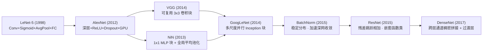
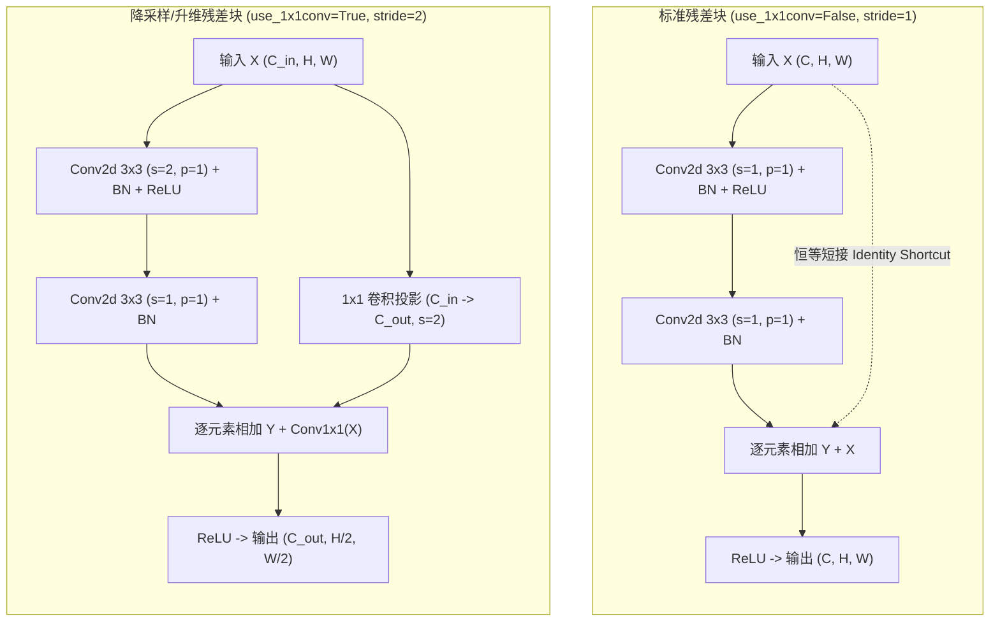

# 07. 现代卷积神经网络

%% learning-vault-navigation:v1 %%
> [!abstract]- 笔记导航
> 目录：[[AI learning/D2L-李沐/动手学深度学习导航|动手学深度学习导航]]
> 上一章：[[AI learning/D2L-李沐/笔记/06. 卷积神经网络|06. 卷积神经网络]] · 下一章：[[AI learning/D2L-李沐/笔记/08. 循环神经网络|08. 循环神经网络]]

> [!abstract] 本章导读
> 本章沿着 2012–2017 年 ImageNet 竞赛的历史演进脉络，梳理现代卷积神经网络从“手工特征 $\to$ 深度表征”到“百层深网稳定训练”的完整技术图谱：**AlexNet $\to$ VGG $\to$ NiN $\to$ GoogLeNet $\to$ BatchNorm $\to$ ResNet $\to$ DenseNet**。除 `densenet.ipynb` 为纯阅读外，其余 6 节核心架构与组件均在 2026-10-03 至 10-04 于本地 `cuda:0` GPU 上完成训练复现与精度对比。

---

## 1. 现代 CNN 架构演进全景总览

### 1.1 六大经典架构核心对比

| 架构（年份） | 核心设计突破 | 标志性基础模块 | 分类头设计 | 优势与局限 | Fashion-MNIST 实测（`cuda:0`, 10 epoch） |
| :--- | :--- | :--- | :--- | :--- | :--- |
| **AlexNet** (2012) | 首次在 ImageNet 击败手工特征（SIFT/HOG）；引入 ReLU、MaxPool、Dropout、数据增强与 GPU 并行 | $11\times 11 \to 5\times 5 \to 3\times 3$ 卷积（5 卷 + 3 全连接） | `6400 → 4096 → 4096 → 10`（两层 Dropout 0.5） | 开启深度学习时代；但后部 FC 参数量极大（占全网绝大部分显存） | `224×224`, `lr=0.01`: train `0.879` / test **`0.881`** (`2861 ex/s`) |
| **VGG-11** (2014) | 提出==块（Block）抽象==；证明深而窄的多个 $3\times 3$ 卷积优于浅而宽的大卷积核 | `vgg_block`: 若干 `3×3 Conv(p=1)+ReLU` + `2×2 MaxPool(s=2)`，5 块逐级通道翻倍、高宽减半 | 同 AlexNet（`512×7×7 → 4096 → 4096 → 10`） | 结构规整易扩展（VGG-11/16/19）；计算量与显存开销沉重 | 1/4 通道版 `224×224`, `lr=0.05`: train `0.935` / test **`0.921`** (`1917 ex/s`) |
| **NiN** (2013) | 首次**彻底取消全连接层**，大幅削减参数与过拟合；引入逐像素 MLP 与 GAP | `nin_block`: `k×k Conv` + 两层 `1×1 Conv + ReLU` | 末块输出通道 $=$ 类别数 + **`AdaptiveAvgPool2d((1,1))`** | 极大压缩参数量，启发 GoogLeNet/ResNet；直接压到 10 通道有时收敛偏慢 | `224×224`, `lr=0.1`: train `0.830` / test **`0.826`** (`2150 ex/s`) |
| **GoogLeNet** (2014) | 用**并行多分支**替代纠结选哪种卷积核尺寸；用 $1\times 1$ 卷积先降维控制算力 | **Inception 块**：4 条并行路径（`1×1`、`1×1→3×3`、`1×1→5×5`、`3×3 MaxPool→1×1`）通道拼接 | `AdaptiveAvgPool2d((1,1))` + `Linear(1024, 10)` | 算力–精度比极高；手工设计的各分支通道配比繁琐、难调优 | `96×96`, `lr=0.1`: train `0.909` / test **`0.900`** (`5438 ex/s`) |
| **ResNet-18** (2015) | 基于==嵌套函数类==思想学习残差 $f(\mathbf{x})-\mathbf{x}$；打通梯度高速通路，突破百层深度瓶颈 | **Residual 块**：两层 `3×3 Conv+BN` + 恒等（或 `1×1` 投影）短接相加 | `AdaptiveAvgPool2d((1,1))` + `Linear(512, 10)` | 架构简洁、极易扩展（ResNet-18/50/152），成为现代 CV 通用骨干 | `96×96`, `lr=0.05`: train `0.996` / test **`0.911`** (`8895 ex/s`) |
| **DenseNet** (2017) | 将残差“相加”推广为**通道维稠密拼接**，所有浅层特征直接复用至后续各层 | `DenseBlock`（BN-ReLU-3×3 Conv 迭代拼接，增长率 $k$）+ `Transition`（`1×1 Conv` + `AvgPool`） | `BN + ReLU + AdaptiveAvgPool2d` + `Linear` | 特征复用率高、参数量小于 ResNet；但中间拼接特征图显存占用较高 | 教材记录（未本地重跑）`96×96`, `lr=0.1`: train `0.948` / test `0.885` |

---

## 2. 从 AlexNet 到 GoogLeNet 的关键设计思想（7.1–7.4）

### 2.1 AlexNet 与 GPU 硬件驱动力（7.1 `alexnet`）

- **数据与算力双重临界点**：2009 年 ImageNet（100 万图、1000 类）提供了大样本土壤；GPU 相比 CPU 舍弃复杂分支预测与大 L3 缓存，以数百至上千轻量并行核心 + 10 倍显存带宽，完美契合卷积与矩阵乘的高吞吐并行需求（GTX 580 + `cuda-convnet` 引爆深度学习浪潮）。
- **相较 LeNet 的四大进化**：更深更宽（5 卷积 + 3 全连接，通道数扩大约 10 倍）；激活函数由 `Sigmoid` 换成 `ReLU`（缓解正区间梯度消失）；全连接层引入 `Dropout(0.5)` 控制容量；训练期大量使用随机裁剪、翻转、变色等图像增强。

### 2.2 VGG：以块为单位的模块化范式（7.2 `vgg`）

- **核心发现**：堆叠更深、更窄的 $3\times 3$ 卷积核（如两层 $3\times 3$ 感受野等价于单层 $5\times 5$，但参数更少、非线性层更多）比浅而宽的大卷积核更有效。
- **架构模板**：VGG-11 由 5 个 `vgg_block` 组成，配置为 `conv_arch = ((1, 64), (1, 128), (2, 256), (2, 512), (2, 512))`（8 个卷积层 + 3 个全连接层），每经过一个块空间尺寸减半（$224 \to 112 \to 56 \to 28 \to 14 \to 7$）、通道数翻倍直至 512。

### 2.3 NiN 与 GoogLeNet：消灭全连接与多尺度瓶颈（7.3–7.4）

- **NiN（Network in Network）**提出两大影响深远的范式：
  1. **逐像素 MLP**：每个常规卷积后紧跟两层 $1\times 1$ 卷积 + ReLU，在保留空间结构的同时增强每像素跨通道非线性；
  2. **全局平均汇聚（Global Average Pooling, GAP）**：用 `nn.AdaptiveAvgPool2d((1, 1))` 直接将每张特征图压成 1 个标量，彻底替代臃肿且极易过拟合的 4096 维全连接层。
- **GoogLeNet（Inception）**解决“卷积核该选多大”的难题：在同一个 **Inception 块**内并行铺设 4 条保持高宽不变的路径（$1\times 1$、$1\times 1\to 3\times 3$、$1\times 1\to 5\times 5$、$3\times 3\text{ MaxPool}\to 1\times 1$），并在 $3\times 3$、$5\times 5$ 分支前置 **$1\times 1$ 瓶颈卷积先压缩通道数**，最后沿通道维 `torch.cat(..., dim=1)` 拼接。整网堆叠 5 个阶段共 9 个 Inception 块，末层同样采用全局平均汇聚。

---

## 3. 批量规范化（Batch Normalization，7.5 `batch-norm`）

深层网络训练中，浅层参数更新会引发深层激活值尺度剧烈漂移，且不同层量级悬殊导致难以统一学习率。Ioffe & Szegedy（2015）提出的==批量规范化（BN）==是让 100 层以上深网稳定、快速收敛的核心引擎之一。

### 3.1 训练模式 vs 推理模式的完整数学公式

对一个小批量 $\mathcal{B}$ 中的激活张量 $\mathbf{x}$，BN 通常置于**全连接/卷积的仿射变换之后、非线性激活函数之前**（即 $\mathbf{h} = \phi(\mathrm{BN}(\mathbf{W}\mathbf{x}+\mathbf{b}))$）：

- **训练模式（Training Mode）**：使用当前小批量统计量标准化，并引入与通道/特征同形状的**可学习拉伸参数 $\boldsymbol{\gamma}$**（初始化为 1）和**偏移参数 $\boldsymbol{\beta}$**（初始化为 0），避免强行锁死均值 0 方差 1 损失表达力：

$$
\hat{\boldsymbol{\mu}}_{\mathcal{B}} = \frac{1}{|\mathcal{B}|}\sum_{\mathbf{x}\in\mathcal{B}}\mathbf{x}, \qquad
\hat{\boldsymbol{\sigma}}_{\mathcal{B}}^2 = \frac{1}{|\mathcal{B}|}\sum_{\mathbf{x}\in\mathcal{B}}(\mathbf{x}-\hat{\boldsymbol{\mu}}_{\mathcal{B}})^2 + \epsilon
$$

$$
\mathrm{BN}_{\text{train}}(\mathbf{x}) = \boldsymbol{\gamma} \odot \frac{\mathbf{x} - \hat{\boldsymbol{\mu}}_{\mathcal{B}}}{\sqrt{\hat{\boldsymbol{\sigma}}_{\mathcal{B}}^2}} + \boldsymbol{\beta}
$$

同时以指数移动平均（如教材中 `momentum = 0.9`）持续更新全局运行统计量（不参与梯度反向传播）：

$$
\boldsymbol{\mu}_{\text{moving}} \leftarrow m\,\boldsymbol{\mu}_{\text{moving}} + (1 - m)\,\hat{\boldsymbol{\mu}}_{\mathcal{B}}, \qquad
\boldsymbol{\sigma}^2_{\text{moving}} \leftarrow m\,\boldsymbol{\sigma}^2_{\text{moving}} + (1 - m)\,\hat{\boldsymbol{\sigma}}^2_{\mathcal{B}}
$$

- **推理/预测模式（Evaluation Mode）**：推理时可能逐单样本输入（此时 batch 方差为 0 毫无意义），且不再需要小批量噪声，因此直接使用训练期累积的全局移动均值与方差：

$$
\mathrm{BN}_{\text{eval}}(\mathbf{x}) = \boldsymbol{\gamma} \odot \frac{\mathbf{x} - \boldsymbol{\mu}_{\text{moving}}}{\sqrt{\boldsymbol{\sigma}^2_{\text{moving}} + \epsilon}} + \boldsymbol{\beta}
$$

### 3.2 全连接层 vs 卷积层的统计维度差异

| 应用层类型 | 输入形状 | 求均值/方差的归约维度 | $\boldsymbol{\gamma}, \boldsymbol{\beta}$ 形状 | PyTorch 内置 API |
| :--- | :--- | :--- | :--- | :--- |
| **全连接层（2D）** | $(N, C)$ | `dim=0`（跨批量样本，每个特征独立归一化） | `(1, C)` | `nn.BatchNorm1d(C)` |
| **二维卷积层（4D）** | $(N, C, H, W)$ | `dim=(0, 2, 3)`（跨批量及所有空间位置 $N\cdot H\cdot W$，==每个通道共享一组标量统计与 $\gamma_c, \beta_c$==） | `(1, C, 1, 1)` | `nn.BatchNorm2d(C)` |

> [!tip] BN 实操要点与理论争议
> - **批量大小依赖**：`batch_size = 1` 时减去均值激活全变 0 彻底失效；中等批量（如 $50 \sim 100$ 以上）最稳定，且小批量均值/方差的随机估计噪声自带一定的**隐式正则化**效果。
> - **前置偏置冗余（7.5 练习 1）**：因为 BN 第一步会减去均值，紧接在 BN 前的 `Conv2d` / `Linear` 的偏置项 $\mathbf{b}$ 会被直接抵消（改由 BN 的 $\boldsymbol{\beta}$ 承担偏移），工程中常设 `bias=False`。
> - **加速与提点实测（LeNet + BN）**：学习率可大幅提高至 `lr=1.0`，测试精度从第 6 章无 BN 的 `0.769` 跃升至 **`0.849`**（手写版） / **`0.835`**（`nn.BatchNorm2d` 版，且因 C++/CUDA 融合实现，吞吐量从 `25654 ex/s` 升至 **`34967 ex/s`**）。
> - **关于“内部协变量偏移（ICS）”的争议**：后续研究（Santurkar et al., 2018）指出，BN 真正起效的主因并非原论文声称的“减少内部协变量偏移”，而是使优化目标地形（Loss Landscape）与梯度更加平滑（Lipschitz 连续性更好），从而允许更大的学习率。
> - **PyTorch `momentum` 参数约定差异**：教材手写代码写为 `momentum * moving + (1 - momentum) * batch`（`0.9`）；而 PyTorch 官方 `nn.BatchNorm2d` 默认 `momentum=0.1`，公式为 `(1 - momentum) * running + momentum * batch`，两者数学等价！

---

## 4. 残差网络（ResNet，7.6 `resnet`）

### 4.1 嵌套函数类（Nested Function Classes）与退化问题

简单地把普通卷积层越堆越深，训练误差有时反而比浅层网络更高——因为非嵌套函数类 $\mathcal{F}' \not\supseteq \mathcal{F}$ 增大复杂度时，最优解可能反而偏离真实目标函数 $f^*$。只有当更深网络的函数类**严格包含**浅层函数类（$\mathcal{F}_1 \subseteq \mathcal{F}_2 \subseteq \cdots \subseteq \mathcal{F}_6$），即新增层能轻松退化为**恒等映射 $f(\mathbf{x}) = \mathbf{x}$** 时，加深网络才至少不会变差。

He 等人（2016）的洞见极为简洁：与其让堆叠的非线性层直接拟合目标映射 $f(\mathbf{x})$，不如让它们拟合**残差映射 $g(\mathbf{x}) = f(\mathbf{x}) - \mathbf{x}$**，输出为 $f(\mathbf{x}) = g(\mathbf{x}) + \mathbf{x}$。当恒等映射接近最优时，优化器只需把残差分支权重推向 $0$，比拟合恒等矩阵容易得多；且反向传播时梯度可通过加法恒等通路无衰减地直达浅层，极大缓解梯度消失。

### 4.2 残差块（Residual Block）架构图

### 4.3 ResNet-18 整体结构与实测

ResNet-18 由 5 个模块构成（共 $1 + 4\times 4 + 1 = 18$ 个权重层，不含投影 $1\times 1$ 卷积）：
- **`b1` Stem**：`7×7 Conv(1→64, s=2, p=3)` $\to$ `BN` $\to$ `ReLU` $\to$ `3×3 MaxPool(s=2, p=1)`（$224\to 56$）；
- **`b2`–`b5` 残差阶段**：每阶段 2 个 `Residual` 块（4 个 $3\times 3$ 卷积），通道依次为 `64 → 64 → 128 → 256 → 512`；除 `b2` 保持空间尺寸外，`b3/b4/b5` 的首个残差块均启用 `use_1x1conv=True, strides=2` 同时实现通道翻倍与高宽减半（$56 \to 28 \to 14 \to 7$）；
- **分类头**：`AdaptiveAvgPool2d((1, 1))` $\to$ `Flatten()` $\to$ `Linear(512, 10)`。
- **本地实测（Fashion-MNIST，`96×96`, `lr=0.05`, `bs=256`, 10 epoch）**：`loss 0.015`，`train acc 0.996`，`test acc 0.911`（`8895.1 ex/s on cuda:0`），收敛速度与拟合能力惊人（且已有轻微过拟合，可进一步加数据增强或权重衰减）。

---

## 5. 稠密连接网络（DenseNet，7.7 `densenet`）

DenseNet（Huang et al., 2017）是 ResNet 思想的逻辑延伸：类比泰勒展开，ResNet 将函数拆成 $\mathbf{x} + g(\mathbf{x})$（**逐元素相加**），而 DenseNet 将跨层连接改为**沿通道维度拼接（Concatenation）**：

$$
\mathbf{x} \longrightarrow \Big[\mathbf{x},\; f_1(\mathbf{x}),\; f_2\big([\mathbf{x}, f_1(\mathbf{x})]\big),\; \ldots\Big]
$$

核心由两大组件交替堆叠：
1. **稠密块（`DenseBlock`）**：采用预激活顺序 `BN → ReLU → 3×3 Conv(p=1)`；内部每个卷积块只产出少量新通道（称为**增长率 Growth Rate $k$**，如 $k=32$），并与此前所有输入沿 `dim=1` 拼接。经过 $L$ 层后通道数增长为 $C_{\text{in}} + L \cdot k$。
2. **过渡层（`transition_block`）**：防止通道数无限膨胀导致计算爆炸——通过 `BN → ReLU → 1×1 Conv` 将通道数**减半**，再接 `2×2 AvgPool2d(stride=2)` 将高宽**减半**。

**ResNet vs DenseNet 权衡**：DenseNet 让深层能直接访问所有浅层原始特征，特征复用率极高、总参数量通常小于同级 ResNet；但由于频繁 `torch.cat` 需在反向传播期间缓存大量拼接中间张量，**显存占用偏高**（工程中需借助显存共享优化实现）。

---

## 6. 配套材料与 Notebook

| 小节 | Notebook | 学习状态（按修改时间） | 核心内容与实验记录 |
| :--- | :--- | :--- | :--- |
| 章目录 | [[AI learning/D2L-李沐/pytorch/chapter_convolutional-modern/index.ipynb\|index.ipynb]] | 原版（2023-08-19） | 本章导言与目录 |
| 7.1 | [[AI learning/D2L-李沐/pytorch/chapter_convolutional-modern/alexnet.ipynb\|alexnet.ipynb]] | 已在 GPU 运行训练（2026-10-03） | AlexNet、GPU 架构解析；实测 test acc `0.881` |
| 7.2 | [[AI learning/D2L-李沐/pytorch/chapter_convolutional-modern/vgg.ipynb\|vgg.ipynb]] | 已在 GPU 运行训练（2026-10-03） | `vgg_block` 与 VGG-11；1/4 通道版实测 test acc `0.921` |
| 7.3 | [[AI learning/D2L-李沐/pytorch/chapter_convolutional-modern/nin.ipynb\|nin.ipynb]] | 已在 GPU 运行训练（2026-10-03） | `nin_block` + 全局平均池化；实测 test acc `0.826` |
| 7.4 | [[AI learning/D2L-李沐/pytorch/chapter_convolutional-modern/googlenet.ipynb\|googlenet.ipynb]] | 已在 GPU 运行训练（2026-10-03） | 四分支 `Inception` 块与 GoogLeNet；实测 test acc `0.900` |
| 7.5 | [[AI learning/D2L-李沐/pytorch/chapter_convolutional-modern/batch-norm.ipynb\|batch-norm.ipynb]] | 已在 GPU 运行训练（2026-10-03） | 手写 `BatchNorm`（`0.849`）vs 内置 `nn.BatchNorm2d`（`0.835`, `34967 ex/s`） |
| 7.6 | [[AI learning/D2L-李沐/pytorch/chapter_convolutional-modern/resnet.ipynb\|resnet.ipynb]] | 已在 GPU 运行训练（2026-10-04） | `Residual` 块与 ResNet-18；实测 train `0.996` / test `0.911` |
| 7.7 | [[AI learning/D2L-李沐/pytorch/chapter_convolutional-modern/densenet.ipynb\|densenet.ipynb]] | 原版（2023-08-19，仅阅读） | `DenseBlock`（增长率）+ `transition_block` 稠密连接网络 |

---

> [!question]- 章节自测与思考
> 1. 在 `Conv2d` 后紧接 `BatchNorm2d` 时，为什么 `Conv2d` 的 `bias=True` 通常是多余的？BN 的拉伸 $\gamma$ 和偏移 $\beta$ 若去掉会发生什么？
> 2. 为什么 BatchNorm 在卷积层上是对 `(N, H, W)` 三个轴求均值和方差，而不是对每个空间像素 `(H, W)` 单独维护统计量？
> 3. 从**前向嵌套函数类**和**反向梯度流**两个角度，解释为什么 ResNet 的残差相加连接能够成功训练上百层网络，而直接堆叠普通卷积层会出现网络退化？
> 4. 对比 NiN、GoogLeNet、ResNet 和 DenseNet 中 $1\times 1$ 卷积各自扮演的角色（提示：逐像素非线性、瓶颈降维、跨层通道/步幅对齐、过渡层通道压缩）。
