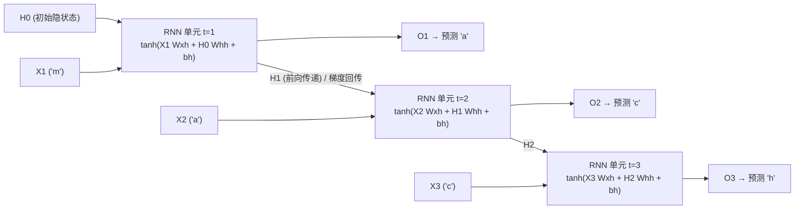

# 08. 循环神经网络

%% learning-vault-navigation:v1 %%
> [!abstract]- 笔记导航
> 目录：[[AI learning/D2L-李沐/动手学深度学习导航|动手学深度学习导航]]
> 上一章：[[AI learning/D2L-李沐/笔记/07. 现代卷积神经网络|07. 现代卷积神经网络]] · 下一章：[[AI learning/D2L-李沐/笔记/09. 现代循环神经网络|09. 现代循环神经网络]]

> [!abstract] 本章核心脉络
> 前几章处理表格与图像数据时默认样本独立同分布（i.i.d.），而自然语言、时间序列、音频与视频均具有显著的**时序依赖性**。如果说卷积神经网络（CNN）擅长提取空间结构，==循环神经网络（Recurrent Neural Network, RNN）则通过跨时间步共享参数与维护隐状态（Hidden State）来建模序列的历史信息==。本章从统计序列模型与文本预处理出发，构建字符级语言模型与困惑度评估体系，完成 RNN 的从零实现与简洁实现，最后借助通过时间反向传播（BPTT）从数学上剖析梯度消失与梯度爆炸的根源。

---

## 1. 序列模型与统计工具

对于按时间顺序生成的观测序列 $x_1, x_2, \ldots, x_T$，预测下一时刻值 $x_t$ 需估计条件分布：

$$
x_t \sim P(x_t \mid x_{t-1}, \ldots, x_1)
$$

由概率链式法则，整个序列的联合概率可分解为：

$$
P(x_1, \ldots, x_T) = \prod_{t=1}^{T} P(x_t \mid x_{t-1}, \ldots, x_1)
$$

### 1.1 两种处理变长历史的建模范式

随着时间步 $t$ 增长，条件历史 $(x_{t-1}, \ldots, x_1)$ 的维度不断增大，统计建模中有两种经典应对策略：

1. **自回归模型（Autoregressive Models）**：只利用固定长度时间跨度 $\tau$ 内的观测 $x_{t-1}, \ldots, x_{t-\tau}$ 来预测 $x_t$，即满足 $\tau$ 阶**马尔可夫条件**。参数数量不再随 $t$ 增长，可以直接用 MLP 等常规网络拟合。
   - **一阶马尔可夫模型**（$\tau = 1$）：
     $$
     P(x_1, \ldots, x_T) = \prod_{t=1}^{T} P(x_t \mid x_{t-1}), \quad P(x_1 \mid x_0) = P(x_1)
     $$
   - 借助动态规划可沿马尔可夫链计算跨步转移概率：
     $$
     P(x_{t+1} \mid x_{t-1}) = \sum_{x_t} P(x_{t+1} \mid x_t) P(x_t \mid x_{t-1})
     $$
2. **隐变量自回归模型（Latent Autoregressive Models）**：保留对全部过去观测的压缩总结——**隐状态** $h_t$，同时联合学习状态转移与观测生成：
   $$
   h_t = f(h_{t-1}, x_{t-1}), \qquad \hat{x}_t = P(x_t \mid h_t)
   $$
   由于 $h_t$ 从未被直接观测，故称隐变量模型；RNN 正是这一思想的神经网络化。

### 1.2 因果关系与多步预测的误差累积

- **因果方向**：理论上联合概率也可反向分解 $P(x_1, \ldots, x_T) = \prod_{t=T}^{1} P(x_t \mid x_{t+1}, \ldots, x_T)$，但对随时间正向演化的物理/语言过程而言，正向估计通常远比逆向估计简单。
- **内插法 vs 外推法**：在已知观测之间填补缺失值（内插）远比向未知未来延拓（外推）容易。训练序列模型时**必须尊重时间顺序**，切勿泄漏未来信息。
- **$k$ 步预测（Multistep Prediction）**：在 `sequence.ipynb` 的加噪正弦波实验（$x_t = \sin(0.01t) + \epsilon$，$\tau = 4$，前 600 个点训练简单两层 MLP）中：
  - **单步预测**：始终输入真实观测 $(x_{t-4}, \ldots, x_{t-1})$，预测曲线贴合良好。
  - **$k$ 步自回归预测**：一旦超出训练集末端，模型不得不将自己的预测值喂回输入：
    $$
    \hat{x}_{605} = f(x_{601}, x_{602}, x_{603}, x_{604}), \quad \hat{x}_{606} = f(x_{602}, x_{603}, x_{604}, \hat{x}_{605}), \ldots
    $$
    单步误差在递推中不断放大，实验显示 $k=4$ 步尚可用，而 $k=16$ 或 $k=64$ 步时预测迅速衰减为常数，完全失效。

---

## 2. 文本预处理与语言模型数据集

将原始文本送入神经网络前，需完成标准的四步流水线（以 H. G. Wells《时光机器》为例）：


### 2.1 `Vocab` 词表设计要点

在 `text-preprocessing.ipynb` 中，`Vocab` 类将离散词元与连续整数索引双向映射：
- 统计语料词频并按降序排列，过滤掉出现次数小于 `min_freq` 的低频词。
- 固定将未知词元 `<unk>` 放在索引 `0`，并支持传入 `reserved_tokens`（如后续机器翻译中的 `<pad>`、`<bos>`、`<eos>`）。
- 字符级语言模型中将所有文本行展平为单一长列表 `corpus`，词表极小（28 个字符：26 字母 + 空格 + `<unk>`），便于教学与快速收敛。

### 2.2 $n$ 元语法、拉普拉斯平滑与齐普夫定律

语言模型的目标是估计文本序列的概率 $P(x_1, \ldots, x_T) = \prod_{t=1}^T P(x_t \mid x_1, \ldots, x_{t-1})$。若直接用词频比估计条件概率，长词组极易因未出现而概率归零：

- **拉普拉斯平滑（Laplace Smoothing）**：向计数加入微小常数 $\epsilon_1, \epsilon_2, \epsilon_3$ 防止零概率：
  $$
  \hat{P}(x) = \frac{n(x) + \epsilon_1 / m}{n + \epsilon_1}, \qquad \hat{P}(x' \mid x) = \frac{n(x, x') + \epsilon_2 \hat{P}(x')}{n(x) + \epsilon_2}
  $$
- **$n$ 元语法（$n$-gram）**：利用 $(n-1)$ 阶马尔可夫假设截断历史，分为一元语法（Unigram，各词独立）、二元语法（Bigram，仅依赖前一词）、三元语法（Trigram，依赖前两词）。缺点是参数量随 $n$ 呈指数级增长 $\mathcal{O}(|\mathcal{V}|^n)$，且极易稀疏。
- **齐普夫定律（Zipf's Law）**：第 $i$ 个最常用词的词频 $n_i$ 满足幂律分布：
  $$
  n_i \propto \frac{1}{i^\alpha} \iff \log n_i = -\alpha \log i + c
  $$
  在双对数坐标下呈直线，且该规律不仅适用于一元词，同样适用于二元与三元语法——这意味着绝大多数 $n$-gram 组合在语料中极少或从未出现，仅靠计数平滑远远不够，必须借助神经网络进行表示泛化。

### 2.3 读取长序列的两种小批量策略

面对单个极长语料序列，需将其切分为若干长度为 `num_steps`（时间步数 $T$）的子序列并组成小批量（每次采样都会先丢弃一段 $[0, T-1]$ 内的随机偏移量以增加覆盖随机性）：

| 策略 | D2L 实现函数 | 相邻批次子序列关系 | 隐状态处理方式 | 特点 |
| --- | --- | --- | --- | --- |
| **随机采样** | `seq_data_iter_random` | 原始序列上**不一定相邻** | 每个小批量迭代前**必须重新初始化**隐状态 | 样本独立性更好，近似 i.i.d.，但跨批次丢失更长上下文 |
| **顺序分区** | `seq_data_iter_sequential` | 相同批量位置上的子序列在原始序列中**首尾相接** | 跨批次延续隐状态，但每批次前须调用 `detach_()` 分离计算图 | 能保留跨小批量的长程状态记忆，同时避免反向传播贯穿整个语料 |

> [!tip] 标签构造规则
> 语言模型用当前词元预测下一词元，因此若输入子序列为 `corpus[pos : pos + num_steps]`，对应的标签序列恰好向右平移一位：`corpus[pos + 1 : pos + 1 + num_steps]`。

---

## 3. 循环神经网络原理与困惑度

### 3.1 从 MLP 到有隐状态的 RNN

设小批量大小为 $n$、输入特征维数为 $d$、隐藏单元数为 $h$、输出维数为 $q$。普通单隐藏层 MLP 仅映射当前输入 $\mathbf{H} = \phi(\mathbf{X}\mathbf{W}_{xh} + \mathbf{b}_h)$；而 RNN 在时间步 $t$ 引入上一时间步的隐状态 $\mathbf{H}_{t-1} \in \mathbb{R}^{n \times h}$：

$$
\mathbf{H}_t = \phi\left(\mathbf{X}_t \mathbf{W}_{xh} + \mathbf{H}_{t-1} \mathbf{W}_{hh} + \mathbf{b}_h\right)
$$

$$
\mathbf{O}_t = \mathbf{H}_t \mathbf{W}_{hq} + \mathbf{b}_q
$$

其中共享参数为 $\mathbf{W}_{xh} \in \mathbb{R}^{d \times h}$、$\mathbf{W}_{hh} \in \mathbb{R}^{h \times h}$、$\mathbf{b}_h \in \mathbb{R}^{1 \times h}$ 以及输出层 $\mathbf{W}_{hq} \in \mathbb{R}^{h \times q}$、$\mathbf{b}_q \in \mathbb{R}^{1 \times q}$。

> [!note] 拼接矩阵等价视角
> 计算 $\mathbf{X}_t \mathbf{W}_{xh} + \mathbf{H}_{t-1} \mathbf{W}_{hh}$ 完全等价于将 $\mathbf{X}_t$ 与 $\mathbf{H}_{t-1}$ 沿列方向拼接，再与垂直堆叠的权重矩阵相乘：
> $$
> \mathbf{X}_t \mathbf{W}_{xh} + \mathbf{H}_{t-1} \mathbf{W}_{hh} = \begin{bmatrix} \mathbf{X}_t & \mathbf{H}_{t-1} \end{bmatrix} \begin{bmatrix} \mathbf{W}_{xh} \\ \mathbf{W}_{hh} \end{bmatrix}
> $$
> 参数量仅与 $(d, h, q)$ 有关，与序列长度 $T$ 无关。



### 3.2 困惑度（Perplexity, PPL）

为了在不同长度文档间公平评估语言模型质量，先计算所有 $n$ 个词元的平均负对数似然（即交叉熵损失）：

$$
\frac{1}{n} \sum_{t=1}^{n} -\log P(x_t \mid x_{t-1}, \ldots, x_1)
$$

再取自然指数得到==困惑度（Perplexity）==：

$$
\mathrm{PPL} = \exp\left(-\frac{1}{n} \sum_{t=1}^{n} \log P(x_t \mid x_{t-1}, \ldots, x_1)\right)
$$

困惑度可直观理解为**模型在每一步选择下一个词元时的有效平均分支数**：
- **最优情况**：模型每次都以概率 1 准确预测标签词元，交叉熵为 $0$，$\mathrm{PPL} = 1$。
- **均匀基线**：对词表 $\mathcal{V}$ 中所有词元等概率猜测 $1/|\mathcal{V}|$，则 $\mathrm{PPL} = |\mathcal{V}|$；任何有意义的模型都应显著低于词表大小。
- **最差情况**：给真实标签赋予概率 $0$，$\mathrm{PPL} = +\infty$。

---

## 4. RNN 实现要点与梯度裁剪

### 4.1 从零实现与 PyTorch 简洁实现对比

1. **张量维度转置约定**：原始小批量索引张量 `X` 形状为 `(batch_size, num_steps)`。为方便沿时间步循环读取连续内存块，在独热编码 `F.one_hot(X.T, vocab_size)` 后张量变为 `(num_steps, batch_size, vocab_size)`。
2. **输出拼接**：`rnn()` 逐时间步循环更新 `H = torch.tanh(X @ W_xh + H @ W_hh + b_h)` 并输出 `Y`，最后沿第 0 维拼接得到 `(num_steps * batch_size, vocab_size)`，与展平后的标签 `y.T.reshape(-1)` 对齐计算交叉熵。
3. **预测与预热期（Warm-up）**：在 `predict_ch8` 中，给定前缀 `prefix`（如 `"time traveller "`）时，先将前缀字符依次送入模型以更新隐状态，**不采纳此阶段预测结果**（预热期），待前缀结束后再将模型自身预测的字符自回归送入下一时间步。
4. **高级 API 差异**：PyTorch 的 `nn.RNN(vocab_size, num_hiddens)` **仅包含循环隐藏层，不包含输出全连接层**，返回 `(Y, state)`，其中 `Y` 形状为 `(num_steps, batch_size, num_hiddens)`、`state` 形状为 `(num_layers * num_directions, batch_size, num_hiddens)`。因此 `RNNModel` 需额外接入 `nn.Linear(num_hiddens, vocab_size)`。

```python
class RNNModel(nn.Module):
    """基于 PyTorch nn.RNN 的简洁语言模型封装"""
    def __init__(self, rnn_layer, vocab_size):
        super().__init__()
        self.rnn = rnn_layer
        self.vocab_size = vocab_size
        self.num_hiddens = self.rnn.hidden_size
        self.num_directions = 2 if self.rnn.bidirectional else 1
        self.linear = nn.Linear(self.num_hiddens * self.num_directions, vocab_size)

    def forward(self, inputs, state):
        X = F.one_hot(inputs.T.long(), self.vocab_size).to(torch.float32)
        Y, state = self.rnn(X, state)
        # Y: (num_steps, batch_size, num_hiddens) -> (num_steps * batch_size, vocab_size)
        output = self.linear(Y.reshape((-1, Y.shape[-1])))
        return output, state
```

### 4.2 梯度裁剪（Gradient Clipping）

对于长度为 $T$ 的序列，反向传播会经历 $\mathcal{O}(T)$ 次矩阵连乘，极易引发梯度爆炸。设目标函数满足 $L$-Lipschitz 连续 $|f(\mathbf{x}) - f(\mathbf{y})| \leq L\|\mathbf{x}-\mathbf{y}\|$，单步更新后的变化上界为 $|f(\mathbf{x}) - f(\mathbf{x} - \eta\mathbf{g})| \leq L\eta\|\mathbf{g}\|$。将所有模型参数梯度拼接成整体向量 $\mathbf{g}$，当其 $L_2$ 范数超过阈值 $\theta$ 时将其投影回半径为 $\theta$ 的球面：

$$
\mathbf{g} \leftarrow \min\left(1, \frac{\theta}{\|\mathbf{g}\|}\right) \mathbf{g}
$$

```python
def grad_clipping(net, theta):
    params = [p for p in net.parameters() if p.requires_grad] if isinstance(net, nn.Module) else net.params
    norm = torch.sqrt(sum(torch.sum(p.grad ** 2) for p in params))
    if norm > theta:
        for param in params:
            param.grad[:] *= theta / norm
```

> [!warning] 关键陷阱：梯度裁剪与 `detach_()` 的边界
> 1. ==梯度裁剪只能抑制梯度爆炸，无法解决梯度消失==（因为当 $\|\mathbf{g}\| \ll \theta$ 时缩放系数为 1，梯度维持不变）；解决梯度消失需依赖下一章的 GRU/LSTM 门控机制或残差结构。
> 2. 在**顺序分区**训练中，必须在每个小批量开始前对隐状态调用 `state.detach_()`（对 LSTM 为元组 `(h, c)` 逐个 detach），否则反向传播计算图会随迭代无限拉长导致显存溢出与速度雪崩。

---

## 5. 通过时间反向传播（BPTT）

### 5.1 隐状态递归求导的本质

考虑简化标量模型 $h_t = f(x_t, h_{t-1}, w_h)$，$o_t = g(h_t, w_o)$，总损失 $L = \frac{1}{T}\sum_{t=1}^{T} l(y_t, o_t)$。损失对循环权重 $w_h$ 的梯度由链式法则给出：

$$
\frac{\partial L}{\partial w_h} = \frac{1}{T} \sum_{t=1}^{T} \frac{\partial l(y_t, o_t)}{\partial o_t} \frac{\partial g(h_t, w_o)}{\partial h_t} \frac{\partial h_t}{\partial w_h}
$$

难点在于 $\frac{\partial h_t}{\partial w_h}$ 存在递归依赖（$w_h$ 既直接作用于第 $t$ 步，又通过 $h_{t-1}$ 间接影响）：

$$
\frac{\partial h_t}{\partial w_h} = \frac{\partial f(x_t, h_{t-1}, w_h)}{\partial w_h} + \frac{\partial f(x_t, h_{t-1}, w_h)}{\partial h_{t-1}} \frac{\partial h_{t-1}}{\partial w_h}
$$

记 $a_t = \frac{\partial h_t}{\partial w_h}$、$b_t = \frac{\partial f(x_t, h_{t-1}, w_h)}{\partial w_h}$、$c_t = \frac{\partial f(x_t, h_{t-1}, w_h)}{\partial h_{t-1}}$，展开递归式可得：

$$
a_t = b_t + \sum_{i=1}^{t-1} \left(\prod_{j=i+1}^{t} c_j\right) b_i
$$

在忽略激活函数与偏置的线性向量模型（$\mathbf{h}_t = \mathbf{W}_{hx}\mathbf{x}_t + \mathbf{W}_{hh}\mathbf{h}_{t-1}$，$\mathbf{o}_t = \mathbf{W}_{qh}\mathbf{h}_t$）中，反向递推得到：

$$
\frac{\partial L}{\partial \mathbf{h}_t} = \sum_{i=t}^{T} \left(\mathbf{W}_{hh}^\top\right)^{T-i} \mathbf{W}_{qh}^\top \frac{\partial L}{\partial \mathbf{o}_{T+t-i}}
$$

==核心结论==：式中的矩阵高次幂 $(\mathbf{W}_{hh}^\top)^{T-i}$ 决定了数值稳定性——特征值绝对值大于 1 的方向呈指数级**梯度爆炸**，特征值绝对值小于 1 的方向呈指数级**梯度消失**。

### 5.2 三种梯度计算与截断策略对比

| 策略 | 做法 | 优点 | 缺点与局限 |
| --- | --- | --- | --- |
| **完全计算** | 计算整个展开序列全部项的导数和 | 梯度精确无偏 | 长序列计算极慢，且极易因高次幂引发梯度爆炸/消失 |
| **常规截断（Truncated BPTT）** | 仅反向传播固定 $\tau$ 个时间步（在代码中通过 `detach_()` 实现） | 计算高效稳定，隐式充当正则化，迫使模型聚焦近期依赖 | 梯度有偏，难以捕获超过 $\tau$ 步的远距离依赖 |
| **随机截断** | 引入满足 $\mathbb{E}[\xi_t]=1$ 的随机变量 $\xi_t$（以概率 $1-p_t$ 置 $0$，以概率 $p_t$ 取 $1/p_t$）加权递归项 | 理论上梯度期望无偏 | 实际方差较大，且短程依赖往往已占主导，实践中不如常规截断常用 |

---

## 6. 配套材料与 Notebook

| 节次 | 主题 | Notebook 入口 | 核心代码组件 |
| --- | --- | --- | --- |
| 8.0 | 章节导览 | [[AI learning/D2L-李沐/pytorch/chapter_recurrent-neural-networks/index.ipynb\|index.ipynb]] | 序列问题与 RNN 动机 |
| 8.1 | 序列模型 | [[AI learning/D2L-李沐/pytorch/chapter_recurrent-neural-networks/sequence.ipynb\|sequence.ipynb]] | 自回归 MLP、单步与 $k$ 步预测 |
| 8.2 | 文本预处理 | [[AI learning/D2L-李沐/pytorch/chapter_recurrent-neural-networks/text-preprocessing.ipynb\|text-preprocessing.ipynb]] | `read_time_machine`、`tokenize`、`Vocab` |
| 8.3 | 语言模型和数据集 | [[AI learning/D2L-李沐/pytorch/chapter_recurrent-neural-networks/language-models-and-dataset.ipynb\|language-models-and-dataset.ipynb]] | 齐普夫定律验证、`seq_data_iter_random` / `sequential` |
| 8.4 | 循环神经网络 | [[AI learning/D2L-李沐/pytorch/chapter_recurrent-neural-networks/rnn.ipynb\|rnn.ipynb]] | 隐状态递推、字符级语言模型与困惑度 |
| 8.5 | RNN 从零开始实现 | [[AI learning/D2L-李沐/pytorch/chapter_recurrent-neural-networks/rnn-scratch.ipynb\|rnn-scratch.ipynb]] | `RNNModelScratch`、`predict_ch8`、`grad_clipping`、`train_ch8` |
| 8.6 | RNN 简洁实现 | [[AI learning/D2L-李沐/pytorch/chapter_recurrent-neural-networks/rnn-concise.ipynb\|rnn-concise.ipynb]] | `nn.RNN`、`RNNModel` |
| 8.7 | 通过时间反向传播 | [[AI learning/D2L-李沐/pytorch/chapter_recurrent-neural-networks/bptt.ipynb\|bptt.ipynb]] | BPTT 链式求导、截断时间步与数值稳定性 |

> [!question]- 复盘自测
> 1. **为什么在顺序分区训练 RNN 时，每个小批量前都必须执行 `state.detach_()`，而在随机采样时却直接重新初始化 `state`？**
>    - 顺序分区中下一批次子序列在原文中紧接上一批次，因此希望保留前向隐状态值以延续长期记忆，同时必须截断反向传播计算图（Truncated BPTT）防止跨批次无限回传；随机采样的相邻批次在原文中无承接关系，延续旧状态反而引入噪声，故直接重新零初始化。
> 2. **词表大小为 28 的字符级语言模型，如果困惑度为 28 说明什么？困惑度为 1.0 又意味着什么？**
>    - 困惑度等于 28 说明模型表现与完全随机均匀猜测无异；困惑度趋近于 1.0 说明模型几乎以概率 1 准确预测了每一个字符（在训练集上往往意味着过拟合）。
> 3. **为什么梯度裁剪能防梯度爆炸，却无法缓解梯度消失？**
>    - 梯度裁剪仅在 $\|\mathbf{g}\| > \theta$ 时按比例缩小梯度范数；当远距离时间步的连乘项导致梯度趋近于 0 时，总梯度范数远小于阈值，裁剪完全不会被触发。
