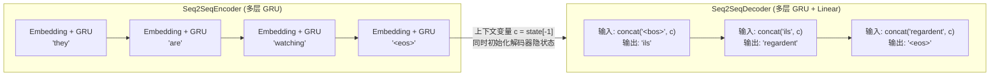

# 09. 现代循环神经网络

%% learning-vault-navigation:v1 %%
> [!abstract]- 笔记导航
> 目录：[[AI learning/D2L-李沐/动手学深度学习导航|动手学深度学习导航]]
> 上一章：[[AI learning/D2L-李沐/笔记/08. 循环神经网络|08. 循环神经网络]] · 下一章：[[AI learning/D2L-李沐/笔记/10. 注意力机制|10. 注意力机制]]

> [!abstract] 本章核心脉络
> 基础 RNN 存在严重的梯度消失问题，难以捕获长距离依赖；同时，语言建模仅能处理等长或单向预测任务，无法直接应对输入输出长度均不固定的序列转换任务（如机器翻译）。本章沿两条主线升级循环架构：前半部分通过**门控机制**（GRU、LSTM）与**架构扩展**（深度 RNN、双向 RNN）提升记忆与表示能力；后半部分以英法机器翻译为载体，完整构建**编码器-解码器（Encoder-Decoder）→ Seq2Seq → 掩蔽损失与 BLEU → 束搜索（Beam Search）**的端到端序列生成范式。

---

## 1. 门控循环单元（GRU）

并非序列中的每个词元都同等重要：模型需要具备**记住关键早期信息**、**跳过无关噪声词元**以及**在语义切换时重置记忆**的细粒度控制能力。门控循环单元（Gated Recurrent Unit, GRU）引入两个取值在 $(0, 1)$ 之间的门控向量来实现这一机制。

### 1.1 数学定义

给定时间步 $t$ 的小批量输入 $\mathbf{X}_t \in \mathbb{R}^{n \times d}$ 和上一时间步隐状态 $\mathbf{H}_{t-1} \in \mathbb{R}^{n \times h}$：

1. **重置门（Reset Gate）$\mathbf{R}_t$ 与更新门（Update Gate）$\mathbf{Z}_t$**：
   $$
   \begin{aligned}
   \mathbf{R}_t &= \sigma\left(\mathbf{X}_t \mathbf{W}_{xr} + \mathbf{H}_{t-1} \mathbf{W}_{hr} + \mathbf{b}_r\right) \\
   \mathbf{Z}_t &= \sigma\left(\mathbf{X}_t \mathbf{W}_{xz} + \mathbf{H}_{t-1} \mathbf{W}_{hz} + \mathbf{b}_z\right)
   \end{aligned}
   $$
2. **候选隐状态（Candidate Hidden State）$\tilde{\mathbf{H}}_t$**：
   $$
   \tilde{\mathbf{H}}_t = \tanh\left(\mathbf{X}_t \mathbf{W}_{xh} + (\mathbf{R}_t \odot \mathbf{H}_{t-1}) \mathbf{W}_{hh} + \mathbf{b}_h\right)
   $$
3. **最终隐状态更新**：
   $$
   \mathbf{H}_t = \mathbf{Z}_t \odot \mathbf{H}_{t-1} + (1 - \mathbf{Z}_t) \odot \tilde{\mathbf{H}}_t
   $$

### 1.2 门控行为直觉

- ==**重置门 $\mathbf{R}_t$ 捕获短期依赖**==：当 $\mathbf{R}_t \to 1$ 时退化为标准 RNN；当 $\mathbf{R}_t \to 0$ 时屏蔽过去状态 $\mathbf{H}_{t-1}$，候选隐状态退化为仅依赖当前输入 $\mathbf{X}_t$ 的 MLP，相当于清零历史记忆重新开始。
- ==**更新门 $\mathbf{Z}_t$ 捕获长期依赖**==：当 $\mathbf{Z}_t \to 1$ 时，$\mathbf{H}_t \approx \mathbf{H}_{t-1}$，当前输入被跳过，历史状态与梯度可近乎无损地跨越多步传递，极大缓解梯度消失；当 $\mathbf{Z}_t \to 0$ 时则用候选状态 $\tilde{\mathbf{H}}_t$ 覆写旧状态。

---

## 2. 长短期记忆网络（LSTM）

长短期记忆网络（Long Short-Term Memory, LSTM）比 GRU 提出更早，设计灵感类比计算机内存寄存器：它在外部传递的**隐状态 $\mathbf{H}_t$** 之外，专门开辟一条内部高速通路——**记忆元（Memory Cell）$\mathbf{C}_t$**，并配备三个门控单元。

### 2.1 数学定义

1. **输入门 $\mathbf{I}_t$、遗忘门 $\mathbf{F}_t$、输出门 $\mathbf{O}_t$**：
   $$
   \begin{aligned}
   \mathbf{I}_t &= \sigma\left(\mathbf{X}_t \mathbf{W}_{xi} + \mathbf{H}_{t-1} \mathbf{W}_{hi} + \mathbf{b}_i\right) \\
   \mathbf{F}_t &= \sigma\left(\mathbf{X}_t \mathbf{W}_{xf} + \mathbf{H}_{t-1} \mathbf{W}_{hf} + \mathbf{b}_f\right) \\
   \mathbf{O}_t &= \sigma\left(\mathbf{X}_t \mathbf{W}_{xo} + \mathbf{H}_{t-1} \mathbf{W}_{ho} + \mathbf{b}_o\right)
   \end{aligned}
   $$
2. **候选记忆元 $\tilde{\mathbf{C}}_t$**：
   $$
   \tilde{\mathbf{C}}_t = \tanh\left(\mathbf{X}_t \mathbf{W}_{xc} + \mathbf{H}_{t-1} \mathbf{W}_{hc} + \mathbf{b}_c\right)
   $$
3. **记忆元更新（线性加法通路）**：
   $$
   \mathbf{C}_t = \mathbf{F}_t \odot \mathbf{C}_{t-1} + \mathbf{I}_t \odot \tilde{\mathbf{C}}_t
   $$
4. **隐状态输出**：
   $$
   \mathbf{H}_t = \mathbf{O}_t \odot \tanh(\mathbf{C}_t)
   $$

> [!tip] 为什么 $\mathbf{H}_t$ 还要对 $\mathbf{C}_t$ 再做一次 $\tanh$？
> 虽然 $\tilde{\mathbf{C}}_t \in (-1, 1)$，但 $\mathbf{C}_t = \mathbf{F}_t \odot \mathbf{C}_{t-1} + \mathbf{I}_t \odot \tilde{\mathbf{C}}_t$ 经过多步累加后其数值幅度可能远超 $(-1, 1)$。外层 $\tanh(\mathbf{C}_t)$ 将输出重新压缩回 $(-1, 1)$，再由输出门 $\mathbf{O}_t$ 决定向下一层/输出层暴露多少记忆元信息。注意：==只有隐状态 $\mathbf{H}_t$ 传入输出层，记忆元 $\mathbf{C}_t$ 完全属于内部状态==。

### 2.2 Vanilla RNN / GRU / LSTM 核心对比

| 模型 | 内部状态 | 门控数量 | 单层循环参数量（忽略偏置） | PyTorch API | 特点与适用场景 |
| --- | --- | --- | --- | --- | --- |
| **Vanilla RNN** | $\mathbf{H}_t$ | 0 | $(d + h)h$ | `nn.RNN` | 结构最简、速度最快，但易发生梯度消失，仅适合短依赖 |
| **GRU** | $\mathbf{H}_t$ | 2（$\mathbf{R}_t, \mathbf{Z}_t$） | $3(d + h)h$ | `nn.GRU` | 合并细胞状态与隐状态，参数更少、计算较快，中小数据集表现优异 |
| **LSTM** | $(\mathbf{H}_t, \mathbf{C}_t)$ | 3（$\mathbf{I}_t, \mathbf{F}_t, \mathbf{O}_t$） | $4(d + h)h$ | `nn.LSTM` | 独立记忆元加法通路控制力更强，长序列建模能力稳健，但显存与耗时最高 |

---

## 3. 深度与双向循环神经网络

### 3.1 深度循环神经网络（Deep RNN）

通过垂直堆叠 $L$ 个循环隐藏层，可以在单时间步内引入更深层的非线性变换。设 $\mathbf{H}_t^{(0)} = \mathbf{X}_t$，第 $l \in \{1, \ldots, L\}$ 层隐状态同时接收**同时间步上一层输出**与**同层上一时间步隐状态**：

$$
\mathbf{H}_t^{(l)} = \phi_l\left(\mathbf{H}_t^{(l-1)} \mathbf{W}_{xh}^{(l)} + \mathbf{H}_{t-1}^{(l)} \mathbf{W}_{hh}^{(l)} + \mathbf{b}_h^{(l)}\right)
$$

$$
\mathbf{O}_t = \mathbf{H}_t^{(L)} \mathbf{W}_{hq} + \mathbf{b}_q
$$

PyTorch 中只需在 `nn.LSTM` / `nn.GRU` 中传入 `num_layers=L` 即可一键构建（此时 `state` 第 0 维大小为 `num_layers`）。

### 3.2 双向循环神经网络（Bi-RNN）

在隐马尔可夫模型（HMM）中，基于完整序列推断中间观测 $P(x_j \mid x_{-j}) \propto \sum_{h_j} \pi_j(h_j)\rho_j(h_j)P(x_j \mid h_j)$ 需要同时沿前向（$\pi_t$）和后向（$\rho_t$）递推。双向 RNN 将这一思想引入神经网络，为每个时间步维护前向隐状态 $\overrightarrow{\mathbf{H}}_t \in \mathbb{R}^{n \times h}$ 与后向隐状态 $\overleftarrow{\mathbf{H}}_t \in \mathbb{R}^{n \times h}$：

$$
\begin{aligned}
\overrightarrow{\mathbf{H}}_t &= \phi\left(\mathbf{X}_t \mathbf{W}_{xh}^{(f)} + \overrightarrow{\mathbf{H}}_{t-1} \mathbf{W}_{hh}^{(f)} + \mathbf{b}_h^{(f)}\right) \\
\overleftarrow{\mathbf{H}}_t &= \phi\left(\mathbf{X}_t \mathbf{W}_{xh}^{(b)} + \overleftarrow{\mathbf{H}}_{t+1} \mathbf{W}_{hh}^{(b)} + \mathbf{b}_h^{(b)}\right)
\end{aligned}
$$

随后沿特征维拼接为 $\mathbf{H}_t = [\overrightarrow{\mathbf{H}}_t, \overleftarrow{\mathbf{H}}_t] \in \mathbb{R}^{n \times 2h}$ 送入输出层 $\mathbf{O}_t = \mathbf{H}_t \mathbf{W}_{hq} + \mathbf{b}_q$（PyTorch 中设置 `bidirectional=True`）。

> [!warning] 严禁将双向 RNN 用于自回归语言模型或未来预测！
> `bi-rnn.ipynb` 专门演示了一个经典反例：用双向 LSTM 训练《时光机器》字符预测时，训练困惑度会迅速降到看似完美的 `1.1`，但实际生成文本却是一堆无意义乱码（`"time travellererererer..."`）。
> **根因**：训练阶段后向分支直接“偷看”了未来答案；而推理预测未来词元时根本不存在后续序列，导致训练与推理分布彻底断裂。==双向 RNN 仅适用于双向上下文均已知的任务==（如序列编码、情感分类、命名实体识别、完形填空）。

---

## 4. 机器翻译与编码器-解码器（Seq2Seq）

### 4.1 机器翻译数据集预处理（Tatoeba 英-法）

在 `machine-translation-and-dataset.ipynb` 中，平行语料处理相比单语文本新增了多项关键机制：
- **文本规范化（`preprocess_nmt`）**：将不间断空格（`\u202f`、`\xa0`）替换为普通空格，统一小写，并在单词与标点（`,.!?`）之间插入空格。
- **词级词元化与特殊词元**：使用 `min_freq=2` 抑制低频词爆炸，并显式保留三个核心特殊词元：
  - `<pad>`：填充词元，配合 `truncate_pad` 将变长句子对齐到固定 `num_steps` 以组成批量张量。
  - `<bos>`（Beginning of Sequence）：解码器首个时间步的启动输入。
  - `<eos>`（End of Sequence）：附加在每个源/目标句子末尾，标志生成终止，并据此统计真实有效长度 `valid_len`。

### 4.2 编码器-解码器通用接口与 Seq2Seq 结构

`encoder-decoder.ipynb` 抽象出三个解耦基类：`Encoder`（将变长输入映射为中间状态）、`Decoder`（通过 `init_state` 接收编码输出并在 `forward` 中逐步解码）与组合器 `EncoderDecoder`。

在 `seq2seq.ipynb` 中，编码器与解码器均采用多层 GRU（含词嵌入层 `nn.Embedding`）：
- **编码器**：将源序列 $\mathbf{x}_1, \ldots, \mathbf{x}_T$ 逐步编码为隐状态 $\mathbf{h}_t = f(\mathbf{x}_t, \mathbf{h}_{t-1})$，汇总为固定形状的上下文变量 $\mathbf{c} = q(\mathbf{h}_1, \ldots, \mathbf{h}_T) = \mathbf{h}_T$（实际实现中取编码器最后一层最终时间步隐状态 `state[-1]`）。
- **解码器**：一方面用编码器最终隐状态初始化解码器隐状态；另一方面**将上下文变量 $\mathbf{c}$ 广播拼接到解码器每一个时间步的词嵌入输入上**，再送入 GRU：
  $$
  \mathbf{s}_{t'} = g(y_{t'-1}, \mathbf{c}, \mathbf{s}_{t'-1})
  $$



### 4.3 强制教学、掩蔽损失与 BLEU 评估

1. **强制教学（Teacher Forcing）**：训练阶段将**真实目标序列**（在句首拼接 `<bos>` 并去掉末词）直接作为解码器输入，而非使用解码器上一步的预测词元，从而大幅加快收敛并避免早期错误级联放大；推理预测阶段则只能将上一步预测的最高概率词元喂回下一步，直到生成 `<eos>`。
2. **掩蔽 Softmax 交叉熵损失（`MaskedSoftmaxCELoss`）**：批量中不同句子长度不同，末尾 `<pad>` 位置的预测误差绝不能参与反向传播。`sequence_mask` 根据 `valid_len` 生成 0/1 权重掩码，将填充位置的损失置零后仅对有效词元求均值：
   ```python
   class MaskedSoftmaxCELoss(nn.CrossEntropyLoss):
       def forward(self, pred, label, valid_len):
           weights = torch.ones_like(label)
           weights = sequence_mask(weights, valid_len)
           self.reduction = 'none'
           # CrossEntropyLoss 要求类别维在 dim=1，故需 permute(0, 2, 1)
           unweighted_loss = super().forward(pred.permute(0, 2, 1), label)
           return (unweighted_loss * weights).mean(dim=1)
   ```
3. **BLEU（Bilingual Evaluation Understudy）评估指标**：通过测量预测序列与参考标签之间 $1$ 至 $k$ 元语法的精确率 $p_n$（每个 $n$-gram 匹配次数受限于参考句出现次数）并加入过短惩罚项来量化翻译质量：
   $$
   \mathrm{BLEU} = \exp\left(\min\left(0, 1 - \frac{\mathrm{len}_{\text{label}}}{\mathrm{len}_{\text{pred}}}\right)\right) \prod_{n=1}^{k} p_n^{1/2^n}
   $$
   - 当预测过短（$\mathrm{len}_{\text{pred}} < \mathrm{len}_{\text{label}}$）时，指数项小于 1，惩罚“只输出少量高频词骗取高精确率”的作弊行为。
   - 长 $n$-gram 更难匹配，因此权重按 $1/2^n$ 递减的指数加权（由于 $p_n \le 1$，指数 $1/2^n$ 越小反而使 $p_n^{1/2^n}$ 越接近 1——实际效果是更强调较长连续短语精确匹配的贡献，且任意一阶 $p_n = 0$ 会直接导致整体 BLEU 归零）。

---

## 5. 解码搜索策略与束搜索（Beam Search）

在推理阶段，解码器需要在所有 $\mathcal{O}(|\mathcal{Y}|^{T'})$ 条候选序列中寻找条件概率最高的输出序列：

| 搜索策略 | 核心规则 | 时间复杂度 | 优缺点 |
| --- | --- | --- | --- |
| **贪心搜索（Greedy Search）** | 每步只选当前条件概率最大的单个词元 $y_{t'} = \arg\max_{y \in \mathcal{Y}} P(y \mid y_1, \ldots, y_{t'-1}, \mathbf{c})$ | $\mathcal{O}(|\mathcal{Y}| T')$ | 极快，但局部最优不等于全局最优（前期一次次优选择可能错失整体高概率序列） |
| **穷举搜索（Exhaustive Search）** | 枚举并评估全部可能输出序列 | $\mathcal{O}(|\mathcal{Y}|^{T'})$ | 必得全局最优，但计算量呈指数爆炸，实际不可行 |
| **束搜索（Beam Search）** | 设置**束宽（Beam Size）$k$**：每步从当前保留的 $k$ 条前缀各自扩展 $|\mathcal{Y}|$ 个词元，在 $k|\mathcal{Y}|$ 个候选中保留联合概率最高的 $k$ 条 | $\mathcal{O}(k |\mathcal{Y}| T')$ | 介于贪心（$k=1$）与穷举（$k=\infty$）之间的实用折中 |

由于联合概率连乘随序列长度 $L$ 增加必然单调衰减（每多乘一个 $<1$ 的概率值都会变小），直接按联合概率排序会严重偏好过短序列。束搜索在所有生成完成的候选序列集合中采用**带长度惩罚的对数似然得分**选出最终结果：

$$
\mathrm{Score}(y_1, \ldots, y_L) = \frac{1}{L^\alpha} \log P(y_1, \ldots, y_L \mid \mathbf{c}) = \frac{1}{L^\alpha} \sum_{t'=1}^{L} \log P(y_{t'} \mid y_1, \ldots, y_{t'-1}, \mathbf{c})
$$

其中长度归一化超参数 $\alpha$ 通常取 $0.75$（D2L 教材默认值）。

> [!important] Seq2Seq 的结构瓶颈 → 引出下一章注意力机制
> 传统 Seq2Seq 强迫编码器将**任意长度的源句子压缩进单一固定长度的上下文向量 $\mathbf{c}$**。当源句子较长时，前端信息极易丢失形成信息瓶颈。下一章[[AI learning/D2L-李沐/笔记/10. 注意力机制|10. 注意力机制]]将打破这一瓶颈，允许解码器在每个时间步动态检索源序列的不同位置。

---

## 6. 配套材料与 Notebook

| 节次 | 主题 | Notebook 入口 | 核心代码组件 |
| --- | --- | --- | --- |
| 9.0 | 章节导览 | [[AI learning/D2L-李沐/pytorch/chapter_recurrent-modern/index.ipynb\|index.ipynb]] | 现代循环网络演进脉络 |
| 9.1 | 门控循环单元（GRU） | [[AI learning/D2L-李沐/pytorch/chapter_recurrent-modern/gru.ipynb\|gru.ipynb]] | `gru` 从零实现、`nn.GRU` |
| 9.2 | 长短期记忆网络（LSTM） | [[AI learning/D2L-李沐/pytorch/chapter_recurrent-modern/lstm.ipynb\|lstm.ipynb]] | `lstm` 从零实现、`nn.LSTM` |
| 9.3 | 深度循环神经网络 | [[AI learning/D2L-李沐/pytorch/chapter_recurrent-modern/deep-rnn.ipynb\|deep-rnn.ipynb]] | 多层 `nn.LSTM(num_layers=2)` |
| 9.4 | 双向循环神经网络 | [[AI learning/D2L-李沐/pytorch/chapter_recurrent-modern/bi-rnn.ipynb\|bi-rnn.ipynb]] | `bidirectional=True` 及其误用反例 |
| 9.5 | 机器翻译与数据集 | [[AI learning/D2L-李沐/pytorch/chapter_recurrent-modern/machine-translation-and-dataset.ipynb\|machine-translation-and-dataset.ipynb]] | `preprocess_nmt`、`truncate_pad`、`load_data_nmt` |
| 9.6 | 编码器-解码器架构 | [[AI learning/D2L-李沐/pytorch/chapter_recurrent-modern/encoder-decoder.ipynb\|encoder-decoder.ipynb]] | `Encoder`、`Decoder`、`EncoderDecoder` |
| 9.7 | 序列到序列学习（Seq2Seq） | [[AI learning/D2L-李沐/pytorch/chapter_recurrent-modern/seq2seq.ipynb\|seq2seq.ipynb]] | `Seq2SeqEncoder/Decoder`、`MaskedSoftmaxCELoss`、`bleu` |
| 9.8 | 束搜索 | [[AI learning/D2L-李沐/pytorch/chapter_recurrent-modern/beam-search.ipynb\|beam-search.ipynb]] | 贪心、穷举与束搜索评分公式 |

> [!question]- 复盘自测
> 1. **在 GRU 中，重置门和更新门分别主要解决什么尺度的依赖？当重置门接近 0、更新门接近 1 时网络分别表现为什么行为？**
>    - 重置门主要捕获短期依赖，更新门主要捕获长期依赖。重置门 $\to 0$ 时忽略历史隐状态（重启记忆）；更新门 $\to 1$ 时直接复制上一时间步隐状态，跳过当前输入。
> 2. **为什么 Seq2Seq 计算交叉熵损失前必须使用 `sequence_mask` 掩蔽？如果去掉掩蔽会发生什么？**
>    - 批量内句子经 `<pad>` 填充到相同长度，若不掩蔽，模型会花费大量容量学习在句尾不断预测 `<pad>`，不仅污染有效梯度，还会虚降损失值并恶化翻译质量。
> 3. **束搜索为何要除以 $L^\alpha$（长度惩罚）？当束宽 $k=1$ 时退化为什么策略？**
>    - 因为每一步对数概率 $\log P \le 0$，累加项越多总和越小，不归一化会导致系统系统性地偏向提前输出 `<eos>` 的短句；当 $k=1$ 时束搜索退化为贪心搜索。
