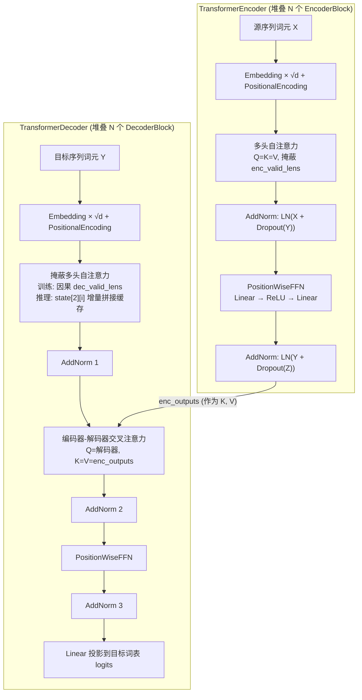

# 10. 注意力机制

%% learning-vault-navigation:v1 %%
> [!abstract]- 笔记导航
> 目录：[[AI learning/D2L-李沐/动手学深度学习导航|动手学深度学习导航]]
> 上一章：[[AI learning/D2L-李沐/笔记/09. 现代循环神经网络|09. 现代循环神经网络]] · 下一章：[[AI learning/D2L-李沐/笔记/11. 优化算法|11. 优化算法]]

> [!abstract] 本章核心脉络
> 第 9 章的经典 Seq2Seq 将变长源序列强行压缩进单个固定长度的上下文向量，难以应对长序列建模。本章从认知心理学中的注意力提示出发，抽象出==查询（Query）、键（Key）、值（Value）==统一框架：先借 Nadaraya-Watson 核回归建立非参数与参数化注意力汇聚直觉，再系统推导加性注意力、缩放点积注意力、Bahdanau 注意力与多头注意力，随后对比 CNN、RNN 与自注意力的复杂度并引入正弦余弦位置编码，最终完整搭建现代深度学习基石——**Transformer** 架构。

---

## 1. 注意力框架：查询、键与值

心理学双组件框架指出，人类有限的注意力受两种提示共同引导：
- **非自主性提示（Nonvolitional Cue）**：基于环境中物体的突出特征（如红色咖啡杯），对应数据本身的索引特征——**键（Key, $\mathbf{k}$）**。
- **自主性提示（Volitional Cue）**：基于主观任务意图（如“想喝咖啡”或“想看书”），对应当前需要检索信息的目标——**查询（Query, $\mathbf{q}$）**。
- **感官输入**：被检索与聚合的真实内容——**值（Value, $\mathbf{v}$）**，且键与值总是成对出现 $(\mathbf{k}_i, \mathbf{v}_i)$。

与传统全连接层或固定汇聚层不同，==注意力汇聚（Attention Pooling）根据查询 $\mathbf{q}$ 与每个键 $\mathbf{k}_i$ 的相关性动态分配权重 $\alpha(\mathbf{q}, \mathbf{k}_i)$，再对所有值加权求和==：

$$
f\left(\mathbf{q}, (\mathbf{k}_1, \mathbf{v}_1), \ldots, (\mathbf{k}_m, \mathbf{v}_m)\right) = \sum_{i=1}^{m} \alpha(\mathbf{q}, \mathbf{k}_i)\mathbf{v}_i \in \mathbb{R}^{v}
$$

其中注意力权重通过**注意力评分函数（Attention Scoring Function）** $a(\mathbf{q}, \mathbf{k}_i)$ 经 Softmax 归一化获得：

$$
\alpha(\mathbf{q}, \mathbf{k}_i) = \mathrm{softmax}\left(a(\mathbf{q}, \mathbf{k}_i)\right) = \frac{\exp\left(a(\mathbf{q}, \mathbf{k}_i)\right)}{\sum_{j=1}^{m} \exp\left(a(\mathbf{q}, \mathbf{k}_j)\right)} \in \mathbb{R}
$$

---

## 2. Nadaraya-Watson 核回归：从非参数到带参数汇聚

在 `nadaraya-waston.ipynb` 中，以非线性带噪回归函数 $y_i = 2\sin(x_i) + x_i^{0.8} + \epsilon$ 为例对比三种汇聚方式（把测试输入 $x$ 看作查询、训练输入 $x_i$ 看作键、训练输出 $y_i$ 看作值）：

1. **平均汇聚**：$f(x) = \frac{1}{n}\sum_{i=1}^{n} y_i$，完全忽略查询与键的关系，输出水平直线。
2. **非参数 Nadaraya-Watson 核回归**：引入高斯核 $K(u) = \frac{1}{\sqrt{2\pi}}\exp(-u^2/2)$，距离查询 $x$ 越近的键 $x_i$ 权重越大：
   $$
   f(x) = \sum_{i=1}^{n} \frac{K(x - x_i)}{\sum_{j=1}^{n} K(x - x_j)} y_i = \sum_{i=1}^{n} \mathrm{softmax}\left(-\frac{1}{2}(x - x_i)^2\right) y_i
   $$
   无需训练即可随数据增多保持一致性（渐近收敛到真实函数）。
3. **带参数注意力汇聚（`NWKernelRegression`）**：引入可学习标量参数 $w$ 调节核带宽：
   $$
   f(x) = \sum_{i=1}^{n} \mathrm{softmax}\left(-\frac{1}{2}\left((x - x_i)w\right)^2\right) y_i
   $$
   利用批量矩阵乘法 `torch.bmm` 高效实现加权求和；注意训练时需剔除每个样本自身的键值对（留一法构造 `(n_train, n_train - 1)` 矩阵），防止模型走捷径直接复制自身标签。学习到的较大 $w$ 使注意力集中在极窄对角带内，拟合训练点更准但曲线平滑度有所下降。

---

## 3. 掩蔽 Softmax 与两类核心注意力评分函数

### 3.1 掩蔽 Softmax（`masked_softmax`）

由于序列批量包含 `<pad>` 填充词元，无意义位置绝不能分摊注意力权重。`masked_softmax(X, valid_lens)` 在对最后一维做 Softmax 之前，将超出 `valid_lens` 的位置替换为极大负数（如 `-1e6`），经 $\exp(-10^6) \approx 0$ 后权重精确归零；支持 1D（按样本统一长度）和 2D（按每个查询位置单独指定长度，用于 Transformer 解码器因果掩码）两种 `valid_lens`。

### 3.2 加性注意力 vs 缩放点积注意力

| 评分函数 | 数学公式 | 维度要求 | 计算效率与适用场景 |
| --- | --- | --- | --- |
| **加性注意力** (`AdditiveAttention`) | $a(\mathbf{q}, \mathbf{k}) = \mathbf{w}_v^\top \tanh(\mathbf{W}_q \mathbf{q} + \mathbf{W}_k \mathbf{k})$ | $\mathbf{q} \in \mathbb{R}^q, \mathbf{k} \in \mathbb{R}^k$ **长度可不同** | 需额外可学习参数 $\mathbf{W}_q, \mathbf{W}_k, \mathbf{w}_v$ 及广播求和，显存和计算开销较高；适合异构维度对齐（如 Bahdanau 注意力） |
| **缩放点积注意力** (`DotProductAttention`) | $a(\mathbf{q}, \mathbf{k}) = \dfrac{\mathbf{q}^\top \mathbf{k}}{\sqrt{d}}$ | $\mathbf{q}, \mathbf{k} \in \mathbb{R}^d$ **长度必须相同** | 矩阵化为 $\mathrm{softmax}\left(\dfrac{\mathbf{Q}\mathbf{K}^\top}{\sqrt{d}}\right)\mathbf{V}$，完全依托 `torch.bmm` 高度并行，是 Transformer 的核心引擎 |

> [!important] 为什么缩放点积注意力必须除以 $\sqrt{d}$？
> 假设 $\mathbf{q}$ 与 $\mathbf{k}$ 的各个分量相互独立且均值为 $0$、方差为 $1$，则点积 $\mathbf{q}^\top \mathbf{k} = \sum_{i=1}^d q_i k_i$ 的均值为 $0$、==方差为 $d$==。当维度 $d$ 较大时，点积数值幅度剧烈增大，送入 Softmax 后分布会极端尖锐（接近 one-hot），落入**梯度消失饱和区**。除以 $\sqrt{d}$ 可将点积方差重新拉回 $1$，保证训练梯度稳定。

---

## 4. Bahdanau 注意力：动态上下文 Seq2Seq

在 `bahdanau-attention.ipynb` 中，为解决传统 Seq2Seq 固定上下文向量 $\mathbf{c}$ 的信息瓶颈，编码器不再只传出最后一个隐状态，而是保留全部时间步隐状态 $(\mathbf{h}_1, \ldots, \mathbf{h}_T)$。在解码器第 $t'$ 步：
- **Query**：解码器上一时间步的最终层隐状态 $\mathbf{s}_{t'-1}$；
- **Key & Value**：编码器所有时间步的输出 $\mathbf{h}_1, \ldots, \mathbf{h}_T$（同一份张量）；
- **动态上下文**：通过加性注意力汇聚得到随时间步变化的上下文变量：
  $$
  \mathbf{c}_{t'} = \sum_{t=1}^{T} \alpha(\mathbf{s}_{t'-1}, \mathbf{h}_t) \mathbf{h}_t
  $$
随后将 $\mathbf{c}_{t'}$ 与当前解码器词嵌入拼接送入 GRU。可视化注意力热力图可以看到明显的软对齐模式——解码每个法语词时，模型自动聚焦于对应的英语源词位置。

---

## 5. 多头注意力（Multi-Head Attention）

单一注意力汇聚只能在一组表示下学习一种相关性模式。多头注意力并行设置 $h$ 个独立的线性投影头，让模型同时在不同表示子空间中捕捉语法、指代、短程与长程语义依赖：

$$
\mathbf{h}_i = f\left(\mathbf{W}_i^{(q)} \mathbf{q},\ \mathbf{W}_i^{(k)} \mathbf{k},\ \mathbf{W}_i^{(v)} \mathbf{v}\right) \in \mathbb{R}^{p_v}, \qquad i = 1, \ldots, h
$$

$$
\mathrm{MultiHead}(\mathbf{q}, \mathbf{k}, \mathbf{v}) = \mathbf{W}_o \begin{bmatrix} \mathbf{h}_1 \\ \vdots \\ \mathbf{h}_h \end{bmatrix} \in \mathbb{R}^{p_o}
$$

### 高效并行实现技巧（`transpose_qkv` / `transpose_output`）

在 `multihead-attention.ipynb` 中，设 $p_q = p_k = p_v = p_o / h$（总隐藏维 `num_hiddens` 均分给 `num_heads` 个头），无需写 Python `for` 循环逐头计算，而是用大矩阵一次性投影后做张量变形：
1. `self.W_q(queries)` 输出 `(batch_size, num_queries, num_hiddens)`；
2. `transpose_qkv` 将其重塑为 `(batch_size, num_queries, num_heads, num_hiddens // num_heads)`，交换第 1、2 维后再合并前两维得到 `(batch_size * num_heads, num_queries, num_hiddens // num_heads)`；
3. 将 `valid_lens` 沿第 0 维重复 `num_heads` 次，一次性调用 `DotProductAttention` 并行计算全部头；
4. `transpose_output` 执行逆重塑与逆转置还原为 `(batch_size, num_queries, num_hiddens)`，最后经 `self.W_o` 线性融合。

---

## 6. 自注意力与位置编码

### 6.1 自注意力及三大序列架构对比

当查询、键和值均来自同一组序列输入 $\mathbf{x}_1, \ldots, \mathbf{x}_n \in \mathbb{R}^d$ 时，称为**自注意力（Self-Attention）**：

$$
\mathbf{y}_i = f\left(\mathbf{x}_i,\ (\mathbf{x}_1, \mathbf{x}_1), \ldots, (\mathbf{x}_n, \mathbf{x}_n)\right) \in \mathbb{R}^{d}
$$

对于将长度为 $n$、维数为 $d$ 的序列映射到等长序列的三种主流层结构，`self-attention-and-positional-encoding.ipynb` 给出了经典三维度对比：

| 网络架构 | 计算复杂度 | 顺序操作数（并行度） | 最大路径长度（长程依赖捕获） | 优劣权衡 |
| --- | --- | --- | --- | --- |
| **卷积神经网络（核大小 $k$）** | $\mathcal{O}(k n d^2)$ | $\mathcal{O}(1)$（高度并行） | $\mathcal{O}(n / k)$ | 并行快、局部归纳偏置强，但捕获全局依赖需堆叠多层 |
| **循环神经网络（RNN）** | $\mathcal{O}(n d^2)$ | $\mathcal{O}(n)$（串行阻塞） | $\mathcal{O}(n)$ | 长序列计算量呈线性，但无法并行且远距信号衰减严重 |
| **自注意力（Self-Attention）** | $\mathcal{O}(n^2 d)$ | $\mathcal{O}(1)$（高度并行） | $\mathcal{O}(1)$（任意两词直连） | ==并行度最高且最大路径长度为常数 $1$==；主要瓶颈是长度 $n$ 的二次方复杂度 |

### 6.2 正弦余弦位置编码（Sinusoidal Positional Encoding）

自注意力本身是**置换等变（Permutation Equivariant）**的——打乱词元顺序仅会同步打乱输出而丢失语序信息。因此需向输入嵌入 $\mathbf{X} \in \mathbb{R}^{n \times d}$ 逐元素相加位置编码矩阵 $\mathbf{P} \in \mathbb{R}^{n \times d}$：

$$
\begin{aligned}
p_{i, 2j} &= \sin\left(\frac{i}{10000^{2j/d}}\right) \\
p_{i, 2j+1} &= \cos\left(\frac{i}{10000^{2j/d}}\right)
\end{aligned}
$$

这一设计的两大精妙数学性质：
1. **绝对位置编码**：随特征维度 $j$ 增大，波长从 $2\pi$ 按几何级数增长到 $10000 \cdot 2\pi$，频率逐渐降低（类似二进制编码中低位翻转快、高位翻转慢），赋予每个位置唯一指纹。
2. **相对位置线性表示**：令 $\omega_j = 1 / 10000^{2j/d}$，对任意固定偏移 $\delta$，位置 $i + \delta$ 的编码可由位置 $i$ 的编码经一个==与绝对位置 $i$ 无关的正交旋转矩阵==线性变换得到：
   $$
   \begin{bmatrix} \cos(\delta \omega_j) & \sin(\delta \omega_j) \\ -\sin(\delta \omega_j) & \cos(\delta \omega_j) \end{bmatrix} \begin{bmatrix} p_{i, 2j} \\ p_{i, 2j+1} \end{bmatrix} = \begin{bmatrix} \sin\left((i + \delta)\omega_j\right) \\ \cos\left((i + \delta)\omega_j\right) \end{bmatrix} = \begin{bmatrix} p_{i+\delta, 2j} \\ p_{i+\delta, 2j+1} \end{bmatrix}
   $$

---

## 7. Transformer 完整架构剖析

Transformer 完全摒弃循环结构与卷积，纯基于注意力机制构建编码器-解码器框架，奠定了后续 BERT、GPT 等大语言模型的架构基础。

### 7.1 四大核心组件与工程细节

1. **嵌入缩放（Embedding Scaling）**：由于正弦位置编码取值位于 $[-1, 1]$，而词嵌入初始化方差较小，在 `TransformerEncoder` 与 `TransformerDecoder` 中都会先将嵌入乘以 $\sqrt{d}$：`self.embedding(X) * math.sqrt(self.num_hiddens)`，再加位置编码，避免语义嵌入被位置信号淹没。
2. **基于位置的前馈网络（`PositionWiseFFN`）**：对序列中每个时间步独立施加参数共享的两层全连接网络（`Linear(d, d_ff) -> ReLU -> Linear(d_ff, d)`）。在 PyTorch 中，`nn.Linear` 接收形状为 `(batch_size, num_steps, d)` 的 3D 张量时默认只变换最后一维，天然实现逐位置并行变换。
3. **残差连接与层规范化（`AddNorm`）**：实现为 `self.ln(self.dropout(Y) + X)`（要求残差支路输入与输出形状严格一致）。
   > [!tip] 为什么 NLP / Transformer 用 LayerNorm 而非 BatchNorm？
   > - **BatchNorm** 沿批量维对每个特征通道求均值方差，在变长序列中不同样本填充长度不同，且当批量较小时统计量噪声极大；
   > - **LayerNorm** 针对**单个样本自身的全部特征维**归一化，完全独立于批量大小与序列长度变化，在序列模型中极其稳定。
4. **解码器自回归掩码与推理缓存（`DecoderBlock`）**：
   - **训练阶段**：所有目标词元并行输入，通过 `dec_valid_lens` 设为每行 `[1, 2, ..., num_steps]`，使位置 $t$ 只能关注 $1 \ldots t$，严格维护自回归因果性；
   - **预测阶段**：词元逐个自回归生成，`state[2][self.i]` 在每个解码块中拼接保存截至当前步的历史键-值表示 `key_values = torch.cat((state[2][self.i], X), axis=1)`，避免重复计算历史表征（即现代大模型推理中 **KV Cache** 的雏形）。

---

## 8. 配套材料与 Notebook

| 节次 | 主题 | Notebook 入口 | 核心代码组件 |
| --- | --- | --- | --- |
| 10.0 | 章节导览 | [[AI learning/D2L-李沐/pytorch/chapter_attention-mechanisms/index.ipynb\|index.ipynb]] | 注意力机制演进总览 |
| 10.1 | 注意力提示 | [[AI learning/D2L-李沐/pytorch/chapter_attention-mechanisms/attention-cues.ipynb\|attention-cues.ipynb]] | Q/K/V 框架、`show_heatmaps` |
| 10.2 | 注意力汇聚：Nadaraya-Watson 核回归 | [[AI learning/D2L-李沐/pytorch/chapter_attention-mechanisms/nadaraya-waston.ipynb\|nadaraya-waston.ipynb]] | 非参数汇聚、`NWKernelRegression`、`torch.bmm` |
| 10.3 | 注意力评分函数 | [[AI learning/D2L-李沐/pytorch/chapter_attention-mechanisms/attention-scoring-functions.ipynb\|attention-scoring-functions.ipynb]] | `masked_softmax`、`AdditiveAttention`、`DotProductAttention` |
| 10.4 | Bahdanau 注意力 | [[AI learning/D2L-李沐/pytorch/chapter_attention-mechanisms/bahdanau-attention.ipynb\|bahdanau-attention.ipynb]] | `AttentionDecoder`、`Seq2SeqAttentionDecoder` |
| 10.5 | 多头注意力 | [[AI learning/D2L-李沐/pytorch/chapter_attention-mechanisms/multihead-attention.ipynb\|multihead-attention.ipynb]] | `MultiHeadAttention`、`transpose_qkv`、`transpose_output` |
| 10.6 | 自注意力和位置编码 | [[AI learning/D2L-李沐/pytorch/chapter_attention-mechanisms/self-attention-and-positional-encoding.ipynb\|self-attention-and-positional-encoding.ipynb]] | 复杂度对比、`PositionalEncoding` |
| 10.7 | Transformer | [[AI learning/D2L-李沐/pytorch/chapter_attention-mechanisms/transformer.ipynb\|transformer.ipynb]] | `PositionWiseFFN`、`AddNorm`、`EncoderBlock`、`DecoderBlock`、`TransformerEncoder/Decoder` |

> [!question]- 复盘自测
> 1. **在 Transformer 的解码器中，两个多头注意力子层的 Query、Key、Value 分别来自哪里？各自的 `valid_lens` 掩码作用是什么？**
>    - 第一个子层（掩蔽多头自注意力）：Q/K/V 均来自解码器自身上一层输出，训练时用 `dec_valid_lens = [1, 2, ..., T]` 遮蔽未来词元以维持因果性。
>    - 第二个子层（交叉注意力）：Q 来自解码器第一个子层的输出，K 和 V 来自编码器最终输出 `enc_outputs`，用 `enc_valid_lens` 遮蔽源句子末尾的 `<pad>` 词元。
> 2. **为什么自注意力层需要显式注入位置编码，而 RNN 和 CNN 通常不需要？**
>    - RNN 按时间步递归更新隐状态，天然隐含顺序；CNN 的卷积核对左右相对偏移赋予不同权重，隐含局部位置；而自注意力对所有位置做对称的两两点积汇聚，本身对输入排列不敏感，必须靠位置编码引入语序。
> 3. **当序列长度 $n$ 远大于隐藏维度 $d$ 时，自注意力相比 RNN 的主要短板是什么？**
>    - 自注意力计算与显存复杂度为 $\mathcal{O}(n^2 d)$，在超长序列上开销急剧膨胀，而 RNN 计算复杂度仅随 $n$ 线性增长 $\mathcal{O}(n d^2)$。
