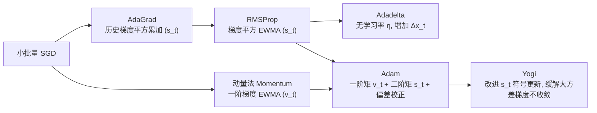

# 11. 优化算法

%% learning-vault-navigation:v1 %%
> [!abstract]- 笔记导航
> 目录：[[AI learning/D2L-李沐/动手学深度学习导航|动手学深度学习导航]]
> 上一章：[[AI learning/D2L-李沐/笔记/10. 注意力机制|10. 注意力机制]] · 下一章：[[AI learning/D2L-李沐/笔记/12. 计算性能|12. 计算性能]]

> [!abstract] 本章核心脉络
> 深度神经网络的训练本质上是高维非凸函数的数值优化问题。本章先辨析**优化目标（经验风险）与深度学习终极目标（泛化风险）**的差异，梳理非凸优化的三大障碍与凸优化基础理论；随后沿着**梯度下降（GD）→ 随机梯度下降（SGD）→ 小批量 SGD → 动量法 → AdaGrad → RMSProp → Adadelta → Adam / Yogi** 的演进脉络逐一推导更新公式与收敛机理，最后总结常用**学习率调度器与预热（Warmup）**策略。

---

## 1. 深度学习中的优化挑战与凸性基础

### 1.1 优化目标 vs 泛化目标

优化算法仅能直接最小化训练集上的**经验风险（训练误差）**，但深度学习真正关心的是未知分布上的**泛化误差**。过度追求训练损失归零反而会导致过拟合；优秀的优化算法和学习率调度往往不仅加速收敛，还会隐式引导参数落入更平坦、泛化更好的极小值区域。

### 1.2 非凸优化的三大挑战

1. **局部最小值（Local Minima）**：非凸损失曲面存在大量局部极小点（如 $f(x) = x\cos(\pi x)$），梯度下降可能停留在次优局部极小值；不过小批量随机梯度的自然噪声往往有助于跳出浅局部极小值。
2. **鞍点（Saddle Points）**：梯度为零但既非局部极小也非局部极大的临界点（如 $f(x, y) = x^2 - y^2$ 的原点）。根据 Hessian 矩阵 $\mathbf{H} = \nabla^2 f(\mathbf{x})$ 的特征值可判断临界点性质：全正为局部极小值、全负为局部极大值、有正有负为鞍点。==在高维空间中，所有特征值同号的概率极低（若随机独立约为 $2^{-d}$），因此深度网络面临的临界点绝大多数是鞍点而非局部极小值==。
3. **梯度消失（Vanishing Gradients）**：当激活函数进入饱和区（如 $\tanh(4) \approx 0.9993$，导数 $\approx 0.0013$）时，梯度趋近于零导致参数几乎停止更新，需要借助 ReLU、重参数化、归一化或良好初始化加以缓解。

### 1.3 凸优化的核心结论

虽然深度学习问题大多非凸，但凸分析提供了理解算法收敛与步长设计的理论基石（`convexity.ipynb`）：
- **凸集**：$\forall a, b \in \mathcal{X}, \lambda \in [0, 1]$ 有 $\lambda a + (1-\lambda)b \in \mathcal{X}$。凸集的交集仍是凸集，但并集未必是凸集。
- **凸函数与詹森不等式（Jensen's Inequality）**：
  $$
  \sum_i \alpha_i f(x_i) \geq f\left(\sum_i \alpha_i x_i\right), \qquad \mathbb{E}_X[f(X)] \geq f\left(\mathbb{E}_X[X]\right)
  $$
  （应用于负对数函数即导出变分推断和信息论中的关键不等式 $\mathbb{E}_{Y}[-\log P(X \mid Y)] \ge -\log P(X)$。）
- **三大性质**：
  1. 凸函数的任何局部极小值都是**全局极小值**；
  2. 凸函数的下水平集 $\mathcal{S}_b = \{x \in \mathcal{X} \mid f(x) \le b\}$ 必为凸集；
  3. 二次可微函数是凸函数 $\iff$ 其 Hessian 矩阵处处半正定（$\nabla^2 f(\mathbf{x}) \succeq 0$）。
- **约束处理**：可通过拉格朗日函数 $L(\mathbf{x}, \boldsymbol{\alpha}) = f(\mathbf{x}) + \sum_i \alpha_i c_i(\mathbf{x})$（$\alpha_i \ge 0$）、软惩罚项（如权重衰减 $\frac{\lambda}{2}\|\mathbf{w}\|^2$）或凸集投影 $\mathrm{Proj}_{\mathcal{X}}(\mathbf{x}) = \arg\min_{\mathbf{x}' \in \mathcal{X}}\|\mathbf{x}-\mathbf{x}'\|$（第 8 章的梯度裁剪正是向半径 $\theta$ 球面的投影）实现。

---

## 2. 梯度下降、牛顿法与小批量随机梯度下降

### 2.1 梯度下降与二阶牛顿法

- **一阶梯度下降（GD）**：由一阶泰勒展开 $f(\mathbf{x}+\boldsymbol{\epsilon}) \approx f(\mathbf{x}) + \boldsymbol{\epsilon}^\top \nabla f(\mathbf{x})$，沿负梯度方向迭代：
  $$
  \mathbf{x} \leftarrow \mathbf{x} - \eta \nabla f(\mathbf{x})
  $$
  学习率 $\eta$ 过大会导致震荡发散，过小则收敛极慢；对病态条件数（各方向曲率差异悬殊）问题容易走出“之字形”低效轨迹。
- **牛顿法（Newton's Method）**：由二阶泰勒展开 $f(\mathbf{x}+\boldsymbol{\epsilon}) \approx f(\mathbf{x}) + \boldsymbol{\epsilon}^\top \nabla f(\mathbf{x}) + \frac{1}{2}\boldsymbol{\epsilon}^\top \mathbf{H}\boldsymbol{\epsilon}$，令导数为零得更新步长：
  $$
  \boldsymbol{\epsilon} = -\mathbf{H}^{-1}\nabla f(\mathbf{x}), \qquad \mathbf{x} \leftarrow \mathbf{x} - \eta \mathbf{H}^{-1}\nabla f(\mathbf{x})
  $$
  在强凸问题中具备极快的**局部二次收敛**（$|e^{(k+1)}| \le c (e^{(k)})^2$），但存储 Hessian 需 $\mathcal{O}(d^2)$ 内存、求逆需 $\mathcal{O}(d^3)$ 计算量，且非凸区域（Hessian 不正定）会主动跳向鞍点或极大值。因此深度学习中常借用**对角预处理** $\mathbf{x} \leftarrow \mathbf{x} - \eta\,\mathrm{diag}(\mathbf{H})^{-1}\nabla f(\mathbf{x})$ 的思想，用一阶梯度的历史统计近似各坐标曲率。

### 2.2 随机梯度下降（SGD）与小批量 SGD

对包含 $n$ 个样本的目标函数 $f(\mathbf{x}) = \frac{1}{n}\sum_{i=1}^{n} f_i(\mathbf{x})$：
- **SGD** 每次随机抽取单个样本 $i$ 计算梯度，单步开销从 $\mathcal{O}(n)$ 降至 $\mathcal{O}(1)$，且满足无偏性 $\mathbb{E}_i[\nabla f_i(\mathbf{x})] = \nabla f(\mathbf{x})$。在凸目标假设下，配合 $\eta_t \propto 1/\sqrt{t}$ 衰减可得 $\mathcal{O}(1/\sqrt{T})$ 的期望次优界。
- **小批量 SGD（Minibatch SGD）**：随机采样大小为 $|\mathcal{B}_t|$ 的小批量计算平均梯度：
  $$
  \mathbf{g}_t = \partial_{\mathbf{w}} \frac{1}{|\mathcal{B}_t|} \sum_{i \in \mathcal{B}_t} f(\mathbf{x}_i, \mathbf{w})
  $$
  它精确平衡了两个维度：
  - **统计效率**：小批量梯度方差随批大小按 $1/|\mathcal{B}_t|$ 缩小（标准差按 $1/\sqrt{|\mathcal{B}_t|}$ 缩小），过高批大小会导致样本复用收益递减；
  - **计算效率**：大矩阵乘法能充分利用 CPU/GPU 的 SIMD 向量化与缓存局部性（`minibatch-sgd.ipynb` 实测一次性矩阵乘法比逐元素循环快数个数量级）。

---

## 3. 现代一阶优化算法演进与对比

为解决病态曲率震荡（如 $f(x_1, x_2) = 0.1x_1^2 + 2x_2^2$）、稀疏特征更新失衡及手动调参困难，深度学习发展出一系列维护历史一阶矩/二阶矩状态变量的优化器。

### 3.1 各算法核心更新方程总览

统一记第 $t$ 步小批量梯度为 $\mathbf{g}_t$，平方 $\mathbf{g}_t^2$ 与除法/开方均表示按元素（element-wise）运算：

| 算法 | 维护状态变量 | 核心更新公式 | 典型超参数 | 核心优势与局限 |
| --- | --- | --- | --- | --- |
| **小批量 SGD** | 无 | $\mathbf{x}_t = \mathbf{x}_{t-1} - \eta_t \mathbf{g}_t$ | $\eta$ | 内存最省、配合合适调度器泛化极佳；但对病态曲率易震荡、需精调学习率 |
| **动量法 (Momentum)** | 一阶动量 $\mathbf{v}_t$ | $\mathbf{v}_t = \beta \mathbf{v}_{t-1} + \mathbf{g}_t$ $\mathbf{x}_t = \mathbf{x}_{t-1} - \eta_t \mathbf{v}_t$ | $\beta \in [0.9, 0.99]$ | 指数加权平均平滑震荡、加速一致方向（有效窗口 $\frac{1}{1-\beta}$）；各坐标仍共用同一学习率 |
| **AdaGrad** | 梯度平方累积 $\mathbf{s}_t$ | $\mathbf{s}_t = \mathbf{s}_{t-1} + \mathbf{g}_t^2$ $\mathbf{x}_t = \mathbf{x}_{t-1} - \dfrac{\eta}{\sqrt{\mathbf{s}_t + \epsilon}} \odot \mathbf{g}_t$ | $\eta, \epsilon = 10^{-6}$ | ==天然适配稀疏特征==，高频坐标降速、低频坐标保速；但 $\mathbf{s}_t$ 单调不减导致后期学习率趋零停滞 |
| **RMSProp** | 梯度平方 EWMA $\mathbf{s}_t$ | $\mathbf{s}_t = \gamma \mathbf{s}_{t-1} + (1 - \gamma)\mathbf{g}_t^2$ $\mathbf{x}_t = \mathbf{x}_{t-1} - \dfrac{\eta}{\sqrt{\mathbf{s}_t + \epsilon}} \odot \mathbf{g}_t$ | $\gamma \in [0.9, 0.99]$ | 用泄漏平均替代无限累加，彻底解决 AdaGrad 后期停滞问题，适合非平稳目标与 RNN |
| **Adadelta** | 梯度平方 $\mathbf{s}_t$ 更新平方 $\Delta\mathbf{x}_t$ | $\mathbf{s}_t = \rho \mathbf{s}_{t-1} + (1-\rho)\mathbf{g}_t^2$ $\mathbf{g}'_t = \dfrac{\sqrt{\Delta\mathbf{x}_{t-1}+\epsilon}}{\sqrt{\mathbf{s}_t+\epsilon}} \odot \mathbf{g}_t$ $\Delta\mathbf{x}_t = \rho \Delta\mathbf{x}_{t-1} + (1-\rho){\mathbf{g}'_t}^2$ $\mathbf{x}_t = \mathbf{x}_{t-1} - \mathbf{g}'_t$ | $\rho \approx 0.9$, $\epsilon = 10^{-5}$ | **无需设置全局学习率 $\eta$**，利用参数变化量均方根匹配量纲；但在深度网络调优中普及度不及 Adam |
| **Adam** | 一阶矩 $\mathbf{v}_t$ 二阶矩 $\mathbf{s}_t$ | $\mathbf{v}_t = \beta_1 \mathbf{v}_{t-1} + (1-\beta_1)\mathbf{g}_t$ $\mathbf{s}_t = \beta_2 \mathbf{s}_{t-1} + (1-\beta_2)\mathbf{g}_t^2$ $\hat{\mathbf{v}}_t = \dfrac{\mathbf{v}_t}{1-\beta_1^t},\quad \hat{\mathbf{s}}_t = \dfrac{\mathbf{s}_t}{1-\beta_2^t}$ $\mathbf{x}_t = \mathbf{x}_{t-1} - \dfrac{\eta \hat{\mathbf{v}}_t}{\sqrt{\hat{\mathbf{s}}_t} + \epsilon}$ | $\beta_1 = 0.9$ $\beta_2 = 0.999$ $\epsilon = 10^{-6}$ | 兼具动量平滑与自适应步长，对超参数鲁棒、收敛快，是 NLP/Transformer 默认首选；高方差稀疏梯度下可能存在收敛不稳定 |

### 3.2 Adam 偏差校正与 Yogi 改进细节

1. **为什么 Adam 需要偏差校正？**
   初始化时设 $\mathbf{v}_0 = \mathbf{0}, \mathbf{s}_0 = \mathbf{0}$。在第 $t$ 步展开有 $\mathbf{v}_t = (1-\beta_1)\sum_{i=1}^t \beta_1^{t-i}\mathbf{g}_i$，权重之和为 $\sum_{i=1}^t (1-\beta_1)\beta_1^{t-i} = 1 - \beta_1^t < 1$。训练初期（$t$ 很小，尤其当 $\beta_2 = 0.999$ 时）估计值严重偏向于 $0$。除以 $(1 - \beta_1^t)$ 与 $(1 - \beta_2^t)$ 即可消除初始偏差，且当 $t \to \infty$ 时校正因子自动趋近于 $1$。
2. **Yogi 对二阶矩的修正**：
   将 Adam 的二阶矩更新改写为 $\mathbf{s}_t = \mathbf{s}_{t-1} + (1-\beta_2)(\mathbf{g}_t^2 - \mathbf{s}_{t-1})$，当 $\mathbf{g}_t^2$ 突然远小于 $\mathbf{s}_{t-1}$ 时（大方差极端梯度后跟随小梯度），$\mathbf{s}_t$ 会受 $\mathbf{s}_{t-1}$ 大小支配而剧烈波动。Yogi 改为：
   $$
   \mathbf{s}_t \leftarrow \mathbf{s}_{t-1} + (1 - \beta_2)\mathbf{g}_t^2 \odot \mathrm{sgn}\left(\mathbf{g}_t^2 - \mathbf{s}_{t-1}\right)
   $$
   使更新幅度仅取决于当前梯度平方 $\mathbf{g}_t^2$，方向由 $\mathbf{g}_t^2$ 与 $\mathbf{s}_{t-1}$ 的相对大小决定，显著改善收敛稳定性。

> [!tip] PyTorch 常用优化器速查
> - `torch.optim.SGD(params, lr=0.01, momentum=0.9)`（注意 PyTorch 的 `SGD(momentum=β)` 与教材公式略有实现细节差异，配合 `weight_decay` 常用于 CV 视觉骨干网络）
> - `torch.optim.Adagrad` / `torch.optim.RMSprop(alpha=γ)` / `torch.optim.Adadelta(rho=ρ)`
> - `torch.optim.Adam(params, lr=1e-3, betas=(0.9, 0.999), eps=1e-8)`（现代大模型与 Transformer 常使用解耦权重衰减变体 `AdamW`）

---

## 4. 学习率调度器（Learning Rate Schedulers）

训练初期希望用较大学习率快速逃离平坦区并跨越障碍；中后期当损失趋于平稳时，==逐步降低学习率能减小随机梯度噪声带来的参数方差，促使模型精确收敛并降低过拟合==。

### 4.1 常见调度策略（`lr-scheduler.ipynb`）

| 调度器类型 | 数学规律 | PyTorch / D2L 实现 | 特点与典型用途 |
| --- | --- | --- | --- |
| **平方根衰减** | $\eta_t = \eta_0 (t + 1)^{-1/2}$ | `SquareRootScheduler` | 贴合凸优化理论 $\mathcal{O}(1/\sqrt{T})$ 收敛率，后期衰减缓慢 |
| **单因子衰减** | $\eta_{t+1} \leftarrow \max(\eta_{\min}, \eta_t \cdot \alpha)$ | `FactorScheduler` / `ExponentialLR` | 每轮按固定乘法因子 $\alpha < 1$ 衰减，设下界防过早归零 |
| **多因子阶梯衰减** | 在预设里程碑 $t \in \{t_1, t_2, \ldots\}$ 处乘以 $\gamma$ | `lr_scheduler.MultiStepLR(opt, milestones=[15, 30], gamma=0.5)` | 经典视觉训练（如 ResNet）标配：保持平台期充分探索后阶梯式精细收敛 |
| **余弦退火调度器** | $\eta_t = \eta_T + \dfrac{\eta_0 - \eta_T}{2}\left(1 + \cos\left(\dfrac{\pi t}{T}\right)\right)$ | `CosineScheduler` / `CosineAnnealingLR` | 初期与末期平滑缓降、中期快速下降，CV 与现代 LLM 训练极受欢迎 |
| **预热（Warmup）** | 前 $T_{\text{warmup}}$ 步线性爬坡：$\eta_t = \eta_{\text{init}} + (\eta_0 - \eta_{\text{init}})\dfrac{t}{T_{\text{warmup}}}$ | `CosineScheduler(..., warmup_steps=5)` | ==防止随机初始化初期参数远离最优解且梯度方差极大时直接大步长发散==；常与余弦衰减串联（Warmup + Cosine Decay） |

> [!warning] PyTorch 调度器调用顺序陷阱
> 在 PyTorch 中使用内置调度器（如 `MultiStepLR`、`CosineAnnealingLR`）时，必须在每个 epoch（或每个 step，视调度粒度而定）完成 `optimizer.step()` **之后**再调用 `scheduler.step()`，否则会跳过首个学习率并触发框架警告。

---

## 5. 配套材料与 Notebook

| 节次 | 主题 | Notebook 入口 | 核心要点 |
| --- | --- | --- | --- |
| 11.0 | 章节导览 | [[AI learning/D2L-李沐/pytorch/chapter_optimization/index.ipynb\|index.ipynb]] | 深度学习优化全貌 |
| 11.1 | 优化和深度学习 | [[AI learning/D2L-李沐/pytorch/chapter_optimization/optimization-intro.ipynb\|optimization-intro.ipynb]] | 经验风险 vs 泛化误差、局部极小值/鞍点/梯度消失 |
| 11.2 | 凸性 | [[AI learning/D2L-李沐/pytorch/chapter_optimization/convexity.ipynb\|convexity.ipynb]] | 凸集、詹森不等式、Hessian 半正定、拉格朗日与投影 |
| 11.3 | 梯度下降 | [[AI learning/D2L-李沐/pytorch/chapter_optimization/gd.ipynb\|gd.ipynb]] | 一维/多元梯度下降、牛顿法、预处理与线搜索 |
| 11.4 | 随机梯度下降 | [[AI learning/D2L-李沐/pytorch/chapter_optimization/sgd.ipynb\|sgd.ipynb]] | 动态学习率、凸目标收敛分析 |
| 11.5 | 小批量随机梯度下降 | [[AI learning/D2L-李沐/pytorch/chapter_optimization/minibatch-sgd.ipynb\|minibatch-sgd.ipynb]] | 向量化加速、`train_ch11`、`train_concise_ch11` |
| 11.6 | 动量法 | [[AI learning/D2L-李沐/pytorch/chapter_optimization/momentum.ipynb\|momentum.ipynb]] | 泄漏平均值、病态曲率实验、二次凸函数谱分析 |
| 11.7 | AdaGrad 算法 | [[AI learning/D2L-李沐/pytorch/chapter_optimization/adagrad.ipynb\|adagrad.ipynb]] | 稀疏特征按坐标缩放、条件数预处理 |
| 11.8 | RMSProp 算法 | [[AI learning/D2L-李沐/pytorch/chapter_optimization/rmsprop.ipynb\|rmsprop.ipynb]] | 梯度平方 EWMA、缓解 AdaGrad 学习率衰减过快 |
| 11.9 | Adadelta | [[AI learning/D2L-李沐/pytorch/chapter_optimization/adadelta.ipynb\|adadelta.ipynb]] | 无显式学习率、双状态变量维护 |
| 11.10 | Adam 算法 | [[AI learning/D2L-李沐/pytorch/chapter_optimization/adam.ipynb\|adam.ipynb]] | 一二阶矩 EWMA + 偏差校正、Yogi 改进 |
| 11.11 | 学习率调度器 | [[AI learning/D2L-李沐/pytorch/chapter_optimization/lr-scheduler.ipynb\|lr-scheduler.ipynb]] | `FactorScheduler`、`MultiStepLR`、`CosineScheduler` 与 Warmup |

> [!question]- 复盘自测
> 1. **从 AdaGrad 到 RMSProp 再到 Adam，每一步具体解决了上一代算法的什么痛点？**
>    - AdaGrad 解决了各坐标梯度尺度/稀疏度不同导致的统一学习率低效问题，但累计平方单调递增造成后期学习率提前枯竭；RMSProp 将累加改为指数移动平均，解除了学习率过早归零的桎梏；Adam 在 RMSProp 基础上叠加一阶动量（Momentum）并对冷启动的零初始化执行偏差校正，兼具方向平滑与坐标自适应缩放。
> 2. **为什么高维非凸深度网络中，鞍点通常比局部极小值更常见？**
>    - 一个临界点要成为局部极小值，需要 $d \times d$ Hessian 矩阵的所有 $d$ 个特征值同时严格大于零；高维空间中只要部分方向曲率为负即为鞍点，因此鞍点数量压倒性地多于局部极小值。
> 3. **训练大模型或深度 ResNet 时，为什么经常在余弦退火前加一段 Warmup 预热期？**
>    - 参数随机初始化后，模型预测与真实标签偏差极大，初期梯度方向剧烈震荡且范数过大；若一开始就施加大峰值学习率，参数极易直接飞出良好盆地导致 NaN 或发散。线性 Warmup 让模型先在小步长下稳住梯度与二阶矩统计，再平稳过渡到峰值学习率与余弦衰减。
