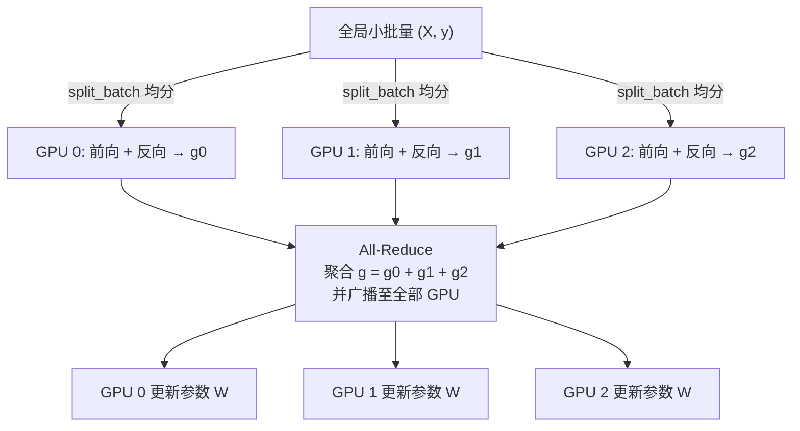

# 12. 计算性能

%% learning-vault-navigation:v1 %%
> [!abstract]- 笔记导航
> 目录：[[AI learning/D2L-李沐/动手学深度学习导航|动手学深度学习导航]]
> 上一章：[[AI learning/D2L-李沐/笔记/11. 优化算法|11. 优化算法]] · 下一章：[[AI learning/D2L-李沐/笔记/13. 计算机视觉|13. 计算机视觉]]

> [!abstract] 本章核心脉络
> 模型规模与数据集持续膨胀，优秀系统设计与朴素实现之间往往相差**数个数量级**（例如训练耗时 1 周与 3 个月的差别）。本章自底向上打通深度学习系统性能优化的四大层面：**编程范式编译优化（TorchScript）→ 框架异步调度与自动并行 → 计算机硬件带宽与延迟规律 → 单机多卡数据并行与多机参数服务器分布式训练**。

---

## 1. 编译器、解释器与混合式编程

深度学习框架面临易用性与执行效率的根本张力，由此分化出三种编程范式：

| 编程范式 | 执行方式 | 核心优势 | 主要局限 |
| --- | --- | --- | --- |
| **命令式编程（Imperative）** | 逐行解释执行（如常规 Python / PyTorch Eager 模式） | 直观灵活、支持原生控制流与交互式调试，研发迭代快 | 每步都受 Python 解释器开销与 GIL 束缚，难以做全局算子融合与内存复用 |
| **符号式编程（Symbolic）** | 先定义完整计算图 → 编译优化 → 传入数据统一执行 | 脱离 Python 解释器运行，支持常量折叠、算子融合、跨语言序列化部署 | 编写动态控制流与调试难度较高 |
| **混合式编程（Hybrid）** | 开发调试阶段用命令式，部署加速阶段通过 JIT 编译转为符号图 | ==兼顾开发灵活性与生产高性能== | 并非所有动态 Python 语法都可无损脚本化 |

### PyTorch 中的 TorchScript 实践（`hybridize.ipynb`）

在 PyTorch 中，只需使用 `torch.jit.script(net)` 即可将命令式 `nn.Sequential` / `nn.Module` 模型编译为 TorchScript 中间表示：

```python
net = get_net()
# 编译为 TorchScript，加速前向执行并消除 Python 解释器调度开销
net = torch.jit.script(net)
# 序列化保存计算图与权重到磁盘，便于 C++ 等非 Python 生产环境部署
net.save('my_mlp')
```

---

## 2. 异步计算与自动并行

### 2.1 前端与后端解耦（`async-computation.ipynb`）

深度学习框架（如 PyTorch 的 CUDA 后端）采用**生产者-消费者异步架构**：
- **Python 前端线程**：只负责将算子指令高速推入任务队列并立刻返回控制权，不等待运算完成；
- **C++ / CUDA 后端工作线程**：从队列异步拉取任务，在 GPU 上全速并行执行。

> [!warning] 异步执行带来的两大常见陷阱
> 1. **基准测试测速失真**：若直接在 Python 中统计 GPU 算子耗时，测到的只是“提交任务入队”的时间而非真实计算时间。基准测试前必须先做 GPU 预热，并在计时终点显式调用 **`torch.cuda.synchronize(device)`** 作为屏障等待所有异步内核执行完毕。
> 2. **任务队列堆积导致显存暴涨（OOM）**：若前端提交小批量速度远超后端消耗速度，大量待执行张量会滞留在内存中。工程实践中应在每个小批量末尾引入适度同步（如读取 `loss.item()` 或打印指标），使前后端节奏保持平衡。

### 2.2 自动并行：多设备计算与通信重叠（`auto-parallelism.ipynb`）

现代框架后端会自动分析计算图中的数据依赖关系，实现两类关键并行：
1. **跨设备计算并行**：对彼此无数据依赖的算子（如 `run(x_gpu1)` 与 `run(x_gpu2)`），前端依次发出后两张 GPU 会**同时满载运行**，总耗时近似单卡耗时而非两卡之和。
2. **计算与通信并行重叠**：通过 **`tensor.to('cpu', non_blocking=True)`** 启用异步非阻塞数据拷贝，可在 GPU 继续计算下一批矩阵乘法的同时，并行经 PCIe 总线将前序结果传回主机内存，有效掩盖数据传输延迟。

---

## 3. 深度学习硬件基础：延迟、带宽与局部性

理解底层硬件数量级差异，是避免“算力闲置、全在等数据”的前提（`hardware.ipynb`）。

### 3.1 关键存储与互连层次对比

| 硬件层级 | 典型延迟 | 典型带宽 / 吞吐 | 核心特征与算法设计启示 |
| --- | --- | --- | --- |
| **CPU 缓存（L1 / L2 / L3）** | ~0.5 – 15 ns | 数百 GB/s – TB/s | 容量小（KB–MB 级）但极快；通过分块矩阵乘提高缓存命中率可获数量级加速 |
| **CPU 内存（DDR4 RAM）** | 首次寻址 ~100 ns<br>突发连续读 ~0.2 ns | 40 – 100 GB/s | ==首读成本是连续突发读（Burst Read）的 500 倍==；避免随机访问，保持 64 位内存对齐 |
| **GPU 显存（GDDR6 / HBM）** | 高于缓存但远低主存 | >500 GB/s（RTX 2080Ti 352-bit）至 TB/s（V100/HBM） | 总线极宽、带宽远高于 CPU 内存，但容量昂贵且较小 |
| **PCIe 扩展总线** | 微秒级 | PCIe 4.0 x4 (NVMe) ~8 GB/s<br>x16 ~32 GB/s | 连接 CPU、GPU、网卡与 NVMe SSD；频繁跨主机-设备小包拷贝是头号瓶颈 |
| **固态驱动器（SSD / NVMe）** | ~10 – 100 μs | 1 – 8 GB/s（10万–50万 IOPS） | 读远快于写，按大块（≥256 KB）擦写，避免小文件随机写 |
| **机械硬盘（HDD）** | ~8 ms（7200 RPM 寻道） | 100 – 200 MB/s（~100 IOPS） | 仅适合冷归档，直接用作深度学习在线数据读取会严重饿死 GPU |

### 3.2 CPU 与 GPU 架构本质差异

- **CPU（低延迟控制大师）**：少量复杂核心（如 8–64 核），配备庞大的指令解码、分支预测、乱序执行与多级缓存，并借助 **SIMD 向量处理单元**（x86 AVX2/AVX-512、ARM NEON、乘加融合 FMA）在单时钟周期并行处理多个数值。
- **GPU（高吞吐算力怪兽）**：舍弃复杂分支预测与大缓存，将绝大部分晶体管面积投入数千个轻量级流处理器（如 RTX 2080Ti 含 4352 个 CUDA 核心）及专用**张量核（Tensor Cores）**（如 Volta 擅长 FP16 矩阵乘、Turing 支持 FP16/INT8/INT4）。

> [!tip] 硬件感知的四大工程铁律
> 1. **量大次少**：无论 RAM、SSD、PCIe 还是网络，单次传输大块连续张量远胜高频零碎传输；
> 2. **张量对齐与向量化**：通道数、批量大小尽量对齐硬件 SIMD/Tensor Core 倍数（如 8 或 16 的倍数）；
> 3. **低精度慎防溢出**：FP16/BF16 与 INT8 推理可大幅提速省显存，但训练阶段精度过低易导致梯度下溢/溢出（需混合精度与损失缩放）；
> 4. **先估算再实验**：动手优化前先在纸上对比计算量（FLOPs）与访存带宽（Roofline 思路），定位究竟是计算受限还是 I/O 受限。

---

## 4. 多 GPU 训练与数据并行

当单卡算力或训练速度不足时，有三种拆分策略：**网络层间流水线并行**、**单层内部张量模型并行**（二者均需精细编排设备间通信），以及实践中最通用高效的==**数据并行（Data Parallelism）**==。

### 4.1 数据并行的标准五步闭环（`multiple-gpus.ipynb`）

设共有 $k$ 块 GPU，总小批量大小为 $B$：
1. **参数复制（`get_params`）**：将完整模型参数广播复制到全部 $k$ 块 GPU；
2. **数据切分（`split_batch`）**：将一个小批量沿样本维均分为 $k$ 份（每卡 $B/k$ 个样本）并分发到对应 GPU；
3. **独立前向与反向**：各 GPU 并行计算各自子批量的损失与局部梯度 $\mathbf{g}_j$；
4. **梯度归约与广播（`allreduce`）**：将所有 GPU 上的梯度求和聚合 $\mathbf{g} = \sum_{j=1}^k \mathbf{g}_j$，再广播回每一块 GPU；
5. **同步更新**：每块 GPU 使用完全一致的聚合梯度执行相同的优化器更新，保证各卡模型权重严格同步。



### 4.2 PyTorch 简洁实现与超参数缩放（`multiple-gpus-concise.ipynb`）

```python
devices = [d2l.try_gpu(i) for i in range(num_gpus)]
net = nn.DataParallel(net, device_ids=devices)
# 前向自动切分输入、汇总输出，反向自动归约梯度
for X, y in train_iter:
    trainer.zero_grad()
    X, y = X.to(devices[0]), y.to(devices[0])
    l = loss(net(X), y)
    l.backward()
    trainer.step()
```

> [!note] 多卡扩展时的批大小与学习率缩放
> 从 1 卡扩至 $k$ 卡时，为了保持每卡计算饱和度，通常将全局 `batch_size` 扩大为 $k$ 倍（如 1 卡 `bs=256, lr=0.1` → 2 卡 `bs=512, lr=0.2`）。由于大批量梯度方差更小，**学习率通常需要相应适度调高**（线性缩放或平方根缩放），以维持相似的收敛速率与最终精度。
> *(注：工业级大规模训练通常进一步使用多进程、无 GIL 瓶颈且基于 NCCL Ring All-Reduce 的 `DistributedDataParallel (DDP)` 替代单进程 `nn.DataParallel`。)*

---

## 5. 参数服务器与多机分布式同步

当训练扩展到多台服务器（每台多块 GPU）时，机器间网卡带宽远低于机内 PCIe/NVLink，全局梯度聚合变为：

$$
\mathbf{g}_i = \sum_{k \in \text{workers}} \sum_{j \in \text{GPUs}} \mathbf{g}_{ijk}
$$

### 5.1 机内与跨机通信拓扑演进（`parameterserver.ipynb`）

| 同步架构 | 工作机制 | 通信瓶颈与适用场景 |
| --- | --- | --- |
| **单卡/CPU 汇聚** | 所有 GPU 梯度发往 GPU 0 或 CPU 求和再广播 | 中心节点带宽成为严重瓶颈，卡数增多后扩展性骤降 |
| **环同步（Ring All-Reduce）** | 将梯度按参数切分块，在环形互连（如 NVIDIA DGX / p3 NVLink）中执行 Scatter-Reduce + All-Gather | 每卡仅与相邻节点通信，通信总量与 GPU 数量几乎解耦，充分利用所有链路带宽 |
| **单中心参数服务器** | 每台机器先在本地聚合 GPU 梯度发给本地 CPU，再发往唯一中央参数服务器更新并拉回 | $m$ 个工作节点争抢单台服务器带宽，通信复杂度 $\mathcal{O}(m)$ |
| **多参数服务器（分片键值存储 KVStore）** | 将参数切分存储在 $n$ 台参数服务器（工作节点常兼任部分服务器角色），通过 `push(key, grad)` 与 `pull(key)` 通信 | 每台服务器仅负责 $\mathcal{O}(1/n)$ 参数，总通信开销降至 $\mathcal{O}(m/n)$，实现平稳水平扩展 |

---

## 6. 配套材料与 Notebook

| 节次 | 主题 | Notebook 入口 | 核心要点 |
| --- | --- | --- | --- |
| 12.0 | 章节导览 | [[AI learning/D2L-李沐/pytorch/chapter_computational-performance/index.ipynb\|index.ipynb]] | 计算性能体系总览 |
| 12.1 | 编译器和解释器 | [[AI learning/D2L-李沐/pytorch/chapter_computational-performance/hybridize.ipynb\|hybridize.ipynb]] | 命令式 vs 符号式、`torch.jit.script`、`net.save`、`Benchmark` |
| 12.2 | 异步计算 | [[AI learning/D2L-李沐/pytorch/chapter_computational-performance/async-computation.ipynb\|async-computation.ipynb]] | 前端后端解耦、`torch.cuda.synchronize` |
| 12.3 | 自动并行 | [[AI learning/D2L-李沐/pytorch/chapter_computational-performance/auto-parallelism.ipynb\|auto-parallelism.ipynb]] | 多 GPU 自动并行、`non_blocking=True` 计算通信重叠 |
| 12.4 | 硬件 | [[AI learning/D2L-李沐/pytorch/chapter_computational-performance/hardware.ipynb\|hardware.ipynb]] | 延迟/带宽层次、突发读、SIMD 矢量化、缓存与 GPU 架构 |
| 12.5 | 多 GPU 训练 | [[AI learning/D2L-李沐/pytorch/chapter_computational-performance/multiple-gpus.ipynb\|multiple-gpus.ipynb]] | 从零实现 `allreduce`、`split_batch` 与数据并行 |
| 12.6 | 多 GPU 的简洁实现 | [[AI learning/D2L-李沐/pytorch/chapter_computational-performance/multiple-gpus-concise.ipynb\|multiple-gpus-concise.ipynb]] | `nn.DataParallel`、多卡批大小与学习率缩放 |
| 12.7 | 参数服务器 | [[AI learning/D2L-李沐/pytorch/chapter_computational-performance/parameterserver.ipynb\|parameterserver.ipynb]] | Ring All-Reduce、多机同步与分布式键值存储 |

> [!question]- 复盘自测
> 1. **为什么在 PyTorch 中测试一段 GPU 代码的运行时间时，必须在计时结束前调用 `torch.cuda.synchronize()`？**
>    - 因为 PyTorch GPU 执行默认是异步的，Python 主线程把算子推入 CUDA 队列后立刻向下运行；不加同步测到的仅仅是 CPU 派发任务的时间，远小于实际 GPU 运算耗时。
> 2. **为什么 DDR4 内存随机访问比顺序连续访问慢得多？这给深度学习张量存储带来什么启示？**
>    - 向内存发送新地址建立读取连接需要约 100 ns，而连续突发读取后续数据仅需约 0.2 ns（相差 500 倍）。因此算子设计应尽量访问内存连续块（如在 RNN 中先将时间步轴转置到最外层或使用批量矩阵乘法），最大化缓存与突发读命中率。
> 3. **为什么单中心参数服务器在多机训练中会成为瓶颈？如何通过多参数服务器架构化解？**
>    - 当 $m$ 台工作机同时向 1 台参数服务器上传梯度、拉取参数时，该服务器网卡带宽被 $m$ 路流量瓜分，耗时 $\mathcal{O}(m)$；将参数均匀分片到 $n$ 台参数服务器（且常用工作机本身兼任分片服务器），每台只承担 $1/n$ 参数量，通信时间降至 $\mathcal{O}(m/n)$，在 $n \propto m$ 时具备良好扩展性。
