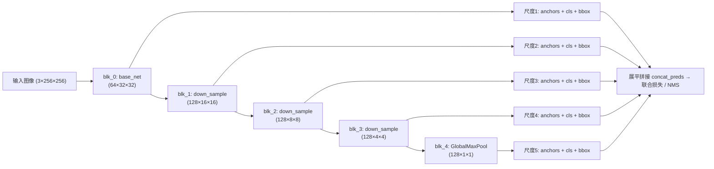

# 13. 计算机视觉

%% learning-vault-navigation:v1 %%
> [!abstract]- 笔记导航
> 目录：[[AI learning/D2L-李沐/动手学深度学习导航|动手学深度学习导航]]
> 上一章：[[AI learning/D2L-李沐/笔记/12. 计算性能|12. 计算性能]] · 下一章：[[AI learning/D2L-李沐/笔记/14. 自然语言处理：预训练|14. 自然语言处理：预训练]]

> [!abstract] 本章核心脉络
> 本章从图像分类迈向真实工业级计算机视觉任务，完整覆盖五大核心模块：**提升泛化的通用技巧（图像增广、迁移学习微调）→ 目标检测核心原语（边界框、锚框、IoU、NMS、多尺度检测）→ 两大主流检测范式（单阶段 SSD vs 两阶段 R-CNN 家族）→ 像素级语义分割（转置卷积、全卷积网络 FCN）→ 生成式视觉应用（神经风格迁移）与 Kaggle 图像竞赛实战**。

---

## 1. 图像增广与微调（迁移学习）

### 1.1 图像增广（`image-augmentation.ipynb`）

图像增广（Image Augmentation）通过对训练图像施加一系列保持语义不变的随机变换，在几乎不增加标注成本的前提下扩充样本多样性、抑制模型对特定位置/光照/尺度的过拟合：
- **几何变换**：`RandomHorizontalFlip()`（左右翻转，通常安全）、`RandomVerticalFlip()`（上下翻转，慎用于含方向先验的场景）、`RandomResizedCrop(size, scale=(0.1, 1), ratio=(0.5, 2))`（随机裁剪并缩放至固定尺寸）。
- **色彩变换**：`ColorJitter(brightness, contrast, saturation, hue)` 随机扰动亮度、对比度、饱和度与色调。
- **组合流水线**：使用 `torchvision.transforms.Compose([...])` 串联多种增广与张量归一化。

> [!warning] 训练与推理的增广不对称原则
> 随机图像增广**仅用于训练集**；测试与部署阶段必须去除随机变换（仅保留确定性的 `Resize`、`CenterCrop` 与通道标准化 `Normalize`），以保证推理结果确定、可复现。

### 1.2 微调（Fine-Tuning，`fine-tuning.ipynb`）

目标数据集往往规模有限（如热狗识别仅约千余张图），直接从零训练深层 CNN 极易过拟合。**微调（迁移学习核心范式）**复用在大型源数据集（ImageNet）上预训练的特征提取器：
1. 加载预训练源模型（如 `torchvision.models.resnet18(pretrained=True)`），复制除输出层外的全部结构与权重（浅层边缘/纹理与中层部件特征具有强跨任务泛化性）；
2. 将最终分类头替换为匹配目标类别数的新层（如 `finetune_net.fc = nn.Linear(in_features, 2)`），并对其做 Xavier 随机初始化；
3. ==**分组差异化学习率训练**==：骨干网络权重已接近最优，使用较小学习率 `lr` 温和微调；从头初始化的新输出层使用 **10 倍学习率** `10 * lr` 快速收敛：
   ```python
   params_1x = [p for name, p in net.named_parameters()
                if name not in ["fc.weight", "fc.bias"]]
   trainer = torch.optim.SGD([
       {'params': params_1x},
       {'params': net.fc.parameters(), 'lr': learning_rate * 10}
   ], lr=learning_rate, weight_decay=0.001)
   ```

---

## 2. 目标检测基础原语：边界框、锚框、IoU 与 NMS

目标检测不仅要识别画面中的全部感兴趣物体类别，还要精准回归每个物体的空间位置。

### 2.1 边界框与锚框生成（`bounding-box.ipynb`, `anchor.ipynb`）

- **两种边界框表示**：左上-右下角点坐标 `(x1, y1, x2, y2)` 与中心-宽高坐标 `(cx, cy, w, h)`，通过 `box_corner_to_center` 与 `box_center_to_corner` 互转。
- **锚框（Anchor Boxes, `multibox_prior`）**：以特征图每个像素中心 $(i+0.5, j+0.5)$ 为锚点，按给定尺度集合 $s_1, \ldots, s_n$ 与宽高比集合 $r_1, \ldots, r_m$ 生成候选区域。为避免组合爆炸（$n \cdot m$ 过多），D2L 仅保留包含 $s_1$ 或 $r_1$ 的组合：
  $$
  (s_1, r_1), (s_1, r_2), \ldots, (s_1, r_m), (s_2, r_1), \ldots, (s_n, r_1)
  $$
  单像素生成 $n + m - 1$ 个锚框，高 $h$ 宽 $w$ 的特征图共产生 $w h (n + m - 1)$ 个锚框。

### 2.2 交并比（IoU）与训练标注策略

- **交并比（Intersection over Union, IoU / Jaccard 系数）**：衡量两个边界框 $\mathcal{A}, \mathcal{B}$ 重叠度：
  $$
  J(\mathcal{A}, \mathcal{B}) = \frac{|\mathcal{A} \cap \mathcal{B}|}{|\mathcal{A} \cup \mathcal{B}|} \in [0, 1]
  $$
- **真实边界框分配算法（`assign_anchor_to_bbox`）**：构造锚框数 $n_a \times$ 真实框数 $n_b$ 的 IoU 矩阵：
  1. 先按阈值筛选（通常 `iou_threshold=0.5`）：若某锚框最大 IoU $\ge 0.5$，初步匹配给对应真实框；
  2. 为防止某些真实框因尺寸特殊完全没匹配到锚框，迭代找出矩阵全局最大元素 $(i^*, j^*)$，强制将真实框 $j^*$ 分配给锚框 $i^*$ 并丢弃该行该列，直至所有真实框均有保底锚框。
  3. 其余未分配锚框标为背景类（类别索引 `0`），偏移量掩码 `bbox_masks` 置 `0`。
- **标准化偏移量回归目标（`offset_boxes`）**：相比直接回归绝对坐标，回归锚框 $A=(x_a, y_a, w_a, h_a)$ 到真实框 $B=(x_b, y_b, w_b, h_b)$ 的标准化相对偏移更稳定（D2L 默认 $\mu = 0, \sigma = [0.1, 0.1, 0.2, 0.2]$）：
  $$
  \left( \frac{\frac{x_b - x_a}{w_a} - \mu_x}{\sigma_x},\ \frac{\frac{y_b - y_a}{h_a} - \mu_y}{\sigma_y},\ \frac{\log\frac{w_b}{w_a} - \mu_w}{\sigma_w},\ \frac{\log\frac{h_b}{h_a} - \mu_h}{\sigma_h} \right)
  $$

### 2.3 非极大值抑制（NMS）与多尺度检测

- **非极大值抑制（Non-Maximum Suppression, `nms`）**：推理时同一物体周围会产生大量高度重叠的预测框。NMS 按非背景最高类别置信度从高到低排序：每次保留得分最高的预测框 $B_1$，计算它与所有剩余框的 IoU 并剔除超过阈值（如 `0.5`）的冗余重叠框，循环直到列表为空。
- **多尺度目标检测（`multiscale-object-detection.ipynb`）**：==在浅层大尺寸特征图上生成密集小锚框检测小目标（感受野小），在深层小尺寸特征图上生成稀疏大锚框检测大目标（感受野大）==，从而高效覆盖全尺度物体。

---

## 3. 主流目标检测架构：SSD 与 R-CNN 家族

### 3.1 单发多框检测（SSD，`ssd.ipynb`）

SSD 属于典型的**单阶段（One-Stage）检测器**，一次前向传播即在多个尺度的特征图上同步预测所有锚框的类别与偏移量，推理速度极快。



- **全卷积预测头**：在每个尺度特征图上直接接两个不改变高宽的 $3\times 3$（`padding=1`）卷积层：`cls_predictor` 输出通道 `num_anchors * (num_classes + 1)`，`bbox_predictor` 输出通道 `num_anchors * 4`。
- **联合损失函数（`calc_loss`）**：类别损失采用交叉熵，边界框回归损失采用带 `bbox_masks` 的 $L_1$ 范数误差（背景锚框不计回归损失）：
  - 进阶损失（`ssd.ipynb` 练习）：**Smooth $L_1$ 损失**（零点附近平滑、远离零点线性防异常值梯度爆炸）与 **Focal Loss** $-\alpha(1 - p_j)^\gamma \log p_j$（降低海量简单背景负样本的权重，缓解正负样本极端不平衡）。

### 3.2 区域卷积神经网络（R-CNN）系列演进（`rcnn.ipynb`）

R-CNN 家族代表**两阶段（Two-Stage）检测范式**（先提议候选区，再精细分类与回归），四代架构一步步消除冗余计算并走向端到端与像素级分割：

| 模型 | 候选区域生成方式 | 特征提取方式 | 区域特征对齐 | 预测任务与核心突破 |
| --- | --- | --- | --- | --- |
| **R-CNN** | 选择性搜索（~2000 提议） | 对每个提议区域**独立运行一次 CNN** | 直接缩放裁剪图像 | 深度特征引入检测开山之作，但 2000 次重复前向传播极其缓慢，SVM 与回归器分步训练 |
| **Fast R-CNN** | 选择性搜索 | **整张图像仅执行一次 CNN 前向传播** | **兴趣区域汇聚（RoI Pooling）** | 共享全图卷积特征大幅提速，用单阶段多任务损失端到端联合训练分类与回归 |
| **Faster R-CNN** | **区域提议网络（RPN）**（锚框二分类+回归+NMS） | 整图共享 CNN 骨干 | **RoI Pooling** | 用可学习的 RPN 取代手工选择性搜索，大幅减少提议数量且全链路端到端可训 |
| **Mask R-CNN** | **RPN** | 整图共享 CNN 骨干 | **兴趣区域对齐（RoI Align，双线性插值）** | 消除 RoI Pooling 的像素取整量化错位，并新增并行 FCN 分支预测像素级实例分割掩码 |

---

## 4. 语义分割、转置卷积与全卷积网络（FCN）

### 4.1 语义分割与 Pascal VOC2012 数据集

- **任务区分**：**语义分割（Semantic Segmentation）**为图像中每个像素分配语义类别（如猫、狗、背景），不区分同类不同个体；**实例分割（Instance Segmentation）**则进一步区分同一类别的不同个体（如“狗 1”与“狗 2”）。
- **VOC2012 预处理要点**：标注图像是 RGB 彩色编码图（21 类颜色映射表 `VOC_COLORMAP` → 整数索引 `voc_label_indices`）。由于输入图像与像素标签严格逐像素对齐，训练时**必须同步随机裁剪固定尺寸（`voc_rand_crop`）而不能随意插值缩放标签**（插值会破坏离散类别整数索引）。

### 4.2 转置卷积（Transposed Convolution，`transposed-conv.ipynb`）

常规卷积与汇聚逐步缩小空间尺寸，而语义分割需要上采样还原至原图分辨率。转置卷积（`nn.ConvTranspose2d`，切忌误称“反卷积”）通过将每个输入像素值作为权重广播乘以卷积核并在输出对应位置叠加来放大特征图：
- **步幅与填充的“相反”含义**：在转置卷积中，步幅 $s$ 控制的是**输出端**移动步长（放大倍数），填充 $p$ 则是从最终输出边缘**裁去** $p$ 行/列。若输入高宽为 $n$、核大小为 $k$、填充 $p$、步幅 $s$，输出尺寸为：
  $$
  n_{\text{out}} = (n - 1)s + k - 2p
  $$
- **矩阵视角本质**：若将常规卷积写成稀疏矩阵乘法 $\mathbf{y} = \mathbf{W}\mathbf{x}$（前向乘 $\mathbf{W}$，反向传梯度乘 $\mathbf{W}^\top$），则转置卷积的前向即乘以 $\mathbf{W}^\top$、反向乘以 $\mathbf{W}$——==它交换了常规卷积的前向传播与反向传播，能恢复空间形状，但并不是数值上的逆运算==。

### 4.3 全卷积网络（FCN，`fcn.ipynb`）

全卷积网络（Fully Convolutional Network）摒弃传统分类网络末尾的全连接层，实现任意分辨率输入到像素级语义图的端到端映射：
1. **特征提取骨干**：截取预训练 `resnet18` 去掉最后全局平均池化与全连接层（`list(pretrained_net.children())[:-2]`），将 $(3, 320, 480)$ 下采样 32 倍为 $(512, 10, 15)$；
2. **$1 \times 1$ 通道投影**：`nn.Conv2d(512, 21, kernel_size=1)` 将通道数映射为 VOC 类别数 21；
3. **32 倍转置卷积上采样**：`nn.ConvTranspose2d(21, 21, kernel_size=64, padding=16, stride=32)` 将 $(21, 10, 15)$ 精确还原为 $(21, 320, 480)$，并用**双线性插值核（`bilinear_kernel`）初始化权重**以加速收敛；
4. **逐像素交叉熵损失**：`F.cross_entropy(inputs, targets, reduction='none').mean(1).mean(1)`。

---

## 5. 神经风格迁移与 Kaggle 视觉竞赛实战

### 5.1 神经风格迁移（`neural-style.ipynb`）

风格迁移将“内容图像”的主体结构与“风格图像”的笔触色彩融合。核心范式转变在于：**冻结预训练 VGG-19 权重不变，把待生成的合成图像 $\mathbf{X}$ 本身封装为可训练参数 `SynthesizedImage(nn.Module)` 进行梯度下降更新**。

- **特征层选择**：越靠近输入层越捕捉纹理细节，越深层越捕捉全局语义。D2L 取 VGG 第 4 卷积块最后一层（层索引 `25`）作内容层，取 5 个卷积块各自首层（`[0, 5, 10, 19, 28]`）作风格层。
- **三合一联合损失**：
  1. **内容损失**：合成图与内容图在内容层特征图上的均方误差（目标特征需 `.detach()`）；
  2. **风格损失**：利用**格拉姆矩阵（Gram Matrix）** $\mathbf{G}(\mathbf{X}) = \frac{1}{c \cdot hw}\mathbf{X}_{\text{flat}}\mathbf{X}_{\text{flat}}^\top \in \mathbb{R}^{c \times c}$ 衡量风格层不同通道特征间的空间相关性（剥离具体位置、保留全局纹理分布），最小化合成图与风格图格拉姆矩阵的 MSE；
  3. **全变分损失（Total Variation Loss）**：抑制相邻像素高频剧烈跳变，起到去噪平滑作用：
     $$
     \mathcal{L}_{\mathrm{TV}} = \sum_{i, j} \left|x_{i, j} - x_{i+1, j}\right| + \left|x_{i, j} - x_{i, j+1}\right|
     $$

### 5.2 Kaggle 视觉竞赛实战要点（CIFAR-10 与 ImageNet Dogs）

| 实战项目 | 数据规模与特点 | 模型与训练策略 | 关键工程经验 |
| --- | --- | --- | --- |
| **CIFAR-10 图像分类**<br>(`kaggle-cifar10.ipynb`) | 32×32 小图，10 类，5 万训练图 | 从零训练修改版 **ResNet-18**，配合 `StepLR` 阶梯降学习率 | 按类别拆分 `train_valid_test` 标准 `ImageFolder` 目录；先放大至 40×40 再 `RandomResizedCrop(32)` 增广；调优完毕后用全量训练+验证集重训提交 |
| **狗的品种识别**<br>(`kaggle-dog.ipynb`) | ImageNet 子集，224×224 大图，120 类细粒度 | 加载预训练 **ResNet-34 冻结骨干**，仅训练 `512→256→120` 小型自定义输出 MLP | 因为目标是 ImageNet 原始子集，预训练特征已高度匹配，==冻结骨干只训输出头能极大节省显存与训练时间并避免小样本过拟合== |

---

## 6. 配套材料与 Notebook

| 节次 | 主题 | Notebook 入口 | 核心代码 / 概念 |
| --- | --- | --- | --- |
| 13.0 | 章节导览 | [[AI learning/D2L-李沐/pytorch/chapter_computer-vision/index.ipynb\|index.ipynb]] | 计算机视觉应用总览 |
| 13.1 | 图像增广 | [[AI learning/D2L-李沐/pytorch/chapter_computer-vision/image-augmentation.ipynb\|image-augmentation.ipynb]] | `torchvision.transforms`、`train_ch13` |
| 13.2 | 微调 | [[AI learning/D2L-李沐/pytorch/chapter_computer-vision/fine-tuning.ipynb\|fine-tuning.ipynb]] | 预训练 ResNet-18、差异化学习率热狗识别 |
| 13.3 | 目标检测和边界框 | [[AI learning/D2L-李沐/pytorch/chapter_computer-vision/bounding-box.ipynb\|bounding-box.ipynb]] | `box_corner_to_center`、`box_center_to_corner` |
| 13.4 | 锚框 | [[AI learning/D2L-李沐/pytorch/chapter_computer-vision/anchor.ipynb\|anchor.ipynb]] | `multibox_prior`、`box_iou`、`multibox_target`、`nms` |
| 13.5 | 多尺度目标检测 | [[AI learning/D2L-李沐/pytorch/chapter_computer-vision/multiscale-object-detection.ipynb\|multiscale-object-detection.ipynb]] | 不同分辨率特征图上的多尺度锚框采样 |
| 13.6 | 目标检测数据集 | [[AI learning/D2L-李沐/pytorch/chapter_computer-vision/object-detection-dataset.ipynb\|object-detection-dataset.ipynb]] | 香蕉检测数据集 `BananasDataset` |
| 13.7 | 单发多框检测（SSD） | [[AI learning/D2L-李沐/pytorch/chapter_computer-vision/ssd.ipynb\|ssd.ipynb]] | `TinySSD`、`calc_loss`、Smooth $L_1$、Focal Loss |
| 13.8 | R-CNN 系列 | [[AI learning/D2L-李沐/pytorch/chapter_computer-vision/rcnn.ipynb\|rcnn.ipynb]] | R-CNN → Fast → Faster (RPN) → Mask (RoI Align) |
| 13.9 | 语义分割和数据集 | [[AI learning/D2L-李沐/pytorch/chapter_computer-vision/semantic-segmentation-and-dataset.ipynb\|semantic-segmentation-and-dataset.ipynb]] | Pascal VOC2012、`voc_rand_crop`、`VOCSegDataset` |
| 13.10 | 转置卷积 | [[AI learning/D2L-李沐/pytorch/chapter_computer-vision/transposed-conv.ipynb\|transposed-conv.ipynb]] | `trans_conv`、`nn.ConvTranspose2d`、`kernel2matrix` |
| 13.11 | 全卷积网络（FCN） | [[AI learning/D2L-李沐/pytorch/chapter_computer-vision/fcn.ipynb\|fcn.ipynb]] | ResNet-18 + $1\times 1$ 卷积 + `bilinear_kernel` 转置卷积 |
| 13.12 | 风格迁移 | [[AI learning/D2L-李沐/pytorch/chapter_computer-vision/neural-style.ipynb\|neural-style.ipynb]] | `gram`、`content_loss`、`style_loss`、`tv_loss` |
| 13.13 | Kaggle 实战：CIFAR-10 | [[AI learning/D2L-李沐/pytorch/chapter_computer-vision/kaggle-cifar10.ipynb\|kaggle-cifar10.ipynb]] | 数据重组、增广、ResNet-18 端到端竞赛流程 |
| 13.14 | Kaggle 实战：狗品种识别 | [[AI learning/D2L-李沐/pytorch/chapter_computer-vision/kaggle-dog.ipynb\|kaggle-dog.ipynb]] | 冻结预训练 ResNet-34 特征提取 + 小分类头微调 |

> [!question]- 复盘自测
> 1. **在 Fast R-CNN → Faster R-CNN → Mask R-CNN 的演进中，核心改进点分别是什么？**
>    - Fast R-CNN 让整张图只过一次 CNN 并引入 RoI Pooling；Faster R-CNN 用端到端可训练的 RPN 替换了耗时的选择性搜索；Mask R-CNN 用基于双线性插值的 RoI Align 替代 RoI Pooling 解决像素错位，并增加了 FCN 分支输出像素级实例掩码。
> 2. **为什么语义分割预处理 VOC2012 时使用 `voc_rand_crop` 同步裁剪，而不是把图像和标签直接 resize 缩放？**
>    - 双线性等插值缩放会混合相邻像素值，破坏离散的类别索引编码（尽管最近邻插值可保留类别但会引入锯齿变形）；同步裁剪既能严格保持原图与标签逐像素一一对应，又兼顾了数据增广效果。
> 3. **神经风格迁移中，反向传播更新的是 VGG 网络的权重还是输入图像？为什么用格拉姆矩阵衡量风格？**
>    - 更新的是作为可学习参数的**合成图像本身**，VGG 权重全程冻结仅作特征提取器；格拉姆矩阵计算特征图各通道之间的内积协方差，抛弃了特征的具体空间位置，精准刻画了不同笔触/颜色纹理的共现统计特征。
