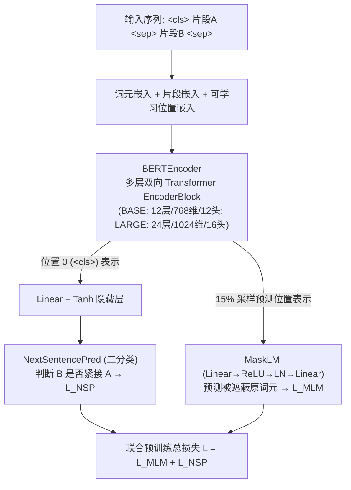

# 14. 自然语言处理：预训练

%% learning-vault-navigation:v1 %%
> [!abstract]- 笔记导航
> 目录：[[AI learning/D2L-李沐/动手学深度学习导航|动手学深度学习导航]]
> 上一章：[[AI learning/D2L-李沐/笔记/13. 计算机视觉|13. 计算机视觉]] · 下一章：[[AI learning/D2L-李沐/笔记/15. 自然语言处理：应用|15. 自然语言处理：应用]]

> [!abstract] 本章核心脉络
> 离散的独热（One-Hot）向量维度高且任意两词正交，无法表达任何语义相似度。本章完整呈现自然语言表示学习的三次范式跃迁：**静态分布式词向量（word2vec 跳元/CBOW + 负采样/层序 Softmax + 全局共现矩阵 GloVe）→ 打破词表边界的子词嵌入（fastText 与 BPE）→ 上下文敏感且任务无关的双向预训练语言模型（BERT：输入三嵌入 + MLM + NSP）**，为第 15 章的各类下游 NLP 应用奠定表示基石。

---

## 1. 静态词嵌入：word2vec 与近似训练

### 1.1 为什么独热向量行不通？

对于词表 $\mathcal{V}$，任意两个不同词的独热向量 $\mathbf{x}, \mathbf{y}$ 内积恒为 $0$，余弦相似度 $\frac{\mathbf{x}^\top\mathbf{y}}{\|\mathbf{x}\|\|\mathbf{y}\|} = 0$，模型无法从中得知“猫”比“汽车”更接近“狗”。**词嵌入（Word Embedding）**将每个词映射到低维稠密连续实向量空间，通过在大规模无标注语料上进行**自监督学习**捕获分布式语义。

### 1.2 Skip-Gram（跳元模型）与 CBOW（连续词袋模型）

word2vec 为词表中的每个词 $i$ 维护两套向量：作为**中心词**时的向量 $\mathbf{v}_i \in \mathbb{R}^d$ 与作为**上下文词**时的向量 $\mathbf{u}_i \in \mathbb{R}^d$（通常最终取中心词向量作为词表示）。

| 模型 | 核心假设与预测方向 | 条件概率定义 | 训练目标（最小化负对数似然） |
| --- | --- | --- | --- |
| **跳元模型 (Skip-Gram)** | 给定中心词 $w_c$，条件独立地生成窗口 $[-m, m]$ 内的周围上下文词 $w_o$ | $P(w_o \mid w_c) = \dfrac{\exp(\mathbf{u}_o^\top \mathbf{v}_c)}{\sum_{i \in \mathcal{V}} \exp(\mathbf{u}_i^\top \mathbf{v}_c)}$ | $-\sum_{t=1}^{T} \sum_{-m \le j \le m,\, j \ne 0} \log P(w^{(t+j)} \mid w^{(t)})$ |
| **连续词袋 (CBOW)** | 给定周围 $2m$ 个上下文词的平均向量 $\bar{\mathbf{v}}_o = \frac{1}{2m}\sum_{k=1}^{2m} \mathbf{v}_{o_k}$，预测中心词 $w_c$ | $P(w_c \mid \mathcal{W}_o) = \dfrac{\exp(\mathbf{u}_c^\top \bar{\mathbf{v}}_o)}{\sum_{i \in \mathcal{V}} \exp(\mathbf{u}_i^\top \bar{\mathbf{v}}_o)}$ | $-\sum_{t=1}^{T} \log P(w^{(t)} \mid \mathcal{W}^{(t)})$ |

### 1.3 全词表 Softmax 瓶颈与两种近似训练法

直接对 $\log P(w_o \mid w_c)$ 求梯度需要遍历整个词表 $\mathcal{V}$ 计算归一化分母（如数十万词），每步梯度代价高达 $\mathcal{O}(|\mathcal{V}|)$。`approx-training.ipynb` 给出两种经典加速方案：

1. **负采样（Negative Sampling）**：将多分类近似转化为“真实正样本对 $(w_c, w_o)$ 判为 1 + $K$ 个随机采样噪声词 $w_k \sim P(w)$ 判为 0”的独立二元分类。设 $P(D=1 \mid w_c, w_o) = \sigma(\mathbf{u}_o^\top \mathbf{v}_c)$，单对损失变为：
   $$
   -\log \sigma\left(\mathbf{u}_{i_{t+j}}^\top \mathbf{v}_{i_t}\right) - \sum_{k=1,\ w_k \sim P(w)}^{K} \log \sigma\left(-\mathbf{u}_{h_k}^\top \mathbf{v}_{i_t}\right)
   $$
   ==计算复杂度从 $\mathcal{O}(|\mathcal{V}|)$ 剧降至 $\mathcal{O}(K)$==（仅与噪声词数 $K$ 线性相关，噪声采样分布通常设为词频的 $0.75$ 次方以照顾低频词）。
2. **层序 Softmax（Hierarchical Softmax）**：构造以词表所有词为叶节点的二叉树，每个内部节点 $n$ 配备向量 $\mathbf{u}_n$。中心词生成上下文词 $w_o$ 的概率等于从根节点走到叶节点 $w_o$ 路径上每一步二分类选择左右子节点的概率连乘：
   $$
   P(w_o \mid w_c) = \prod_{j=1}^{L(w_o)-1} \sigma\left(\llbracket n(w_o, j+1) = \text{leftChild}(n(w_o, j)) \rrbracket \cdot \mathbf{u}_{n(w_o, j)}^\top \mathbf{v}_c\right)
   $$
   满足严格概率归一化 $\sum_{w \in \mathcal{V}} P(w \mid w_c) = 1$，单步计算复杂度降至 $\mathcal{O}(\log_2 |\mathcal{V}|)$。

### 1.4 预训练工程技巧与词向量评估

- **高频词下采样（Subsampling，`word-embedding-dataset.ipynb`）**：诸如 `"the"`、`"a"`、`"in"` 等高频停用词信息量低且拖慢训练，按如下概率随机丢弃词元 $w_i$（$f(w_i)$ 为词频占比，默认阈值 $t = 10^{-4}$）：
  $$
  P(w_i) = \max\left(1 - \sqrt{\frac{t}{f(w_i)}}, 0\right)
  $$
- **批量掩码训练（`word2vec-pretraining.ipynb`）**：由于每个中心词的上下文数与负样本数不固定，`batchify` 将它们拼接填充至统一长度 `max_len`，并配合 `masks`（区分真实样本与 `<pad>`）和 `labels`（正例为 1、负例与填充为 0）计算带掩码的二元交叉熵 `SigmoidBCELoss`。
- **相似性与类比推理（`similarity-analogy.ipynb`）**：利用预训练词向量的余弦相似度可检索语义近邻（`get_similar_tokens`），而向量空间线性算术支持词类比推理（`get_analogy`）：对于 $a : b :: c : d$，寻找与 $\mathbf{x}_b - \mathbf{x}_a + \mathbf{x}_c$ 余弦最接近的词向量（如 `man : woman :: son : daughter`、`beijing : china :: tokyo : japan`）。

---

## 2. GloVe 与子词嵌入（fastText、BPE）

### 2.1 全局向量（GloVe，`glove.ipynb`）

Skip-Gram 仅依赖局部滑动窗口采样，未能充分利用语料全局统计信息；且交叉熵对海量低频长尾词拟合成本高。GloVe 直接对整个语料预先统计**词-词共现计数矩阵 $x_{ij}$**，采用加权平方损失拟合对数共现次数：

$$
\mathcal{L}_{\mathrm{GloVe}} = \sum_{i \in \mathcal{V}} \sum_{j \in \mathcal{V}} h(x_{ij}) \left(\mathbf{u}_j^\top \mathbf{v}_i + b_i + c_j - \log x_{ij}\right)^2
$$

- **权重函数 $h(x)$**：当 $x < c$（如 $c=100$）时取 $(x/c)^\alpha$（$\alpha = 0.75$），否则截断为 $1$——既避免 $x_{ij} = 0$ 时 $\log 0$ 病态，又防止极高频停用词主导损失。
- **对称等价性**：由于 $x_{ij} = x_{ji}$，损失函数关于 $\mathbf{v}_i$ 与 $\mathbf{u}_j$ 完全对称，训练完毕后通常取 $\mathbf{v}_i + \mathbf{u}_i$ 作为词 $i$ 的最终词向量。
- **条件概率比值直觉**：$\exp(\mathbf{u}_j^\top\mathbf{v}_i) / \exp(\mathbf{u}_k^\top\mathbf{v}_i) \approx p_{ij}/p_{ik}$，通过比较共现概率的比值（如 `ice` 与 `steam` 相对于 `solid`/`gas`/`water` 的比值），线性分离出精准语义维度。

### 2.2 子词嵌入（`subword-embedding.ipynb`）

word2vec 与 GloVe 将每个词视作不可分割的原子，无法共享形态学词根（如 `help`/`helps`/`helped`），也无法处理未登录词（OOV）。两种主流子词方法打破了这一局限：

1. **fastText**：在词首尾加上边界符号（如 `<where>`），提取长度在 3–6 之间的所有字符 $n$-gram 及词本身构成子词集合 $\mathcal{G}_w$，将中心词向量表示为全部子词向量之和：
   $$
   \mathbf{v}_w = \sum_{g \in \mathcal{G}_w} \mathbf{z}_g
   $$
   即使面对词表外的新词，也可通过拆分字符子词求和获得有意义的语义向量（代价是子词表庞大、内存占用高）。
2. **字节对编码（Byte Pair Encoding, BPE）**：面向现代大模型分词的核心贪心算法：
   - **构建词表**：将训练语料所有词拆为单字符（附词尾标记 `_`）作为初始符号集；反复统计当前频次最高的相邻符号对（`get_max_freq_pair`）并将其合并为一个新子词加入词表（`merge_symbols`），直至达到预设词表上限。
   - **推理切分（`segment_BPE`）**：高频完整词保留为单符号，低频词/OOV 词则按贪心最长匹配拆分为已知子词片段，完美兼顾词表大小控制与零 OOV 覆盖。

---

## 3. BERT：来自 Transformers 的双向编码器表示

### 3.1 预训练语言模型的演进定位

静态词嵌入（word2vec / GloVe）对同一个多义词（如 `"crane"` 在 `"a crane is flying"` 与 `"a crane driver came"` 中）永远赋予相同向量 $f(x)$。向**上下文敏感表示** $f(x, c(x))$ 与**任务无关架构**演进的关键节点对比如下：

| 预训练模型 | 上下文敏感性 | 上下文编码方向 | 下游任务适配方式 | 核心优势与局限 |
| --- | --- | --- | --- | --- |
| **word2vec / GloVe** | 上下文无关 $f(x)$ | 局部窗口 / 全局共现 | 作为固定或微调初始词嵌入 | 简单轻量，但无法区分一词多义 |
| **ELMo** | 上下文敏感 | 双向（拼接前向+后向 LSTM） | 冻结参数，拼接到**任务特定模型**中 | 首次大规模证明深层双向特征威力，但仍需为每个任务定制专用架构 |
| **GPT** | 上下文敏感 | **单向（从左到右）** Transformer 解码器 | **任务无关**，全参数微调 + 极简线性头 | 统一了下游范式，但单向自回归限制了理解类任务利用右侧语境的能力 |
| **BERT** | 上下文敏感 | **深层双向** Transformer 编码器 | **任务无关**，全参数微调 + 极简线性头 | ==集 ELMo 双向编码与 GPT 任务无关微调之大成==，全面刷新理解类 NLP 基准 |

### 3.2 BERT 输入表示与整体架构（`bert.ipynb`）

BERT 同时支持**单个文本**（`<cls> A <sep>`）和**文本对**（`<cls> A <sep> B <sep>`）输入，输入序列在送入多层双向 `EncoderBlock` 之前，由==三组同维度嵌入逐元素相加==构成：

$$
\mathbf{E}_{\text{input}} = \mathbf{E}_{\text{token}} + \mathbf{E}_{\text{segment}} + \mathbf{E}_{\text{pos}}
$$

- **词元嵌入（Token Embedding）**：对应词表词元（含 `<cls>` 句首分类位、`<sep>` 分隔/结束位、`<mask>` 遮蔽位、`<pad>` 填充位）；
- **片段嵌入（Segment Embedding）**：取值 `0`（片段 A 及首尾标记）或 `1`（片段 B 及结尾标记），区分句对来源；
- **位置嵌入（Positional Embedding）**：与原始 Transformer 固定正弦函数不同，**BERT 的位置嵌入是可学习的模型参数** `nn.Parameter(torch.randn(1, max_len, num_hiddens))`。

### 3.3 两大自监督预训练任务（`bert-dataset.ipynb`, `bert-pretraining.ipynb`）

1. **掩蔽语言模型（Masked Language Modeling, MLM）**：
   - 常规语言模型只能从左到右预测（否则双向会直接看到待测词本身导致信息泄漏）。BERT 随机选取序列中 **15%** 的非特殊词元作为预测目标，迫使模型利用**双向上下文**填空还原原词。
   - **80% / 10% / 10% 替换策略**：由于下游微调时输入中不会出现 `<mask>` 词元，为避免预训练与微调的分布失配，对这 15% 被选中词元：
     - **80%** 概率替换为 `<mask>`；
     - **10%** 概率替换为词表中的随机词元；
     - **10%** 概率保持原词元不变。
   - 仅在采样出的预测位置通过 `MaskLM`（`Linear -> ReLU -> LayerNorm -> Linear(vocab_size)`）计算带掩码权重 `mlm_weights_X` 的交叉熵损失 `mlm_l`。
2. **下一句预测（Next Sentence Prediction, NSP）**：
   - MLM 聚焦词元级理解，无法显式建模句子间的逻辑连贯性（这对自然语言推断、问答等任务至关重要）。
   - 构造样本对时：**50%** 概率取同一段落中真实连续的下一句（正例 `1`），**50%** 概率从语料库其他段落随机采样一句（负例 `0`）。
   - 取出编码器在索引 `0`（`<cls>`）处的输出表示，经 `self.hidden`（`Linear + Tanh`）与 `NextSentencePred`（`Linear(num_hiddens, 2)`）做二分类，得到 `nsp_l`。
3. **模型规格与联合优化**：
   - 总损失为两任务直接相加：$L = L_{\mathrm{MLM}} + L_{\mathrm{NSP}}$（实验中 MLM 损失明显高于 NSP，因为 MLM 是在庞大词表上的多分类，而 NSP 只是二分类）。
   - 原论文两大标准规模：$\text{BERT}_{\text{BASE}}$（12 层、768 维、12 头、**1.1 亿参数**）与 $\text{BERT}_{\text{LARGE}}$（24 层、1024 维、16 头、**3.4 亿参数**），最大序列长度 512。

---

## 4. 配套材料与 Notebook

| 节次 | 主题 | Notebook 入口 | 核心代码 / 概念 |
| --- | --- | --- | --- |
| 14.0 | 章节导览 | [[AI learning/D2L-李沐/pytorch/chapter_natural-language-processing-pretraining/index.ipynb\|index.ipynb]] | NLP 预训练演进总览 |
| 14.1 | 词嵌入（word2vec） | [[AI learning/D2L-李沐/pytorch/chapter_natural-language-processing-pretraining/word2vec.ipynb\|word2vec.ipynb]] | Skip-Gram、CBOW 原理与梯度推导 |
| 14.2 | 近似训练 | [[AI learning/D2L-李沐/pytorch/chapter_natural-language-processing-pretraining/approx-training.ipynb\|approx-training.ipynb]] | 负采样与层序 Softmax 推导 |
| 14.3 | 词嵌入预训练数据集 | [[AI learning/D2L-李沐/pytorch/chapter_natural-language-processing-pretraining/word-embedding-dataset.ipynb\|word-embedding-dataset.ipynb]] | PTB 数据集、下采样、`RandomGenerator`、`batchify` |
| 14.4 | 预训练 word2vec | [[AI learning/D2L-李沐/pytorch/chapter_natural-language-processing-pretraining/word2vec-pretraining.ipynb\|word2vec-pretraining.ipynb]] | `skip_gram`、`SigmoidBCELoss`、余弦相似度查询 |
| 14.5 | 全局向量的词嵌入（GloVe） | [[AI learning/D2L-李沐/pytorch/chapter_natural-language-processing-pretraining/glove.ipynb\|glove.ipynb]] | 全局共现矩阵、加权平方损失与概率比值解释 |
| 14.6 | 子词嵌入 | [[AI learning/D2L-李沐/pytorch/chapter_natural-language-processing-pretraining/subword-embedding.ipynb\|subword-embedding.ipynb]] | fastText 子词求和、BPE 合并与 `segment_BPE` |
| 14.7 | 词的相似性和类比任务 | [[AI learning/D2L-李沐/pytorch/chapter_natural-language-processing-pretraining/similarity-analogy.ipynb\|similarity-analogy.ipynb]] | `TokenEmbedding`、`knn`、`get_analogy` |
| 14.8 | BERT 架构 | [[AI learning/D2L-李沐/pytorch/chapter_natural-language-processing-pretraining/bert.ipynb\|bert.ipynb]] | `BERTEncoder`、`MaskLM`、`NextSentencePred`、`BERTModel` |
| 14.9 | BERT 预训练数据集 | [[AI learning/D2L-李沐/pytorch/chapter_natural-language-processing-pretraining/bert-dataset.ipynb\|bert-dataset.ipynb]] | WikiText-2、`_get_nsp_data`、`_replace_mlm_tokens` |
| 14.10 | 预训练 BERT | [[AI learning/D2L-李沐/pytorch/chapter_natural-language-processing-pretraining/bert-pretraining.ipynb\|bert-pretraining.ipynb]] | `_get_batch_loss_bert`、`train_bert`、`get_bert_encoding` |

> [!question]- 复盘自测
> 1. **在 BERT 的 MLM 预训练任务中，为什么不能把被选中的 15% 词元 100% 全部替换为 `<mask>`，而要保留 10% 不变、10% 随机替换？**
>    - 因为在下游微调和推理时，输入句子里绝对不会出现 `<mask>` 标记。如果 100% 替换，模型会形成偷懒策略（只在看到 `<mask>` 时才依赖上下文推断，对正常词元几乎不构建深层双向语义表征）；加入 10% 原词与 10% 随机词，迫使模型对序列中**每一个位置**都必须结合双向上下文来编码表征。
> 2. **负采样与层序 Softmax 各自把 Skip-Gram 每步训练复杂度从 $\mathcal{O}(|\mathcal{V}|)$ 降到了多少？**
>    - 负采样降至与噪声词数线性相关的 $\mathcal{O}(K)$；层序 Softmax 降至与词表大小呈对数关系的 $\mathcal{O}(\log_2 |\mathcal{V}|)$。
> 3. **为什么说 BERT 结合了 ELMo 和 GPT 的优点？**
>    - ELMo 具备双向编码但需针对下游任务单独设计架构且通常冻结权重；GPT 实现了任务无关的端到端微调但只能从左到右单向编码；BERT 采用双向 Transformer 编码器 + MLM 预训练，既实现了深层双向语境感知，又保持了极简任务无关微调范式。
