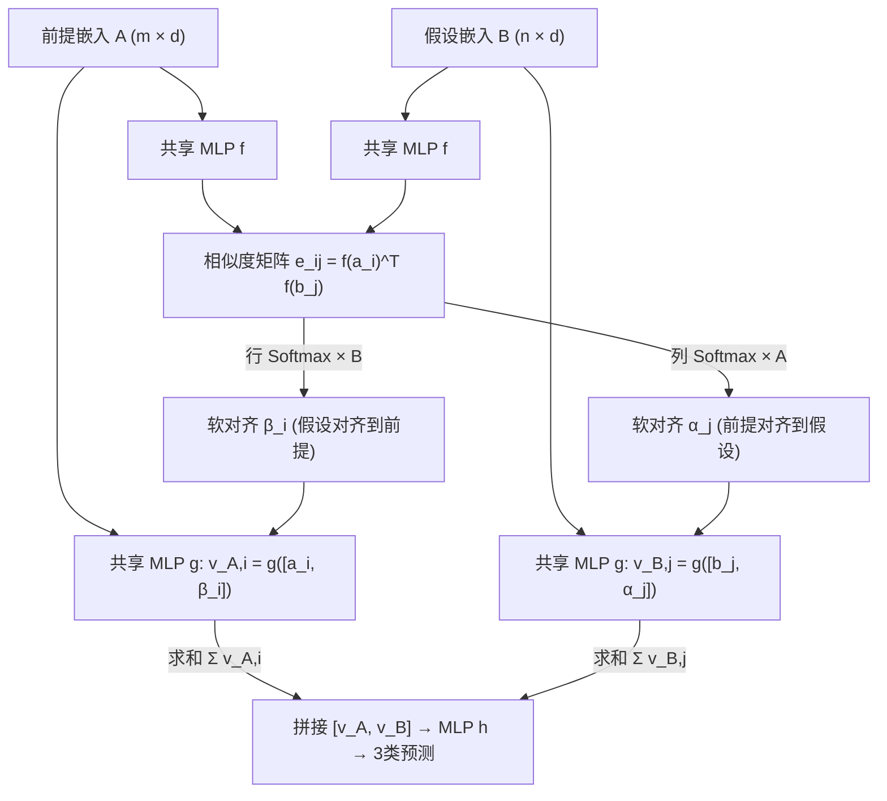

# 15. 自然语言处理：应用

%% learning-vault-navigation:v1 %%
> [!abstract]- 笔记导航
> 目录：[[AI learning/D2L-李沐/动手学深度学习导航|动手学深度学习导航]]
> 上一章：[[AI learning/D2L-李沐/笔记/14. 自然语言处理：预训练|14. 自然语言处理：预训练]]

> [!abstract] 本章核心脉络
> 本章将第 14 章学得的预训练静态词向量（GloVe）与上下文敏感模型（BERT）落地到两大代表性自然语言理解（NLU）下游任务——**单文本分类（IMDb 情感分析）**与**文本对关系推断（SNLI 自然语言推断）**，系统对比**双向 LSTM（BiRNN）**、**一维卷积（TextCNN）**、**可分解注意力（Decomposable Attention）**与**微调 BERT** 四类经典架构的设计哲学与适用场景，为全书画上完整句号。

---

## 1. 情感分析：BiRNN 与 TextCNN

情感分析（Sentiment Analysis）将变长文本序列映射为离散情感极性（积极 / 消极）。D2L 采用 **IMDb 影评数据集**（25,000 条训练评论 + 25,000 条测试评论，正负均衡），按 `min_freq=5` 构建词表并截断/填充为统一长度 `num_steps = 500`。

### 1.1 基于双向循环神经网络（`BiRNN`, `sentiment-analysis-rnn.ipynb`）

回顾第 9 章：双向 RNN 不能用于自回归预测未来，却==非常适合已知完整句子的文本编码与分类任务==。
- **预训练词嵌入加载与冻结**：加载 100 维预训练 GloVe 词向量写入 `net.embedding.weight.data`，并设置 `net.embedding.weight.requires_grad = False` 冻结词向量（减少小样本过拟合并降低参数更新量）。
- **双向特征聚合**：输入 `(batch_size, num_steps)` 先转置为 `(num_steps, batch_size)` 送入 2 层双向 LSTM（`bidirectional=True`），输出形状为 `(num_steps, batch_size, 2 * num_hiddens)`。由于前向分支在末步 `outputs[-1]` 汇总整句正向语境、后向分支在首步 `outputs[0]` 汇总整句逆向语境，将**首末两步隐状态拼接**为形状 `(batch_size, 4 * num_hiddens)` 的句向量，再送入 `nn.Linear(4 * num_hiddens, 2)` 分类。

```python
embeddings = self.embedding(inputs.T)                 # (num_steps, batch_size, embed_size)
self.encoder.flatten_parameters()
outputs, _ = self.encoder(embeddings)                 # (num_steps, batch_size, 2 * num_hiddens)
encoding = torch.cat((outputs[0], outputs[-1]), dim=1) # (batch_size, 4 * num_hiddens)
outs = self.decoder(encoding)                         # (batch_size, 2)
```

### 1.2 基于一维卷积神经网络（`TextCNN`, `sentiment-analysis-cnn.ipynb`）

将文本视为高度为 1、宽度为序列长度 $n$、通道数为词向量维度 $d$ 的一维信号，一维卷积核（宽度 $k$）沿时间轴滑动恰好充当**局部 $n$-gram 短语特征检测器**（例如捕获 `"not very good"` 之类的情感反转短语）。多输入通道的一维互相关在数学上等价于卷积核宽度等于 $d$ 的单通道二维互相关。

- **双通道词嵌入设计**：`TextCNN` 并行维护两层嵌入并沿特征维拼接为 `2 * embed_size` 通道：
  - `self.embedding`：以 GloVe 初始化且**参与反向传播微调**，捕获任务特定情感偏移；
  - `self.constant_embedding`：以 GloVe 初始化且**全程冻结**，锚定通用语义以防过拟合。
- **多尺度卷积 + 时间维全局汇聚**：并行使用多种宽度卷积核（如 `kernel_sizes = [3, 4, 5]`，各配 `num_channels = [100, 100, 100]`），输入需经 `permute(0, 2, 1)` 转为 PyTorch `Conv1d` 要求的 `(batch_size, channels, seq_len)`。每个卷积输出经时间维全局汇聚压缩为 `(batch_size, c, 1)`，抹去序列长度差异后拼接成 300 维特征向量，再经 `Dropout(0.5)` 与 `Linear(300, 2)` 输出预测。

> [!note] 源码实现细节核查
> 在经典 TextCNN 论文与教材文字讲解中，卷积后的汇聚层为**最大时间汇聚（Max-over-Time Pooling）**，旨在提取每个卷积核通道在整个句子中的最强 $n$-gram 激活响应；而在本地配套 `sentiment-analysis-cnn.ipynb` 的 PyTorch 代码单元格中实际使用了 `self.pool = nn.AdaptiveAvgPool1d(1)`（自适应平均池化，同样无参数且可将任意长度序列压为 1）。工程复现时可根据需要对比 `nn.AdaptiveMaxPool1d(1)` 与 `nn.AdaptiveAvgPool1d(1)` 的验证集效果。

---

## 2. 自然语言推断与可分解注意力模型

### 2.1 任务定义与 SNLI 数据集

**自然语言推断（Natural Language Inference, NLI）**判断一段**假设（Hypothesis）**能否从给定的**前提（Premise）**推导出来，是典型的**文本对三分类**任务：
- **蕴涵（Entailment）**：前提逻辑上能推出假设；
- **矛盾（Contradiction）**：假设与前提语义冲突；
- **中性（Neutral）**：前提既不能证实也不能证伪假设。

**斯坦福自然语言推断（SNLI）数据集**包含约 55 万训练句对与 1 万验证/测试句对；`SNLIDataset` 对前提和假设分别截断/填充至 `num_steps = 50`。

### 2.2 可分解注意力模型（Decomposable Attention，`natural-language-inference-attention.ipynb`）

相比用深层 RNN 编码两句话再交互，Parikh 等人提出的可分解注意力模型仅靠**逐词 MLP 与软对齐机制**即可高度并行地完成细粒度短语比对，严格拆分为==注意（Attend）→ 比较（Compare）→ 聚合（Aggregate）==三步：



1. **注意（Attending，软对齐）**：设前提 $\mathbf{A}=(\mathbf{a}_1,\ldots,\mathbf{a}_m)$、假设 $\mathbf{B}=(\mathbf{b}_1,\ldots,\mathbf{b}_n)$。采用**分解技巧**：先用同一 MLP $f$ 分别映射每个词元（复杂度仅 $\mathcal{O}(m+n)$，避免直接拼接所有 $m \times n$ 词对送入 MLP 的二次 MLP 代价），再点积求权重矩阵 $e_{ij} = f(\mathbf{a}_i)^\top f(\mathbf{b}_j)$，分别沿行、列 Softmax 得到双向软对齐表示：
   $$
   \boldsymbol{\beta}_i = \sum_{j=1}^{n} \frac{\exp(e_{ij})}{\sum_{k=1}^{n} \exp(e_{ik})} \mathbf{b}_j, \qquad \boldsymbol{\alpha}_j = \sum_{i=1}^{m} \frac{\exp(e_{ij})}{\sum_{k=1}^{m} \exp(e_{kj})} \mathbf{a}_i
   $$
2. **比较（Comparing）**：将每个词元与其跨句软对齐上下文拼接，送入共享 MLP $g$ 逐位置判别局部匹配或冲突：
   $$
   \mathbf{v}_{A,i} = g([\mathbf{a}_i, \boldsymbol{\beta}_i]), \qquad \mathbf{v}_{B,j} = g([\mathbf{b}_j, \boldsymbol{\alpha}_j])
   $$
3. **聚合（Aggregating）**：对两组比较向量分别求和池化为固定长度表示 $\mathbf{v}_A = \sum_{i=1}^m \mathbf{v}_{A,i}$、$\mathbf{v}_B = \sum_{j=1}^n \mathbf{v}_{B,j}$，拼接后经最终分类 MLP $h([\mathbf{v}_A, \mathbf{v}_B])$ 输出三分类概率。

---

## 3. 面向下游 NLP 应用微调 BERT

BiRNN、TextCNN 和可分解注意力虽轻量高效，但仍需针对每类任务手工设计专用网络。利用第 14 章预训练好的 **BERT**，==只需在编码器顶部附加极简线性/MLP 输出层，并对预训练主干与新增输出层联合端到端微调==，即可统一覆盖序列级与词元级四大核心应用（`finetuning-bert.ipynb`）。

### 3.1 四大下游任务微调范式总览

| 任务层级 | 下游任务类型 | 代表任务 / 数据集 | BERT 输入格式 | 顶部微调结构与输出读取 |
| --- | --- | --- | --- | --- |
| **序列级** | **单文本分类** | 情感分析（IMDb）、语法可接受性（CoLA） | `<cls> 文本 <sep>` | 取 `<cls>` 位置向量 $\mathbf{h}_{\text{cls}}$ 接入线性层/小 MLP 预测类别 |
| **序列级** | **文本对分类 / 回归** | 自然语言推断（SNLI）、语义相似度（STS-B） | `<cls> 句A <sep> 句B <sep>` | 取 `<cls>` 位置向量 $\mathbf{h}_{\text{cls}}$ 接线性分类头（离散）或标量回归头（连续） |
| **词元级** | **文本标注（序列标注）** | 词性标注（POS）、命名实体识别（NER） | `<cls> 文本 <sep>` | 对**每个普通词元**的最终表示 $\mathbf{h}_i$ 分别施加共享线性层预测该词标签 |
| **词元级** | **抽取式问答（QA）** | SQuAD（在给定段落中定位答案片段） | `<cls> 问题 <sep> 段落 <sep>` | 仅引入两个权重向量，对段落每个词元分别计算作为答案**起始位置**与**结束位置**的 Softmax 概率，预测最大联合分数的合法区间 $[s, e]$（$s \le e$） |

### 3.2 SNLI 微调 BERT 实战要点（`natural-language-inference-bert.ipynb`）

1. **预处理与交替截断（`SNLIBERTDataset`）**：
   - 将前提和假设分别作为片段 A（`segment=0`）与片段 B（`segment=1`），拼装为 `<cls> 前提 <sep> 假设 <sep>`；
   - 若总词元数超过 `max_len - 3`，`_truncate_pair_of_tokens` 每次从**当前更长**的那一句末尾截去一个词元，尽量均衡保留前提与假设的语义信息；
   - 由于 SNLI 样本量超 50 万，使用 Python `multiprocessing.Pool` 并行预处理加速数据构建。
2. **微调模型封装（`BERTClassifier`）**：
   ```python
   class BERTClassifier(nn.Module):
       def __init__(self, bert):
           super().__init__()
           self.encoder = bert.encoder
           self.hidden = bert.hidden      # 复用预训练 NSP 前的 Linear + Tanh 池化层
           self.output = nn.Linear(256, 3) # 仅此层从零随机初始化

       def forward(self, inputs):
           tokens_X, segments_X, valid_lens_x = inputs
           encoded_X = self.encoder(tokens_X, segments_X, valid_lens_x)
           return self.output(self.hidden(encoded_X[:, 0, :]))
   ```
   - 预训练模型中仅用于预训练损失的 `bert.mlm` 与 `bert.nsp` 头不会被接入计算图，在微调期间不会产生梯度更新；
   - `bert.encoder` 与 `bert.hidden` 的预训练权重则以较小学习率（如 `lr = 1e-4`，Adam 优化器，5 个 epoch）与新分类头协同微调，在轻量级 `bert.small`（2 层、256 维、4 头）上即可快速收敛并显著超越无预训练架构。

---

## 4. 四类 NLP 模型综合选型对比

| 架构 | 核心机制 | 优点 | 局限与适用边界 |
| --- | --- | --- | --- |
| **BiRNN (BiLSTM)** | 双向时序递归 + 首末状态拼接 | 天然建模长程语序依赖，参数量适中 | 难以沿时间步并行，长文本训练慢 |
| **TextCNN** | 多宽度 1D 卷积 + 时间维汇聚 | 高度并行、推理极快，极擅长捕捉局部关键 $n$-gram | 难以直接捕捉跨远距离的全局句法逻辑 |
| **可分解注意力** | 逐词 MLP + 双向软对齐比较聚合 | 参数极少、全并行、针对句对推断效率极高 | 忽略词序细节，复杂推理与跨任务通用性有限 |
| **微调 BERT** | 深层双向 Transformer + 大规模自监督预训练 | ==上下文敏感、小标注样本泛化极强、全任务统一架构== | 参数庞大、显存与推理延迟高，受限于最大序列长度 |

---

## 5. 配套材料与 Notebook

| 节次 | 主题 | Notebook 入口 | 核心代码 / 概念 |
| --- | --- | --- | --- |
| 15.0 | 章节导览 | [[AI learning/D2L-李沐/pytorch/chapter_natural-language-processing-applications/index.ipynb\|index.ipynb]] | NLP 下游应用总览 |
| 15.1 | 情感分析及数据集 | [[AI learning/D2L-李沐/pytorch/chapter_natural-language-processing-applications/sentiment-analysis-and-dataset.ipynb\|sentiment-analysis-and-dataset.ipynb]] | IMDb 数据集、`load_data_imdb` |
| 15.2 | 情感分析：使用 RNN | [[AI learning/D2L-李沐/pytorch/chapter_natural-language-processing-applications/sentiment-analysis-rnn.ipynb\|sentiment-analysis-rnn.ipynb]] | `BiRNN`（双向 LSTM + GloVe 冻结嵌入） |
| 15.3 | 情感分析：使用 CNN | [[AI learning/D2L-李沐/pytorch/chapter_natural-language-processing-applications/sentiment-analysis-cnn.ipynb\|sentiment-analysis-cnn.ipynb]] | `corr1d`、`TextCNN`（双通道嵌入 + 多尺度 1D 卷积） |
| 15.4 | 自然语言推断与数据集 | [[AI learning/D2L-李沐/pytorch/chapter_natural-language-processing-applications/natural-language-inference-and-dataset.ipynb\|natural-language-inference-and-dataset.ipynb]] | SNLI 语料、`SNLIDataset`、`load_data_snli` |
| 15.5 | 自然语言推断：使用注意力 | [[AI learning/D2L-李沐/pytorch/chapter_natural-language-processing-applications/natural-language-inference-attention.ipynb\|natural-language-inference-attention.ipynb]] | `Attend`、`Compare`、`Aggregate`、`DecomposableAttention` |
| 15.6 | 微调 BERT 范式 | [[AI learning/D2L-李沐/pytorch/chapter_natural-language-processing-applications/finetuning-bert.ipynb\|finetuning-bert.ipynb]] | 单文本/文本对/序列标注/抽取式问答微调图谱 |
| 15.7 | 自然语言推断：微调 BERT | [[AI learning/D2L-李沐/pytorch/chapter_natural-language-processing-applications/natural-language-inference-bert.ipynb\|natural-language-inference-bert.ipynb]] | `SNLIBERTDataset`、`BERTClassifier` 微调实战 |

> [!question]- 复盘自测
> 1. **在 `BiRNN` 情感分析中，为什么要拼接 `outputs[0]` 和 `outputs[-1]`，而不是只取 `outputs[-1]`？**
>    - `outputs` 由前向与后向隐状态拼接而成：`outputs[-1]` 包含完整句子的前向汇总信息，但其后向分支只看到了最后一个词；而 `outputs[0]` 的后向分支遍历了从句尾到句首的完整逆向信息。同时拼接首末两步，才能把双向上下文完整无损地送入分类器。
> 2. **为什么 `TextCNN` 要同时设计一个可训练嵌入层和一个冻结的 `constant_embedding`？**
>    - 预训练 GloVe 向量凝聚了大规模语料的通用语义，完全放开微调在较小数据集上容易偏离原有分布导致过拟合；而完全冻结又无法适配情感分析特有的领域词义。双通道拼接兼顾了“保留通用先验”与“学习任务特化表示”两重收益。
> 3. **用 BERT 做序列标注（词性标注/NER）与做单文本分类，在模型头部设计上有什么核心区别？**
>    - 单文本分类属于序列级任务，只需提取句首 `<cls>` 位置的单一表示接分类头输出整句类别；序列标注属于词元级任务，需要对输入序列中**每一个普通词元**的最终隐状态独立施加共享线性层，逐词输出对应标签。
