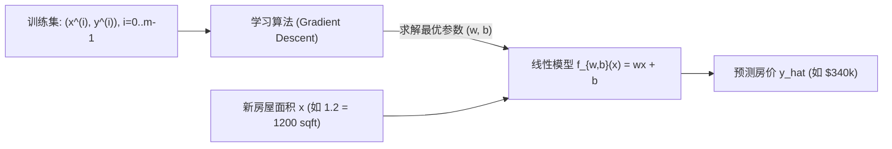

# C1 Week 1：监督学习与单变量线性回归

%% learning-vault-navigation:v1 %%
> [!abstract]- 笔记导航
> 目录：[[AI learning/Machine Learning Specialization Coursera/C1 - Supervised Machine Learning - Regression and Classification/机器学习C1监督学习导航|机器学习 C1 监督学习导航]]
> 下一章：[[AI learning/Machine Learning Specialization Coursera/C1 - Supervised Machine Learning - Regression and Classification/week2/Week 2 多元线性回归与梯度下降实践|C1 Week 2：多元线性回归与梯度下降实践]]

> [!abstract] 本周学习概览与原始资料
> 本周搭建机器学习的第一块基石：系统区分**监督学习**与**无监督学习**，建立**单变量线性回归**的完整数学框架（假设函数 $f_{w,b}(x)$、均方误差代价函数 $J(w,b)$、凸“汤碗”曲面几何直觉），并亲手用 Python/NumPy 实现 **梯度下降（Gradient Descent）** 自动求解最优参数，深入理解同步更新与学习率 $\alpha$ 对收敛/发散的决定性影响。
> - 本周索引：[[AI learning/Machine Learning Specialization Coursera/C1 - Supervised Machine Learning - Regression and Classification/week1/机器学习C1第1周导航|机器学习 C1 第 1 周导航]]
> - 配套测验：
>   - [[AI learning/Machine Learning Specialization Coursera/C1 - Supervised Machine Learning - Regression and Classification/week1/Practice quiz - Supervised vs unsupervised learning/C1W1监督与无监督学习测验导航|Practice Quiz: Supervised vs Unsupervised Learning]]
>   - [[AI learning/Machine Learning Specialization Coursera/C1 - Supervised Machine Learning - Regression and Classification/week1/Practice quiz - Regression/C1W1回归测验导航|Practice Quiz: Regression]]
>   - [[AI learning/Machine Learning Specialization Coursera/C1 - Supervised Machine Learning - Regression and Classification/week1/Practice quiz - Train the model with gradient descent/C1W1梯度下降训练测验导航|Practice Quiz: Train the Model with Gradient Descent]]

---

## 1. 机器学习范式：监督学习 vs. 无监督学习

Arthur Samuel（1959）将机器学习定义为：“在不进行显式编程的情况下，赋予计算机学习能力的研究领域。” 现代机器学习最核心的两大基础范式对比如下：

| 范式 | 训练数据特征 | 核心目标 | 典型子类型与示例 |
| :--- | :--- | :--- | :--- |
| **监督学习（Supervised Learning）** | 同时给出输入特征 $x$ 与正确标签 $y$（"Right answers"） | 学习 $x \to y$ 的精准映射以预测新样本 | **回归（Regression）**：输出连续无限可能数值（如房价预测）<br>**分类（Classification）**：输出有限离散类别（如肿瘤良性/恶性判断） |
| **无监督学习（Unsupervised Learning）** | 只有输入数据 $x$，**没有任何标签 $y$** | 让算法自主发现数据内部隐藏结构或模式 | **聚类（Clustering）**：谷歌新闻聚合、DNA 基因分群、客户细分<br>**异常检测（Anomaly Detection）**：金融欺诈监测<br>**降维（Dimensionality Reduction）**：高维数据压缩 |

---

## 2. 单变量线性回归模型表示（Model Representation）

以房价预测为驱动案例：输入特征为房屋面积（单位：$1000\text{ sqft}$），输出目标为房屋售价（单位：千美元）。

### 2.1 课程标准符号与 Python 命名对照

| 数学符号 | 含义说明 | 代码变量名 |
| :---: | :--- | :---: |
| $m$ | 训练样本总数（`x_train.shape[0]` 或 `len(x_train)`） | `m` |
| $x, y$ | 输入特征（Feature）与输出目标（Target） | `x_train`, `y_train` |
| $(x^{(i)}, y^{(i)})$ | 第 $i$ 个训练样本（数学常从 $1$ 起，Python 从 `0` 到 `m-1`） | `x_i`, `y_i` |
| $w, b$ | 模型参数：权重/斜率（weight）与偏置/截距（bias） | `w`, `b` |
| $f_{w,b}(x^{(i)})$ | 模型在样本 $x^{(i)}$ 上的预测输出（记作 $\hat{y}^{(i)}$） | `f_wb` |

### 2.2 线性模型假设函数

单变量线性回归（Linear Regression with One Variable，又称 Univariate Linear Regression）假设输入与输出呈线性关系：

$$
f_{w,b}(x^{(i)}) = w x^{(i)} + b
$$



在 [[AI learning/Machine Learning Specialization Coursera/C1 - Supervised Machine Learning - Regression and Classification/week1/Optional Labs/C1_W1_Lab02_Model_Representation_Soln.ipynb|Lab02: Model Representation]] 的两点示例 `(1.0, 300)` 与 `(2.0, 500)` 中：
- 初始尝试 $w=100, b=100$ 明显欠拟合；
- 调整为 $w=200, b=100$ 后直线完美穿过两点，进而可预测 `1200 sqft`（$x=1.2$）房价为 `200 * 1.2 + 100 = 340`（即 34 万美元）。

---

## 3. 代价函数（Cost Function）与几何直觉

如何量化一组参数 $(w, b)$ 拟合训练集的好坏？我们定义 ==均方误差代价函数（Squared Error Cost Function）==：

$$
J(w, b) = \frac{1}{2m} \sum_{i=0}^{m-1} \left( f_{w,b}(x^{(i)}) - y^{(i)} \right)^2 = \frac{1}{2m} \sum_{i=0}^{m-1} \left( w x^{(i)} + b - y^{(i)} \right)^2
$$

我们的优化目标是寻找使代价最小的参数对：

$$
\min_{w, b} J(w, b)
$$

> [!tip] 为什么分母多乘了一个 $2$（即 $\frac{1}{2m}$ 而非 $\frac{1}{m}$）？
> 1. 乘以常数 $\frac{1}{2}$ **完全不改变**最小值点 $(w^*, b^*)$ 的位置；
> 2. 在后续对 $w, b$ 求偏导时，平方项求导产生的系数 $2$ 会与 $\frac{1}{2}$ 恰好约去，让梯度公式无比整洁。

### 3.1 代价函数的几何直觉（Lab03 核心观察）

在 [[AI learning/Machine Learning Specialization Coursera/C1 - Supervised Machine Learning - Regression and Classification/week1/Optional Labs/C1_W1_Lab03_Cost_function_Soln.ipynb|Lab03: Cost Function]] 中，通过一维切片、3D 曲面与等高线图（Contour Plot）可以建立三条关键直觉：

1. **一维抛物线（固定 $b=100$）**：$J(w)$ 关于 $w$ 是一条开口向上的抛物线，在 $w=200$ 处取到最小值 $0$；误差经平方放大，偏离越远代价增长越快。
2. **多点真实数据最小代价非零**：当加入 6 个不在同一直线上的样本 `x=[1.0, 1.7, 2.0, 2.5, 3.0, 3.2]`、`y=[250, 300, 480, 430, 630, 730]` 时，在约 $w \approx 209, b \approx 2.4$ 处达到最低代价，但**最小代价大于 0**。
3. **严格的凸“汤碗”曲面（Convex Soup Bowl）**：线性回归的平方误差代价函数在 $(w, b)$ 空间上恒为**凸函数**——**没有局部极小值陷阱**，只有唯一的全局最小值（Global Minimum），从任意初值沿负梯度方向下降都保证走向碗底。

---

## 4. 梯度下降算法（Gradient Descent）

梯度下降是一种通用的迭代优化算法，不仅适用于线性回归，也是整个深度学习训练的核心引擎。

### 4.1 迭代更新规则与偏导推导

重复以下步骤直至收敛（Repeat until convergence）：

$$
\begin{aligned}
w &= w - \alpha \frac{\partial J(w, b)}{\partial w} \\
b &= b - \alpha \frac{\partial J(w, b)}{\partial b}
\end{aligned}
$$

其中 $\alpha > 0$ 称为 ==学习率（Learning Rate）==，控制每次更新的步长；利用链式法则对 $J(w, b)$ 求偏导，得到两个梯度解析式：

$$
\begin{aligned}
\frac{\partial J(w, b)}{\partial w} &= \frac{1}{m} \sum_{i=0}^{m-1} \left( f_{w,b}(x^{(i)}) - y^{(i)} \right) x^{(i)} \\
\frac{\partial J(w, b)}{\partial b} &= \frac{1}{m} \sum_{i=0}^{m-1} \left( f_{w,b}(x^{(i)}) - y^{(i)} \right)
\end{aligned}
$$

> [!important] 为什么必须“同步更新（Simultaneous Update）”？
> 在同一次迭代中，必须先用**当前旧的 $(w, b)$** 同时算出 `dj_dw` 和 `dj_db`，再统一更新 `w` 和 `b`：
> ```python
> tmp_w = w - alpha * dj_dw
> tmp_b = b - alpha * dj_db
> w, b = tmp_w, tmp_b
> ```
> 如果先覆盖更新了 `w`，再用新 `w` 去算 $\frac{\partial J}{\partial b}$，就不再是标准的梯度下降算法，数值行为会出错。

### 4.2 梯度方向与学习率 $\alpha$ 的动力学机制

1. **为什么是“减去”梯度？**
   - 梯度方向指向函数值**上升最快**的方向（背离碗底）。
   - 在最小值右侧，导数 $\frac{\partial J}{\partial w} > 0$，减去正值使 $w$ 减小（向左移）；在左侧，导数 $< 0$，减去负值使 $w$ 增大（向右移）。
2. **固定 $\alpha$ 为何也能自然收敛？**
   - 随着参数逼近碗底，曲面越来越平缓，导数 $|\frac{\partial J}{\partial w}|$ 自动趋近于 $0$；因此即使 $\alpha$ 保持固定，实际更新步长 $-\alpha \frac{\partial J}{\partial w}$ 也会**自动变小**，最终平稳停在极小值点。
3. **学习率 $\alpha$ 选择不当的两种极端**：

| 学习率情况 | 现象与代价曲线表现 | Lab04 实验佐证 |
| :--- | :--- | :--- |
| **$\alpha$ 过小** | 每次更新步子太小，代价虽单调下降，但收敛极慢，需要极多迭代 | —— |
| **$\alpha$ 适中** | 代价前期骤降、后期平滑趋零；参数沿等高线法向稳步逼近 $(200, 100)$ | `alpha = 1.0e-2`，10000 步：`Cost` 从 `7.93e+04` 降至 `9.95e-03`（第 5000 步）并收敛至 `(199.99, 100.01)` |
| **$\alpha$ 过大** | 一步跨过碗底到达对侧更高处，梯度符号每次翻转且绝对值越来越大，代价指数级**发散（Diverge）** | `alpha = 8.0e-1`：仅 5 步 `Cost` 就从 `2.58e+05` 暴涨至 `6.62e+07`，`w` 在 `+520 → -384 → +1192 → -1551 → +3228` 剧烈震荡 |

> [!note] 批量梯度下降（Batch Gradient Descent）
> 本周实现的梯度下降在**每一步更新**时都对**全部 $m$ 个训练样本**求和计算梯度，这在学术界称为 **Batch Gradient Descent**。

---

## 5. 核心代码模式与 Optional Labs 精要

本周 4 个实验从零搭建了单变量线性回归的核心模块：

```python
def compute_cost(x, y, w, b):
    m = x.shape[0]
    cost_sum = 0.0
    for i in range(m):
        f_wb = w * x[i] + b
        cost_sum += (f_wb - y[i]) ** 2
    return cost_sum / (2 * m)


def compute_gradient(x, y, w, b):
    m = x.shape[0]
    dj_dw, dj_db = 0.0, 0.0
    for i in range(m):
        err = (w * x[i] + b) - y[i]
        dj_dw += err * x[i]
        dj_db += err
    return dj_dw / m, dj_db / m


def gradient_descent(x, y, w_in, b_in, alpha, num_iters):
    w, b = w_in, b_in
    J_history = []
    for i in range(num_iters):
        dj_dw, dj_db = compute_gradient(x, y, w, b)
        # 同步更新（先算完梯度再统一赋值）
        w = w - alpha * dj_dw
        b = b - alpha * dj_db
        J_history.append(compute_cost(x, y, w, b))
    return w, b, J_history
```

| 实验文件 | 核心练习内容与关键收获 |
| :--- | :--- |
| [[AI learning/Machine Learning Specialization Coursera/C1 - Supervised Machine Learning - Regression and Classification/week1/Optional Labs/C1_W1_Lab01_Python_Jupyter_Soln.ipynb\|Lab01: Python & Jupyter]] | 熟悉 Jupyter Markdown/Code Cell 切换、快捷键运行与 Python `f-string` 格式化输出 |
| [[AI learning/Machine Learning Specialization Coursera/C1 - Supervised Machine Learning - Regression and Classification/week1/Optional Labs/C1_W1_Lab02_Model_Representation_Soln.ipynb\|Lab02: Model Representation]] | 用 NumPy 1D 数组存储 `x_train, y_train`，实现 `compute_model_output`，手动调试 $w=200, b=100$ 并预测 1200 sqft 房价（\$340k） |
| [[AI learning/Machine Learning Specialization Coursera/C1 - Supervised Machine Learning - Regression and Classification/week1/Optional Labs/C1_W1_Lab03_Cost_function_Soln.ipynb\|Lab03: Cost Function]] | 实现 `compute_cost`，借助交互滑块、等高线点击与 3D `soup_bowl()` 建立平方误差凸曲面直觉 |
| [[AI learning/Machine Learning Specialization Coursera/C1 - Supervised Machine Learning - Regression and Classification/week1/Optional Labs/C1_W1_Lab04_Gradient_Descent_Soln.ipynb\|Lab04: Gradient Descent]] | 实现 `compute_gradient` 与 `gradient_descent`；绘制代价曲线（前段/尾段分开缩放）、梯度箭头图与学习率过大发散对比实验 |

---

## 6. 本周自测与易错点回顾

> [!question]- Week 1 核心自检清单
> 1. **给定一批无标签用户消费记录，想自动划分出不同消费群体，属于哪类学习？**
>    - 无监督学习中的**聚类（Clustering）**。
> 2. **为什么绘制 Cost vs. Iteration 时，常常要把前 100 步与后 1000 步分两个子图画？**
>    - 初期代价下降极快（量级从 $10^4$ 掉到个位数），若画在同一纵轴上，后期细微的收敛趋势会被压缩成一条直线，难以判断是否真正收敛。
> 3. **如果已处于局部/全局极小值点，再执行一步梯度下降会发生什么？**
>    - 该点偏导数 $\frac{\partial J}{\partial w} = 0, \frac{\partial J}{\partial b} = 0$，因此 $w = w - \alpha \cdot 0 = w$，参数保持不变。
> 4. **发现训练时 Cost 随迭代次数不降反升，首要排查哪两个问题？**
>    - 第一检查**学习率 $\alpha$ 是否过大**导致震荡发散；第二检查**梯度公式实现或更新符号**（是否误写成 `+ alpha * dj`）是否有 Bug。
