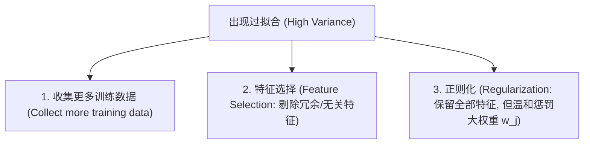

# C1 Week 3：逻辑回归分类与正则化

%% learning-vault-navigation:v1 %%
> [!abstract]- 笔记导航
> 目录：[[AI learning/Machine Learning Specialization Coursera/C1 - Supervised Machine Learning - Regression and Classification/机器学习C1监督学习导航|机器学习 C1 监督学习导航]]
> 上一章：[[AI learning/Machine Learning Specialization Coursera/C1 - Supervised Machine Learning - Regression and Classification/week2/Week 2 多元线性回归与梯度下降实践|C1 Week 2：多元线性回归与梯度下降实践]]

> [!abstract] 本周学习概览与原始资料
> 本周进入监督学习的另一大核心任务——**二分类（Binary Classification）**，并解决机器学习中最关键的泛化挑战——**过拟合（Overfitting）**：系统掌握线性回归用于分类的失效机制、Sigmoid 函数与概率解释、线性与非线性决策边界、凸的交叉熵/逻辑损失代价函数、逻辑回归梯度下降，以及面向线性回归与逻辑回归的 **L2 正则化（Regularization）**；最后完整复盘 **C1W3A1 大学录取预测 & 微芯片质检（6 次多项式特征映射 + L2 正则化）** 编程作业。
> - 本周索引：[[AI learning/Machine Learning Specialization Coursera/C1 - Supervised Machine Learning - Regression and Classification/week3/机器学习C1第3周导航|机器学习 C1 第 3 周导航]]
> - 配套测验：
>   - [[AI learning/Machine Learning Specialization Coursera/C1 - Supervised Machine Learning - Regression and Classification/week3/Practice quiz - Classification with logistic regression/C1W3逻辑回归分类测验导航|Practice Quiz: Classification with Logistic Regression]]
>   - [[AI learning/Machine Learning Specialization Coursera/C1 - Supervised Machine Learning - Regression and Classification/week3/Practice quiz - Cost function for logistic regression/C1W3逻辑回归代价函数测验导航|Practice Quiz: Cost Function for Logistic Regression]]
>   - [[AI learning/Machine Learning Specialization Coursera/C1 - Supervised Machine Learning - Regression and Classification/week3/Practice quiz - Gradient descent for logistic regression/C1W3逻辑回归梯度下降测验导航|Practice Quiz: Gradient Descent for Logistic Regression]]
>   - [[AI learning/Machine Learning Specialization Coursera/C1 - Supervised Machine Learning - Regression and Classification/week3/Practise quiz - The problem of overfitting/C1W3过拟合测验导航|Practice Quiz: The Problem of Overfitting]]
> - 编程作业：[[AI learning/Machine Learning Specialization Coursera/C1 - Supervised Machine Learning - Regression and Classification/week3/C1W3A1/C1_W3_Logistic_Regression.ipynb|C1W3A1: Logistic Regression (Admission & Microchip QA)]]
> - 延伸参考：[[AI learning/Machine Learning Specialization Coursera/黄博士机器学习个人笔记完整版v5.52.pdf|黄博士机器学习参考笔记]] · [[AI learning/D2L-李沐/动手学深度学习导航|动手学深度学习]]

---

## 1. 为什么线性回归不适合分类任务？

在二分类问题中（如垃圾邮件判断、肿瘤良性 $y=0$ / 恶性 $y=1$），输出仅取两个离散值 $y \in \{0, 1\}$。在 [[AI learning/Machine Learning Specialization Coursera/C1 - Supervised Machine Learning - Regression and Classification/week3/Optional Labs/C1_W3_Lab01_Classification_Soln.ipynb|Lab01: Classification]] 中，交互实验清楚展示了强行使用线性回归 + 阈值 `0.5` 的两大缺陷：

1. **输出范围越界**：线性函数 $wx+b$ 可以输出远大于 $1$ 或远小于 $0$ 的值，无法解释为类别概率；
2. **对极端离群正样本极度敏感**：原本在 `x = [0,1,2,3,4,5]` 上用 `0.5` 阈值能分对，一旦在右侧新增一个极大肿瘤（如 $x = 10, y = 1$），为了拉平平方误差，拟合直线会被大幅压扁、向右倾斜，导致原本正确的边界恶性样本 $x = 3$ 被错误分类为良性！

---

## 2. 逻辑回归模型、Sigmoid 函数与决策边界

### 2.1 Sigmoid（Logistic）函数与概率语义

逻辑回归（Logistic Regression）在原有线性打分 $z = \mathbf{w} \cdot \mathbf{x} + b$ 之外套上一层 ==Sigmoid 函数==，将任意实数平滑压缩到开区间 $(0, 1)$：

$$
f_{\mathbf{w}, b}(\mathbf{x}) = g(\mathbf{w} \cdot \mathbf{x} + b) = \frac{1}{1 + e^{-(\mathbf{w} \cdot \mathbf{x} + b)}}
$$

其中：

$$
g(z) = \frac{1}{1 + e^{-z}}
$$

- 当 $z \to +\infty$ 时，$g(z) \to 1$；当 $z \to -\infty$ 时，$g(z) \to 0$；当 $z = 0$ 时，$g(0) = 0.5$。
- **概率解释**：$f_{\mathbf{w}, b}(\mathbf{x}) = P(y = 1 \mid \mathbf{x}; \mathbf{w}, b)$，表示在给定特征 $\mathbf{x}$ 与参数 $(\mathbf{w}, b)$ 条件下样本属于正类 $y=1$ 的概率；相应地 $P(y=0 \mid \mathbf{x}) = 1 - f_{\mathbf{w}, b}(\mathbf{x})$。
- 对比 [[AI learning/Machine Learning Specialization Coursera/C1 - Supervised Machine Learning - Regression and Classification/week3/Optional Labs/C1_W3_Lab02_Sigmoid_function_Soln.ipynb|Lab02]] 实验：即便在右侧加入 $x=10$ 的大肿瘤样本，逻辑回归的 S 型曲线在右侧已饱和趋近 $1$，决策位置几乎不受扰动，依然准确分类！

### 2.2 决策边界（Decision Boundary）

取最常见分类阈值 $0.5$：

$$
\hat{y} = \begin{cases}
1, & \text{if } f_{\mathbf{w}, b}(\mathbf{x}) \ge 0.5 \iff z = \mathbf{w} \cdot \mathbf{x} + b \ge 0 \\
0, & \text{if } f_{\mathbf{w}, b}(\mathbf{x}) < 0.5 \iff z = \mathbf{w} \cdot \mathbf{x} + b < 0
\end{cases}
$$

满足 ==$\mathbf{w} \cdot \mathbf{x} + b = 0$== 的超平面/曲线称为 **决策边界（Decision Boundary）**：
- **线性决策边界**（[[AI learning/Machine Learning Specialization Coursera/C1 - Supervised Machine Learning - Regression and Classification/week3/Optional Labs/C1_W3_Lab03_Decision_Boundary_Soln.ipynb|Lab03]]）：如 $w_0 = 1, w_1 = 1, b = -3$ 时，边界为直线 $x_0 + x_1 = 3$，直线上方预测 $y=1$，下方预测 $y=0$；
- **非线性决策边界**：借助多项式特征映射（如 $z = w_0 x_0^2 + w_1 x_1^2 - 1$ 画出圆形边界，或高阶多项式画出椭圆/任意封闭曲线），逻辑回归即可完美切分线性不可分数据。

---

## 3. 逻辑损失函数（Logistic Loss）与凸代价函数

### 3.1 为什么不能对逻辑回归使用平方误差代价？

在 [[AI learning/Machine Learning Specialization Coursera/C1 - Supervised Machine Learning - Regression and Classification/week3/Optional Labs/C1_W3_Lab04_LogisticLoss_Soln.ipynb|Lab04: Logistic Loss]] 中，将非线性的 $f_{\mathbf{w}, b}(\mathbf{x}) = g(\mathbf{w} \cdot \mathbf{x} + b)$ 直接代入平方误差 $\frac{1}{2m} \sum (f - y)^2$，绘制出的 3D 曲面布满平坦高原与**大量局部极小值（Non-convex）**，梯度下降极易陷入次优解。

### 3.2 Loss（单样本）与 Cost（全样本）的严格定义

课程在 Lab04 中专门区分两个术语：
- **Loss（损失）**：衡量**单个样本**预测与真实标签的差异；
- **Cost（代价）**：衡量**整个训练集**上所有样本损失的平均值。

单样本**逻辑损失（Logistic Loss / Binary Cross-Entropy）**分段定义为：

$$
L\left(f_{\mathbf{w}, b}(\mathbf{x}^{(i)}), y^{(i)}\right) = \begin{cases}
-\log\left(f_{\mathbf{w}, b}(\mathbf{x}^{(i)})\right), & \text{if } y^{(i)} = 1 \\
-\log\left(1 - f_{\mathbf{w}, b}(\mathbf{x}^{(i)})\right), & \text{if } y^{(i)} = 0
\end{cases}
$$

- 若真实 $y=1$：预测 $f \to 1$ 时损失 $\to 0$；但若自信误判 $f \to 0$，损失 $-\log(f) \to +\infty$（施以无穷大惩罚）！
- 若真实 $y=0$：预测 $f \to 0$ 时损失 $\to 0$；但若自信误判 $f \to 1$，损失 $-\log(1-f) \to +\infty$！

由于 $y^{(i)} \in \{0, 1\}$，可将分段函数合并为统一的简洁单行形式，进而写出**逻辑回归代价函数**：

$$
J(\mathbf{w}, b) = -\frac{1}{m} \sum_{i=0}^{m-1} \left[ y^{(i)} \log\left(f_{\mathbf{w}, b}(\mathbf{x}^{(i)})\right) + \left(1 - y^{(i)}\right) \log\left(1 - f_{\mathbf{w}, b}(\mathbf{x}^{(i)})\right) \right]
$$

> [!important] 逻辑代价函数的核心数学性质
> 该交叉熵代价函数源自统计学中的**最大似然估计（Maximum Likelihood Estimation, MLE）**，并且关于参数 $(\mathbf{w}, b)$ 是**严格凸函数（Convex）**——没有局部极小值，梯度下降保证收敛到全局最优解！
> 在 [[AI learning/Machine Learning Specialization Coursera/C1 - Supervised Machine Learning - Regression and Classification/week3/Optional Labs/C1_W3_Lab05_Cost_Function_Soln.ipynb|Lab05]] 中，`w=[1,1], b=-3` 的代价为 `0.3669`，明显优于偏移边界 `b=-4` 的 `0.5037`。

---

## 4. 逻辑回归的梯度下降

对上述 $J(\mathbf{w}, b)$ 求偏导，借助 Sigmoid 导数特性 $g'(z) = g(z)(1 - g(z))$，各项巧妙约去后得到：

$$
\begin{aligned}
\frac{\partial J(\mathbf{w}, b)}{\partial w_j} &= \frac{1}{m} \sum_{i=0}^{m-1} \left( f_{\mathbf{w}, b}(\mathbf{x}^{(i)}) - y^{(i)} \right) x^{(i)}_j \\
\frac{\partial J(\mathbf{w}, b)}{\partial b} &= \frac{1}{m} \sum_{i=0}^{m-1} \left( f_{\mathbf{w}, b}(\mathbf{x}^{(i)}) - y^{(i)} \right)
\end{aligned}
$$

同步更新规则与线性回归完全一致：

$$
w_j := w_j - \alpha \frac{\partial J(\mathbf{w}, b)}{\partial w_j}, \qquad b := b - \alpha \frac{\partial J(\mathbf{w}, b)}{\partial b}
$$

> [!warning] 形似神异：线性回归 vs. 逻辑回归梯度
> 两个算法的偏导公式表面看起来一模一样，但本质完全不同，因为预测函数 $f_{\mathbf{w}, b}(\mathbf{x})$ 的定义不同：
> - 线性回归：$f_{\mathbf{w}, b}(\mathbf{x}) = \mathbf{w} \cdot \mathbf{x} + b$
> - 逻辑回归：$f_{\mathbf{w}, b}(\mathbf{x}) = \dfrac{1}{1 + e^{-(\mathbf{w} \cdot \mathbf{x} + b)}}$

在工程实践中（[[AI learning/Machine Learning Specialization Coursera/C1 - Supervised Machine Learning - Regression and Classification/week3/Optional Labs/C1_W3_Lab07_Scikit_Learn_Soln.ipynb|Lab07: Scikit-Learn]]），可直接调用 `sklearn.linear_model.LogisticRegression`：
```python
from sklearn.linear_model import LogisticRegression
lr_model = LogisticRegression()
lr_model.fit(X, y)
y_pred = lr_model.predict(X)
acc = lr_model.score(X, y)  # 在 6 点演示集上准确率为 1.0
```

---

## 5. 过拟合（Overfitting）与 L2 正则化（Regularization）

### 5.1 欠拟合、刚好拟合与过拟合对比

在 [[AI learning/Machine Learning Specialization Coursera/C1 - Supervised Machine Learning - Regression and Classification/week3/Optional Labs/C1_W3_Lab08_Overfitting_Soln.ipynb|Lab08: Overfitting]] 中，通过调节回归/分类的多项式次数（degree = 1 ~ 6）与交互增删数据点，可以直观观察三种拟合状态：

| 状态 | 又称 | 模型特征与表现 | 典型原因 |
| :--- | :--- | :--- | :--- |
| **欠拟合（Underfitting）** | **高偏差（High Bias）** | 模型过于简单（如 degree = 1 直线拟合弯曲数据），训练集和测试集误差都很高 | 模型容量不足，带有过强的错误先验假设 |
| **恰当拟合（Just right）** | **良好泛化（Generalization）** | 捕捉真实底层趋势，在新样本上预测准确 | 模型复杂度与数据规模匹配 |
| **过拟合（Overfitting）** | **高方差（High Variance）** | 模型过于复杂（如 degree = 6 剧烈扭曲穿过每个噪点），训练误差近乎 0 但泛化极差 | 特征过多而训练样本太少，把随机噪声当规律背了下来 |

### 5.2 解决过拟合的三大核心策略



- **更多常规样本**能有效抑制高阶曲线的剧烈摆动（但极端异常离群点反而可能加剧过拟合）；
- **特征选择**虽能降维，但可能丢掉一些仍有微弱预测价值的信息；
- **正则化（Regularization）**在保留所有特征的同时，通过惩罚权重平方和迫使各 $w_j$ 保持较小数值，使拟合曲线或决策边界变得平滑稳健！

### 5.3 L2 正则化代价函数与梯度统一形式（Lab09）

在原代价函数后加上 ==L2 正则项 $\dfrac{\lambda}{2m} \sum_{j=0}^{n-1} w_j^2$==（惯例**不对偏置项 $b$ 正则化**，因为惩罚 $b$ 几乎无益于控制复杂度）：

- **正则化线性回归代价函数**：
$$
J(\mathbf{w}, b) = \frac{1}{2m} \sum_{i=0}^{m-1} \left( \mathbf{w} \cdot \mathbf{x}^{(i)} + b - y^{(i)} \right)^2 + \frac{\lambda}{2m} \sum_{j=0}^{n-1} w_j^2
$$
- **正则化逻辑回归代价函数**：
$$
J(\mathbf{w}, b) = -\frac{1}{m} \sum_{i=0}^{m-1} \left[ y^{(i)} \log f_{\mathbf{w}, b}(\mathbf{x}^{(i)}) + (1 - y^{(i)}) \log(1 - f_{\mathbf{w}, b}(\mathbf{x}^{(i)})) \right] + \frac{\lambda}{2m} \sum_{j=0}^{n-1} w_j^2
$$
- **二者统一的正则化梯度与权重衰减视角**：
$$
\begin{aligned}
\frac{\partial J(\mathbf{w}, b)}{\partial w_j} &= \frac{1}{m} \sum_{i=0}^{m-1} \left( f_{\mathbf{w}, b}(\mathbf{x}^{(i)}) - y^{(i)} \right) x^{(i)}_j + \frac{\lambda}{m} w_j \\
\frac{\partial J(\mathbf{w}, b)}{\partial b} &= \frac{1}{m} \sum_{i=0}^{m-1} \left( f_{\mathbf{w}, b}(\mathbf{x}^{(i)}) - y^{(i)} \right)
\end{aligned}
$$

将 $\frac{\partial J}{\partial w_j}$ 代入梯度下降更新式，可以清晰看出 L2 正则化的 **权重衰减（Weight Decay）** 本质：

$$
w_j := w_j \underbrace{\left(1 - \alpha \frac{\lambda}{m}\right)}_{< 1\text{，每步先按比例收缩}} - \alpha \cdot \frac{1}{m} \sum_{i=0}^{m-1} \left(f_{\mathbf{w}, b}(\mathbf{x}^{(i)}) - y^{(i)}\right) x^{(i)}_j
$$

> [!important] 超参数 $\lambda$（Regularization Parameter）的权衡艺术
> - **$\lambda = 0$**：无正则化，高次模型极易**过拟合**；
> - **$\lambda$ 过大（如 $10^{10}$）**：为了压低惩罚项，所有 $w_j \approx 0$，模型退化为常数 $f(\mathbf{x}) \approx b$，导致严重**欠拟合**；
> - **$\lambda$ 适中**：在“拟合训练数据（最小化原损失）”与“保持权重平滑（最小化权重平方和）”之间取得最佳平衡。

---

## 6. 编程作业复盘：C1W3A1 逻辑回归与正则化实战

在 [[AI learning/Machine Learning Specialization Coursera/C1 - Supervised Machine Learning - Regression and Classification/week3/C1W3A1/C1_W3_Logistic_Regression.ipynb|C1_W3_Logistic_Regression.ipynb]] 中，亲手完成了全部 **6 道 graded exercises** 并全部通过单元测试（`All tests passed!`）：

### 任务一：大学入学录取预测（无正则化逻辑回归）
- **数据集**：`ex2data1.txt`，$m = 100$ 名申请者的两门考试成绩（特征 shape `(100, 2)`）及是否录取标签（`0/1`）。
- **个人完成的核心函数**：
  1. `sigmoid(z)`：`1 / (1 + np.exp(-z))`，支持标量与任意维度数组（`sigmoid(0) = 0.5`）；
  2. `compute_cost`：用 `np.dot(X[i], w) + b` 向量化计算 $z$，全零初值时 `Cost = 0.693`（即 $-\ln 0.5$），验证点 `w=[0.2, 0.2], b=-24` 得 `Cost = 0.218`；
  3. `compute_gradient`：全零初值时 `dj_db = -0.1, dj_dw = [-12.01, -11.26]`；
  4. `predict`：阈值 `0.5` 输出 `0/1` 离散类别。
- **训练结果**：以 `initial_b = -8`, `alpha = 0.001`, `iterations = 10000` 运行梯度下降，代价从 `0.96` 降至 `0.30`，画出的线性决策边界清晰分开两类学生，**训练集准确率达 `92.00%`**。
- **工程小坑记录**：代码中 `initial_w = 0.01 * (np.random.rand(2).reshape(-1,1) - 0.5)` 生成了 `(2, 1)` 二维列数组，导致 `np.dot(X[i], w)` 返回 `(1,)` 单元素数组，在 NumPy 1.25+ 打印 `float(J_history[-1])` 时触发了 `DeprecationWarning`；今后写代码应统一保持 `w` 为 1-D `(n,)` 或使用 `.item()` 提取标量。

### 任务二：微芯片质量检测 QA（6 次多项式特征映射 + L2 正则化）
- **数据集**：`ex2data2.txt`，$m = 118$ 块芯片的两项测试指标，合格点集中在中心环状区域，**明显线性不可分**。
- **特征映射**：调用 `map_feature(x1, x2)` 生成最高 6 次的全部多项式交叉项（$x_1, x_2, x_1^2, x_1 x_2, x_2^2, \dots, x_2^6$），输入维度从 `(118, 2)` 扩展至 `(118, 27)`——表达能力大增，但也极易过拟合。
- **个人完成的正则化实现**：
  5. `compute_cost_reg`：复用 `compute_cost` 并加上 `(lambda_ / (2 * m)) * sum(w[j]**2)`（测试点 `lambda_=0.5` 得 `0.661825`）；
  6. `compute_gradient_reg`：复用 `compute_gradient`，仅对 `dj_dw[j]` 叠加 `(lambda_ / m) * w[j]`，保持 `dj_db` 不变。
- **训练结果**：设定 `lambda_ = 0.01`, `alpha = 0.01`, `iterations = 10000`，代价从 `0.72` 稳定下降至 `0.45`，等高线绘制出平滑闭合的非线性决策边界，**训练集准确率达 `82.20%`**。

---

## 7. Optional Labs 索引与 C1 全课程总结

| 实验文件 | 核心主题 |
| :--- | :--- |
| [[AI learning/Machine Learning Specialization Coursera/C1 - Supervised Machine Learning - Regression and Classification/week3/Optional Labs/C1_W3_Lab01_Classification_Soln.ipynb\|Lab01: Classification]] | 对比回归与二分类数据可视化，交互验证离群大肿瘤导致线性回归分类失效 |
| [[AI learning/Machine Learning Specialization Coursera/C1 - Supervised Machine Learning - Regression and Classification/week3/Optional Labs/C1_W3_Lab02_Sigmoid_function_Soln.ipynb\|Lab02: Sigmoid Function]] | 实现 `sigmoid(z)` 并验证逻辑回归在极端样本下的鲁棒性 |
| [[AI learning/Machine Learning Specialization Coursera/C1 - Supervised Machine Learning - Regression and Classification/week3/Optional Labs/C1_W3_Lab03_Decision_Boundary_Soln.ipynb\|Lab03: Decision Boundary]] | 绘制二维线性决策边界 $x_0 + x_1 - 3 = 0$ 与正负决策区域 |
| [[AI learning/Machine Learning Specialization Coursera/C1 - Supervised Machine Learning - Regression and Classification/week3/Optional Labs/C1_W3_Lab04_LogisticLoss_Soln.ipynb\|Lab04: Logistic Loss]] | 对比平方误差非凸曲面与逻辑损失凸曲面，推导合并式单样本损失 |
| [[AI learning/Machine Learning Specialization Coursera/C1 - Supervised Machine Learning - Regression and Classification/week3/Optional Labs/C1_W3_Lab05_Cost_Function_Soln.ipynb\|Lab05: Cost Function]] | 实现 `compute_cost_logistic`，定量对比 `b=-3` (`0.367`) 与 `b=-4` (`0.504`) 的模型优劣 |
| [[AI learning/Machine Learning Specialization Coursera/C1 - Supervised Machine Learning - Regression and Classification/week3/Optional Labs/C1_W3_Lab06_Gradient_Descent_Soln.ipynb\|Lab06: Gradient Descent]] | 实现 `compute_gradient_logistic` 与梯度下降，绘制概率渐变热力图与等高线轨迹 |
| [[AI learning/Machine Learning Specialization Coursera/C1 - Supervised Machine Learning - Regression and Classification/week3/Optional Labs/C1_W3_Lab07_Scikit_Learn_Soln.ipynb\|Lab07: Scikit-Learn]] | 使用 `sklearn.linear_model.LogisticRegression` 一键训练、预测与评分 |
| [[AI learning/Machine Learning Specialization Coursera/C1 - Supervised Machine Learning - Regression and Classification/week3/Optional Labs/C1_W3_Lab08_Overfitting_Soln.ipynb\|Lab08: Overfitting]] | 交互式切换回归/分类、调整多项式次数（1–6）与增减数据点观察欠拟合与过拟合 |
| [[AI learning/Machine Learning Specialization Coursera/C1 - Supervised Machine Learning - Regression and Classification/week3/Optional Labs/C1_W3_Lab09_Regularization_Soln.ipynb\|Lab09: Regularization]] | 完整实现正则化线性回归与逻辑回归的代价函数与梯度函数，对比 $\lambda=0$ 与 $\lambda=1$ 抑噪效果 |

> [!question]- Week 3 核心自检清单
> 1. **逻辑回归全零初始化（$\mathbf{w}=\mathbf{0}, b=0$）时，初始代价恒为多少？**
>    - 无论样本标签如何，每个样本预测概率均为 $g(0) = 0.5$，因此单样本损失恒为 $-\ln(0.5) = \ln 2 \approx 0.693$，总体代价必为 `0.693`。
> 2. **为什么正则化项通常只惩罚 $\mathbf{w}$ 而不惩罚截距 $b$？**
>    - 截距 $b$ 只控制模型整体的上下/左右平移，不控制曲线弯曲剧烈程度；惩罚 $b$ 几乎无法缓解过拟合，反而容易引入不必要的系统偏差。
> 3. **为什么逻辑回归不能直接套用平方误差损失？**
>    - 因为 $f_{\mathbf{w}, b}(\mathbf{x})$ 嵌套了非线性的 Sigmoid 函数，平方误差关于 $(\mathbf{w}, b)$ 会变成非凸函数，存在大量局部极小值与平坦梯度区，梯度下降无法保证找到全局最优。
> 4. **C1 监督学习的核心知识脉络如何串联？**
>    - `Week 1`（单变量线性回归 + MSE + 梯度下降） $\to$ `Week 2`（多变量向量化 + 特征缩放 + 多项式特征工程 + Sklearn） $\to$ `Week 3`（Sigmoid 分类 + 交叉熵凸代价 + 过拟合与 L2 正则化）。这也正是后续深入神经网络（参见 [[AI learning/D2L-李沐/动手学深度学习导航|动手学深度学习]]）与传统机器学习进阶的直接底座。
