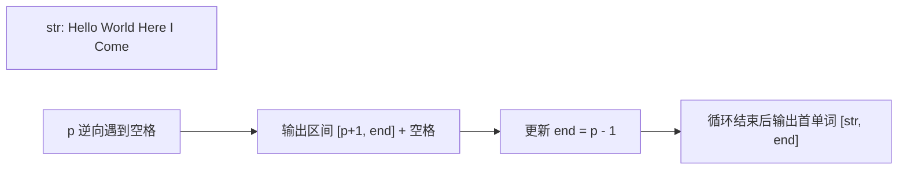

# 10-0 — 句子中的单词逆序

%% learning-vault-navigation:v1 %%
> [!abstract]- 笔记导航
> 目录：[[CS Learning/C wengkai/翁恺C语言导航|翁恺 C 语言导航]]
> 上一篇：[[CS Learning/C wengkai/08-3 用给定数字组成最小数/8-3|8-3 — 用给定数字组成最小数]] · 下一篇：[[CS Learning/C wengkai/10-1 查找字符并输出后缀/10-1|10-1 — 查找字符并输出后缀]]
> 源码：[[CS Learning/C wengkai/10-0 句子中的单词逆序/10-0.c|查看源码]]

> [!abstract] 本题概览
> 将一行不超过 80 个字符的英文句子按单词整体倒序输出（单词内部字母顺序不变）。核心考点为==字符数组缓冲区分配、含空格整行读入，以及利用尾指针 `end` 与扫描指针 `p` 从后向前切分单词==。

---

## 题目描述

给定一句英语，要求你编写程序，将句中所有单词的顺序颠倒输出。

### 输入格式

测试输入包含一个测试用例，在一行内给出总长度不超过 80 的字符串。字符串由若干单词和若干空格组成，其中单词是由英文字母（大小写有区分）组成的字符串，单词之间用 1 个空格分开，输入保证句子末尾没有多余的空格。

### 输出格式

每个测试用例的输出占一行，输出倒序后的句子。

### 输入样例

```text
Hello World Here I Come
```

### 输出样例

```text
Come I Here World Hello
```

---

## 解题思路与核心知识点

### 1. 逆向双指针切分流程

1. **整行读入**：由于句子含空格，不能用 `scanf("%s")`，而是循环调用 `getchar()` 逐字符写入 `char str[81]` 直到遇到 `'\n'`，最后手动补上字符串终止符 `'\0'`。
2. **定位单词区间 `[p + 1, end]`**：
   - 初始化 `end = str + len - 1` 指向当前待输出单词的末尾字符；
   - 指针 `p` 从 `str + len - 1` 向前扫描至 `str`；
   - 每遇到空格 `*p == ' '`，区间 `[p + 1, end]` 即为一个完整单词：顺序打印该区间字符，再补一个空格，并更新 `end = p - 1` 指向前一个单词末尾。
3. **收尾输出首单词**：循环结束后，最左侧的第一个单词前面没有空格，由 `for (p = str; p <= end; p++)` 单独输出，同时保证行末无多余空格。



### 2. 原始学习注释与易错点

| 源码行号 | 对应代码 | 原注释与核心解释 |
| :---: | --- | --- |
| 16 | 独立注释 | `char *str没有初始化` —— 若只声明指针 `char *str;` 而不指向有效缓冲区，解引用 `*p = ch` 会写入随机内存导致段错误（UB）；必须开定长数组 `char str[81]`（多留 1 字节存放 `'\0'`） |

- **时间复杂度**：$O(n)$，每个字符被读入一次、逆向扫描一次、输出一次。
- **空间复杂度**：$O(n)$，字符缓冲区 `char str[81]`。

> [!warning] 两个 C 语言输入与边界细节
> 1. **`getchar()` 返回值类型**：`getchar()` 的返回类型是 `int`（以便容纳 `EOF = -1`），用 `int ch` 接收并在循环中增加 `ch != EOF` 判断可防止输入流无换行符时死循环。
> 2. **空串边界**：若输入为空行（`len == 0`），`str + len - 1` 会指向数组首元素之前（在 C 标准中构造 `str - 1` 属于未定义行为）；生产代码可先特判 `if (len == 0) return 0;`。

## 完整源码

```c
/*
给定一句英语，要求你编写程序，将句中所有单词的顺序颠倒输出。
输入格式：测试输入包含一个测试用例，在一行内给出总长度不超过80的字符串。
字符串由若干单词和若干空格组成，其中单词是由英文字母（大小写有区分）组成的字符串，
单词之间用1个空格分开，输入保证句子末尾没有多余的空格。
输出格式：每个测试用例的输出占一行，输出倒序后的句子。
输入样例：
Hello World Here I Come
输出样例：
Come I Here World Hello
*/
#include <stdio.h>
#include <string.h>
int main(){
    char str[81];
    //char *str没有初始化
    char ch;
    char *p=str;
    while ((ch=getchar())!='\n'){
        *p=ch;
        p++;
    }
    *p='\0';
    int len=strlen(str);
    char *end=str+len-1;
    for (p=str+len-1;p>=str;p--){
        if (*p==' '){
            char *q;
            for (q=p+1;q<=end;q++){
                printf("%c",*q);
            }
            printf(" ");
            end=p-1;
        }
    }
    for (p=str;p<=end;p++){
            printf("%c",*p);
        }
    return 0;
}
```
