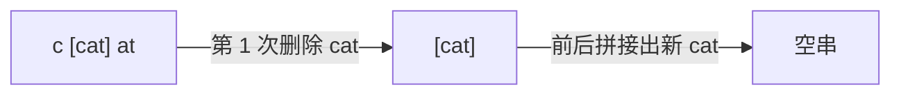

# 10-2 — 删除字符串中的子串

%% learning-vault-navigation:v1 %%
> [!abstract]- 笔记导航
> 目录：[[CS Learning/C wengkai/翁恺C语言导航|翁恺 C 语言导航]]
> 上一篇：[[CS Learning/C wengkai/10-1 查找字符并输出后缀/10-1|10-1 — 查找字符并输出后缀]] · 下一篇：[[CS Learning/C wengkai/10-3 字符串逆序/10-3|10-3 — 字符串逆序]]
> 源码：[[CS Learning/C wengkai/10-2 删除字符串中的子串/10-2.c|查看源码]]

> [!abstract] 本题概览
> 输入两个非空字符串 $S_1$ 和 $S_2$（均不超过 80 字符），要求彻底删除 $S_1$ 中出现的所有子串 $S_2$（包括删除后前后字符拼接出的新 $S_2$）。核心考点为==窗口定长比较、安全前移覆盖（避免重叠 `strcpy` 未定义行为）与删除后回退重扫==。

---

## 题目描述

输入 2 个字符串 $S_1$ 和 $S_2$，要求删除字符串 $S_1$ 中出现的所有子串 $S_2$，即结果字符串中不能包含 $S_2$。

### 输入格式

输入在 2 行中分别给出不超过 80 个字符长度的、以回车结束的 2 个非空字符串，对应 $S_1$ 和 $S_2$。

### 输出格式

在一行中输出删除字符串 $S_1$ 中出现的所有子串 $S_2$ 后的结果字符串。

### 输入样例

```text
Tomcat is a male ccatat
cat
```

### 输出样例

```text
Tom is a male
```

---

## 解题思路与核心知识点

### 1. 级联删除为何必须“回退重扫”

观察样例末尾的 `ccatat`（删除 `cat`）：



如果删完后指针只继续向后走，就会漏掉拼接后新出现的 `cat`。源码在每次删除后将指针重置回 `p = S1`，保证结果串中彻底不含 $S_2$。

### 2. 源码关键步骤与原注释解析

| 源码行号 | 对应代码 | 原注释 | 原理解析 |
| :---: | --- | --- | --- |
| 33 | `*(p+len) = '\0';` | 确保后续 `strcmp` 的使用 | 暂存 `ch = *(p+len)` 后临时截断，使 `p` 构成长度为 `len` 的 C 字符串以供 `strcmp(p, S2)` 精确比较 |
| 36 | `strcpy(tmp, p+len);` | 把 `cat` 后面的部分向前复制 | 先拷入中转数组 `tmp` 再拷回 `p`，==刻意规避了重叠内存直接 `strcpy(p, p+len)` 的未定义行为== |
| 38 | `p = S1;` | 删除 `cat` 后重头再查找一次 | 捕获因删除导致左右字符拼接出的新匹配 |

### 3. 复杂度与标准库改进

- **时间复杂度**：每次删除最多缩减 `len` 个字符，最多删除 $O(n / m)$ 次，每次重头扫描与拷贝耗时 $O(n)$，总计最坏 $O(n^2)$（$n \le 80$ 下瞬间完成）。
- **空间复杂度**：$O(n)$（`S1`、`S2` 与中转缓冲区 `tmp`）。

> [!tip] 更简洁的 `<string.h>` 替代写法
> 1. 用 `strncmp(p, S2, len) == 0` 替代“临时写 `'\0'` + `strcmp` + 还原字符”，无需反复改写原串。
> 2. 用 `strstr(S1, S2)` 直接定位匹配位置，再用专门允许内存重叠的 `memmove` 原地前移：
> ```c
> char *pos;
> while ((pos = strstr(S1, S2)) != NULL) {
>     memmove(pos, pos + len, strlen(pos + len) + 1); // +1 连同 '\0' 一并搬移
> }
> ```

## 完整源码

```c
/*
输入2个字符串S1和S2，要求删除字符串S1中出现的所有子串S2，即结果字符串中不能包含S2。
输入格式：
输入在2行中分别给出不超过80个字符长度的、以回车结束的2个非空字符串，对应S1和S2。
输出格式：
在一行中输出删除字符串S1中出现的所有子串S2后的结果字符串。
输入样例：
Tomcat is a male ccatat
cat
输出样例：
Tom is a male
*/
#include <stdio.h>
#include <string.h>
int main( ){
    char S1[81],S2[81],tmp[81],*p=S1,*q=S2,s1,s2;
    int len;
    while ((s1=getchar())!='\n'){
        *p=s1;
        p++;
    }
    *p='\0';
    while ((s2=getchar())!='\n'){
        *q=s2;
        q++;
    }
    *q='\0';
    len=strlen(S2);
    p=S1;
    while (*p!='\0'){
        if(strlen(p)>=len){
            char ch=*(p+len);
            *(p+len)='\0';//确保后续strcmp的使用
            if (strcmp(p,S2)==0){
                *(p+len)=ch;
                strcpy(tmp,p+len);//把cat后面的部分向前复制
                strcpy(p,tmp);
                p=S1;//删除cat后重头再查找一次
            }
            else {
                *(p+len)=ch;
                p++;
            }
        }
        else {
            p++;
        }
    }
    printf("%s",S1);
    return 0;
}
```
