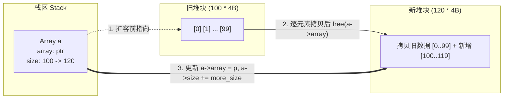

# 12-1-learning resizble array — 可变长数组与封装

%% learning-vault-navigation:v1 %%
> [!abstract]- 笔记导航
> 目录：[[CS Learning/C wengkai/翁恺C语言导航|翁恺 C 语言导航]]
> 上一篇：[[CS Learning/C wengkai/11-1 通讯录记录与查询/11-1|11-1 — 通讯录记录与查询]] · 下一篇：[[CS Learning/C wengkai/12-2 单链表的增删查与释放/12-2-learning linked-list|12-2-learning linked-list — 单链表的增删查与释放]]
> 相关：[[CS Learning/C++ STL/Containers/Sequence containers/vector/vector|vector — 动态数组容器]]
> 源码：[[CS Learning/C wengkai/12-1 可变长数组与封装/12-1-learning resizble array.c|查看源码]]

> [!abstract] 本节概览
> 用纯 C 语言手动实现一个可自动扩容的动态数组（`Array`），深入实践**抽象数据类型（ADT）与封装思想**——将底层堆内存分配、越界自动扩容、释放置空全部收敛到统一的接口函数中，让调用方不再直接触碰内部结构体字段。该机制正是 C++ [[CS Learning/C++ STL/Containers/Sequence containers/vector/vector|std::vector]] 的核心雏形。

---

## 核心知识点与实现解析

### 1. 封装思想（Encapsulation）

原学习笔记强调的核心原则：

> [!important] 封装的核心原则
> 外部代码**不直接操作结构体内部细节**（例如不直接写 `a.array[0] = 10` 或 `a.size`），而是统一通过 `array_create`、`array_size`、`array_at`、`array_free` 等接口函数与数据结构交互。这样日后即便修改底层存储策略（如更换扩容倍率或改为分块链表），只要接口契约不变，调用方代码完全无需改动。

### 2. 内存布局与动态扩容流程

`Array` 结构体本身（含指向堆区的指针 `array` 与当前容量 `size`）存放在**栈区**，实际元素缓冲区通过 `malloc` 分配在**堆区**。当访问下标 `index >= a->size` 时，`array_at()` 自动触发 `array_inflate()` 完成搬迁扩容：



### 3. 接口契约与复杂度总览

头文件声明见 [[CS Learning/C wengkai/array/array|array — 可变长数组接口]]，各实现函数职责如下：

| 函数原型 | 核心职责 | 时间复杂度 | 关键实现细节 |
| --- | --- | :---: | --- |
| `Array array_create(int init_size)` | 创建并分配初始堆空间 | $O(1)$ | `malloc(sizeof(int) * init_size)`，按值返回小型结构体 |
| `void array_free(Array *a)` | 释放堆内存并复位状态 | $O(1)$ | `free(a->array)` 后立即将 `a->array = NULL; a->size = 0;`，==防止悬空指针与二次释放== |
| `int array_size(const Array *a)` | 查询当前容量 | $O(1)$ | 形参带 `const` 保证只读语义，隐藏内部字段名 |
| `int* array_at(Array *a, int index)` | 安全访问并按需自动扩容 | 均摊见下 | 返回元素地址 `int*`，==解引用 `*array_at(&a, i)` 可作左值直接赋值== |
| `void array_inflate(Array *a, int more_size)` | 分配更大堆块、搬移并释放旧块 | $O(n)$ | 手动分配 → 拷贝 → 释放旧块 → 切换指针与容量 |

### 4. 原始学习注释解析

| 源码行号 | 对应代码 | 原注释与原理解析 |
| :---: | --- | --- |
| 38 | `*array_at(&a, 0) = 10;` | `<=> a.array[0] = 10;`，此处使用函数用以封装 —— 因为 `array_at` 返回的是指向目标槽位的指针 `int*`，对其进行解引用 `*` 即可得到可读写**左值（lvalue）**，同时兼顾读操作 `printf("%d", *array_at(&a, 0))` 与写操作 `*array_at(&a, 0) = 10`！ |

### 5. 扩容策略深度对比：固定块长 vs 几何倍增

源码中 `array_at` 在 `index >= a->size` 时按固定步长 `BLOCK_SIZE = 20` 向上取整扩容：

$$\text{more\_size} = \left(\left\lfloor \frac{\text{index}}{\text{BLOCK\_SIZE}} \right\rfloor + 1\right) \times \text{BLOCK\_SIZE} - \text{size}$$

| 扩容策略 | 单次扩容成本 | 连续插入 $n$ 个元素的总拷贝成本 | 均摊单次插入 |
| --- | :---: | :---: | :---: |
| 固定步长 `BLOCK_SIZE`（本实现） | $O(n)$ | $O(n^2 / B)$ | $O(n)$ |
| 几何倍增（如 $2\times$，[[CS Learning/C++ STL/Containers/Sequence containers/vector/vector\|std::vector]]） | $O(n)$ | $O(n)$ | ==$O(1)$== |

> [!warning] 生产环境健壮性补充
> 1. **检查 `malloc` 返回值**：堆内存不足时 `malloc` 会返回 `NULL`，若直接解引用会崩溃；生产代码应在分配后判空，或在扩容失败时保留旧 `a->array` 不丢失原数据。
> 2. **负下标防护**：若传入 `index < 0`，`array_at` 未做下界校验会越界访问。
> 3. **标准库优化**：`array_inflate` 中的拷贝循环可用 `memcpy` 加速，或直接改用 `realloc`（注意先用临时指针接收 `realloc` 返回值，避免失败时覆盖原指针造成内存泄漏）。

---

## 文件依赖与编译

本文件使用 `#include "array.h"`。配套头文件：[[CS Learning/C wengkai/array/array.h|array.h]] · 头文件说明：[[CS Learning/C wengkai/array/array|array — 可变长数组接口]]。

在当前笔记所在文件夹打开终端，可用以下 GCC 命令指定头文件搜索目录：

```powershell
gcc -I "../array" "12-1-learning resizble array.c" -o example.exe
```

## 完整源码

```c
#include "array.h"
#include <stdio.h>
#include <stdlib.h>
const int BLOCK_SIZE=20;
Array array_create(int init_size){
    Array a;
    a.size=init_size;
    a.array=(int*)malloc(sizeof(int)*a.size);
    return a;
}
void array_free(Array *a){
    free(a->array);
    a->size=0;
    a->array=NULL;
}
int array_size(const Array *a){
    return a->size;
}
int* array_at(Array *a,int index){
    if (index>=a->size){
        array_inflate(a,(index/BLOCK_SIZE+1)*BLOCK_SIZE-a->size);
    }
    return &(a->array[index]);
}
void array_inflate(Array *a,int more_size){
    int *p=(int*)malloc(sizeof(int)*(a->size+more_size));
    int i;
    for (i=0;i<a->size;i++){
        p[i]=a->array[i];
    }
    free(a->array);
    a->array=p;
    a->size+=more_size;
}
int main(int argc,char const *argv[]){
    Array a=array_create(100);
    printf("%d\n",array_size(&a));
    *array_at(&a,0)=10;//<=>a.array[0]=10;,此处使用函数用以封装
    printf("%d\n",*array_at(&a,0));
    int cnt=0,number=0;
    while (number!=-1){
        scanf("%d",&number);
        if (number!=-1){
        *array_at(&a,cnt++)=number;
        }
    }
    array_free(&a);
    return 0;
}
/*重要思想“封装”：外部代码不直接操作内部细节，而是通过各种函数来操作，
  例如size、free函数的创建和main中at的使用*/
```
