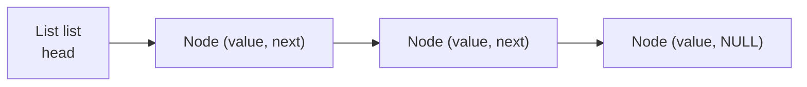

# 12-2-learning linked-list — 单链表的增删查与释放

%% learning-vault-navigation:v1 %%
> [!abstract]- 笔记导航
> 目录：[[CS Learning/C wengkai/翁恺C语言导航|翁恺 C 语言导航]]
> 上一篇：[[CS Learning/C wengkai/12-1 可变长数组与封装/12-1-learning resizble array|12-1-learning resizble array — 可变长数组与封装]] · 下一篇：[[CS Learning/C wengkai/13-1 全局变量与静态局部变量/13-1-learning global variable|13-1-learning global variable — 全局变量与静态局部变量]]
> 源码：[[CS Learning/C wengkai/12-2 单链表的增删查与释放/12-2-learning linked-list.c|查看源码]]

> [!abstract] 本节概览
> 用纯 C 语言从零实现**单向链表（Singly Linked List）**的完整生命周期：动态建表（尾插法）、顺序遍历输出、按值查找、双指针删除节点以及整表安全释放。核心在于理解**包装结构体 `List`（持有 `Node *head`）**如何消除二级指针传递，以及节点删除/释放时对前驱与后继指针的保护。

---

## 核心知识点与实现解析

### 1. 链表结构与操作复杂度



| 操作 | 实现方式 | 时间复杂度 | 关键指针细节 |
| --- | --- | :---: | --- |
| **尾插添加 `add`** | `malloc(sizeof(Node))` 创建节点，遍历至 `last->next == NULL` 挂接 | $O(n)$ | 需区分空链表（更新 `pList->head = p`）与非空链表；若额外维护 `tail` 指针可降为 $O(1)$ |
| **顺序输出 `print`** | `for (p = pList->head; p; p = p->next)` | $O(n)$ | 以 `p == NULL` 作为遍历终止条件 |
| **按值查找** | 遍历比对 `p->value == number`，用标志位 `isFound` 记录 | $O(n)$ | 命中后立即 `break` |
| **按值删除** | 同步维护前驱 `q` 与当前 `p`（`q = p, p = p->next`） | $O(n)$ | ==删除头节点（`q == NULL`）时必须更新 `list.head = p->next`==，其余节点令 `q->next = p->next`，最后 `free(p)` |
| **整表释放** | 先暂存后继 `q = p->next`，再 `free(p)`，令 `p = q` | $O(n)$ | ==绝不能在 `free(p)` 之后再访问 `p->next`==（释放后使用属于未定义行为） |

> [!warning] 指针与内存安全提示
> 1. **删除边界处理**：源码中 `if (q) { q->next = p->next; } else { list.head = p->next; }` 优雅地把「删头节点」与「删中间/尾节点」分情况处理；更通用的进阶技巧是引入**哑头节点（Dummy Head）**以统一分支。
> 2. **释放后置空**：整表释放循环结束后建议补上 `list.head = NULL;`，避免留下悬空头指针。
> 3. **与 C++ STL 对照**：本节手写单链表对应 C++ STL 的 [[CS Learning/C++ STL/Containers/Sequence containers/forward_list/forward_list|std::forward_list]]。

---

## 文件依赖与编译

本文件依赖头文件 [[CS Learning/C wengkai/node/node.h|node.h]]（接口说明见 [[CS Learning/C wengkai/node/node|node — 链表节点定义]]）。在当前笔记目录打开终端，可用 `-I` 指定头文件搜索路径编译：

```powershell
gcc -I "../node" "12-2-learning linked-list.c" -o example.exe
```

## 完整源码

```c
#include "node.h"
#include <stdio.h>
#include <stdlib.h>
typedef struct _list{
    Node* head;
}List;
void add(List*pList,int number);
void print(List *pList);
int main(int argc,char const *argv[]){
    List list;
    int number;
    list.head=NULL;
    do {
        scanf("%d",&number);
        if (number!=-1){
            add(&list,number);
        }
    }while (number!=-1);//建立链表
    print(&list);//输出链表
    scanf("%d",&number);
    Node *p;
    int isFound=0;
    for (p=list.head;p;p=p->next){
        if (p->value==number){
            printf("Find it\n");
            isFound=1;
            break;
        }
    }
    if (!isFound){
        printf("Not Found\n");
    }//查找
    Node *q;
    for (q=NULL,p=list.head;p;q=p,p=p->next){
        if (p->value==number){
            if (q){
                q->next=p->next;
            }
            else {
                list.head=p->next;
            }
            free(p);
            break;
        }
    }//删除
    for (p=list.head;p;p=q){
        q=p->next;
        free(p);
    }//释放
    return 0;
}
void add(List*pList,int number){
    Node *p=(Node*)malloc(sizeof(Node));
    p->value=number;
    p->next=NULL;
    Node *last=pList->head;
    if (last){
        while (last->next){
        last=last->next;
        }
        last->next=p;
    }
    else {
        pList->head=p;
    }
}//链表的添加
void print(List *pList){
        Node *p;
    for (p=pList->head;p;p=p->next){
        printf("%d\t",p->value);
    }
    printf("\n");
}//链表的输出
```
