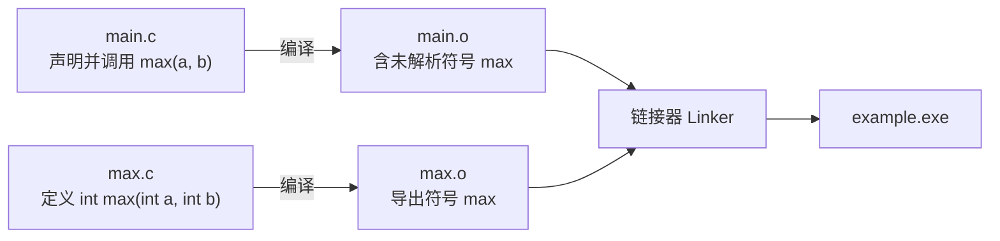

# main — 多文件程序的入口

%% learning-vault-navigation:v1 %%
> [!abstract]- 笔记导航
> 目录：[[CS Learning/C wengkai/翁恺C语言导航|翁恺 C 语言导航]]
> 上一篇：[[CS Learning/C wengkai/13-2 宏与表达式括号/13-2-learning macro|13-2-learning macro — 宏与表达式括号]] · 下一篇：[[CS Learning/C wengkai/13-3 多文件程序结构/max/max|max — 多文件程序的 max 函数]]
> 源码：[[CS Learning/C wengkai/13-3 多文件程序结构/main/main.c|查看源码]]

> [!abstract] 本节概览
> 演示 C 语言**多文件程序结构（分离编译与链接）**的入口文件 `main.c`：在 `main.c` 中仅给出函数原型声明 `int max(int a, int b);`，而将函数定义拆分到另一个编译单元 [[CS Learning/C wengkai/13-3 多文件程序结构/max/max|max.c]] 中，最后由链接器（Linker）解析符号合并为可执行程序。

---

## 核心知识点与分离编译流程



- **声明（Declaration）与定义（Definition）分离**：编译器编译 `main.c` 时只需通过函数原型 `int max(int a, int b);` 检查参数与返回类型，不必看到函数体；实际工程中通常把共享的函数原型抽到 `.h` 头文件里供多文件 `#include`。
- **外部链接性（External Linkage）**：C 语言函数默认具有外部链接属性，因此 `main.c` 可以直接链接到 `max.c` 中定义的 `max`。

---

## 多文件编译

配套实现文件：[[CS Learning/C wengkai/13-3 多文件程序结构/max/max.c|max.c]]（说明见 [[CS Learning/C wengkai/13-3 多文件程序结构/max/max|max — 多文件程序的 max 函数]]）。在上一级 `13-3 多文件程序结构` 目录运行：

```powershell
gcc "main/main.c" "max/max.c" -o example.exe
```

## 完整源码

```c
#include <stdio.h>
int max(int a,int b);
int main(void){
    int a=5,b=6;
    printf("%d\n",max(a,b));
    return 0;
}
```
