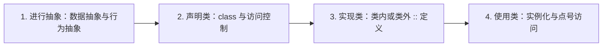

# Classes and Objects — 类与对象

%% learning-vault-navigation:v1 %%
> [!abstract]- 笔记导航
> 目录：[[CS Learning/C++ PKU/北大C++导航|北大 C++ 导航]]
> 下一篇：[[CS Learning/C++ PKU/cstring/cstring|cstring — C 风格字符串函数]]
> 源码：[[CS Learning/C++ PKU/Classes and Objects/Classes and Objects.cpp|查看源码]]

> [!abstract] 本节概览
> 本节系统梳理 C++ 面向对象编程（OOP）的入门核心脉络：从**抽象 → 声明 → 实现 → 使用**的完整类设计流程出发，串联访问控制（`public` / `protected` / `private`）、`struct` 与 `class` 的本质区别、类内与类外成员函数实现、作用域运算符 `::`、静态成员 `static`、构造函数与析构函数的生命周期管理，以及基类与派生类的继承权限规则，并通过 `Clock` 系列与 `Shape -> Rectangle` 实例落地。

---

## 1. 面向对象建模：类的定义与使用流程

定义和使用一个类的标准过程分为四个阶段：**进行抽象 → 声明类 → 实现类 → 使用类**。



### 什么是抽象（Abstraction）

抽象是对具体对象或问题进行概括、提炼该类对象公共性质并加以描述的过程。建模时应==先关注问题的本质与接口描述，其次才是具体实现细节==，且抽象总是相对具体场景而言的（没有绝对统一的抽象）：

- **数据抽象**：描述某类事物共有的属性或状态（映射为类的**数据成员**）。
- **行为抽象**：描述某类事物共有的行为特征或功能（映射为类的**成员函数**）。

---

## 2. 类的声明、访问控制与 `struct` 对比

类是一种用户自定义的抽象数据类型（ADT），基本声明语法如下（注意结尾的**分号 `;`** 不可省略）：

```cpp
class ClassName {
public:
    // 公有成员：对外暴露的接口
protected:
    // 保护成员：仅类内及派生类内可访问
private:
    // 私有成员：仅类内可访问（class 默认权限）
};
```

- **类内**：在类声明的花括号 `{ ... }` 之内。
- **类外**：在类声明之外。

| 访问修饰符 | 类内成员函数 | 派生类成员函数（`public` 继承） | 类外代码（通过对象） |
| --- | :---: | :---: | :---: |
| `public` | 可访问 | 可访问 | 可访问 |
| `protected` | 可访问 | 可访问 | 不可访问 |
| `private` | 可访问 | 不可直接访问 | 不可访问 |

> [!important] C++ 中 `struct` 与 `class` 的唯一区别
> 在 C++ 语法层面，`struct` 与 `class` 的**唯一区别在于默认访问权限**（包括成员默认权限与默认继承方式）：
> - `struct` 未显式标注时，成员默认为 **`public`**（默认 `public` 继承）；
> - `class` 未显式标注时，成员默认为 **`private`**（默认 `private` 继承）。
>
> **工程习惯**：当类型仅用于打包纯数据字段时常用 `struct`；涉及成员函数、封装与不变量维护时优先使用 `class`。

---

## 3. 类的实现：类内定义、类外定义与 `::` 运算符

实现类即按设定语义编写各个成员函数，常见有两种组织方式：

### 类内定义 vs 类外定义

- **类内定义（`Clock1`）**：直接在类体中写出函数体，代码紧凑，编译器会自动将其视为内联函数（`inline`）候选。
- **类外定义（`Clock2`）**：类内只留函数声明，类外使用作用域运算符 `::` 给出定义，便于头文件（`.h`）与源文件（`.cpp`）分离。

```cpp
class Clock2 {
private:
    int Hour, Minute, Second;
public:
    void SetTime(int h, int m, int s); // 类内声明
    void ShowTime();
};

// 类外实现：必须加上 类名:: 指明归属作用域
void Clock2::SetTime(int h, int m, int s) {
    Hour = h;
    Minute = m;
    Second = s;
}
```

### 双冒号 `::`（作用域解析运算符）的三种典型用法

| 用法分类 | 写法示例 | 含义说明 |
| --- | --- | --- |
| **1. 域操作符（类外实现）** | `void A::f() { ... }` | 指明函数 `f()` 属于类 `A` 的成员函数，受类作用域及访问权限约束 |
| **2. 全局作用域前缀** | `::func()` / `::API()` | 直接置于函数或变量名前，强制访问全局作用域实体（常用于避免局部遮蔽或调用全局 API） |
| **3. 作用域成员引用** | `std::cout` / `ClassName::staticMem` | 访问命名空间或类的静态成员（类比其他语言中如 `System.Math.Sqrt()` 的层级访问，原注以 `System::Math::Sqrt()` 类比） |

---

## 4. 对象实例化、成员访问与静态成员（`static`）

类是类型蓝图，由类定义的变量称为**类的实例**或**对象**（例如 `Clock aclock;`）：

- **成员访问规则**：
  - 在类作用域内，成员函数可以直接访问本类的所有数据成员与其他成员函数。
  - 在类作用域外，只能访问对象的 **`public`** 成员，通过点运算符 `.` 访问（若是指向对象的指针则使用 `->`）。
- **静态成员（`static`）**：
  - 普通数据成员会为**每个对象单独分配内存**，不同对象之间的成员互不干扰。
  - 当希望**同一类的所有对象共享同一份数据或工具函数**时，可用 `static` 修饰成员（既可用于数据成员，也可用于成员函数）。

---

## 5. 对象生命周期：构造函数与析构函数


### 构造函数（Constructor）

- **职责**：用于对象初始化（理论上函数体内可以做任何事，但最佳实践是只专注成员变量初始化）。
- **语法规则**：
  - 函数名**固定与类名相同**，**没有返回类型**（连 `void` 也不能写）；
  - 允许按照函数重载规则提供多个不同参数列表的构造函数，也支持默认参数（如 `Clock3(int h = 12, int m = 0, int s = 0);`）；
  - 在对象创建时由系统自动调用，**不允许像普通函数那样对已存在对象显式调用构造函数**；
  - 除函数体内赋值外，C++ 还允许在构造函数头部通过**成员初始化列表**（如 `: Hour(h), Minute(m), Second(s)`）直接初始化成员。

> [!warning] C++ 缺省构造函数不会自动初始化内置类型成员
> 若类未声明任何构造函数，编译器会自动合成一个无参的**缺省构造函数**，但它什么也不做。
> 与 Java 等语言自动清零不同，C++ 出于运行效率考量，==未显式初始化的内置类型（如 `int`、`double`、指针）成员变量值是不确定的（垃圾值）==。因此务必通过构造函数或类内初始值确保成员在被读取前已正确初始化。

### 析构函数（Destructor）

- **职责**：在对象生命周期结束、即将消亡时自动调用，常用于执行收尾与资源释放工作（典型场景是对 `new` 分配的堆内存执行 `delete`）。
- **语法规则**：
  - 函数名为 **`~类名`**（例如 `~Clock3()`），**没有返回类型**；
  - **不带任何参数，因此不能重载**（每个类最多只有一个析构函数）；
  - 在对象离开作用域或被 `delete` 时自动触发，常规代码中不应手动显式调用析构函数。

> [!note] 源码注释补充
> 源码注释中“函数名是 加上类名”一处漏打了波浪号，正确形式为 `~` 加上类名（即 `~Clock3()`）。仅在极少见的底层场景（如 placement `new`）下才会手动调用析构函数。

---

## 6. 继承与派生（Inheritance）

当新建一个类时，无需重复编写已有类的数据成员与成员函数，可通过**继承**复用已有类的成员：被继承的类称为**基类（Base Class）**，新建的类称为**派生类（Derived Class）**。C++ 同时支持单继承与多继承。

### 派生类声明语法

```cpp
class DerivedClass : access-specifier BaseClass {
    // 派生类新增成员
};
```

其中 `access-specifier` 可选 `public`、`protected` 或 `private`；若使用 `class` 定义派生类且省略访问修饰符，则**默认为 `private` 继承**。

### 三种继承方式的权限映射表

实际工程中绝大多数场景使用 **`public` 继承**（表达 *is-a* 关系），极少使用 `protected` 或 `private` 继承。不同继承方式下，基类成员在派生类中的最终访问级别如下：

| 基类成员原权限 | `public` 继承后 | `protected` 继承后 | `private` 继承后 |
| --- | --- | --- | --- |
| **`public`** | `public` | `protected` | `private` |
| **`protected`** | `protected` | `protected` | `private` |
| **`private`** | 不可直接访问 | 不可直接访问 | 不可直接访问 |

> [!tip] 基类 `private` 成员并非“没被继承”
> 基类的 `private` 成员依然存在于派生类对象的内存布局中，只是**不能在派生类内部直接按名字访问**，但完全可以通过调用基类提供的 `public` 或 `protected` 成员函数间接读写。

### 源码实例解析：`Shape` → `Rectangle`

源码末尾演示了经典的公有继承模型：

```cpp
class Shape {
public:
    void setWidth(int w) { width = w; }
    void setHeight(int h) { height = h; }
protected:
    int width;
    int height;
};

class Rectangle : public Shape {
public:
    int getArea() { return (width * height); } // 直接访问基类 protected 成员
};
```

- `Shape` 将 `width` 和 `height` 设为 `protected`，既对外部调用者屏蔽了直接修改（必须经由 `setWidth` / `setHeight`），又允许派生类 `Rectangle` 的 `getArea()` 直接读取计算面积。
- `main()` 中设置 `width = 5`、`height = 7`，最终输出：

```text
Total area: 35
```

---

## 完整源码

```cpp
#include <iostream>
using namespace std;
/*
「类」
定义和使用类的基本过程:
    一、进行抽象
    二、声明类
    三、实现类
    四、使用类

「抽象」
抽象是对具体对象(问题)进行概括,提炼出这一类对象的公共性质并加以描述的过程
 -先注意问题的本质及描述,其次是实现过程或细节
 -数据抽象:描述某类对象(事物)共有的属性或状态
 -行为抽象:描述某类对象(事物)共有的行为特征或具有的功能
 抽象是相对的不是绝对的

「声明」
类是一种抽象数据类型,声明形式如下:
    class(关键字) ClassName{
        数据成员
        函数成员
    };
    关键字：用于声明类的类型
    数据成员：用于表达数据抽象
    函数成员：用于表达行为抽象
    「类成员的访问控制」
    当创建一个类时，不需要重新编写新的数据成员和成员函数，只需指定新建的类继承了一个已有的类的成员即可。
    这个已有的类称为基类，新建的类称为派生类。
    类内：在类声明之内称为类内
    类外：在类声明之外称为类外
    一个类可以派生自多个类，这意味着，它可以从多个基类继承数据和函数。
    定义一个派生类，我们使用一个类派生列表来指定基类。类派生列表以一个或多个基类命名，形式如下：
        class derived-class: access-specifier base-class
        其中，访问修饰符 access-specifier 是 public、protected 或 private 其中的一个，
        base-class 是之前定义过的某个类的名称。如果未使用访问修饰符 access-specifier，则默认为 private。
    「继承类型」
        当一个类派生自基类，该基类可以被继承为 public、protected 或 private 几种类型。继承类型是通过上面讲解的访问修饰符 access-specifier 来指定的。
        我们几乎不使用 protected 或 private 继承，通常使用 public 继承。当使用不同类型的继承时，遵循以下几个规则：
        公有继承（public）：当一个类派生自公有基类时，基类的公有成员也是派生类的公有成员，基类的保护成员也是派生类的保护成员，
                          基类的私有成员不能直接被派生类访问，但是可以通过调用基类的公有和保护成员来访问。
        保护继承（protected）： 当一个类派生自保护基类时，基类的公有和保护成员将成为派生类的保护成员。
        私有继承（private）：当一个类派生自私有基类时，基类的公有和保护成员将成为派生类的私有成员。
*/
class ClassName{
        public://公有成员
        protected://保护成员
        private://私有成员
        };
/*
「实现」
实现一个类,就是按照所设定的功能语义去实现类中的每一个成员函数
*/
//类内函数
class Clock1{
    private:int Hour,Minute,Second;
    public:
    void SetTime(int h,int m,int s){//类内函数
        Hour=h;Minute=m;Second=s;
    }
    void ShowTime(){
        cout<<"Current Time:"<<Hour<<":"<<Minute<<":"<<Second<<endl;
    }
};
//类外函数
class Clock2{
    private:int Hour,Minute,Second;
    public:
    void SetTime(int h,int m,int s);//类内函数
    void ShowTime();
};
void Clock2::SetTime(int h,int m,int s){
    Hour=h;Minute=m;Second=s;
}
void Clock2::ShowTime(){
        cout<<"Current Time:"<<Hour<<":"<<Minute<<":"<<Second<<endl;
}
//成员函数的定义与一般函数基本相同,只是多了作用域运算符“::”,表明了函数是该类下的函数,访问要收到一定的限制。
/*
「使用」
类是一种数据类型,类的变量称作类的实例,或对象
定义对象的方式:类名 对象名;e.g. Clock aclock;
对象的访问:
在类的作用域内，可以直接访问同类中的数据成员或调用同类中的成员函数
在类的作用域外，对象只能访问本类的公有数据或公有函数，需要用"."运算符
静态对象:
每当声明一个对象时，就会为该对象分配一块内存来存放所有成员，
即每个对象都拥有属于自己的所有成员，对象之间的成员不会互相干扰。
但是在某些情况下，我们希望同一类的不同对象共享某个成员，
对此，较好地解决办法是将其定义成类的静态成员。
使用关键字 static 修饰的成员叫做静态成员,可为数据也可为函数
*/
/*
C++ 中的结构体与类的唯一区别就是：
未明确说明的情况下，结构体的成员是公有的，类的成员是私有的。
但是，尽管结构体与类在 C++ 中基本相同，
习惯上还是在结构体定义中仅包含数据，涉及成员函数时尽量使用类的定义。
*/
/*
双冒号(::)用法
（1）表示“域操作符”
    例：声明了一个类A,类A里声明了一个成员函数void f(),但没有在类的声明里给出f的定义,那么在类外定义f时,就要写成void A::f(),表示这个f()函数是类A的成员函数。
（2）直接用在全局函数前，表示是全局函数
    例：在VC里,你可以在调用API函数里,在API函数名前加::
（3）表示引用成员函数及变量,作用域成员运算符
    例：System::Math::Sqrt() 相当于System.Math.Sqrt()
*/
/*
「构造函数」
构造函数是用来给对象初始化的函数。理论上来说构造函数体内可以做任何事情，
但一般只专用做成员变量的初始化。构造函数在对象创建之时自动调用，
任何对构造函数的显示调用都是不被允许的。构造函数没有返回类型，
函数名固定为类名，但是允许按照重载规则给出不同的参数类型的构造函数。
在没有给任何构造函数时，系统会自动给出缺省构造函数，里面什么也不做。
在一些 OOP（面向对象）语言比如 Java 当中，编译器会自动给类里的成员变量按照统一的规则进行初始化；
然而 C++ 语言当中，如果没有定义构造函数，它是不会自动给类里面的成员变量初始化的。
这是 C++ 为了提高编译效率而考量的。因此如果在对类里的成员进行操作之前没有进行初始化，
那么成员变量里的值将会是不确定。除了在构造函数的函数体内进行初始化之外，C++ 还允许在构造函数头部列一个参数表来进行初始化。
「析构函数」
析构函数常常用来做对象消亡之前的扫尾工作，常常是用来对 new 出来的空间做 delete。
析构函数没有返回类型，函数名是 加上类名，不带参数，不能重载。析构函数在对象消亡之时自动调用，
在任何地方显示调用析构函数也是不对的。
*/
class Clock3{
    private:int Hour,Minute,Second;
    public:Clock3(int h=12,int m=0,int s=0);
           ~Clock3();
           //...
};
Clock3::~Clock3(){
    cout<<"Clock obj destroyed!"<<endl;
}

#include <iostream>
using namespace std;
// 基类
class Shape{
    public:
    void setWidth(int w){
        width = w;
    }
    void setHeight(int h){
        height = h;
    }
    protected:
    int width;
    int height;
};
// 派生类
class Rectangle: public Shape{
    public:
    int getArea(){
        return (width * height);
    }
};
int main(void){
    Rectangle Rect;
    Rect.setWidth(5);
    Rect.setHeight(7);
    // 输出对象的面积
    cout<<"Total area: "<<Rect.getArea()<<endl;
    return 0;
}
```
