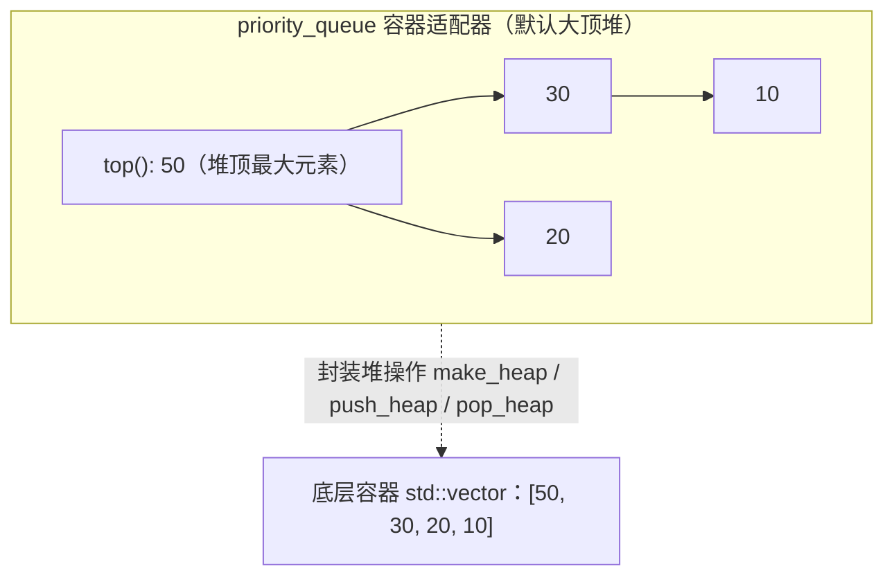

# `priority_queue` — 优先队列

%% learning-vault-navigation:v1 %%
> [!abstract]- 笔记导航
> 目录：[[CS Learning/C++ STL/C++ STL导航|C++ STL 导航]]
> 下一篇：[[CS Learning/C++ STL/Adapters/queue/queue|queue — 队列]]
> 相关：[[CS Learning/C++ STL/Adapters/queue/queue|queue — 队列]]
> 源码：[[CS Learning/C++ STL/Adapters/priority_queue/priority_queue.cpp|查看源码]]

> [!abstract] 本节概览
> `std::priority_queue` 定义在头文件 `#include <queue>` 中，是一个基于**二叉堆（Binary Heap）**实现的容器适配器，默认维护==最大堆（大顶堆）==。它支持在 $O(1)$ 时间内访问当前优先级最高（默认最大）的队顶元素，在 $O(\log n)$ 时间内完成入队与出队，但不提供迭代器，也不支持随机访问。

## 核心概念与模板声明

`priority_queue` 不是独立容器，而是封装底层容器并提供堆操作的**容器适配器（Container Adapter）**。其完整模板原型包含三个参数：

```cpp
#include <queue>
#include <vector>
#include <functional>

// 模板声明：template <class T, class Container = std::vector<T>, class Compare = std::less<T>>
std::priority_queue<int> pq_max;                                        // 默认最大堆（大顶堆）
std::priority_queue<int, std::vector<int>, std::greater<int>> pq_min;   // 最小堆（小顶堆）
```

三个模板参数的含义如下：

| 模板参数 | 含义 | 默认值 | 说明 |
| :--- | :--- | :--- | :--- |
| `T` | 存储的元素类型 | 无（必填） | 支持比较运算符或配合自定义比较器使用 |
| `Container` | 底层存储容器 | `std::vector<T>` | 需支持随机访问迭代器（`vector` 或 `deque`），竞赛与日常开发保持默认即可 |
| `Compare` | 优先级比较器（仿函数） | `std::less<T>` | 返回 `true` 表示第一个参数优先级**低于**第二个参数，因此 `less<T>` 构成最大堆 |



## 常用成员函数与复杂度速查

| 成员函数 | 功能说明 | 时间复杂度 |
| :--- | :--- | :---: |
| `pq.empty()` | 判断优先队列是否为空（空返回 `true`） | $O(1)$ |
| `pq.size()` | 返回队列中当前的元素个数 | $O(1)$ |
| `pq.top()` | 返回堆顶元素的常引用（`const T&`，不删除元素） | $O(1)$ |
| `pq.push(val)` | 插入元素并向上调整堆结构 | $O(\log n)$ |
| `pq.emplace(args...)` | 原地构造元素并入堆（C++11，可减少拷贝） | $O(\log n)$ |
| `pq.pop()` | 移除堆顶元素并向下调整堆结构（返回 `void`） | $O(\log n)$ |

## 典型用法与自定义比较器

### 1. 自定义最小堆（仿函数写法）

除标准库内置的 `std::greater<T>` 外，可以通过重载 `operator()` 定义比较结构体，用于实现最小堆或自定义结构体（如按距离、权值排序）的优先队列：

```cpp
struct compare {
    bool operator()(int a, int b) const {
        return a > b;  // a > b 时认为 a 的优先级低于 b，数值更小者浮到堆顶（最小堆）
    }
};

std::priority_queue<int, std::vector<int>, compare> pq_min;
```

### 2. 源码示例运行结果追踪

依次向最大堆 `pq` 和最小堆 `pq_min` 插入 `30, 10, 50, 20` 后循环弹出：

- **默认最大堆 `pq`**：依次输出 `50` → `30` → `20` → `10`（降序弹出）。
- **自定义最小堆 `pq_min`**：依次输出 `10` → `20` → `30` → `50`（升序弹出）。

## 常见易错点与注意事项

> [!warning] 比较器方向与 `std::sort()` 相反
> 在 `std::sort()` 中，`return a > b` 表示**降序**（大元素在前）；而在 `priority_queue` 中，比较器判断的是“第一个参数是否应排在第二个参数之下”，因此 ==`return a > b`（或 `std::greater<T>`）构造的是最小堆==，堆顶反而最小。

> [!warning] 常见接口限制
> - **没有 `clear()` 成员函数**：若需清空队列，可重新赋值 `pq = priority_queue<int>();` 或循环 `pop()`。
> - **不支持迭代器与随机访问**：只能通过 `top()` 查看堆顶元素，也无法直接修改或删除堆中任意元素（`top()` 返回 `const` 引用以防止破坏堆序）。
> - **空堆访问是未定义行为（UB）**：调用 `top()` 或 `pop()` 前务必先检查 `!pq.empty()`。

> [!tip] 典型应用场景
> 优先队列常用于 **Dijkstra 最短路**、**Prim 最小生成树**、**Huffman 编码**、**Top-K 问题**以及动态维护中位数（对顶堆）。如果需要从已有数组一次性建堆，使用迭代器区间构造 `priority_queue<int> pq(v.begin(), v.end())` 仅需 $O(n)$ 时间，优于逐个 `push` 的 $O(n \log n)$。

## 完整源码

```cpp
/*
priority_queue的定义:
在 C++ 中，<priority_queue> 是标准模板库（STL）的一部分，用于实现优先队列。
优先队列是一种特殊的队列，它允许(只能)我们快速访问队列中具有最高（或最低）优先级的元素。
在 C++ 中，priority_queue 默认是一个最大堆(底层原理二叉堆)，这意味着队列的顶部元素总是具有最大的值。
priority_queue 是一个容器适配器，它提供了对底层容器的堆操作。它不提供迭代器，「也不支持随机访问」。

priority_queue的声明示例:
头文件 #include <queue>
priority_queue<int> pq;  // 声明一个整型优先队列
struct compare {         // 声明一个自定义类型的优先队列，需要提供比较函数
    bool operator()(int a,int b){
        return a > b;    // 这里定义了最小堆
    }
};
priority_queue<int,vector<int>,compare> pq_min;//类型：要储存的数据类型
               类型  容器        比较器           容器：储存数据的底层容器，默认为 vector<类型>，竞赛中保持默认即可
                                                 比较器：比较大小使用的比较器，默认为 less<类型>，可自定义

常用成员函数
empty():    检查队列是否为空。
size():     返回队列中的元素数量。
top():      返回队列顶部的元素（不删除它）。
push():     向队列添加一个元素。
pop():      移除队列顶部的元素。
*/
#include <iostream>
#include <queue>
using namespace std;
struct compare {
    bool operator()(int a,int b){
        return a>b; // 定义最小堆
    }
};
int main(){
    // 创建一个整型优先队列
    priority_queue<int> pq;
    // 向优先队列中添加元素
    pq.push(30);
    pq.push(10);
    pq.push(50);
    pq.push(20);
    // 输出队列中的元素
    cout<<"队列中的元素："<<endl;
    while (!pq.empty()) {
        cout<<pq.top()<<endl;
        pq.pop();
    }
    // 创建一个自定义类型的优先队列，使用最小堆
    priority_queue<int,vector<int>,compare> pq_min;
    // 向优先队列中添加元素
    pq_min.push(30);
    pq_min.push(10);
    pq_min.push(50);
    pq_min.push(20);
    // 输出队列中的元素
    cout<<"最小堆中的元素："<<endl;
    while (!pq_min.empty()) {
        cout<<pq_min.top()<<endl;
        pq_min.pop();
    }
    return 0;
}
```
