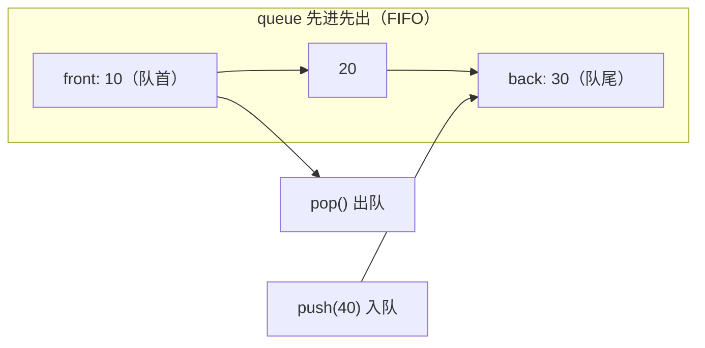

# `queue` — 队列

%% learning-vault-navigation:v1 %%
> [!abstract]- 笔记导航
> 目录：[[CS Learning/C++ STL/C++ STL导航|C++ STL 导航]]
> 上一篇：[[CS Learning/C++ STL/Adapters/priority_queue/priority_queue|priority_queue — 优先队列]] · 下一篇：[[CS Learning/C++ STL/Adapters/stack/stack|stack — 栈]]
> 相关：[[CS Learning/C++ STL/Adapters/stack/stack|stack — 栈]] · [[CS Learning/C++ STL/Adapters/priority_queue/priority_queue|priority_queue — 优先队列]]
> 源码：[[CS Learning/C++ STL/Adapters/queue/queue.cpp|查看源码]]

> [!abstract] 本节概览
> `std::queue` 定义在头文件 `#include <queue>` 中，实现了经典的==先进先出（FIFO, First In First Out）==队列容器适配器。元素**只能从队尾入队、从队首出队**，所有核心操作（入队、出队、访问队首/队尾、判空与查大小）的时间复杂度均为 $O(1)$。

## 核心概念与声明方式

`queue` 是一个受限接口的**容器适配器**，默认以 `std::deque<T>` 作为底层容器（也可替换为 `std::list<T>`）：

```cpp
#include <queue>

std::queue<int> q;                       // 默认底层容器为 std::deque<int>
std::queue<int, std::list<int>> q_list;  // 指定 std::list<int> 作为底层容器
```



> [!note] 为什么 `std::vector` 不能作为 `queue` 的底层容器？
> `queue::pop()` 要求底层容器提供 `pop_front()` 接口；`std::vector` 仅支持尾部高效增删（`push_back`/`pop_back`），不提供 `pop_front()`，因此不能用于实例化 `std::queue`。

## 常用成员函数与复杂度速查

| 成员函数 | 功能说明 | 时间复杂度 |
| :--- | :--- | :---: |
| `q.empty()` | 检查队列是否为空（空返回 `true`） | $O(1)$ |
| `q.size()` | 返回队列中当前的元素数量 | $O(1)$ |
| `q.front()` | 返回队首元素的引用（可读写） | $O(1)$ |
| `q.back()` | 返回队尾元素的引用（可读写） | $O(1)$ |
| `q.push(val)` | 在队尾添加一个元素 | $O(1)$ |
| `q.emplace(args...)` | 在队尾原地构造一个元素（C++11） | $O(1)$ |
| `q.pop()` | 移除队首元素（返回 `void`，不返回元素值） | $O(1)$ |

## 典型用法与示例追踪

### 1. 源码示例状态变化

| 执行语句 | 队列内容（队首 → 队尾） | 输出结果 |
| :--- | :--- | :--- |
| `q.push(10); q.push(20); q.push(30);` | `[10, 20, 30]` | — |
| `q.size()` / `q.front()` / `q.back()` | `[10, 20, 30]` | 数量 `3`，队首 `10`，队尾 `30` |
| `q.pop();` | `[20, 30]` | 移除后队首 `20`，数量 `2` |

### 2. 广度优先搜索（BFS）标准遍历模式

```cpp
while (!q.empty()) {
    int cur = q.front();  // 先取出队首元素
    q.pop();              // 再弹出队首
    // 扩展 cur 的相邻状态并 push 入队
}
```

## 常见易错点与注意事项

> [!warning] 注意 `pop()` 的返回值与空队列检查
> - **`pop()` 不返回元素值**：它的返回类型是 `void`，必须先用 `front()` 读取（或拷贝）队首元素，再调用 `pop()`。
> - **空队列访问会导致未定义行为**：在调用 `front()`、`back()`、`pop()` 之前，务必确保 `!q.empty()`。
> - **无迭代器、无 `clear()`**：`queue` 不支持遍历内部元素，也没有 `clear()` 方法；如需清空，可写 `q = std::queue<int>();` 或循环 `pop()`。

> [!tip] 何时改用 `std::deque`？
> 如果除了队尾入队、队首出队之外，还需要**遍历队列元素**、**随机访问**、或在队首插入 / 队尾弹出（例如滑动窗口单调队列、0-1 BFS），直接使用 [[CS Learning/C++ STL/Containers/Sequence containers/deque/deque|deque — 双端队列容器]] 会更合适。

## 完整源码

```cpp
/*
queue的定义:
C++ 标准库中的 <queue> 头文件提供了队列（Queue）数据结构的实现。
队列是一种先进先出（FIFO, First In First Out）的数据结构，它允许在一端添加元素（称为队尾），并在另一端移除元素（称为队首）。
queue的特点：
「元素只能从队尾添加」。
「元素只能从队首移除」。

queue的声明:
头文件 #include <queue>
       queue<T> q;

常用成员函数
empty():    检查队列是否为空。
size():     返回队列中的元素数量。
front():    返回队首元素的引用。
back():     返回队尾元素的引用。
push():     在队尾添加一个元素。
pop():      移除队首元素。
*/
#include <iostream>
#include <queue>
using namespace std;
int main() {
    // 创建一个整数队列
    queue<int> q;
    // 向队列中添加元素
    q.push(10);
    q.push(20);
    q.push(30);
    // 打印队列中的元素数量
    cout<<"队列中的元素数量: "<<q.size()<<endl;
    // 打印队首元素
    cout<<"队首元素: "<<q.front()<<endl;
    // 打印队尾元素
    cout<<"队尾元素: "<<q.back()<<endl;
    // 移除队首元素
    q.pop();
    cout<<"移除队首元素后，队首元素: "<<q.front()<<endl;
    // 再次打印队列中的元素数量
    cout<<"队列中的元素数量: "<<q.size()<<endl;
    return 0;
}
```
