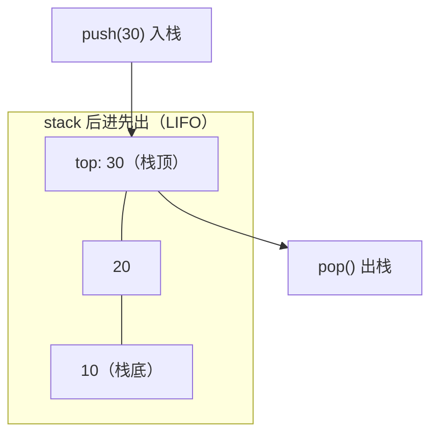

# `stack` — 栈

%% learning-vault-navigation:v1 %%
> [!abstract]- 笔记导航
> 目录：[[CS Learning/C++ STL/C++ STL导航|C++ STL 导航]]
> 上一篇：[[CS Learning/C++ STL/Adapters/queue/queue|queue — 队列]] · 下一篇：[[CS Learning/C++ STL/Algorithms/Algorithms/Algorithms|Algorithms — 标准算法概览]]
> 相关：[[CS Learning/C++ STL/Adapters/queue/queue|queue — 队列]]
> 源码：[[CS Learning/C++ STL/Adapters/stack/stack.cpp|查看源码]]

> [!abstract] 本节概览
> `std::stack` 定义在头文件 `#include <stack>` 中，实现了==后进先出（LIFO, Last In First Out）==的栈容器适配器。所有插入和删除操作均严格限制在**栈顶**进行，时间复杂度均为 $O(1)$；它不提供迭代器，无法直接访问栈内非栈顶元素。

## 核心概念与声明方式

`stack` 基于支持尾部增删的顺序容器实现，默认底层容器为 `std::deque<T>`，也可以显式指定为 `std::vector<T>` 或 `std::list<T>`：

```cpp
#include <stack>
#include <vector>

std::stack<int> s;                         // 默认底层容器为 std::deque<int>
std::stack<int, std::vector<int>> s_vec;   // 使用 std::vector<int> 作为底层容器（连续内存）
```



## 常用成员函数与复杂度速查

| 成员函数 | 功能说明 | 时间复杂度 |
| :--- | :--- | :---: |
| `s.push(val)` | 在栈顶压入一个元素 | $O(1)$ |
| `s.emplace(args...)` | 在栈顶原地构造一个元素（C++11） | $O(1)$ |
| `s.pop()` | 移除栈顶元素（返回 `void`，不返回元素值） | $O(1)$ |
| `s.top()` | 返回栈顶元素的引用（不移除元素，可读写） | $O(1)$ |
| `s.empty()` | 检查栈是否为空（空返回 `true`） | $O(1)$ |
| `s.size()` | 返回栈中元素的数量 | $O(1)$ |

## 典型用法与 `vector` 替代方案

### 1. 源码示例运行追踪

在文末示例中，依次压入 `10, 20, 30`：
1. `s.top()` 输出 `30`；
2. 执行一次 `s.pop()` 后，栈顶变为 `20`，`s.empty()` 为 `false`，`s.size()` 为 `2`；
3. 再连续执行两次 `s.pop()`，栈变为空，`s.empty()` 返回 `true`。

### 2. 用 `std::vector` 充当栈

如果不卡常，可以直接使用 `std::stack` 而无需手写数组栈；另外，[[CS Learning/C++ STL/Containers/Sequence containers/vector/vector|vector — 动态数组容器]] 也可以直接当栈使用，且支持遍历、随机访问与 `clear()`：

| 栈操作 | `std::stack` 写法 | `std::vector` 等价写法 |
| :--- | :--- | :--- |
| 入栈 | `s.push(x)` | `v.push_back(x)` |
| 出栈 | `s.pop()` | `v.pop_back()` |
| 取栈顶 | `s.top()` | `v.back()` |
| 判空 / 大小 | `s.empty()` / `s.size()` | `v.empty()` / `v.size()` |
| 清空栈 | `s = stack<int>()` 或循环 `pop()` | `v.clear()` |

## 常见易错点与注意事项

> [!warning] `stack` 没有 `clear()`，且不可访问内部元素
> - **`stack` 无 `clear()` 成员函数**：清空栈需要 `while (!s.empty()) s.pop();` 或直接用空栈覆盖 `s = std::stack<int>();`。
> - **不可遍历内部元素**：若算法需要检查栈中所有元素（例如输出单调栈或 DFS 路径），优先使用 `std::vector` 模拟栈。
> - **防空栈访问**：调用 `s.top()` 或 `s.pop()` 之前必须保证 `!s.empty()`，否则触发未定义行为（段错误）。

> [!tip] 典型应用场景
> 括号匹配、表达式求值（中缀转后缀）、单调栈（寻找左/右侧首个更大或更小元素）、以及将深度优先搜索（DFS）递归改写为非递归迭代。

## 完整源码

```cpp
/*
stack的定义:
<stack> 是 C++ 标准模板库（STL）的一部分，它实现了一个后进先出（LIFO，Last In First Out）的数据结构。这种数据结构非常适合于需要"最后添加的元素最先被移除"的场景。
<stack> 容器适配器提供了一个栈的接口，它基于其他容器（如 deque 或 vector）来实现。栈的元素是线性排列的，但只允许在一端（栈顶）进行添加和移除操作。
ps:不可访问stack的内部元素

头文件:#include <stack>

基本成员函数:
push(): 在栈顶添加一个元素。
pop():  移除栈顶元素。
top():  返回栈顶元素的引用，但不移除它。
empty():检查栈是否为空。ps：无clear
size(): 返回栈中元素的数量。

如果不卡常的话，就可以直接用它而不需要手写栈了。
另外,vector也可以当栈用,vector的.back()取尾部元素,就相当于取栈顶,.push_back() 相当于进栈,.pop_back() 相当于出栈。
*/
//下为具体示例
#include <iostream>
#include <stack>
using namespace std;
int main() {
    stack<int> s;
    // 向栈中添加元素
    s.push(10);
    s.push(20);
    s.push(30);
    // 打印栈顶元素
    cout<<"Top element is: "<<s.top()<<std::endl; // 输出: Top element is: 30
    // 移除栈顶元素
    s.pop();
    cout<<"After popping, top element is: "<<s.top()<<endl; // 输出: After popping, top element is: 20
    // 检查栈是否为空
    if (!s.empty()) {
        cout<<"Stack is not empty."<<endl; // 输出: Stack is not empty.
    }
    // 打印栈的大小
    cout<<"Size of stack: "<<s.size()<<endl; // 输出: Size of stack: 2
    // 继续移除元素
    s.pop();
    s.pop();
    // 检查栈是否为空
    if (s.empty()) {
        cout<<"Stack is empty."<<endl; // 输出: Stack is empty.
    }
    return 0;
}
```
