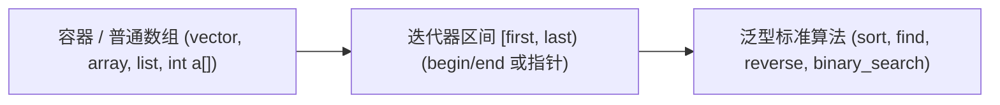

# `Algorithms` — 标准算法概览

%% learning-vault-navigation:v1 %%
> [!abstract]- 笔记导航
> 目录：[[CS Learning/C++ STL/C++ STL导航|C++ STL 导航]]
> 上一篇：[[CS Learning/C++ STL/Adapters/stack/stack|stack — 栈]] · 下一篇：[[CS Learning/C++ STL/Algorithms/binary_search()/binary_search()|binary_search() — 二分查找]]
> 源码：[[CS Learning/C++ STL/Algorithms/Algorithms/Algorithms.cpp|查看源码]]

> [!abstract] 本节概览
> C++ 标准库的 `#include <algorithm>` 头文件提供了一套与具体容器解耦的**泛型模板算法**（排序、查找、计数、变换、排列等）。所有算法统一通过==迭代器区间 `[first, last)`== 间接访问元素，因此同一套算法既可用于 `vector`、`deque`、`list` 等 STL 容器，也可直接用于 C 风格普通数组。

## 核心设计思想：容器与算法解耦

STL 将数据结构（容器）与操作逻辑（算法）分离，由[[CS Learning/C++ STL/Iterators/Iterators/Iterators|迭代器（Iterators）]]充当中间桥梁：



绝大多数 `<algorithm>` 函数遵循统一调用语法：

```cpp
#include <algorithm>

// 作用于 STL 容器
algorithm_name(container.begin(), container.end(), /* 其他参数或比较器 */);

// 作用于普通数组 a[0..n-1]
algorithm_name(a, a + n, /* 其他参数或比较器 */);
```

## 左闭右开区间 `[first, last)` 与迭代器要求

STL 算法几乎全部采用==左闭右开区间 `[first, last)`==：包含 `first` 指向的元素，但不包含 `last`（哨兵位置，指向尾元素的下一个位置）。这一设计带来三个重要性质：

- **空区间表示自然**：当 `first == last` 时区间为空，无需额外边界判断。
- **查找失败统一语义**：查找类算法（如 `find`、`lower_bound`）未找到目标时统一返回 `last`。
- **区间拼接无重叠**：`[first, mid)` 与 `[mid, last)` 恰好无缝拼接为 `[first, last)`。

不同算法对迭代器的能力要求不同：

| 迭代器类别 | 支持的代表容器 / 类型 | 典型算法示例 |
| :--- | :--- | :--- |
| **输入 / 前向迭代器**（Input / Forward） | `forward_list`、`unordered_set`、所有更强迭代器 | `find()`、`count()`、`fill()`、`unique()` |
| **双向迭代器**（Bidirectional） | `list`、`set`、`map` | `reverse()`、`next_permutation()`、`prev_permutation()` |
| **随机访问迭代器**（Random Access） | `vector`、`deque`、`array`、`string`、原生指针 | `sort()`、`shuffle()`、$O(\log n)$ 二分查找 |

## 本专题常用标准算法速览

| 分类 | 核心算法与笔记入口 | 头文件 |
| :--- | :--- | :--- |
| **排序与重排** | [[CS Learning/C++ STL/Algorithms/sort()/sort()\|sort()]]、[[CS Learning/C++ STL/Algorithms/reverse()/reverse()\|reverse()]]、[[CS Learning/C++ STL/Algorithms/shuffle()/shuffle()\|shuffle()]]、[[CS Learning/C++ STL/Algorithms/unique()/unique()\|unique()]] | `<algorithm>` |
| **查找与计数** | [[CS Learning/C++ STL/Algorithms/find()/find()\|find()]]、[[CS Learning/C++ STL/Algorithms/count()/count()\|count()]]、[[CS Learning/C++ STL/Algorithms/binary_search()/binary_search()\|binary_search()]]、[[CS Learning/C++ STL/Algorithms/lower_bound() upper_nound()/lower_bound() upper_nound()\|lower_bound() / upper_bound()]] | `<algorithm>` |
| **最值、交换与填充** | [[CS Learning/C++ STL/Algorithms/max() min() max_element() min_element()/max() min() max_element() min_element()\|max / min / *_element]]、[[CS Learning/C++ STL/Algorithms/swap()/swap()\|swap()]]、[[CS Learning/C++ STL/Algorithms/fill() fill_n()/fill() fill_n()\|fill() / fill_n()]] | `<algorithm>` / `<utility>` |
| **排列组合** | [[CS Learning/C++ STL/Algorithms/prev_permutation() next_permutation()/prev_permutation() next_permutation()\|prev_permutation() / next_permutation()]] | `<algorithm>` |
| **数值、数学与随机** | [[CS Learning/C++ STL/Algorithms/Numeric/Numeric\|Numeric]]、[[CS Learning/C++ STL/Algorithms/Cmath/Cmath\|Cmath]]、[[CS Learning/C++ STL/Algorithms/Random/Random\|Random]] | `<numeric>` / `<cmath>` / `<random>` |

## 常见易错点与注意事项

> [!warning] 标准算法本身不会改变容器的物理大小
> 因为算法只接收迭代器而非容器对象本身，像 `unique()`、`remove()` 这类算法**无法真正删除容器中的元素**，只能移动元素并返回新的逻辑尾迭代器；若要真正缩容，必须配合容器自身的 `erase()`（即经典的 *Erase–Remove Idiom*）。

> [!tip] 关联容器优先使用成员函数
> 对于 `set` / `map` 等有序关联容器，尽量调用成员函数 `s.find(x)`、`s.lower_bound(x)`（$O(\log n)$），而不要调用全局 `std::find()`（$O(n)$ 线性扫描）或 `std::lower_bound()`（对双向迭代器步进会退化为 $O(n)$）。

## 完整源码

```cpp
/*
C++ 标准库中的 <algorithm> 头文件提供了一组用于操作容器(如数组、向量、列表等)的算法。
这些算法包括排序、搜索、复制、比较等,它们是编写高效、可重用代码的重要工具。
<algorithm> 头文件定义了一组模板函数,这些函数可以应用于任何类型的容器,只要容器支持迭代器。
这些算法通常接受两个或更多的迭代器作为参数,表示操作的起始和结束位置。
语法
大多数 <algorithm> 中的函数都遵循以下基本语法：
algorithm_name(container.begin(),container.end(),...);
这里的container是一个容器对象,begin()和end()是容器的成员函数,返回指向容器开始和结束的迭代器。
*/
```
