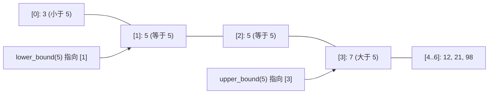

# `lower_bound()` & `upper_bound()` — 上下界查找

%% learning-vault-navigation:v1 %%
> [!abstract]- 笔记导航
> 目录：[[CS Learning/C++ STL/C++ STL导航|C++ STL 导航]]
> 上一篇：[[CS Learning/C++ STL/Algorithms/find()/find()|find() — 查找元素]] · 下一篇：[[CS Learning/C++ STL/Algorithms/max() min() max_element() min_element()/max() min() max_element() min_element()|max() min() max_element() min_element() — 最值与最值位置]]
> 源码：[[CS Learning/C++ STL/Algorithms/lower_bound() upper_nound()/lower_bound() upper_nound().cpp|查看源码]]

> [!abstract] 本节概览
> `std::lower_bound()` 与 `std::upper_bound()` 定义在头文件 `#include <algorithm>` 中，用于在**已排序**区间 `[first, last)` 内执行二分查找并返回==目标位置的迭代器（或数组指针）==。对于随机访问迭代器，时间复杂度均为 $O(\log n)$；若未找到满足条件的元素，均统一返回尾后位置 `last`。

## 核心语义对比

在已按默认 `<` 升序排列的序列中（以 `a = {3, 5, 5, 7, 12, 21, 98}` 查找 `val = 5` 为例）：



| 函数 | 默认 `<` 升序语义 | 自定义规则 `comp` 语义 | 未找到时返回值 | 时间复杂度 |
| :--- | :--- | :--- | :---: | :---: |
| `lower_bound(first, last, val [, comp])` | 第一个 **$\ge$ `val`** 的元素位置 | 首个使 `comp(*it, val)` 为 `false` 的元素（按规则==可以==排在 `val` 后面） | `last` | $O(\log n)$ |
| `upper_bound(first, last, val [, comp])` | 第一个 **$>$ `val`** 的元素位置 | 首个使 `comp(val, *it)` 为 `true` 的元素（按规则==必须==排在 `val` 后面） | `last` | $O(\log n)$ |

### 常见调用形式

```cpp
#include <algorithm>

// 1. 默认升序查找（数组与 vector）
int* p1 = std::lower_bound(a, a + n, val);
auto it1 = std::lower_bound(vec.begin(), vec.end(), val);

int* p2 = std::upper_bound(a, a + n, val);
auto it2 = std::upper_bound(vec.begin(), vec.end(), val);

// 2. 自定义比较器（必须与 sort() 时使用的比较规则一致）
int* p3 = std::lower_bound(a, a + n, val, Rule());
int* p4 = std::upper_bound(a, a + n, val, Rule());
```

## 典型用法与源码运行追踪

### 1. 常用二分衍生公式（升序序列）

| 需求 | 表达式（数组 `a[0..n-1]`） |
| :--- | :--- |
| 第一个 $\ge x$ 的下标 | `lower_bound(a, a + n, x) - a` |
| 第一个 $> x$ 的下标 | `upper_bound(a, a + n, x) - a` |
| 最后一个 $< x$ 的元素位置 | `lower_bound(a, a + n, x) - 1`（需先判断结果 `!= a`） |
| 最后一个 $\le x$ 的元素位置 | `upper_bound(a, a + n, x) - 1`（需先判断结果 `!= a`） |
| 统计 `x` 出现的次数 | `upper_bound(a, a + n, x) - lower_bound(a, a + n, x)` |

### 2. 源码示例输出追踪

原数组 `a[7] = {12, 5, 3, 5, 98, 21, 7}`：

1. **按默认 `<` 升序排序后**为 `{3, 5, 5, 7, 12, 21, 98}`：
   - `lower_bound(a, a + 7, 5)` → 指向 `a[1] = 5`，输出 `5,1`。
   - `upper_bound(a, a + 7, 5)` → 指向 `a[3] = 7`，输出 `7`。
   - `upper_bound(a, a + 7, 13)` → 指向 `a[5] = 21`，输出 `21`。
2. **按 `Rule`（个位数 `a % 10` 升序）排序后**为 `{21, 12, 3, 5, 5, 7, 98}`（个位依次为 `1, 2, 3, 5, 5, 7, 8`）：
   - `lower_bound(a, a + 7, 16, Rule())`：找首个个位 $\ge 6$ 的元素 → `7`。
   - `lower_bound(a, a + 7, 25, Rule()) - a`：找首个个位 $\ge 5$ 的下标 → `3`。
   - `upper_bound(a, a + 7, 18, Rule()) - a`：不存在个位 $> 8$ 的元素 → 返回 `a + 7`，下标差为 `7`，触发 `not found`。
   - `upper_bound(a, a + 7, 5, Rule())`：首个个位 $> 5$ 的元素 → `7`。
   - `upper_bound(a, a + 7, 4, Rule())`：首个个位 $> 4$ 的元素 → `5`。

## 常见易错点与注意事项

> [!warning] 严禁对未检空的返回迭代器直接解引用
> 当查找目标大于区间内所有元素时，`lower_bound` / `upper_bound` 返回 `last`（如 `a + NUM` 或 `vec.end()`）。**解引用 `*p` 之前务必判断 `p != a + NUM`（或 `it != vec.end()`）**，否则将发生越界访问。

> [!tip] `set` / `map` 务必使用成员函数版本
> 对 `std::set` / `std::map` 等有序关联容器，应调用 `s.lower_bound(x)` 和 `s.upper_bound(x)`（$O(\log n)$）。若误用全局 `std::lower_bound(s.begin(), s.end(), x)`，由于迭代器不支持随机跳转，时间复杂度会退化为 $O(n)$。

> [!note] 原文件名与注释勘误
> 为保持仓库路径与反向链接稳定，本目录与文件名沿用原始拼写 `upper_nound()`；原注释中“`upper_bound` 二分查找下界”实际指**上界**，且用法二处的 `T*lower_bound(...)` 应为 `T* upper_bound(...)`。

## 完整源码

```cpp
/*
注意返回的是迭代器
用lower_bound二分查找下界(用法一)
    在对元素类型为T的从小到大排好序的基本类型的数组中进行查找
    T*lower_bound(数组名+n1,数组名+n2,值)
    T*lower_bound(arr.begin(),arr.end(),值)
    返回T*p;*p是查找区间里下标最小的,【大于等于】"值"的元素。
    如果找不到,p指向下标为n2的元素
用lower_bound二分查找下界(用法二)
    在用自定义排序规则排好序的、元素为任意的T类型的数组中进行查找
    T*lower_bound(数组名+n1,数组名+n2,值,排序规则结构名())
    T*lower_bound(arr.begin(),arr.end(),值,排序规则结构名())
    返回T*p;*p是查找区间里下标最小的,按自定义排序规则,【可以】排在"值"后面的元素
    如果找不到,p指向下标为n2的元素
用upper_bound二分查找下界(用法一)
    在对元素类型为T的从小到大排好序的基本类型的数组中进行查找
    T*upper_bound(数组名+n1,数组名+n2,值)
    T*upper_bound(arr.begin(),arr.end(),值)
    返回T*p;*p是查找区间里下标最小的,【大于】"值"的元素。
    如果找不到,p指向下标为n2的元素
用upper_bound二分查找下界(用法二)
    在用自定义排序规则排好序的、元素为任意的T类型的数组中进行查找
    T*lower_bound(数组名+n1,数组名+n2,值,排序规则结构名())
    T*upper_bound(arr.begin(),arr.end(),值,排序规则结构名())
    返回T*p;*p是查找区间里下标最小的,按自定义排序规则,【必须】排在"值"后面的元素
    如果找不到,p指向下标为n2的元素
*/
#include <iostream>
#include <cstring>
#include <algorithm>
#define NUM 7
using namespace std;
struct Rule{//按个位数从小到大排
    bool operator()(const int &a1, const int &a2) const{
        return a1%10<a2%10;
    }
};
void Print(int a[],int size){
    for (int i=0;i<size;++i){
        cout<<a[i]<<",";
    }
    cout<<endl;
}
int main(){
    int a[NUM]={12,5,3,5,98,21,7} ;
    sort(a,a+NUM) ;
    Print(a,NUM);//=>3,5,5,7,12,21,98,
    int *p=lower_bound(a,a+NUM,5);
    cout<<*p<<","<<p-a<<endl;//=> 5,1
    p=upper_bound(a,a+NUM,5);
    cout<<*p<<endl;//=>7
    cout<<*upper_bound(a,a+NUM,13)<<endl;//=>21
    sort(a,a+NUM,Rule());
    Print(a,NUM);//=>21,12,3,5,5,7,98,
    cout<<*lower_bound(a,a+NUM,16,Rule())<<endl;
    cout<<lower_bound(a,a+NUM,25,Rule())-a<<endl;
    cout<<upper_bound(a,a+NUM,18,Rule())-a<<endl;
    if(upper_bound(a,a+NUM,18,Rule())==a+NUM){
        cout<<"not found"<<endl;
    }
    cout<<*upper_bound(a,a+NUM,5,Rule())<<endl;
    cout<<*upper_bound(a,a+NUM,4,Rule())<<endl;
}
```
