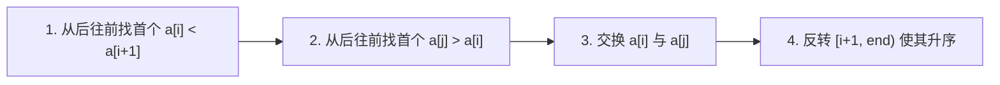

# `prev_permutation()` & `next_permutation()` — 字典序排列

%% learning-vault-navigation:v1 %%
> [!abstract]- 笔记导航
> 目录：[[CS Learning/C++ STL/C++ STL导航|C++ STL 导航]]
> 上一篇：[[CS Learning/C++ STL/Algorithms/Numeric/Numeric|Numeric — 数值算法]] · 下一篇：[[CS Learning/C++ STL/Algorithms/Random/Random|Random — 随机数]]
> 源码：[[CS Learning/C++ STL/Algorithms/prev_permutation() next_permutation()/prev_permutation() next_permutation().cpp|查看源码]]

> [!abstract] 本节概览
> `std::next_permutation()` 与 `std::prev_permutation()` 定义在头文件 `#include <algorithm>` 中，用于原地将区间 `[first, last)` 变换为**字典序的下一个 / 上一个排列**。要求容器提供双向迭代器；单次调用最坏时间复杂度为 $O(n)$，但在枚举全部 $n!$ 个排列时**均摊时间复杂度为 $O(1)$**。

## 核心接口与返回值规则

```cpp
#include <algorithm>

bool next_permutation(BidirectionalIt first, BidirectionalIt last);
bool next_permutation(BidirectionalIt first, BidirectionalIt last, Compare comp);

bool prev_permutation(BidirectionalIt first, BidirectionalIt last);
bool prev_permutation(BidirectionalIt first, BidirectionalIt last, Compare comp);
```

| 函数 | 正常变换（返回 `true`） | 到达极值时（返回 `false`） | 迭代器要求 |
| :--- | :--- | :--- | :--- |
| `next_permutation` | 原地生成字典序**下一个**排列 | 已是最大排列（降序）→ 返回 `false`，并将序列重置为==最小排列（升序）== | 双向迭代器 |
| `prev_permutation` | 原地生成字典序**上一个**排列 | 已是最小排列（升序）→ 返回 `false`，并将序列重置为==最大排列（降序）== | 双向迭代器 |

## 底层算法原理（四步法）

以 `next_permutation` 求下一个字典序排列为例：



- **`next_permutation`**：
  1. 从后往前找到第一个满足 `a[i] < a[i + 1]` 的位置 `i`（若不存在，说明整个序列已降序，反转全序列并返回 `false`）；
  2. 从后往前找到第一个满足 `a[j] > a[i]` 的元素 `a[j]`；
  3. 交换 `a[i]` 与 `a[j]`；
  4. 反转子区间 `[i + 1, end)`，使其变成最小字典序（升序）。
- **`prev_permutation`** 逻辑完全对称，只需将比较条件取反：从后往前找首个 `a[i] > a[i + 1]`，再从后往前找首个 `a[j] < a[i]`，交换后反转 `[i + 1, end)`。

## 典型用法：枚举全排列标准模板

使用 `do ... while` 循环可以在包含**初始排列**的前提下完整遍历所有排列：

```cpp
std::vector<int> a = {3, 1, 2};
std::sort(a.begin(), a.end());  // 必须先升序排序！
do {
    for (int x : a) std::cout << x << ' ';
    std::cout << '\n';
} while (std::next_permutation(a.begin(), a.end()));
```

同理，若要按字典序**从大到小**枚举全排列，先按降序排列（如 `{3, 2, 1}`），再配合 `do ... while (prev_permutation(...))`。

## 常见易错点与注意事项

> [!warning] 枚举全部排列前必须先排序
> `next_permutation` 只会生成**严格大于当前排列**的后续排列。如果初始序列不是完全升序（如 `{2, 1, 3}`），将会漏掉 `{1, 2, 3}` 和 `{1, 3, 2}`！枚举所有排列前，务必先调用 `std::sort(first, last)`（用 `prev_permutation` 则先降序排序）。

> [!tip] 天然支持含重复元素的多重集排列
> 即使序列中包含重复元素（如 `{1, 1, 2}`），`next_permutation` 也**会自动去重**，仅输出互不相同的 3 个排列：`{1, 1, 2}`、`{1, 2, 1}`、`{2, 1, 1}`，无需额外判重。

## 完整源码

```cpp
/*
next_permutation 和 prev_permutation 是两个常用的排列生成函数。
next_permutation:生成下一个字典序排列。
prev_permutation:生成上一个字典序排列。

语法
prev_permutation(Iterator first,Iterator last,Compare comp)
first 和 last:双向迭代器，指定序列范围 [first,last)。
comp:自定义的比较函数或仿函数。

返回值:
如果成功生成目标排列，返回 true，并修改序列。
如果当前排列已经是极值（最大或最小），则返回 false，并将序列改为相反的极值。
next_permutation:改为最小排列（升序）。
prev_permutation:改为最大排列（降序）。

原理
next_permutation生成下一个字典序排列的步骤：
从后往前找第一个满足 a[i] < a[i+1] 的位置 i。
从后往前找第一个大于 a[i] 的元素 a[j]。
交换 a[i] 与 a[j]。
反转 [i+1, end) 的子序列。

prev_permutation生成上一个字典序排列的步骤与 next_permutation 类 似，只是比较条件相反：
从后往前找第一个满足 a[i] > a[i+1] 的位置 i。
从后往前找第一个小于 a[i] 的元素 a[j]。
交换 a[i] 与 a[j]。
反转 [i+1, end) 的子序列。
*/
#include <iostream>
#include <algorithm>
using namespace std;
int main() {
    int a[]={1,2,3};
    int n=3;
    cout<<"使用 next_permutation:"<<endl;
    do {
        for (int i=0;i<n;i++){
            cout<<a[i]<<" ";
        }
        cout<<endl;
    } while (next_permutation(a,a+n));
    int b[]={3,2,1};
    cout<<"使用 prev_permutation:"<<endl;
    do {
        for (int i=0;i<n;i++){
        cout<<b[i]<<" ";
    }
        cout<<endl;
    } while (prev_permutation(b,b+n));
    return 0;
}
```
