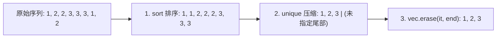

# unique() — 相邻去重

%% learning-vault-navigation:v1 %%
> [!abstract]- 笔记导航
> 目录：[[CS Learning/C++ STL/C++ STL导航|C++ STL 导航]]
> 上一篇：[[CS Learning/C++ STL/Algorithms/swap()/swap()|swap() — 交换]] · 下一篇：[[CS Learning/C++ STL/Containers/Associative containers/map/map|map — 有序键值映射]]
> 源码：[[CS Learning/C++ STL/Algorithms/unique()/unique().cpp|查看源码]]

> [!abstract] 本节概览
> `std::unique` 定义于头文件 `<algorithm>`，用于对**前向迭代器区间** `[first, last)` 执行==相邻元素去重==。它不改变容器的物理大小，而是将每个连续重复组的首元素前移，并返回新序列的逻辑尾后迭代器；若要实现全局去重并真正缩容，必须配合 `std::sort` 与容器的 `erase()` 组成经典的 **Sort + Unique + Erase** 三步惯用法。单次 `unique` 时间复杂度为 $O(n)$，配合排序整体为 $O(n \log n)$，原地执行（额外空间 $O(1)$），不会使已有内存重新分配，但 `erase` 会使被删区间及之后的迭代器失效。

## 核心概念与工作原理

`std::unique` 是一个作用于迭代器范围的通用算法模板，由于算法层不持有容器本身的句柄，它**无法直接调用容器的删除操作来缩短容器长度**。其核心特性如下：

- **仅去除相邻重复**：对于连续相等的元素组，只保留该组的第一个元素；若相同元素不相邻，则不会被合并。
- **全局去重必先排序**：对无序序列进行整体去重前，必须先调用 `std::sort`，使相同元素聚集在一起。
- **“伪”删除（逻辑压缩）**：算法通过双指针扫描，将保留下来的不重复元素依次覆盖/移动到区间前部，容器原有的 `size()` 与 `capacity()` 均保持不变。
- **返回逻辑终点**：返回一个指向去重后有效区间末尾下一位置的迭代器 `new_end`，有效数据范围为 `[first, new_end)`。



> [!note] 关于“尾部元素”的严谨说明
> 原学习笔记中通俗地将 `unique` 描述为“将重复的元素移动到容器末尾”。从 C++ 标准角度进一步精确：`std::unique` 实际上是通过**移动赋值（Move Assignment）**把后续不重复元素前移覆盖，因此逻辑终点 `it` 之后区间 `[it, vec.end())` 中的元素处于==有效但未指定的状态（valid but unspecified）==，不一定恰好等于被删掉的旧重复值，故不应再读取该尾部区间，应立即使用 `erase` 清除。

## 常用重载与复杂度速查

| 函数签名 | 说明 | 迭代器要求 | 时间复杂度 |
| --- | --- | --- | --- |
| `unique(first, last)` | 使用 `operator==` 判断相邻元素是否相等并去重，返回新逻辑终点 | 前向迭代器（ForwardIterator） | $O(n)$ |
| `unique(first, last, pred)` | 使用二元谓词 `pred(a, b)` 判断相邻元素等价并去重，返回新逻辑终点 | 前向迭代器（ForwardIterator） | $O(n)$ |
| `unique_copy(first, last, d_first)` | 不修改原区间，将相邻去重后的结果写入目标输出区间 | 输入迭代器 + 输出迭代器 | $O(n)$ |

## 典型用法与 Erase–Remove 惯用法

### 1. 标准三步去重（`sort` + `unique` + `erase`）

源码中的典型流程对应算法竞赛与工程中最常见的去重模板：

```cpp
vector<int> vec = {1, 2, 2, 3, 3, 3, 1, 2};

sort(vec.begin(), vec.end());               // 1. 排序: {1, 1, 2, 2, 2, 3, 3, 3}
auto it = unique(vec.begin(), vec.end());   // 2. 相邻去重，it 指向第 4 个位置
vec.erase(it, vec.end());                   // 3. 物理删除尾部冗余区间 -> {1, 2, 3}
```

也可以将第 2、3 步合并为一行惯用写法（俗称 **Erase–Remove 惯用法**的变体）：

```cpp
vec.erase(unique(vec.begin(), vec.end()), vec.end());
```

### 2. 对普通数组与自定义谓词去重

对原生数组（如 `int a[n]`）无需 `erase`，直接用指针差得到去重后的新长度：

```cpp
int len = unique(a, a + n) - a; // 有效元素为 a[0 .. len-1]
```

若需要自定义“重复”判定（例如忽略大小写或按浮点误差判断），可传入自定义二元谓词：

```cpp
// 将连续多个空格压缩为单个空格
s.erase(unique(s.begin(), s.end(), [](char a, char b) {
    return a == ' ' && b == ' ';
}), s.end());
```

## 常见易错点与注意事项

> [!warning] 易错点清单
> 1. **忘记先 `sort`**：对 `{1, 2, 1}` 直接调用 `unique` 不会去掉第二个 `1`，结果仍为 `{1, 2, 1}`。
> 2. **忘记调用 `erase`**：仅执行 `unique(v.begin(), v.end())` 后直接遍历整个 `v`，尾部仍残留旧长度的垃圾/未指定元素。
> 3. **对 `std::list` 优先用成员函数 `lst.unique()`**：`list` 提供了专属成员函数 `lst.unique()`，能直接释放重复节点内存，无需额外 `erase`。
> 4. **与 `std::set` 去重对比**：`sort` + `unique` + `erase` 连续内存缓存友好、常数小，适合离线批量去重与离散化；若需动态边插边查重，应使用 [[CS Learning/C++ STL/Containers/Associative containers/set/set|set]] 或 [[CS Learning/C++ STL/Containers/Unordered associative containers/unordered_set unordered_multiset/unordered_set unordered_multiset|unordered_set]]。

## 完整源码

```cpp
/*
unique是一个用来移除「相邻」重复元素的函数模板，定义在头文件 <algorithm> 中

核心功能与特性
相邻去重：它只移除相邻的重复元素，并每个重复组只保留第一个。
必须先排序：若想对整个容器或数组去重，必须先进行排序（sort），否则不相邻的重复元素无法被清除。
「“伪”删除」：它不会真正改变容器的物理容量或大小，而是把不重复的元素前移，将重复的元素移动到容器末尾。
返回值：返回一个指向去重后逻辑终点的迭代器（即新序列最后一个有效元素的下一个位置）。
*/
#include <iostream>
#include <vector>
#include <algorithm>
using namespace std;
int main(){
    vector<int> vec={1,2,2,3,3,3,1,2};
    // 1. 先排序
    sort(vec.begin(),vec.end());
    // 2. 使用 unique 去重
    auto it=unique(vec.begin(),vec.end());
    // 3. 真正删除末尾重复元素
    vec.erase(it,vec.end());
    // 输出结果：1 2 3
    for (int x:vec){
        cout<<x<<" ";
    }
    return 0;
}
```
