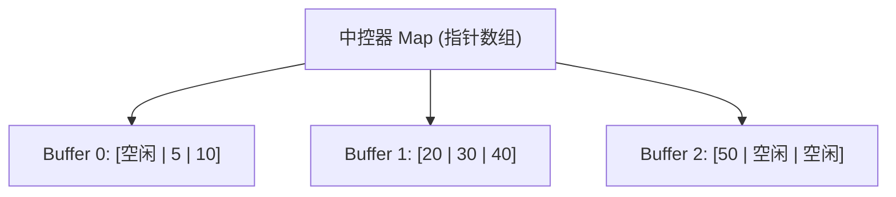

# deque — 双端队列容器

%% learning-vault-navigation:v1 %%
> [!abstract]- 笔记导航
> 目录：[[CS Learning/C++ STL/C++ STL导航|C++ STL 导航]]
> 上一篇：[[CS Learning/C++ STL/Containers/Sequence containers/array/array|array — 定长数组容器]] · 下一篇：[[CS Learning/C++ STL/Containers/Sequence containers/forward_list/forward_list|forward_list — 单向链表容器]]
> 相关：[[CS Learning/C++ STL/Containers/Sequence containers/vector/vector|vector — 动态数组容器]]
> 源码：[[CS Learning/C++ STL/Containers/Sequence containers/deque/deque.cpp|查看源码]]

> [!abstract] 本节概览
> `std::deque`（Double-Ended Queue）定义于头文件 `<deque>`，底层采用==分段连续内存（中控器指针数组 + 固定大小数据块）==实现。它同时支持 $O(1)$ 的随机下标访问以及**头尾两端**均摊 $O(1)$ 的插入与删除（这也是 `stack` 与 `queue` 的默认底层容器）。扩容时只需挂载新数据块，无需像 `vector` 那样整体搬迁已有元素；但头尾插入会令所有迭代器失效（元素引用仍保持有效），且不保证整体物理内存连续。

## 核心概念、底层结构与初始化

### 1. 分段连续内存模型

与 `vector` 使用一整块连续内存不同，`deque` 通过一个**中控器（map，指向各块首地址的指针数组）**管理若干固定大小的连续内存块（chunk / buffer）：



- **两段式定位**：访问 `dq[i]` 时先通过整除定位所在块、再取模定位块内偏移，因此依然支持 $O(1)$ 随机访问（仅常数略大于 `vector`）。
- **两端高效扩展**：向前或向后满块时只需分配新块并挂入中控器，无需拷贝迁移旧元素；注意与适配器 `std::queue` 的区别——`deque` 支持随机访问与迭代器，而 `queue` 不支持。

### 2. 声明与构造方式

```cpp
#include <deque>

deque<int> d1;                  // 默认构造，空双端队列
deque<int> d2(5);               // 包含 5 个默认值（0）元素
deque<int> d3(5, 10);           // 包含 5 个值为 10 的元素
deque<int> d4 = {1, 2, 3, 4};   // 使用初始化列表构造
deque<int> d5 = d4;             // 拷贝构造 / operator= 赋值
```

## 常用接口与时间复杂度速查

| 成员函数 / 操作 | 说明 | 时间复杂度 |
| --- | --- | --- |
| `d.push_back(val)` / `d.pop_back()` | 在尾部添加 / 删除元素 | 均摊 $O(1)$ / $O(1)$ |
| `d.push_front(val)` / `d.pop_front()` | 在头部添加 / 删除元素（==`vector` 不支持==） | 均摊 $O(1)$ / $O(1)$ |
| `d[pos]` / `d.at(pos)` | 访问指定位置元素（`[]` 无越界检查，`at` 带边界检查） | $O(1)$ |
| `d.front()` / `d.back()` | 返回首 / 尾元素的引用，可直接用于读写修改 | $O(1)$ |
| `d.begin()` / `d.end()` | 返回正向随机访问迭代器 | $O(1)$ |
| `d.rbegin()` / `d.rend()` | 返回逆向起始 / 结束迭代器 | $O(1)$ |
| `d.empty()` / `d.size()` / `d.max_size()` | 判空 / 当前元素个数 / 理论最大容量 | $O(1)$ |
| `d.assign(...)` | 用新内容替换容器中的所有元素 | $O(n)$ |
| `d.insert(pos, val)` / `d.erase(pos)` | 在任意指定位置插入 / 移除元素 | $O(n)$（靠两端时较快） |
| `d.resize(count, val)` | 调整元素个数为 `count`，扩容部分用 `val`（缺省为默认值）填充 | $O(n)$ |
| `d.clear()` | 清空所有元素 | $O(n)$ |
| `d.swap(other)` | 交换两个 `deque` 容器内容 | $O(1)$ |
| `d.get_allocator()` | 返回分配器对象副本 | $O(1)$ |

## `vector` 与 `deque` 对比及典型用法

| 对比维度 | `vector` | `deque` |
| --- | --- | --- |
| 内存布局 | 单块完全连续内存（支持 `.data()`） | 分段连续内存（无 `.data()`、`capacity()`、`reserve()`） |
| 头部增删 | 不支持 `push_front` / `pop_front`（`insert(begin())` 为 $O(n)$） | ==原生均摊 $O(1)$== |
| 尾部增删 | 均摊 $O(1)$，扩容可能触发全量元素搬迁 | 均摊 $O(1)$，不搬迁旧元素 |
| 随机访问与缓存局部性 | 极佳（单次偏移寻址，CPU Cache 友好） | 良好（需经中控器二次寻址，常数稍高） |
| 适用场景 | 绝大多数需要随机访问、尾部追加或与 C API 交互的场景 | 滑动窗口单调队列、0-1 BFS、频繁头尾增删场景 |

源码中的两个示例分别展示了：
1. `push_back` + `push_front` 入队与 `pop_back` + `pop_front` 出队，结合 `myDeque[i]` 随机遍历。
2. 利用 `d.front()` 与 `d.back()` 返回左值引用的特性，在不关心总长度时直接原地修改头尾元素（`d.front() = 15; d.back() = 25;`）。

## 常见易错点与迭代器失效规则

> [!warning] `deque` 的特殊迭代器失效规则
> 1. **头尾插入（`push_front` / `push_back`）**：会==使所有现有迭代器失效==（中控器 map 可能重分配），但**指向已有元素的指针和引用仍然有效**（因为已有数据块本身不被搬迁）。
> 2. **头尾删除（`pop_front` / `pop_back`）**：仅使指向被删元素及 `end()` 的迭代器与引用失效，其余保持有效。
> 3. **中间位置 `insert` / `erase`**：会使**所有迭代器、指针和引用**全部失效。
> 4. **没有 `.data()` 接口**：切勿像 `vector` 那样假设 `&dq[0] + i == &dq[i]`，跨块边界时地址并不连续。

## 完整源码

```cpp
/*
deuqe的定义:
在C++中，<deque> 是标准模板库（STL）的一部分，它提供了双端队列（double-ended queue）的实现。
双端队列是一种允许在两端进行插入和删除操作的线性数据结构。
<deque> 在C++中以模板类的形式存在，允许存储任意类型的数据。
<deque> 是一个动态数组，它提供了快速的「随机访问」能力，同时允许在两端进行高效的插入和删除操作。(注意与queue不允许随机访问元素的区别)
这使得 <deque> 成为处理需要频繁插入和删除元素的场景的理想选择。

deque的声明:
头文件:#include <deque>
deque<int> myDeque; // 创建一个整数类型的双端队列
                    // 接下来可以进行插入、删除等操作
                    deque()	默认构造函数，创建一个空的 deque 容器。

deque的初始化和基础操作:
deque()	                            默认构造函数，创建一个空的 deque 容器。
deque(size_type n)	                创建一个包含 n 个默认值元素的 deque 容器。
deque(size_type n, const T& value)	创建一个包含 n 个值为 value 的 deque 容器。
deque(initializer_list<T> il)	    使用初始化列表 il 构造 deque 容器。
operator=	                        赋值操作符，赋值给 deque 容器。

下面是成员函数:
assign()	                            用新值替换 deque 容器中的所有元素。
at(size_type pos)	                    返回 pos 位置的元素，并进行范围检查。
operator[](size_type pos)	            返回 pos 位置的元素，不进   行范围检查。
front()	                                返回第一个元素的引用。
back()	                                返回最后一个元素的引用。
begin()/end()                           返回指向第一个元素/末尾元素后一位置的迭代器。
rbegin()	                            返回指向最后一个元素的逆向迭代器。
rend()	                                返回指向第一个元素之前位置的逆向迭代器。
empty()	                                检查容器是否为空。
size()	                                返回容器中的元素个数。
max_size()	                            返回容器可容纳的最大元素个数。
clear()	                                清除容器中的所有元素。
insert(iterator pos, const T& value)	在 pos 位置插入 value 元素。
erase(iterator pos)	                    移除 pos 位置的元素。
push_back(const T& value)	            在容器末尾添加 value 元素。
pop_back()	                            移除容器末尾的元素。
push_front(const T& value)	            在容器前端添加 value 元素。(注意vector不行)
pop_front()	                            移除容器前端的元素。(注意vector不行)
resize(size_type count,const T& value)	调整容器大小为 count，多出部分用value(无就用默认值)填充。
swap(deque& other)	                    交换两个 deque 容器的内容。
get_allocator()	                        返回一个用于构造双端队列的分配器对象的副本。

vector和deque的区别
vector：连续内存，擅长尾部操作。
deque： 分段连续内存，擅长头尾两端操作。
*/
#include <iostream>
#include <deque>
using namespace std;
int main() {
    deque<int> myDeque;
    // 插入元素
    myDeque.push_back(10);
    myDeque.push_back(20);
    myDeque.push_front(5);
    // 访问元素
    cout << "Deque contains: ";
    for (int i=0;i<myDeque.size();i++) {
        cout<<myDeque[i]<<" ";
    }
    cout<<endl;
    // 删除元素
    myDeque.pop_back();
    myDeque.pop_front();
    // 再次访问元素
    cout<<"Deque after popping: ";
    for (int i=0;i<myDeque.size();i++) {
        cout<<myDeque[i]<<" ";
    }
    cout<<endl;

    //在不知道 deque 长度的时候，可以使用 deque.front() 与 deque.back() 来访问头尾元素：
    deque<int> d;
    // 向双端队列中添加元素
    d.push_back(10);
    d.push_back(20);
    d.push_front(5);
    // 访问前端元素
    cout<<"Front element: "<<d.front()<<endl;
    // 访问后端元素
    cout <<"Back element: "<<d.back()<<endl;
    // 修改前端元素
    d.front() = 15;
    // 修改后端元素
    d.back() = 25;
    // 再次访问元素
    cout<<"Modified front element: "<<d.front()<<endl;
    cout<<"Modified back element: "<<d.back()<<endl;
    return 0;
}
```
