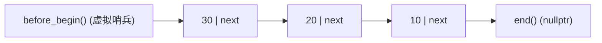

# forward_list — 单向链表容器

%% learning-vault-navigation:v1 %%
> [!abstract]- 笔记导航
> 目录：[[CS Learning/C++ STL/C++ STL导航|C++ STL 导航]]
> 上一篇：[[CS Learning/C++ STL/Containers/Sequence containers/deque/deque|deque — 双端队列容器]] · 下一篇：[[CS Learning/C++ STL/Containers/Sequence containers/list/list|list — 双向链表容器]]
> 相关：[[CS Learning/C++ STL/Containers/Sequence containers/list/list|list — 双向链表容器]]
> 源码：[[CS Learning/C++ STL/Containers/Sequence containers/forward_list/forward_list.cpp|查看源码]]

> [!abstract] 本节概览
> `std::forward_list`（C++11 引入）定义于头文件 `<forward_list>`，是针对极致空间效率设计的==单向链表容器==。每个节点仅保存一个指向后继节点的 `next` 指针，相比双向链表 `list` 节省了一半指针开销。仅提供**前向迭代器**，在已知前驱位置时插入与删除均为 $O(1)$；为了实现零额外开销，它**刻意不提供 `size()`、尾部访问与反向遍历**。插入不使任何迭代器失效，删除仅使被删节点迭代器失效。

## 核心概念、底层结构与声明

### 1. 单向链表节点布局与 `before_begin()`

因为单向链表节点无法回溯前驱，若要在任意位置（包括表头之前）插入或删除节点，必须持有目标位置的**前驱迭代器**。因此 `forward_list` 专门提供了虚拟头前位置 `before_begin()`。

以源码中依次执行 `push_front(10)`、`push_front(20)`、`push_front(30)` 为例（头插法使顺序反转，输出 `30 20 10`）：



### 2. 核心特点与声明

```cpp
#include <forward_list>

forward_list<int> fl;                  // 空单向链表
forward_list<int> fl2 = {1, 2, 3, 4};  // 列表初始化
```

- **单向遍历**：只能从前往后（`++it`），不支持 `--it`、`rbegin()`/`rend()`。
- **低内存开销**：每节点仅多一个 `next` 指针（通常 8 字节），与手写 C 单链表空间开销一致。
- **不支持随机访问**：没有 `operator[]` 和 `at()`，访问第 $k$ 个元素需 $O(k)$ 遍历。

## 常用接口与时间复杂度速查

| 成员函数 | 说明 | 时间复杂度 |
| --- | --- | --- |
| `fl.push_front(val)` / `fl.emplace_front(...)` | 在链表前端插入元素 | $O(1)$ |
| `fl.pop_front()` | 移除链表前端元素 | $O(1)$ |
| `fl.front()` | 返回首个元素的引用 | $O(1)$ |
| `fl.before_begin()` | 返回指向首元素**之前**虚拟位置的迭代器（不可解引用，专供 `*_after` 使用） | $O(1)$ |
| `fl.begin()` / `fl.end()` | 返回正向起始 / 尾后迭代器 | $O(1)$ |
| `fl.insert_after(pos, val)` | 在迭代器 `pos` **之后**插入元素 | $O(1)$ |
| `fl.erase_after(pos)` | 删除迭代器 `pos` **之后**的元素 | $O(1)$ |
| `fl.splice_after(pos, other)` | 将另一链表节点无拷贝转移至 `pos` 之后 | $O(1)$ |
| `fl.remove(val)` / `fl.reverse()` / `fl.unique()` | 按值删除 / 原地反转 / 相邻去重 | $O(n)$ |
| `fl.sort()` | 对单向链表进行归并排序（不能用 `std::sort`） | $O(n \log n)$ |
| `fl.empty()` / `fl.clear()` | 判断是否为空 / 清空链表 | $O(1)$ / $O(n)$ |

## 典型用法：借助 `before_begin()` 操作表头

由于不存在 `insert()` / `erase()`，所有中间或表头修改均通过 `*_after` 族函数完成：

```cpp
forward_list<int> fl = {20, 10};
// 在表头插入 30（等价于 fl.push_front(30)）
fl.insert_after(fl.before_begin(), 30);

// 删除首个元素（等价于 fl.pop_front()）
fl.erase_after(fl.before_begin());

// 获取元素个数（注意：forward_list 没有 .size()！）
auto len = std::distance(fl.begin(), fl.end()); // O(n)
```

## 常见易错点与迭代器失效规则

> [!warning] `forward_list` 的 3 个反直觉设计
> 1. **没有 `size()` 成员函数**：为了与 C 单链表保持相同的最小对象尺寸并确保 `splice_after` 为 $O(1)$，标准库故意省略了 `size()`；需要长度时请用 `std::distance(fl.begin(), fl.end())`（$O(n)$），判空请用 `fl.empty()`（$O(1)$）。
> 2. **没有 `back()` / `push_back()` / `pop_back()`**：单链表不维护尾指针，所有常规增删均在表头或已知前驱之后进行。
> 3. **严禁解引用 `before_begin()`**：`*fl.before_begin()` 是未定义行为（UB），它仅用作 `insert_after`、`erase_after`、`splice_after` 的锚点参数。

> [!tip] 迭代器稳定性
> 与 `std::list` 相同，`forward_list` 基于独立堆节点实现：插入、移动与 `splice_after` 均**不使任何迭代器失效**；删除操作仅使指向被删节点的迭代器失效。

## 完整源码

```cpp
/*
forward_list的定义：
C++ 标准库中的 <forward_list> 是一种容器，它提供了一种单向链表的数据结构。
与双向链表（list）不同，forward_list只支持单向遍历。它适用于需要频繁进行前向遍历和插入、删除操作的场景。

forward_list的特点:
单向链表：forward_list 是单向链表，只能从前往后遍历，不能反向遍历。由于其单向链表的结构，插入和删除操作在已知位置的情况下非常高效（O(1) 复杂度）。
低内存开销：与list相比，forward_list只需要一个指向下一个节点的指针，节省了内存。
不支持随机访问：不支持通过索引访问元素，不能使用operator[]或at，只能通过迭代器进行访问。

forward_list的声明:
头文件#include <forward_list>
    forward_list<T> list;

以下是常用成员函数
push_front(const T& value)  列表的前端插入一个元素。
pop_front()                 移除列表前端的元素。
before_begin()              返回指向列表前端之前的迭代器。
begin()                     返回指向列表前端的迭代器。
end()                       返回指向列表末尾的迭代器。
*/
#include <iostream>
#include <forward_list>
using namespace std;
int main() {
    // 创建一个空的 forward_list
    forward_list<int> fl;
    // 在列表前端添加元素
    fl.push_front(10);
    fl.push_front(20);
    fl.push_front(30);
    // 遍历 forward_list 并输出元素
    for (auto it=fl.begin();it!=fl.end();it++) {
        cout<<*it<<" ";
    }
    cout<<endl;// 输出结果：30 20 10
    return 0;
}
```
