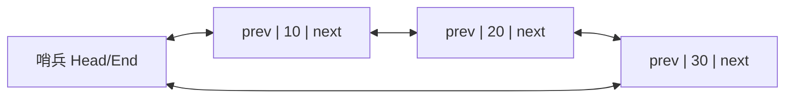

# list — 双向链表容器

%% learning-vault-navigation:v1 %%
> [!abstract]- 笔记导航
> 目录：[[CS Learning/C++ STL/C++ STL导航|C++ STL 导航]]
> 上一篇：[[CS Learning/C++ STL/Containers/Sequence containers/forward_list/forward_list|forward_list — 单向链表容器]] · 下一篇：[[CS Learning/C++ STL/Containers/Sequence containers/string/string|string — string 字符串容器]]
> 相关：[[CS Learning/C++ STL/Containers/Sequence containers/forward_list/forward_list|forward_list — 单向链表容器]]
> 源码：[[CS Learning/C++ STL/Containers/Sequence containers/list/list.cpp|查看源码]]

> [!abstract] 本节概览
> `std::list` 定义于头文件 `<list>`，底层基于==非连续内存的双向链表==（通常为带哨兵节点的双向循环链表）实现。它支持在**任意已知迭代器位置以 $O(1)$ 完成插入、删除与节点拼接（`splice`）**，且无需像 `vector` 那样搬移元素或重新分配整块内存；代价是不支持 $O(1)$ 随机下标访问且内存局部性较弱。提供**双向迭代器**，除指向被删元素的迭代器外，其余迭代器、指针与引用在增删操作中均**保持稳定不失效**。

## 核心概念、底层结构与初始化

### 1. 双向链表节点模型

每个节点独立分配在堆上，保存前驱指针 `prev`、数据域 `val` 与后继指针 `next`：



- **双向迭代**：支持 `++` 与 `--`（以及 `rbegin()`/`rend()`），但不支持 `[]`、`at()` 或 `it + n` 随机跳跃。
- **动态大小**：按节点按需分配，无容量预分配概念，也不会触发整体扩容拷贝。

### 2. 声明与初始化

```cpp
#include <list>

list<int> lst1;              // 空的 list
list<int> lst2(5);           // 包含 5 个默认初始化（0）元素的 list
list<int> lst3(5, 10);       // 包含 5 个值为 10 的元素
list<int> lst4 = {1, 2, 3, 4}; // 初始化列表构造
```

## 常用接口与时间复杂度速查

| 成员函数 | 说明 | 时间复杂度 |
| --- | --- | --- |
| `push_back(val)` / `push_front(val)` | 在链表尾部 / 头部添加元素 | $O(1)$ |
| `pop_back()` / `pop_front()` | 删除链表尾部 / 头部元素 | $O(1)$ |
| `front()` / `back()` | 返回首 / 尾元素的引用 | $O(1)$ |
| `insert(pos, val)` | 在迭代器 `pos` **之前**插入元素，返回新元素迭代器 | $O(1)$ |
| `erase(pos)` | 删除 `pos` 指向的元素，返回下一个有效元素的迭代器 | $O(1)$ |
| `splice(pos, other, ...)` | 将 `other` 的单个、区间或全部节点**直接改指针转移**到 `pos` 之前（零拷贝） | $O(1)$（整表或单节点） |
| `remove(val)` / `remove_if(pred)` | 删除所有等于 `val` 或满足谓词的元素 | $O(n)$ |
| `sort()` | 成员版稳定归并排序（==不可用 `std::sort`==） | $O(n \log n)$ |
| `unique()` | 删除相邻重复元素并真正释放节点（通常先 `sort()`） | $O(n)$ |
| `merge(other)` | 将另一已排序链表 `other` 归并到当前有序链表中（`other` 变空） | $O(n + m)$ |
| `reverse()` | 原地反转链表所有节点链接 | $O(n)$ |
| `size()` / `empty()` / `clear()` | 返回长度（C++11 起严格 $O(1)$） / 判空 / 清空 | $O(1)$ / $O(1)$ / $O(n)$ |
| `begin()` / `end()` | 返回双向起始 / 尾后迭代器 | $O(1)$ |

## 典型用法与三大序列容器对比

### 1. 源码核心操作演示

源码覆盖了 `list` 最典型的四大操作模式：

1. **特定位置定位与增删**：`list` 不能写 `it + 2`，必须通过 `std::advance(it, 2)` 移动迭代器：
   ```cpp
   auto it = lst.begin();
   advance(it, 2);      // 移动到第 3 个元素（值为 3）
   lst.insert(it, 10);  // 在 3 之前插入 10 -> {1, 2, 10, 3, 4, 5}
   lst.erase(it);       // 得益于迭代器稳定，it 仍指向 3，将其删除 -> {1, 2, 10, 4, 5}
   ```
2. **链表专属算法**：`lst.sort(); lst.unique();`（直接物理删除重复节点，无需像 `vector` 那样再 `erase`）。
3. **归并与反转**：两个已排序链表通过 `lst1.merge(lst2)` 零拷贝合并为有序链表，再用 `lst1.reverse()` 翻转为降序。
4. **节点剪切 `splice`（LRU 缓存核心利器）**：`lst.splice(lst.begin(), lst, it)` 可在 $O(1)$ 内把任意节点移动到表头，配合 `unordered_map` 即可高效实现 LRU 缓存。

### 2. `list` vs `vector` vs `deque` 对比

| 特性 | `list` | `vector` | `deque` |
| --- | --- | --- | --- |
| 内存结构 | 非连续内存，双向链表 | 单块连续内存 | 分段连续内存 |
| 访问性能 | 顺序访问，随机访问慢 $O(n)$ | 随机访问极快 $O(1)$ | 随机访问与头尾访问快 $O(1)$ |
| 插入 / 删除性能 | 任意已知位置 $O(1)$ | 尾部均摊 $O(1)$，头/中间 $O(n)$ | 头尾均摊 $O(1)$，中间 $O(n)$ |
| 适用场景 | 频繁在任意位置增删、需要 `splice` 或严格迭代器稳定 | 绝大多数场景、需要缓存友好与随机访问 | 频繁在头尾两端增删且需要随机访问 |
| 迭代器稳定性 | ==极稳定==（仅被删元素迭代器失效） | 扩容时全失效，非扩容时改点及之后失效 | 头尾插使迭代器失效，中间增删全失效 |

## 常见易错点与注意事项

> [!warning] 常见踩坑点
> 1. **不能调用 `std::sort(lst.begin(), lst.end())`**：`std::sort` 要求随机访问迭代器，编译会直接报错，必须调用成员函数 **`lst.sort()`**。
> 2. **`erase(it)` 后原 `it` 立刻失效**：遍历删除时务必写成 `it = lst.erase(it);`，不可对已失效的 `it` 再执行 `++it`。
> 3. **Cache 局部性劣势**：尽管中间插入理论复杂度是 $O(1)$，但链表节点分散在堆内存中，遍历时容易触发 CPU Cache Miss；除非确实需要 `splice` 或极高的迭代器稳定性，小规模数据在现代硬件上往往还是 `vector` 更快。

## 完整源码

```cpp
/*
list的定义：
C++ 标准库提供了丰富的功能，其中 <list> 是一个非常重要的容器类，用于存储元素集合，支持双向迭代器。
<list> 是 C++ 标准模板库（STL）中的一个序列容器，它允许在容器的任意位置快速插入和删除元素。
与数组或向量（<vector>）不同，<list> 不需要在创建时指定大小，并且可以在任何位置添加或删除元素，而不需要重新分配内存。

list的声明和基本操作：
头文件：#include <list>
声明列表：list<T> mylist;，其中 T 是存储在列表中的元素类型。
插入元素：mylist.push_back(value);
删除元素：mylist.pop_back();或mylist.erase(iterator);
访问元素：mylist.front();和mylist.back();
遍历列表：使用迭代器 for (auto it=mylist.begin();it!=mylist.end();it++)

list的特点:
双向迭代：<list> 提供了双向迭代器，可以向前和向后遍历元素。
动态大小：与数组不同，<list> 的大小可以动态变化，不需要预先分配固定大小的内存。
快速插入和删除：可以在列表的任何位置快速插入或删除元素，而不需要像向量那样移动大量元素。

以下是常用成员函数:
push_back(const T& val)	    在链表末尾添加元素
push_front(const T& val)	在链表头部添加元素
pop_back()	                删除链表末尾的元素
pop_front()	                删除链表头部的元素
insert(iterator pos, val)	在指定位置插入元素
erase(iterator pos)	        删除指定位置的元素
clear()	                    清空所有元素
size()	                    返回链表中的元素数量
empty()	                    检查链表是否为空
front()	                    返回链表第一个元素
back()	                    返回链表最后一个元素
remove(const T& val)	    删除所有等于指定值的元素
sort()	                    对链表中的元素进行排序
merge(list& other)	        合并另一个已排序的链表(合并自动排序)
reverse()	                反转链表
begin() / end()	            返回链表的起始/结束迭代器
*/

#include <iostream>
#include <list>
using namespace std;
int main() {
    //声明和初始化示例
    list<int> lst1;                  // 空的list
    list<int> lst2(5);               // 包含5个默认初始化元素的list
    list<int> lst3(5,10);           // 包含5个元素，每个元素为10
    list<int> lst4={1,2,3,4};   // 使用初始化列表

    //基本操作示例
    list<int> lst = {10, 20, 30};
    // 插入和删除元素
    lst.push_front(5);           // 在头部插入5
    lst.push_back(40);           // 在尾部插入40
    lst.pop_front();             // 删除头部元素
    lst.pop_back();              // 删除尾部元素
    // 输出链表内容
    cout<<"List elements: ";
    for (const auto& elem:lst){
        cout<<elem<<" ";
    }
    cout<<endl;

    //插入和删除特定位置的元素示例
    lst={1,2,3,4,5};
    auto it=lst.begin();
    advance(it,2);               // 移动迭代器到第3个元素（值为3）
    lst.insert(it,10);           // 在第3个元素前插入10
    cout<<"List elements: ";
    for (const auto& elem:lst){
        cout<<elem<<" ";
    }
    cout<<endl;
    lst.erase(it);               // 删除原第3个元素(it指向3)
    cout<<"List elements: ";
    for (const auto& elem:lst){
        cout<<elem<<" ";
    }
    cout<<endl;

    //排序和去重示例
    lst={3,1,4,1,5,9,2,6,5,3,5};
    lst.sort();                    // 排序
    lst.unique();                  // 删除相邻重复元素
    cout<<"Sorted and unique list: ";
    for (const auto& elem:lst){
        cout<<elem<<" ";
    }
    cout<<endl;

    //合并和反转示例
    lst1={1,3,5,7};
    lst2={2,4,6,8};
    lst1.merge(lst2);              // 合并两个已排序的链表
    lst1.reverse();                // 反转链表
    // 输出链表内容
    cout<<"Merged and reversed list: ";
    for (const auto& elem:lst1){
        cout<<elem<<" ";
    }
    cout<<endl;
    return 0;
}

/*
三种主要容器的对比
特性	                list	                      vector	                    deque
内存结构	    非连续内存，双向链表	         连续内存	                     分段连续内存
访问性能	    顺序访问较快，随机访问慢	     随机访问快	                      末尾和头部访问都快
插入/删除性能	任意位置插入、删除快	         末尾插入快，中间位置慢	           头尾插入、删除快
适用场景	    频繁在中间插入/删除	             需要高效随机访问	              需要在头尾快速插入/删除
迭代器稳定性	稳定，元素插入或删除不会失效	  插入、删除可能导致迭代器失效	    插入、删除可能导致迭代器失效
*/
```
