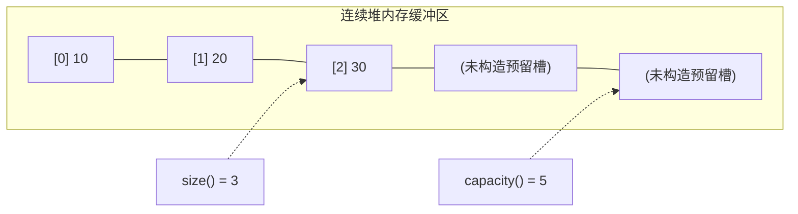

# vector — 动态数组容器

%% learning-vault-navigation:v1 %%
> [!abstract]- 笔记导航
> 目录：[[CS Learning/C++ STL/C++ STL导航|C++ STL 导航]]
> 上一篇：[[CS Learning/C++ STL/Containers/Sequence containers/string/string|string — string 字符串容器]] · 下一篇：[[CS Learning/C++ STL/Containers/Unordered associative containers/unordered_map unordered_multimap/unordered_map unordered_multimap|unordered_map unordered_multimap — 无序键值映射]]
> 相关：[[CS Learning/C++ STL/Containers/Sequence containers/deque/deque|deque — 双端队列容器]] · [[CS Learning/Data Structures and Algorithms/THU Advanced DSA/2. Vector/2.向量|2.向量]] · [[CS Learning/C wengkai/12-1 可变长数组与封装/12-1-learning resizble array|12-1-learning resizble array — 可变长数组与封装]]
> 源码：[[CS Learning/C++ STL/Containers/Sequence containers/vector/vector.cpp|查看源码]]

> [!abstract] 本节概览
> `std::vector` 定义于头文件 `<vector>`，是 C++ STL 中最核心、使用最广泛的序列容器，底层基于==堆上分配的单块连续动态数组==实现。它支持 $O(1)$ 随机下标访问和均摊 $O(1)$ 的尾部追加（`push_back` / `emplace_back`），空间不足时按几何倍数（通常 1.5 倍或 2 倍）自动扩容搬迁；中间插入与删除为 $O(n)$。提供随机访问迭代器，**触发扩容重分配时会使所有迭代器、指针与引用瞬间失效**。

## 核心概念、底层结构与初始化

### 1. 底层内存布局：`size` vs `capacity`

`vector` 对象本身通常仅包含三个指针（`start`、`finish`、`end_of_storage`），分别界定已用空间与预留容量：



- **倍增扩容与均摊 $O(1)$**：当 `size() == capacity()` 且再次 `push_back` 时，`vector` 会申请一块约 1.5 倍（MSVC）或 2 倍（GCC/Clang）的新连续内存，将旧元素移动/拷贝过去并释放旧块。单次扩容耗时 $O(n)$，但按倍增策略分摊到每次 `push_back` 上，均摊时间复杂度仍为 **$O(1)$**。
- **预分配优化**：已知大致数据规模时提前调用 `vec.reserve(n)`，可彻底消除多次扩容与搬迁开销。

### 2. 多种声明与二维数组初始化

```cpp
#include <vector>

vector<int> vec1;                     // 空 vector
vector<int> vec2(5);                  // 长度为 5，元素默认值初始化为 0（构造耗时 O(n)）
vector<int> vec3(5, 10);              // 长度为 5，元素初值均为 10
vector<int> vec4 = {1, 2, 3, 4};      // 列表初始化

// 二维动态数组（矩阵）构造
vector<vector<int>> mat1(100);                         // 100 行，每行初始为空
vector<vector<int>> mat2(100, vector<int>(666, -1));   // 100 行 × 666 列，全初始化为 -1
```

> [!note] 原源码中的两处学习记录说明
> 1. 源码注释第 26–27 行中，原笔记不小心把 `empty()` 的描述拼接到了 `clear()` 后面（`clear() 清空所有元素如果是空返回 true 反之返回 false`）。实际上：**`clear()` 返回 `void`**，仅销毁所有元素使 `size()` 归零（不释放 `capacity()`）；**`empty()` 返回 `bool`**，容器为空返回 `true`，否则返回 `false`。
> 2. 源码第 43–44 行为了并排展示两种二维构造写法，两行示例变量均命名为 `mat`；直接编译完整文件时需将第二个变量改名（如 `mat2`）。

## 常用接口与时间复杂度速查

| 成员函数 / 操作 | 说明 | 时间复杂度 |
| --- | --- | --- |
| `push_back(val)` / `emplace_back(...)` | 在尾部追加元素（`emplace_back` 原地构造，少一次拷贝） | 均摊 $O(1)$（扩容时 $O(n)$） |
| `pop_back()` | 删除末尾元素（不缩减 `capacity`） | $O(1)$ |
| `operator[]` / `at(pos)` | 随机访问下标 `pos`（`[]` 无检查，`at` 越界抛 `std::out_of_range`） | $O(1)$ |
| `front()` / `back()` | 返回首 / 尾元素的引用 | $O(1)$ |
| `data()` | 返回底层连续数组首地址指针 `T*`（兼容 C 接口） | $O(1)$ |
| `size()` / `capacity()` | 返回当前元素个数 / 当前已分配容量 | $O(1)$ |
| `empty()` | 判断容器是否为空（空返回 `true`，非空返回 `false`） | $O(1)$ |
| `reserve(n)` | 仅预留至少容纳 `n` 个元素的底层空间，**不改变 `size()`** | $O(n)$（若需重分配） |
| `resize(n, val)` | 调整 `size()` 为 `n`：缩短则销毁多余尾部元素；变长则以 `val`（缺省默认值）填充 | $O(n)$ |
| `shrink_to_fit()` | 请求将多余的 `capacity()` 收缩至接近 `size()`（非强制约束） | $O(n)$ |
| `clear()` | 销毁所有元素使 `size() = 0`（**保留 `capacity()`**，返回 `void`） | $O(n)$ |
| `insert(pos, val)` | 在 `pos` 前插入元素，后续元素整体后移 | $O(n)$ |
| `erase(pos)` / `erase(first, last)` | 删除单个元素或左闭右开区间 `[first, last)`，返回被删区间后的下一个有效迭代器 | $O(n)$ |
| `begin()` / `end()` | 返回随机访问起始 / 尾后迭代器 | $O(1)$ |

## 核心机制辨析：`reserve()` vs `resize()`

初学者最容易混淆 `reserve(n)` 与 `resize(n)`，二者差异如下：

| 对比项 | `vec.reserve(n)` | `vec.resize(n, val)` |
| --- | --- | --- |
| 改变 `capacity()`？ | 当 `n > capacity()` 时扩大容量 | 当 `n > capacity()` 时扩大容量 |
| 改变 `size()`？ | ==不改变==（仅预留原始内存） | ==强制变为 `n`==（构造新元素或析构多余元素） |
| 能否立刻用 `vec[i]` 访问新空间？ | **不能！**（未构造元素，越界 UB） | **可以**（已构造为 `val` 或默认值） |
| 典型场景 | 配合 `push_back` 避免反复扩容（见源码 `vec7`） | 预先开出定长数组直接按索引 `vec[i] = x` 写入 |

## 常见易错点与迭代器失效规则

> [!warning] `vector` 迭代器失效全规则
> 1. **触发扩容时（`push_back` / `emplace_back` / `insert` / `reserve` / `resize`）**：旧缓冲区被整体释放，==所有迭代器、指针和引用全部失效==！
> 2. **未触发扩容的尾部插入**：只有原来的 `end()` 迭代器失效，之前元素的迭代器仍有效。
> 3. **未触发扩容的中间 `insert` 或任意 `erase`**：**操作位置及之后**的所有迭代器、指针、引用（含 `end()`）全部失效；操作位置之前的保持有效。
> 4. **典型悬空 bug**：切勿在循环内持有 `int& ref = vec[0];` 后再调用 `vec.push_back(...)`，一旦扩容 `ref` 立刻成为悬空引用！
> 5. **遍历中安全删除**：
>    ```cpp
>    for (auto it = vec.begin(); it != vec.end(); ) {
>        if (*it % 2 == 0) it = vec.erase(it); // 用返回值接住下一有效迭代器
>        else ++it;
>    }
>    ```

## 完整源码

```cpp
/*
vector的定义:[时间复杂度O(n)]
<vector> 是 STL 中的一个容器类，用于存储动态大小的数组。
<vector> 是一个序列容器，它允许用户在容器的末尾快速地添加或删除元素。
 与数组相比，<vector> 提供了更多的功能，如自动调整大小、随机访问等。

vector的声明:
头文件:#include <vector>(长度,[初值])
vector<int> myVector;
添加元素:   myVector.push_back(10);
访问元素:   int firstElement = myVector[0];
获取元素数量:size_t size = myVector.size();
清空vector: myVector.clear();

以下是常用成员函数
push_back(const T& val)	    在末尾添加元素(尾接)
pop_back()	                删除末尾元素(尾删)
at(size_t pos)	            返回指定位置的元素，带边界检查
operator[]	                返回指定位置的元素，不带边界检查
front()	                    返回第一个元素
back()	                    返回最后一个元素
data()	                    返回指向底层数组的指针
size()	                    返回当前元素数量
capacity()	                返回当前分配的容量
reserve(size_t n)	        预留至少 n 个元素的存储空间
resize(size_t n, val)	    将元素数量调整为 n;如果是缩短，则删除多余的值;如果是扩大，且指定了val(未指定为默认值)，则新元素均为val（旧元素不变）
clear()	                    清空所有元素如果是空返回 true 反之返回 false.
empty()                     判断是否空
insert(iterator pos, val)	在指定位置插入元素
erase(iterator pos)	        删除指定位置的元素,同时参数用(const_iterator first, const_iterator last)可区间删除[first,last)的元素并返回指向被删除元素的下一个有效元素的迭代器
begin() / end()	            返回起始/结束迭代器
*/
//<vector> 需要指定元素类型，可通过多种方式进行初始化：
#include <iostream>
#include <vector>
using namespace std;
int main() {
    //声明和初始化示例
    vector<int> vec1;                 // 空的vector
    vector<int> vec2(5);              // 长度为5的vector，元素默认初始化
    vector<int> vec3(5,10);           // 长度为5的vector，元素值为10
    vector<int> vec4={1,2,3,4};       // 使用初始化列表初始化
    vector<vector<int>> mat(100,vector<int> ());       // 构造初始100行，不指定列数的二维数组
    vector<vector<int>> mat(100,vector<int> (666, -1)); // 构造初始100行，初始666列的二维数组，初值为-1
    //具体示例
    // 声明一个存储整数的 vector
    vector<int> numbers;
    // 添加元素
    numbers.push_back(10);
    numbers.push_back(20);
    numbers.push_back(30);
    // 输出 vector 中的元素
    cout<<"Vector contains: ";
    for (int i=0;i<numbers.size();i++){
        cout<<numbers[i]<<" ";
    }
    cout<<endl;
    // 添加更多元素
    numbers.push_back(40);
    numbers.push_back(50);
    // 再次输出 vector 中的元素
    cout<<"After adding more elements, vector contains: ";
    for (int i=0;i<numbers.size();i++){
        cout<<numbers[i]<<" ";
    }
    cout<<endl;
    // 访问特定元素
    cout<<"The first element is: "<<numbers[0]<<endl;
    // 清空 vector
    numbers.clear();
    // 检查 vector 是否为空
    if (numbers.empty()){
        cout<<"The vector is now empty."<<endl;
    }

    //以下是常用成员函数操作示例
    //基本操作

    vector<int> vec5={1,2,3,4,5};
    // 输出所有元素
    cout << "Vector elements: ";
    for (int i=0;i<vec5.size();i++) {
        cout<<vec5[i]<<" ";
    }
    cout<<endl;
    // 获取第一个和最后一个元素
    cout<<"First element: "<<vec5.front()<<endl;
    cout<<"Last element: "<<vec5.back()<<endl;

    //动态增加和删除元素

    vector<int> vec6;
    vec6.push_back(10);
    vec6.push_back(20);
    vec6.push_back(30);
    cout<<"Vector size: "<<vec6.size()<<endl;
    cout<<"Vector capacity: "<<vec6.capacity()<<endl;
    // 删除最后一个元素
    vec6.pop_back();
    cout<<"After pop_back, size: "<<vec6.size()<<endl;

    //预分配容量

    vector<int> vec7;
    vec7.reserve(10);  // 预留容量，避免频繁分配内存
    for (int i=0;i<10;i++) {
        vec7.push_back(i);
        cout<<"Capacity after push_back("<<i<<"): "<<vec7.capacity()<<endl;
    }
    return 0;
}
```
