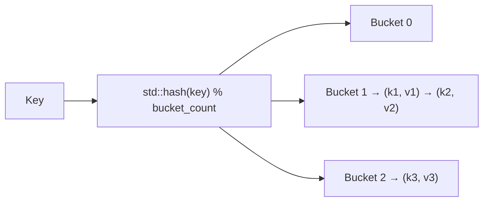

# unordered_map / unordered_multimap — 无序键值映射

%% learning-vault-navigation:v1 %%
> [!abstract]- 笔记导航
> 目录：[[CS Learning/C++ STL/C++ STL导航|C++ STL 导航]]
> 上一篇：[[CS Learning/C++ STL/Containers/Sequence containers/vector/vector|vector — 动态数组容器]] · 下一篇：[[CS Learning/C++ STL/Containers/Unordered associative containers/unordered_set unordered_multiset/unordered_set unordered_multiset|unordered_set unordered_multiset — 无序集合]]
> 相关：[[CS Learning/C++ STL/Containers/Associative containers/map/map|map — 有序键值映射]]
> 源码：[[CS Learning/C++ STL/Containers/Unordered associative containers/unordered_map unordered_multimap/unordered_map unordered_multimap.cpp|查看源码]]

> [!abstract] 本节概览
> `<unordered_map>` 同时提供 **`std::unordered_map`**（键唯一）与 **`std::unordered_multimap`**（允许重复键）两种基于==哈希表（Hash Table，开链法 / 分离链接）==的无序关联容器。二者不维持键的有序性，换取平均 $O(1)$ 的查找、插入与删除性能，最坏情况（哈希冲突严重时）退化至 $O(n)$。

---

## 一、底层结构与声明初始化

头文件：`#include <unordered_map>`（`unordered_map` 与 `unordered_multimap` 共用同一头文件）。

```cpp
// 基本声明
unordered_map<key_type, value_type> mp;
unordered_multimap<key_type, value_type> mmp;

// 常见初始化方式
unordered_map<int, string> m1;                            // 默认空构造
unordered_map<int, string> m2 = {{1, "one"}, {2, "two"}}; // 列表初始化
unordered_map<int, string> m3(10);                        // 指定初始桶数（bucket count）
unordered_map<int, string> m4 = m2;                       // 拷贝构造
```



---

## 二、常用接口与时间复杂度

| 接口 | 说明 | 平均复杂度 | 最坏复杂度 |
| --- | --- | :---: | :---: |
| `mp[k]` | 访问键 `k` 对应值；若不存在则**自动默认插入**（仅 `unordered_map` 支持） | $O(1)$ | $O(n)$ |
| `mp.at(k)` | 带越界检查的访问，键不存在抛 `std::out_of_range`（仅 `unordered_map`） | $O(1)$ | $O(n)$ |
| `insert({k, v})` / `emplace(k, v)` | 插入键值对（`unordered_map` 键已存在时忽略） | $O(1)$ | $O(n)$ |
| `find(k)` | 返回指向键 `k` 的前向迭代器，未找到返回 `end()` | $O(1)$ | $O(n)$ |
| `count(k)` / `contains(k)` (C++20) | 统计键出现次数 / 判断是否存在 | $O(1)$ | $O(n)$ |
| `erase(k)` / `erase(it)` | 删除键为 `k` 的全部元素或指定迭代器元素 | $O(1)$ | $O(n)$ |
| `bucket_count()` / `load_factor()` | 查询当前桶数量与负载因子（`size / bucket_count`） | $O(1)$ | $O(1)$ |
| `reserve(n)` / `rehash(b)` | 预留元素容量或调整桶数，减少动态扩容 `rehash` 次数 | $O(n)$ | $O(n)$ |

---

## 三、四大键值映射容器对比

| 性质 | 说明 | `map` | `multimap` | `unordered_map` | `unordered_multimap` |
| --- | --- | :---: | :---: | :---: | :---: |
| **互异性** | 每个键至多出现一次 | ✔ | ❌（允许重复） | ✔ | ❌（允许重复） |
| **有序性** | 键按严格弱序排列 | ✔（默认升序） | ✔（默认升序） | ❌（无序） | ❌（无序） |
| **底层实现** | 数据结构 | 红黑树 | 红黑树 | 哈希表 | 哈希表 |
| **查找 / 增删** | 时间复杂度 | $O(\log n)$ | $O(\log n)$ | 平均 $O(1)$ / 最坏 $O(n)$ | 平均 $O(1)$ / 最坏 $O(n)$ |
| **迭代器类别** | 支持的操作 | 双向迭代器 | 双向迭代器 | 前向迭代器 | 前向迭代器 |

> [!warning] 高频易错点与算法竞赛避坑
> 1. **`operator[]` 副作用**：仅查询键是否存在时切忌用 `if (mp[k])`，这会在不存在时悄悄插入 `{k, 0}`；请用 `mp.find(k) != mp.end()` 或 `mp.count(k)`。
> 2. **迭代器失效规则**：触发 `rehash` 时**所有迭代器失效**，但指向元素的指针与引用依然有效；`erase` 仅使被删元素的迭代器失效。
> 3. **算法竞赛防卡哈希**：Codeforces 等平台上标准 `std::hash<int>` 可能遭遇针对性哈希冲突构造（Hack）退化至 $O(n^2)$，竞赛中可配合自定义随机盐哈希或直接改用 `std::map`。
> 4. **自定义键类型**：若用 `pair` 或自定义结构体作键，必须提供自定义 `Hash` 仿函数与 `operator==`。

---

## 完整源码

```cpp
/*
unordered_map的定义:
在 C++ 中,<unordered_map> 是标准模板库(STL)的一部分,提供了一种基于哈希表的键值对容器。
与 map 不同,unordered_map 不保证元素的排序,但通常提供更快的查找速度。
unordered_map 是一个关联容器,它存储了键值对(key-value pairs),其中每个键(key)都是唯一的。
unordered_map 使用哈希表来存储元素,这使得它在查找、插入和删除操作中具有平均常数时间复杂度。

unordered_map的声明:
头文件#include <unordered_map>
unordered_map<key_type,value_type> map_name;
    key_type 是键的类型。
    value_type 是值的类型。

unordered_multimap:
和 unordered_map 容器一样,unordered_multimap 容器也以键值对的形式存储数据,且底层也采用哈希表结构存储各个键值对。
两者唯一的不同之处在于,unordered_multimap容器可以存储多个键相等的键值对,而unordered_map 容器不行。
STL标准库中实现unordered_multimap容器的模板类并没有定义在以自己名称命名的头文件中,而是和unordered_map容器一样,定义在<unordered_map>
*/
#include <iostream>
#include <unordered_map>
using namespace std;
int main(){
    /*以下是初始化示例
    // 默认构造
    unordered_map<int,string> myMap;
    // 构造并初始化
    unordered_map<int,string> myMap={{1,"one"},{2,"two"}};
    // 构造并指定初始容量
    unordered_map<int,string> myMap(10);
    // 构造并复制另一个 unordered_map
    unordered_map<int,string> anotherMap=myMap;
    */

    // 创建一个 unordered_map,键为 int,值为 string
    unordered_map<int,string> myMap;
    // 插入一些键值对
    myMap[1]="one";
    myMap[2]="two";
    myMap[3]="three";
    // 打印所有元素
    for (const auto& pair:myMap){
        cout<<"Key: "<<pair.first<<",Value: "<<pair.second<<endl;
    }
    // 访问特定键的值
    cout<<"Value for key 2: "<<myMap[2]<<endl;
    // 删除键为1的元素
    myMap.erase(1);
    // 再次打印所有元素
    cout<<"After erasing key 1:"<<endl;
    for (const auto& pair:myMap){
        cout<<"Key: "<<pair.first<<",Value: "<<pair.second<<endl;
    }
    return 0;
}
/*
性质	    解释	                 map	        multimap	unordered_map       unordered_multimap
互异性	一个键仅可以在映射中出现一次	✔	          ❌(任意次)	      ✔                    ❌(任意次)
无序性	键是没有顺序的	              ❌(从小到大)	❌(从小到大)	     ✔                    ✔
*/
```
