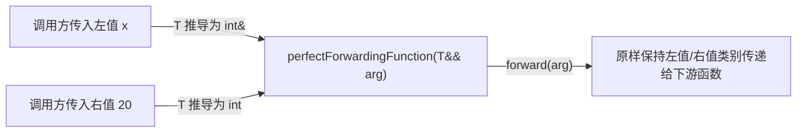

# Utility — `<utility>` 核心工具库

%% learning-vault-navigation:v1 %%
> [!abstract]- 笔记导航
> 目录：[[CS Learning/C++ STL/C++ STL导航|C++ STL 导航]]
> 上一篇：[[CS Learning/C++ STL/Containers/Utility/tuple/tuple|tuple — 多元组]] · 下一篇：[[CS Learning/C++ STL/Iterators/Iterators/Iterators|Iterators — 迭代器]]
> 源码：[[CS Learning/C++ STL/Containers/Utility/Utility/Utility.cpp|查看源码]]

> [!abstract] 本节概览
> `<utility>` 是现代 C++ 标准库的基础设施头文件，除 [[CS Learning/C++ STL/Containers/Utility/pair/pair|std::pair]] 外，还提供 **`std::swap`**（高效交换）、**`std::move`**（启用移动语义）、**`std::forward`**（完美转发）以及编译期整数序列 **`std::integer_sequence`**（C++14）等支撑高效泛型编程的核心原语。

---

## 一、四大核心工具速查

| 工具 | 核心作用 | 底层本质与关键机制 |
| --- | --- | --- |
| `std::swap(a, b)` | 交换两个同类型对象的值 | C++11 起默认基于移动语义实现（对 `vector`/`string` 等仅交换内部指针，$O(1)$） |
| `std::move(x)` | 将对象无条件转为右值引用（`T&&`），请求资源所有权转移 | ==本身不移动任何字节==，仅做编译期类型转换，从而触发移动构造/移动赋值 |
| `std::forward<T>(arg)` | 配合万能引用（`T&&`）实现**完美转发（Perfect Forwarding）** | 有条件转换：原实参为左值则保持左值，原实参为右值则转为右值（引用折叠规则） |
| `std::integer_sequence<T, Ints...>` | 表示编译期整数参数包 | 常配合 `make_integer_sequence<T, N>`（生成 `0..N-1`）与 C++17 折叠表达式展开 `tuple` |

---

## 二、现代 C++ 语义要点（对应源码四大示例）

### 1. 移动语义（`std::move`）与被移后对象状态

```cpp
vector<int> v1 = {1, 2, 3, 4, 5};
vector<int> v2 = std::move(v1); // 常数时间接管底层堆内存，避免深拷贝
```

> [!warning] Moved-from 对象的安全规则
> 执行 `v2 = move(v1)` 后，`v1` 处于==有效但未指定的状态（valid but unspecified state）==：可以安全析构或重新赋值（如 `v1.clear()` / `v1 = {...}`），但**不要对其内容做任何假设**。

### 2. 完美转发（`std::forward`）与值类别传递



> [!note] 源码细节说明
> 源码中 `normalFunction(T arg)` 为按值传参；在实际泛型封装（如 `emplace_back`、`make_unique`）中，下游函数通常提供左值引用 `const T&` 与右值引用 `T&&` 重载，此时 `std::forward<T>(arg)` 的价值才能充分体现——左值走拷贝、右值走移动。

### 3. 编译期整数序列与 C++17 折叠表达式

`make_integer_sequence<int, 5>()` 在编译期生成 `integer_sequence<int, 0, 1, 2, 3, 4>`，借助 C++17 折叠表达式 `((cout << Ints << " "), ...);` 可零开销展开参数包打印 `0 1 2 3 4`。

---

## 完整源码

```cpp
/*
在C++标准库中,<utility>头文件包含了一些实用的工具类和函数,这些工具类和函数在编写高效、可读性强的代码时非常有用。
utility库的核心价值在于：
    提供基础的数据结构和工具函数
    简化常见编程任务的实现
    为其他标准库组件提供基础支持

实用工具函数还有swap、move、forward
swap 用于交换两个同类型对象的值。
move 用于将对象转换为右值引用，启用移动语义。
forward 用于实现完美转发，保持参数的值类别。
*/
#include <utility>
#include <iostream>
#include <vector>
using namespace std;
//swap示例
void demonstrateSwap(){
    int a=10,b=20;
    cout<<"交换前: a="<<a<<",b="<<b<<endl;
    swap(a,b);
    cout<<"交换后: a="<<a<<",b="<<b<<endl;
    // 也可以用于自定义类型（如果实现了移动语义）
    string str1="Hello",str2="World";
    swap(str1,str2);
    cout<<"字符串交换: "<<str1<<" "<<str2<<endl;
}
//move示例
void demonstrateMove(){
    vector<int> v1={1,2,3,4,5};
    vector<int> v2;
    cout<<"移动前 - v1大小: "<<v1.size()
            <<",v2大小: "<<v2.size()<<endl;
    // 使用移动语义转移资源所有权
    v2=move(v1);
    cout<<"移动后 - v1大小: "<<v1.size()
            <<",v2大小: "<<v2.size()<<endl;
    // v1 现在处于有效但未定义的状态
    // 通常不应该再使用 v1，除非重新赋值
}
//forward示例
// 普通函数 - 不能保持值类别
template<typename T>
void normalFunction(T arg){
    cout<<"普通函数参数"<<endl;
}
// 使用完美转发的函数
template<typename T>
void perfectForwardingFunction(T&& arg){
    // 保持参数原有的值类别（左值或右值）
    normalFunction(forward<T>(arg));
}
void demonstrateForward(){
    int x=10;
    // 传递左值
    perfectForwardingFunction(x);
    // 传递右值
    perfectForwardingFunction(20);
}

// 整数序列integer_sequence
// 使用整数序列打印序列中的每个值
template<typename T,T... Ints>
void print_sequence(integer_sequence<T,Ints...>){
    // 使用折叠表达式（C++17）打印所有值
    ((cout<<Ints<<" "),...);
    cout<<endl;
}
void demonstrateIntegerSequence(){
    // 创建整数序列
    auto seq=integer_sequence<int,1,2,3,4,5>();
    print_sequence(seq);
    // 使用 make_integer_sequence 生成序列
    auto seq2=make_integer_sequence<int,5>();
    print_sequence(seq2);  // 输出: 0 1 2 3 4
}
```
