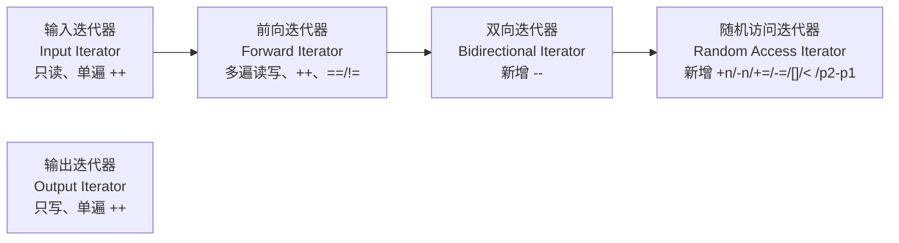

# Iterators — 迭代器

%% learning-vault-navigation:v1 %%
> [!abstract]- 笔记导航
> 目录：[[CS Learning/C++ STL/C++ STL导航|C++ STL 导航]]
> 上一篇：[[CS Learning/C++ STL/Containers/Utility/Utility/Utility|Utility — utility 工具]]
> 源码：[[CS Learning/C++ STL/Iterators/Iterators/Iterators.cpp|查看源码]]

> [!abstract] 本节概览
> 迭代器（Iterator）是连接 STL **容器**与**泛型算法**的桥梁，行为类似于泛化的指针：为数组、链表、红黑树、哈希表等线性与非线性数据结构提供统一的 `[begin(), end())` 左闭右开遍历协议，使同一套算法（如 `find`、`count`、`sort`）无需关心容器底层内存布局。

---

## 一、迭代器的五大分类与能力层级

按能力由弱到强，STL 定义了 5 类迭代器（C++20 另增连续迭代器 `contiguous_iterator`）：



### 常见 STL 容器对应的迭代器类别

| 容器 | 迭代器类别 | 典型支持操作 |
| --- | --- | --- |
| `array`、`vector`、`deque`、`string` | **随机访问迭代器** | `++`、`--`、`+n`、`-n`、`[i]`、`<`、`it2 - it1`（支持 `std::sort`） |
| `list`、`set`、`multiset`、`map`、`multimap` | **双向迭代器** | `++`、`--`、`==`、`!=`（**不支持** `+n` 与 `<`） |
| `forward_list`、`unordered_map/multimap`、`unordered_set/multiset` | **前向迭代器** | 仅支持 `++`、`==`、`!=`（**不支持** `--`） |
| `stack`、`queue`、`priority_queue` | **不支持迭代器** | 仅允许按适配器限定接口访问 |

> [!note] 距离计算澄清
> 对随机访问迭代器，`p2 - p1` 返回二者下标之差（即 `[p1, p2)` 半开区间内的元素个数，例如 `v.end() - v.begin() == v.size()`）；若计算开区间 `(p1, p2)` 之间严格夹着的元素数则是 `(p2 - p1) - 1`。

---

## 二、四种迭代器定义方式与常用操作

| 迭代器类型 | 声明语法 | 读写权限与移动方向 |
| --- | --- | --- |
| **正向迭代器** | `Container::iterator it;` | 可读写；`++it` 移向**后一个**元素 |
| **常量正向迭代器** | `Container::const_iterator it;` | 只读（不可通过 `*it` 修改）；对应 `cbegin()` / `cend()` |
| **反向迭代器** | `Container::reverse_iterator it;` | 可读写；`++it` 移向**前一个**元素，对应 `rbegin()` / `rend()` |
| **常量反向迭代器** | `Container::const_reverse_iterator it;` | 只读反向遍历；对应 `crbegin()` / `crend()` |

### 常用辅助函数（`<iterator>`）

| 操作 / 函数 | 作用 | 复杂度说明 |
| --- | --- | --- |
| `begin()` / `end()` | 返回首元素迭代器 / 尾后哨兵迭代器 | $O(1)$ |
| `rbegin()` / `rend()` | 返回末元素反向迭代器 / 首前哨兵反向迭代器 | $O(1)$ |
| `std::next(it, n)` / `std::prev(it, n)` | 返回向前/向后偏移 `n` 步的新迭代器（不修改原 `it`） | 随机访问 $O(1)$，其余 $O(n)$ |
| `std::advance(it, n)` | 原地将迭代器移动 `n` 步 | 随机访问 $O(1)$，其余 $O(n)$ |
| `std::distance(first, last)` | 计算两个迭代器之间的步数 | 随机访问 $O(1)$，其余 $O(n)$ |

---

## 三、常见易错点与最佳实践

> [!warning] 两大高频陷阱
> 1. **切勿解引用 `end()` 或 `rend()`**：它们是指向容器有效范围之外的**尾后/首前哨兵位置（Past-the-End）**，类似长度为 10 的数组中不可访问的下标 `10`，解引用属于未定义行为。
> 2. **通用循环条件优先写 `it != c.end()` 而非 `it < c.end()`**：只有随机访问迭代器才重载了 `<` 运算符；若改写为 `list` 或 `set`，`it < c.end()` 会直接编译失败，而 `it != c.end()` 对所有容器通用！
> 3. **优先使用 `auto` 与范围 `for`**：现代 C++ 中 `for (auto it = v.begin(); it != v.end(); ++it)` 或 `for (const auto& x : v)` 比手写冗长的 `vector<int>::iterator` 更简洁且不易写错类型。

---

## 完整源码

```cpp
/*
Iterator的定义:
简单来讲,迭代器和 C++ 的指针非常类似,它可以是需要的任意类型,通过迭代器可以指向容器中的某个元素,如果需要,还可以对该元素进行读/写操作。
e.g.
对于一个 vector,我们可以用下标遍历:
    for (int i=0;i<a.size();i++)
        cout<<a[i]<<endl;
我们同时也可以用迭代器来遍历:
    for (vector<int>::iterator it=a.begin();it!=a.end();it++)
        cout<<*it<<endl;
 a.begin() 是一个迭代器,指向的是第一个元素
 a.end() 是一个迭代器,指向的是最后一个元素再后面一位
上述迭代器具有自增运算符,自增则迭代器向下一个元素移动
迭代器与指针相似,如果对它使用解引用运算符,即 *it,就能取到对应值了

迭代器的作用:
很多数据结构并不是线性的(例如红黑树),对于非线性数据结构,下标是无意义的。无法使用下标来遍历整个数据结构。
迭代器的作用就是定义某个数据结构的遍历方式,通过迭代器的增减,代表遍历到的位置,通过迭代器便能成功遍历非线性结构了。

迭代器的分类:
常用的迭代器按功能强弱分为前向迭代器、双向迭代器、随机访问迭代器、输入迭代器、输出迭代器 5 种
1) 前向迭代器(forward iterator)
    假设p是一个前向迭代器,则p支持 ++p,p++,*p 操作,还可以被复制或赋值,可以用 == 和!=运算符进行比较。此外,两个正向迭代器可以互相赋值。
2) 双向迭代器(bidirectional iterator)
    双向迭代器具有正向迭代器的全部功能,除此之外,假设p是一个双向迭代器,则还可以进行 --p 或者 p-- 操作(即一次向后移动一个位置)。
3) 随机访问迭代器(random access iterator)
    随机访问迭代器具有双向迭代器的全部功能。除此之外,假设p是一个随机访问迭代器,i 是一个整型变量或常量,则p还支持以下操作:
    p+=i:  使得p往后移动 i 个元素。
    p-=i:  使得p往前移动 i 个元素。
    p+i:   返回p后面第 i 个元素的迭代器。
    p-i:   返回p前面第 i 个元素的迭代器。
    p[i]:  返回p后面第 i 个元素的引用。
    此外,两个随机访问迭代器 p1、p2 还可以用 <、>、<=、>= 运算符进行比较。
    另外,表达式 p2-p1 也是有定义的,其返回值表示 p2 所指向元素和 p1 所指向元素的序号之差(也可以说是 p2 和 p1 之间的元素个数减一)。
//下是常见容器对应的迭代器
容器	                            对应的迭代器类型
array	                            随机访问迭代器
vector	                            随机访问迭代器
deque	                            随机访问迭代器
list	                            双向迭代器
set / multiset	                    双向迭代器
map / multimap	                    双向迭代器
forward_list	                    前向迭代器
unordered_map / unordered_multimap	前向迭代器
unordered_set / unordered_multiset	前向迭代器
stack	                            不支持迭代器
queue	                            不支持迭代器

「迭代器定义方式」	                    具体格式
正向迭代器	                        容器类名::iterator                迭代器名;
常量正向迭代器                      容器类名::const_iterator          迭代器名;
反向迭代器	                        容器类名::reverse_iterator        迭代器名;
常量反向迭代器	                    容器类名::const_reverse_iterator  迭代器名;
通过定义以上几种迭代器,就可以读取它指向的元素,*迭代器名就表示迭代器指向的元素。
其中,常量迭代器和非常量迭代器的分别在于,通过非常量迭代器还能修改其指向的元素。
另外,反向迭代器和正向迭代器的区别在于:
  对正向迭代器进行 ++ 操作时,迭代器会指向容器中的后一个元素；
  而对反向迭代器进行 ++ 操作时,迭代器会指向容器中的前一个元素。

迭代器用法
对于 vector 容器,它的迭代器功能比较完整,以它举例:
.begin():       头迭代器
.end():         尾迭代器
.rbegin():      反向头迭代器
.rend():        反向尾迭代器
迭代器 + 整型:   将迭代器向后移动
迭代器 - 整型:   将迭代器向前移动
迭代器 ++:       将迭代器向后移动 1 位
迭代器 --:       将迭代器向前移动 1 位
迭代器 - 迭代器: 两个迭代器的距离
prev(it):       返回 it 的前一个迭代器
next(it):       返回 it 的后一个迭代器
*/
//下是vector具体示例
#include <iostream>
#include <vector>
using namespace std;
int main(){
    vector<int> v{1,2,3,4,5,6,7,8,9,10};//v被初始化成有10个元素
    cout<<"第一种遍历方法:"<<endl;
    //size返回元素个数
    for (int i=0;i<v.size();i++)
        cout<<v[i]<<" ";//像普通数组一样使用vector容器
    //创建一个正向迭代器,当然,vector也支持其他 3 种定义迭代器的方式
       cout<<endl<<"第二种遍历方法:"<<endl;
       vector<int>::iterator i;
    //用!=比较两个迭代器
    for (i=v.begin();i!=v.end();i++)
        cout<<*i<<" ";
        cout<<endl<<"第三种遍历方法:"<<endl;
    for (i=v.begin();i<v.end();i++) //用<比较两个迭代器
        cout<<*i<<" ";
        cout<<endl<<"第四种遍历方法:"<<endl;
    i=v.begin();
    while (i<v.end()){ //间隔一个输出
        cout<<*i<<" ";
        i+=2;// 随机访问迭代器支持 "+= 整数"  的操作
    }
    return 0;
}
/*
注意:
1).end()和.rend()指向的位置是无意义的值
对于一个长度为10的数组:for (int i=0;i<10;i++),第10位是不可访问的
对于一个长度为10的容器:for (auto it=a.begin();it!=a.end();it++),.end是不可访问的

2)不同容器的迭代器功能可能不一样
迭代器细化的话有正向、反向、双向,每个容器的迭代器支持的运算符也可能不同,因此不同容器的迭代器细节很有可能是不一样的。
*/
```
