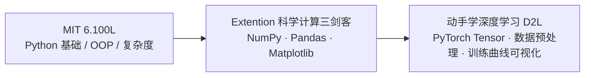

# Extention：NumPy、Pandas 与 Matplotlib 扩展练习

%% learning-vault-navigation:v1 %%
> [!abstract]- 笔记导航
> 目录：[[CS Learning/Python MIT6.100L/MIT Python导航|MIT Python 导航]]
> 上一章：[[CS Learning/Python MIT6.100L/Lecture 26 List Access, Hashing, Simulations, and Wrap-Up/L26 列表访问、哈希、仿真与课程总结|L26 列表访问、哈希、仿真与课程总结]]

> [!abstract] 本节核心概览
> 完成 MIT 6.100L 正课全部 26 讲后，本扩展目录系统练习了 Python 科学计算与数据分析“三剑客”——**NumPy（多维数组与向量化计算）**、**Pandas（带标签表格数据 `Series` / `DataFrame`）** 与 **Matplotlib（面向对象式进阶多图表绘制）**。本笔记完整梳理三个扩展练习脚本中的核心 API、易错陷阱（如视图与拷贝、Pandas 3.0 Copy-on-Write、中文乱码配置），并建立它们与 [[AI learning/D2L-李沐/动手学深度学习导航|动手学深度学习]] 的直接知识衔接。
>
> **配套源文件**：[[CS Learning/Python MIT6.100L/Extention/numpy_learning.py|numpy_learning.py]] · [[CS Learning/Python MIT6.100L/Extention/pandas_learinng.py|pandas_learinng.py]] · [[CS Learning/Python MIT6.100L/Extention/matplotlib_learning.py|matplotlib_learning.py]]

---

## 1. NumPy：多维数组与向量化计算（[[CS Learning/Python MIT6.100L/Extention/numpy_learning.py|numpy_learning.py]]）

### 1.1 数组创建与核心属性

| 类别 | 脚本实操 API | 行为与易错细节 |
| --- | --- | --- |
| **构造数组** | `np.array([1, 2, 3])` / `np.zeros((2, 3), dtype=int)` | 显式指定 `dtype=int` 可避免默认 `float64` |
| **等差 / 等分序列** | `np.arange(1, 9, 2)` / `np.linspace(1, 10, 4)` | `arange` 左闭右开（步长 2）；`linspace` 闭区间均匀取 4 个点 |
| **随机整数矩阵** | `np.random.randint(10, 20, [2, 3])` | ==**踩坑点**：与标准库 `random.randint(a, b)` 两端闭区间不同，NumPy 的 `randint` 为**左闭右开 $[10, 20)$**== |
| **元信息属性** | `a.dtype` / `a.ndim` / `a.shape` / `a.size` / `len(a)` | `size` 是元素总数，`len(a)` 仅返回第 0 维长度（行数） |
| **形状变换与导出** | `b.reshape((3, 4))` / `a.flatten()` / `a.tolist()` | 变形为二维矩阵、展平为一维数组、转回原生 Python 嵌套列表 |

### 1.2 删除、检索、布尔掩码与向量化运算

```python
# 1. 按轴删除（返回新数组，不修改原数组）
np.delete(b, 1, axis=0)         # 删除第 1 行
np.delete(b, [1, 3], axis=1)    # 删除第 1、3 列

# 2. 检索与布尔掩码（Boolean Masking）
2 in a                          # 成员判断
pos = np.argwhere(a == 2)       # 返回所有满足条件的坐标数组 [[row, col], ...]
b = a[a > 2]                    # 筛选出所有大于 2 的元素（一维数组）
a[a > 2] = -1                   # 就地批量条件赋值

# 3. 广播与逐元素向量化运算（无需写 Python for 循环）
b = a + 1                       # 标量广播到每个元素
a * b                           # 逐元素哈达玛积（非矩阵乘法）
c = np.sqrt(a * 10)             # 通用函数 ufunc 逐元素开方
```

### 1.3 核心陷阱：切片是视图（View）而非拷贝（Copy）！

在原生 Python `list` 中，`b = a[3:6]` 会复制出一个独立的新列表；但在 NumPy 中，出于高性能与省内存考虑，**基础切片返回的是共享底层内存的视图（View）**：

```python
a = np.arange(8)          # [0, 1, 2, 3, 4, 5, 6, 7]
b = a[3:6]                # 视图！与 a 共享同一块内存
c = np.copy(a[3:6])       # 显式深拷贝，独立内存
b[0] = 100                # 会同步修改 a[3] 为 100！但 c 保持不变
```

> [!warning] 二维切片同样返回视图
> `b = a[1:3, 1:4]` 取出第 $1 \sim 2$ 行、第 $1 \sim 3$ 列的子矩阵视图。如果需要独立修改子数组而不污染原数据，务必显式调用 **`np.copy(...)`** 或 **`.copy()`**。

---

## 2. Pandas：带标签的表格数据结构（[[CS Learning/Python MIT6.100L/Extention/pandas_learinng.py|pandas_learinng.py]]）

### 2.1 `Series`：兼具列表下标与字典键的一维序列

- **创建与双模式索引**：`s = pd.Series(data=[80, 90, 100], index=['语文', '数学', '英语'])`，既支持标签访问 `s['语文']`，也支持整数位置访问 `s.iloc[1]`；
- **切片边界差异**：整数切片 `s[0:2]` **左闭右开**，而标签切片 `s['数学':'英语']` **左右全闭**（包含 `'英语'`）；
- **增删与拼接**：`s['体育'] = 110`、`s.pop('数学')`、`pd.concat([s, pd.Series([120], index=['政治'])])`。

### 2.2 `DataFrame`：二维表格与 `loc` / `iloc` 精准索引

通过 `pd.set_option('display.unicode.east_asian_width', True)` 开启东亚宽字符对齐后，构建含 `index=names`、`columns=courses` 的成绩表 `df`：
- **底层桥梁**：`df.values` 直接返回底层的 **`numpy.ndarray`**；
- **行列提取**：取单列 `df['语文']` 返回 `Series`；取单行 `df.loc['王二姐']` 返回 `Series`。

| 索引器 | 选择依据 | 区间开闭规则 | 脚本等价示例 |
| --- | --- | --- | --- |
| **`df.iloc[行, 列]`** | 0 起始整数下标 | 左闭右开 | `df.iloc[:2, [1, 3]]` · `df.iloc[[1, 3], 2:4]` |
| **`df.loc[行, 列]`** | 行/列标签名称 | ==左右全闭== | `df.loc[:'王二姐', ['语文', '英语']]` · `df.loc[['王二姐', '李四弟'], '数学':'英语']` |

> [!important] Pandas 3.0 Copy-on-Write（CoW）重要工程规范
> 脚本第 38–40 行特别记录了 Pandas 3.0 的关键变更：
> ==Pandas 3.0 全面启用 **Copy-on-Write（写时复制）**，对 `DataFrame` 切片后再赋值不会回写原表，严禁依赖链式索引或切片视图修改原表！==
> 凡是需要修改原 `DataFrame`，必须通过单步 **`df.loc[行, 列] = ...`** 或 **`df.iloc[行, 列] = ...`** 直接写入。

### 2.3 统计分析、条件筛选与表结构增删改

```python
# 1. 转置、排序与统计聚合
df.T                                                # 行列转置
df.sort_values(by='语文', ascending=False)          # 按列降序排列
df['语文'].sum(), df['数学'].mean(), df['英语'].median()
df[['语文', '数学', '英语']].max(axis=1).loc['王二姐']  # 按行(axis=1)求单人最高分

# 2. 极值定位：标签 vs 位置
df['语文'].idxmax()                                 # 返回行标签：'王二姐'
df['数学'].argmin()                                 # 返回整数行号：2

# 3. 多条件布尔筛选（注意用 & 而非 and，且每个条件必须加括号！）
df.loc[(df['语文'] > 100) & (df['数学'] >= 85)]

# 4. 增删改操作（符合 Pandas 3.0 规范）
df.loc['王二姐', '英语'] = df.iloc[0, 1] = 150       # 单元格修改
df['物理'] = [80, 70, 90, 100]                      # 末尾新增列
df.insert(1, '体育', [89, 77, 76, 45])              # 指定列位置插入
df.loc['钱五叔'] = ['男', 100, 100, 100, 100, 100]  # 新增一行
df.loc[:, '英语'] += 10                             # 整列向量化加分
df.columns = ['性别', '体育', '语文', '数学', 'English', '物理']
```

---

## 3. Matplotlib 进阶：面向对象 `Axes` API 与八大图表实操（[[CS Learning/Python MIT6.100L/Extention/matplotlib_learning.py|matplotlib_learning.py]]）

相较于 [[CS Learning/Python MIT6.100L/Lecture 25 Plotting/L25 数据可视化与绘图（Plotting）|L25]] 采用的状态机风格（`plt.plot`、`plt.title`），本扩展脚本全面切换到了更推荐的**面向对象（OO）风格**：显式创建 `fig = plt.figure(...)` 并获取坐标系对象 `ax = fig.add_subplot(...)`，调用 `ax.set_title`、`ax.set_xticks`、`ax.set_xticklabels`、`ax.legend()` 精细控制每个子图。

**中文渲染配置**（防止中文标题/标签变方块）：
```python
from matplotlib import rcParams
rcParams['font.family'] = rcParams['font.sans-serif'] = 'SimHei'
```

### 八类图表核心 API 速查

| 图表类型 | 核心 API 与关键参数 | 脚本亮点技巧 |
| --- | --- | --- |
| **1. 纵向/横向柱状图** | `ax.bar(x, height, width)` · `ax.barh(y, width, height)` | 支持为每根柱子单独传入不等宽元组 `width=(0.1, 0.2, 0.05, 0.4)` |
| **2. 堆叠柱状图** | `ax.bar(..., bottom=num1)` | 通过 `bottom` 参数将第二组数据堆叠在第一组顶部 |
| **3. 分组对比柱状图** | 三组错位横坐标 `x1, x2, x3` + `width=3` | 编写辅助函数 `label(ax, rects)`，遍历 `rect.get_x() + rect.get_width()/2.0` 调用 `ax.text(..., rotation=90)` 自动在柱顶标数值 |
| **4. 曲线 + 散点折线组合** | `ax.plot(xs, ys)` + `ax.scatter(...)` | 高密度采样 `xs = [i/100 for i in range(1500)]` 绘制平滑正弦波，并通过 `figsize=(10, 4), dpi=100` 控制清晰度 |
| **5. 饼图（Pie）** | `ax.pie(x, labels, explode, autopct='%.2f', shadow=True, startangle=90)` | `explode=[0, 0.1, 0, 0]` 突出重点扇区；`labeldistance` / `pctdistance` 控标签径向距离 |
| **6. 热力图（Heatmap）** | `ax.imshow(data, cmap=plt.cm.hot, aspect='auto', vmin=0, vmax=100)` | 配合 `plt.colorbar(heatMp)`、双循环 `ax.text(i, j, data[j][i], ha='center', va='center')` 单元格注值，以及 `plt.xticks(rotation=45, ha='right')` 防重叠 |
| **7. 单层 / 多层雷达图** | `fig.add_subplot(projection='polar')` | 角度等分 `angles = [2*pi*i/N ...]`，`ax.set_thetagrids(angles_deg, labels)` 标维度，`ax.fill(angles, data, alpha=0.25)` 半透明叠加对比多角色能力 |
| **8. 非对称组合多子图** | `fig.add_subplot(2, 2, 1/2)` + `plt.subplot2grid((2, 2), (1, 0), colspan=2)` | 上方左右并列饼图 + 极坐标雷达图，下方跨两列通栏放折线图，并用 `plt.figtext(0.05, 0.05, ...)` 添加整图脚注 |

> [!tip] 雷达图闭合小技巧
> 在极坐标下使用 `ax.fill(angles, data)` 会自动闭合填充多边形；但如果后续要叠加 `ax.plot(angles, data)` 画外框线，需把首元素追加到末尾（`angles + [angles[0]]`、`data + [data[0]]`）才能让轮廓线首尾闭合。

---

## 4. 承上启下：从 6.100L 到《动手学深度学习》的无缝衔接

本扩展练习所掌握的“NumPy + Pandas + Matplotlib”正是学习深度学习（[[AI learning/D2L-李沐/动手学深度学习导航|动手学深度学习]]）与 PyTorch 的直接基石：



| 扩展练习技能点 | 在 [[AI learning/D2L-李沐/动手学深度学习导航\|动手学深度学习（D2L）]] 中的直接对应 |
| --- | --- |
| **NumPy `ndarray`**（`shape`/`dtype`/`reshape`/广播/布尔索引/视图与拷贝） | **PyTorch `torch.Tensor`** 的 API 设计几乎与 NumPy 1:1 镜像，原地操作与共享内存（`tensor.numpy()` / `view`）机制一脉相承 |
| **Pandas `DataFrame`**（读取表格、`iloc`/`loc` 切片、缺失值处理、`.values` 转数组） | D2L 第 2 章**数据预处理**：从 CSV 读入结构化样本、独热编码与缺失值填充后转为张量输入模型 |
| **Matplotlib OO 绘图**（`ax.plot`、`ax.imshow`、多子图、`colorbar`） | 绘制训练/验证 Loss 与 Accuracy 曲线、可视化图像分类样本网格、卷积特征图与注意力权重热力图 |

---

## 5. 自测与复习思考

> [!question]- 自测 1：为什么在 NumPy 中对切片修改会影响原数组，而在 Pandas 3.0 中却不建议用切片视图修改原 `DataFrame`？
> - **NumPy**：设计目标是极致数值性能与低内存占用，基础切片默认返回共享缓冲区的 View，需要独立副本时显式 `.copy()`；
> - **Pandas 3.0**：为了彻底消除历史上令人困惑的 `SettingWithCopyWarning`，全面采用 Copy-on-Write 机制，保证切片对象表现得像独立拷贝（写入时才真正复制），因此一切就地修改都必须直接通过 `df.loc[...]` 或 `df.iloc[...]` 完成。

> [!question]- 自测 2：在 `matplotlib_learning.py` 的热力图循环 `ax.text(i, j, data[j][i], ...)` 中，为什么传给 `ax.text` 的坐标是 `(i, j)` 而索引二维数组却是 `data[j][i]`？
> 因为图像/热力图的横轴 `x` 对应矩阵的**列号 `i`**（城市，共 6 列），纵轴 `y` 对应矩阵的**行号 `j`**（年份，共 5 行）。而二维数组按 `[行][列]` 索引，所以 `(x=i, y=j)` 位置对应的数值是 `data[j][i]`！弄反行列坐标是绘制热力图和图像处理时最高发的坐标错位 bug。
