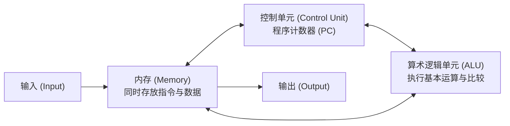

# L01 课程导论与 Python 基础

%% learning-vault-navigation:v1 %%
> [!abstract]- 笔记导航
> 目录：[[CS Learning/Python MIT6.100L/MIT Python导航|MIT Python 导航]]
> 下一讲：[[CS Learning/Python MIT6.100L/Lecture 2 Strings, InputOutput, Branching/L02 字符串、输入输出与分支控制|L02 字符串、输入输出与分支控制]]

> [!abstract] 本讲定位与核心脉络
> 本讲为 MIT 6.100L（Fall 2022，Ana Bell 主讲）的开篇导论，从「什么是计算」出发，建立**算法（Algorithm）**、**存储程序计算机（Stored-Program Computer）**与**编程语言层级**的底层心智模型，随后切入 Python 最基础的构建块：**标量对象与类型**、**类型转换**、**算术表达式与优先级**，以及**变量绑定（Binding）与顺序执行机制**。

---

## 一、什么是计算：从知识到算法

### 1. 两类知识

| 知识类型 | 定义 | 示例 |
| --- | --- | --- |
| **陈述性知识（Declarative Knowledge）** | 对「事实是什么」的声明 | $x$ 的平方根是满足 $y \cdot y = x$ 的数 $y$ |
| **指令性知识（Imperative Knowledge）** | 说明「如何去做」的步骤或菜谱（Recipe） | 从猜测值 $g$ 出发，反复迭代更新直至 $g^2 \approx x$ |

==编程的本质，就是编写指令性知识（算法）去生成陈述性事实。==

### 2. 算法三要素与海伦求根示例

一个完整的**算法（Algorithm）**必须包含三个组成部分：
1. **简单步骤的有序序列**（Sequence of simple steps）；
2. **控制流（Flow of control）**：规定每一步何时执行、是否跳转或重复；
3. **终止条件（Stopping criterion）**：决定何时停止计算并输出结果。

讲义中用经典的**海伦（巴比伦）平方根迭代法**演示指令性过程：给定目标 $x$ 与初始猜测 $g$，若 $g^2$ 足够接近 $x$ 则停止，否则令

$$
g_{\text{new}} = \frac{g + x / g}{2}
$$

以 $x = 16$、$g_0 = 3$ 为例，仅需三轮即可高精度逼近 $\sqrt{16} = 4$：

| 迭代轮次 | 当前猜测 $g$ | $g^2$ | $x / g$ | 新猜测 $(g + x/g)/2$ |
| :---: | :---: | :---: | :---: | :---: |
| 1 | $3$ | $9$ | $16/3 \approx 5.333$ | $4.17$ |
| 2 | $4.17$ | $17.36$ | $3.837$ | $4.0035$ |
| 3 | $4.0035$ | $16.0277$ | $3.997$ | $4.000002$ |

---

## 二、计算机体系结构与编程语言基础

### 1. 固定程序 vs 存储程序计算机

- **固定程序计算机（Fixed-Program Computer）**：硬件只固化特定算法（如 1940 年代以前的专用计算器）。
- **存储程序计算机（Stored-Program Computer）**：==核心洞见在于「程序指令本身与普通数据无异，同样存放在内存中」==，由控制单元按程序计数器（Program Counter）依次取指并交由算术逻辑单元（ALU）执行。



讲义以一组底层指令演示了 CPU 执行流程：将地址 `3456`（值 `3`）与 `3457`（值 `4`）相加存入 `3458`（得 `7`），再将 `7889`（值 `5`）与 `7890`（值 `2`）相加存入 `7891`（得 `7`），随后比较 `3458` 与 `7891` 并输出 `True`。

> [!tip] 图灵完备性（Turing Completeness）
> 图灵证明：只需 **6 种基本原语**（`left`、`right`、`print`、`scan`、`erase`、`no op`）就能计算一切可计算函数。现代高级语言提供更友好的原语及组合方式；**任何一门图灵完备语言能计算的问题，其他图灵完备语言同样能计算**。
> 同时牢记课程第一条铁律：**A computer will ONLY do what you tell it to do.**

### 2. 编程语言的四个层次与错误分类

| 语言维度 | 含义 | 自然语言示例 | Python 示例 | 典型后果 |
| --- | --- | --- | --- | --- |
| **基本原语（Primitives）** | 最小合法构成单元 | 单词 | 数字、字符串、简单运算符 | — |
| **语法（Syntax）** | 符号合法排列的规则 | `"cat dog boy"` 非法；`"cat hugs boy"` 合法 | `"hi"5` 报错；`"hi"*5` 合法 | 语法错误（`SyntaxError`），最易捕获 |
| **静态语义（Static Semantics）** | 语法合法但无合法操作含义 | `"I are hungry"` | `"hi" + 5`（字符串不能加整数） | Python 运行时抛出 `TypeError` |
| **语义（Semantics）** | 程序的实际执行含义 | `"The chicken is ready to eat."`（多义） | 每段合法程序只有**唯一**语义 | 逻辑 Bug：程序崩溃、死循环或算出错误答案 |

---

## 三、Python 对象、类型与表达式

### 1. 对象与标量类型（Scalar Objects）

Python 中一切数据皆为**对象（Object）**，每个对象都有确定的**类型（Type）**，类型决定了允许对该对象执行哪些操作（例如数字可以相除，字符串 `'Ana'` 可取子串但不能除以数字）。

- **标量对象（Scalar）**：不可再细分的原子值。
  - `int`：整数，如 `5`、`-100`、`0`；
  - `float`：浮点数（实数近似），如 `3.27`、`2.0`、`9.0`；
  - `bool`：布尔真值，仅 `True`、`False`；
  - `NoneType`：空值类型，唯一值为 `None`。
- **非标量对象（Non-scalar）**：具有可访问的内部结构，如字符串 `"abc"`、列表（`list`）、字典（`dict`）。

使用内置函数 `type()` 可检查任意对象的类型；使用类型构造函数可进行**显式类型转换（Casting）**：

```python
type(5)           # int
type(9.0)         # float（即使小数部分为 0，带小数点即 float）
float(3)          # 3.0
int(3.9)          # 3  ← 注意：向零截断（Truncation），而非四舍五入！
round(3.9)        # 4  ← 四舍五入，返回 int
float(round(7.2)) # 7.0
```

### 2. 表达式求值与算术运算符

**核心原则（Big Idea）**：Python 对表达式求值后，==只保留最终的单个结果值（Value），不保留表达式本身==。

| 运算符 | 含义 | 结果类型规则 | 示例与结果 |
| :---: | --- | --- | --- |
| `i + j` | 加法 | 全为 `int` 得 `int`，含 `float` 得 `float` | `3 + 2` $\to$ `5` |
| `i - j` | 减法 | 同上 | `13 - 4` $\to$ `9` |
| `i * j` | 乘法 | 同上 | `4.0 * 3` $\to$ `12.0`（`float`） |
| `i / j` | 真除法 | **结果永远是 `float`** | `4 / 2` $\to$ `2.0`，`5 / 3` $\to$ `1.666667` |
| `i // j` | 向下取整除（Floor division） | 全为 `int` 得 `int`，含 `float` 得 `float` | `5 // 3` $\to$ `1` |
| `i % j` | 取余（Modulo） | 同上 | `5 % 3` $\to$ `2` |
| `i ** j` | 幂运算（Exponentiation） | 同上 | `2 ** 3` $\to$ `8` |

**运算符优先级（从高到低）**：
1. 括号 `()`（最优先，建议复杂表达式显式加括号提升可读性）；
2. 幂运算 `**`；
3. 乘、除、整除、取余 `*`、`/`、`//`、`%`（同级从左向右）；
4. 加、减 `+`、`-`（同级从左向右）。

---

## 四、变量绑定、重绑定与代码风格

### 1. 赋值（Assignment）不是数学等式

数学中的 `a + 2 = b - 1` 描述变量间的约束关系；而在 Python 中，`=` 是**赋值绑定操作**：
1. **先计算右侧表达式**，得到内存中的单一对象值；
2. **再将该值绑定到左侧变量名**。

因此 `x = 6` 与 `xy = 3 + 4` 合法，而 `6 = x` 与 `x * y = 3 + 4` 都会触发 `SyntaxError`（左侧必须是单个合法变量名）。

### 2. 顺序执行与重绑定（Re-binding）

Python 默认**逐行顺序执行**。改变上游变量的绑定**不会自动更新**此前已经计算好的下游变量：

```python
pi = 3.14
radius = 2.2
area = pi * (radius ** 2)   # 此时 area 绑定到 15.1976
radius = radius + 1         # radius 重新绑定到 3.2，但 area 依然是 15.1976！
```

同理，课堂练习中的 `meters = 100; feet = 3.2808 * meters; meters = 200` 执行完毕后，`meters` 为 `200`，而 `feet` 仍为 `328.08`，除非重新执行 `feet = 3.2808 * meters`。

### 3. 经典排错：交换两个变量的值

课堂代码 `mit6_100l_f22_lec01_code.py` 中的反面案例：

```python
# 错误写法：第 3 行覆盖了 y，导致原值 2 永久丢失
x = 1
y = 2
y = x   # y 变为 1
x = y   # x 仍为 1

# 正确写法 1：引入临时变量 temp 保存中间值（讲义推荐）
temp = y
y = x
x = temp

# 正确写法 2：Python 元组解包（后续 L09 将详解原理）
x, y = y, x
```

### 4. 代码风格规范

讲义对比了三种求圆面积与周长的写法，明确优质代码的标准：
- **有意义的变量名**：使用 `pi`、`radius`、`area`、`circumference`，避免无语义单字母 `a`、`c`、`p`、`r`；
- **变量名规则**：由字母、数字和下划线组成，不能以数字开头，避开 Python 保留字；
- **高质量注释**：说明「代码意图（Why）」（如 `# calculate area and circumference using an approximation for pi`），而非逐行翻译语法（如 `# multiply p with r squared`）。

---

## 五、个人练习与 Problem Set 0 实践复盘

### 1. Finger Exercise 1（`mit6_100l-f22_ex01.py`）

题目要求假设 `a`、`b`、`c` 已定义，计算 $(a+b) \times c$ 并赋值给 `total` 后打印：

```python
a = 3
b = 4
c = 5
total = (a + b) * c
print(total)  # 输出 35
```

要点在于**用括号改变运算优先级**——若省略括号写成 `a + b * c`，Python 会先算 `b * c` 导致语义错误。

### 2. Problem Set 0（`ps0.py`）与环境配置

PS0 的核心目标是验证 Python 3 环境与科学计算库 `numpy` 可正常运行，并熟悉脚本编写流程：

```python
import numpy
x = 5
y = 8
z = x + y
a = numpy.log2(z)  # log2(13) ≈ 3.700439718141092
```

> [!note] Recitation 1 环境与工程习惯提示
> - 课程推荐 Anaconda 套件（内置 Python 3、Spyder 编辑器、IPython 交互式控制台以及 `numpy`/`matplotlib`），也可在 VS Code 中配合 `.venv` 运行；
> - 每次提交前务必实际运行代码；在 Spyder/VS Code 中善用块注释快捷键（如 Spyder 的 `Ctrl+1`）与 Tab 自动补全。

---

## 六、常见陷阱与自检

> [!warning] 本讲高频易错点
> 1. **`int()` 截断而非四舍五入**：`int(3.9)` 得到 `3` 而非 `4`，`int(1 / 2)` 得到 `0`；需要四舍五入时必须用 `round()`。
> 2. **真除法 `/` 永远返回 `float`**：即使 `4 / 2` 能够整除，结果也是 `2.0`（`float`），而不是 `2`（`int`）。
> 3. **把变量绑定误解为动态公式**：Python 变量不是 Excel 单元格公式，`radius` 更新后 `area` 不会联动重算。
> 4. **静态语义错误与逻辑错误混淆**：`"hi" + 5` 会直接抛出 `TypeError`；而直接写 `y = x; x = y` 交换变量时不会报错，却会悄悄产生错误结果。

> [!question]- 课后自检（点击展开）
> 1. `type(4 * 3)` 与 `type(4.0 * 3)`、`type(12 / 3)` 的返回结果分别是什么？
>    - 依次为 `int`、`float`、`float`。
> 2. 为什么说「存储程序计算机」的关键思想是「指令与数据同等存储在内存中」？
>    - 因为无需改动硬件线路，只需加载不同指令序列即可让同一台机器执行任意算法。
> 3. 执行 `a = 2; b = a + 3; a = 10` 后，`b` 的值是多少？
>    - 仍为 `5`，因为第 2 行已将计算出的对象 `5` 绑定给 `b`，后续重绑定 `a` 不影响 `b`。

---

## 七、配套资料

| 资料名称 | 类型 | 本地链接 |
| --- | --- | --- |
| Lecture 1 讲义 Slides | 讲义 PDF | [[CS Learning/Python MIT6.100L/Lecture 1 Introduction/mit6_100l_f22_lec01.pdf\|mit6_100l_f22_lec01.pdf]] |
| Lecture 1 课堂演示代码 | 源码 `.py` | [[CS Learning/Python MIT6.100L/Lecture 1 Introduction/mit6_100l_f22_lec01_code.py\|mit6_100l_f22_lec01_code.py]] |
| Finger Exercise 1 个人代码 | 练习 `.py` | [[CS Learning/Python MIT6.100L/Lecture 1 Introduction/mit6_100l-f22_ex01.py\|mit6_100l-f22_ex01.py]] |
| Finger Exercise 1 官方参考解 | 题解 PDF | [[CS Learning/Python MIT6.100L/Lecture 1 Introduction/mit6_100l_f22_ex01_sol.pdf\|mit6_100l_f22_ex01_sol.pdf]] |
| Recitation 1 复习讲义 | 习题课 PDF | [[CS Learning/Python MIT6.100L/Lecture 1 Introduction/mit6_100l_f22_rec01.pdf\|mit6_100l_f22_rec01.pdf]] |
| Problem Set 0 题目说明 | 作业 PDF | [[CS Learning/Python MIT6.100L/Lecture 1 Introduction/mit6_100l_f22_ps0/mit6_100l_f22_ps0.pdf\|mit6_100l_f22_ps0.pdf]] |
| Problem Set 0 个人实现 | 作业 `.py` | [[CS Learning/Python MIT6.100L/Lecture 1 Introduction/mit6_100l_f22_ps0/ps0.py\|ps0.py]] |
