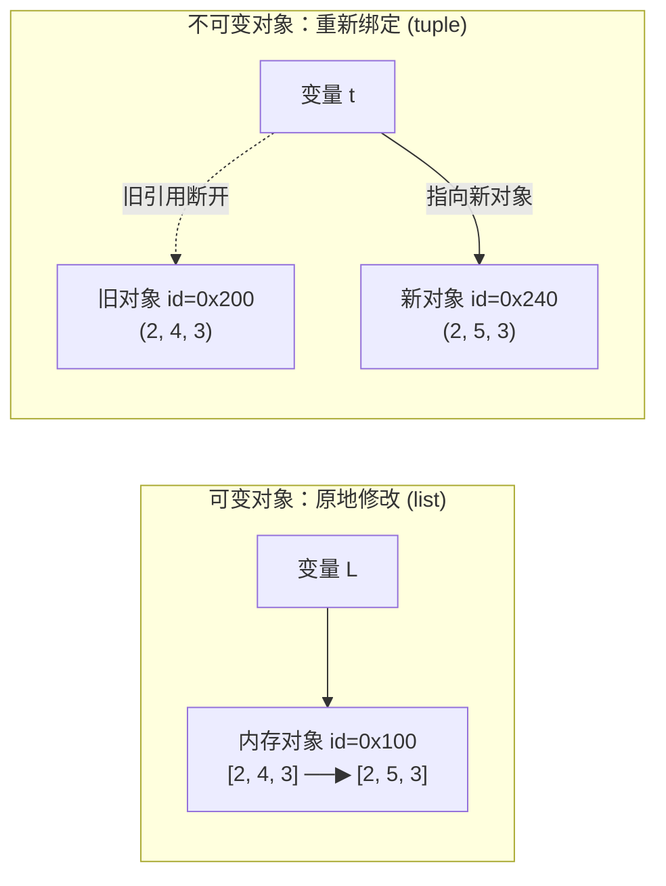
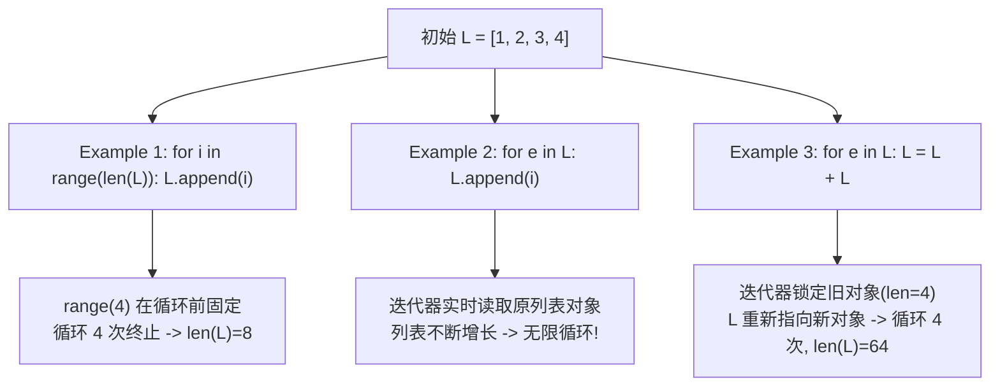

# L10 列表与可变性（Mutability）

%% learning-vault-navigation:v1 %%
> [!abstract]- 笔记导航
> 目录：[[CS Learning/Python MIT6.100L/MIT Python导航|MIT Python 导航]]
> 上一章：[[CS Learning/Python MIT6.100L/Lecture 9 Lambda Functions, Tuples, and Lists/L09 Lambda 表达式、元组与列表|L09 Lambda 表达式、元组与列表]] · 下一章：[[CS Learning/Python MIT6.100L/Lecture 11 Aliasing, Cloning/L11 别名与拷贝（Aliasing & Cloning）|L11 别名与拷贝（Aliasing & Cloning）]]

> [!abstract] 本讲核心概览
> 本讲（MIT 6.100L Lecture 10）深入剖析 Python 中第一个核心==可变数据结构（Mutable Data Structure）==——列表（`list`）。重点涵盖原地修改（Mutation）与创建新对象的内存区别、返回 `None` 的副作用方法（`append` / `extend` / `sort` / `reverse` / `clear`）、字符串与列表互转（`list` / `split` / `join`）、通过索引原地修改列表的函数设计，以及“边遍历边修改列表”引发的三大经典陷阱（Tricky Examples 1–3）与对象身份检测函数 `id()`。

---

## 1. 列表的可变性（Mutability）与内存模型

与上一讲学过的字符串（`str`）和元组（`tuple`）不同，列表是==可变的（Mutable）==：我们可以通过索引直接修改其内部元素，而无需在内存中重新分配一个全新的容器对象。

```python
L = [2, 4, 3]
L[1] = 5         # 原地修改：L 仍指向同一个内存对象，内容变为 [2, 5, 3]

t = (2, 4, 3)
# t[1] = 5       # TypeError: 'tuple' object does not support item assignment
t = (2, 5, 3)    # 重新绑定：在内存中创建了全新的元组对象，原 (2, 4, 3) 被丢弃
```



### 为什么需要区分可变与不可变？
- **不可变类型（`int`、`float`、`bool`、`str`、`tuple`）**：适合表示不应被意外篡改的固定记录，如经纬度 `(lat, lon)`、位置 `(page, line)`；可安全传递且可作为后续字典的键。
- **可变类型（`list`）**：适合动态集合（如每日 Top 40 歌单、用户记录表）。若有一个包含百万条记录的列表仅需更新其中一条，原地修改只需修改单个槽位，而无需复制整张表，时间与空间效率远高于重新构造。

### 用 `id()` 验证“同一对象” vs “新建对象”
Python 内置函数 `id(obj)` 返回对象的唯一内存标识。对比清空列表的两种写法：

| 写法 | 是否原地修改 | `id(L)` 变化 | 内存含义 |
| --- | --- | --- | --- |
| `L.clear()` | 是（Mutates `L`） | **不变** | 清空原列表对象的所有元素，任何指向该对象的别名都会同步变空 |
| `L = []` | 否（Rebinds `L`） | **改变** | 创建了一个全新的空列表对象，并将变量名 `L` 重新指向它；原对象不受影响 |

---

## 2. 副作用（Side Effects）与原地操作 vs 非原地操作

> [!important] Big Idea：对象方法与副作用
> Python 中万物皆对象（Everything is an object），每个对象同时拥有**数据（data）**与**绑定在类型上的操作（methods）**，通过点号语法 `object_name.method(args)` 调用（例如 `L.append(5)` 等价于对 `L` 和 `5` 执行追加）。
> 许多列表方法==原地修改列表并返回 `None`==——我们调用它们是为了利用其**副作用（Side Effect）**，而不是为了获取返回值。

### 高频易错坑：`L = L.append(5)`

```python
L = [2, 1, 3]
L.append(5)       # 正确：原地修改 L 为 [2, 1, 3, 5]
L = L.append(5)   # 致命错误！先将 L 变为 [2, 1, 3, 5, 5]，再把返回值 None 赋给 L！
print(L)          # 输出 None（原列表丢失引用）
```

> [!warning] 常见混淆对照：原地修改（返回 `None`） vs 返回新列表
> 课堂代码和 `learn.py` 中反复强调以下配对的差异，切勿把原地方法的返回值赋回原变量：

| 操作类别 | 原地修改（Mutates `L`，返回 `None`） | 创建新对象（不修改原 `L`，返回新列表） | 关键细节 |
| --- | --- | --- | --- |
| 添加单个元素 | `L.append(x)` | `L + [x]` | `append([1, 2])` 会把整个子列表作为**单个元素**塞进末尾 |
| 拼接多个元素 | `L.extend(L2)` | `L1 + L2` | `extend` 逐个拆开 `L2` 的顶层元素追加到末尾；`L2.extend([[1,2],[3,4]])` 会追加两个子列表 |
| 排序 | `L.sort()` | `sorted(L)` | `sorted(L)` 支持任意可迭代对象并保留原 `L` 不变 |
| 反转 | `L.reverse()` | `L[::-1]` / `list(reversed(L))` | `L.reverse()` 直接翻转原列表顺序 |
| 清空 | `L.clear()` | `L = []` | `clear()` 保持 `id(L)` 不变 |
| 插入 / 删除（Rec05 补充） | `L.insert(i, x)` / `L.remove(x)` / `del L[i]` / `L.pop(i)` | 切片拼接 / 列表过滤构造 | 注意 `L.pop()` **既原地修改又返回被弹出的元素** |

课堂练习对比示例（`L1`~`L4` 追踪）：
```python
L1 = ['re']
L2 = ['mi']
L3 = ['do']
L4 = L1 + L2      # L4 = ['re', 'mi']（新对象）
L3.append(L4)     # L3 = ['do', ['re', 'mi']]（嵌套列表！）
L = L1.append(L3) # L1 = ['re', ['do', ['re', 'mi']]]，但 L 为 None！
```

---

## 3. 字符串与列表的双向转换

| 转换方向 | 语法 | 行为与示例 | 易错点 |
| --- | --- | --- | --- |
| 字符串 → 字符列表 | `list(s)` | `list("I<3 cs")` $\rightarrow$ `['I', '<', '3', ' ', 'c', 's']` | 逐字符拆开，空格也成为独立元素 |
| 字符串 → 词列表 | `s.split(sep)` | `"I<3 cs &u?".split(' ')` $\rightarrow$ `['I<3', 'cs', '&u?']`<br>`"I<3 cs &u?".split('<')` $\rightarrow$ `['I', '3 cs &u?']` | 无参 `s.split()` 按任意连续空白切分；`s.split(' ')` 按单个空格切分 |
| 字符串列表 → 字符串 | `sep.join(L)` | `''.join(['a','b','c'])` $\rightarrow$ `"abc"`<br>`'_'.join(['a','b','c'])` $\rightarrow$ `"a_b_c"` | **要求 `L` 中所有元素必须是 `str`**；`''.join([1, 2, 3])` 会触发 `TypeError` |

课堂函数实现示例：
```python
def count_words(sen):
    """返回以空格分隔的单词数量"""
    return len(sen.split(' '))

def sort_words(sen):
    """返回按字典序排列的单词列表"""
    words = sen.split(' ')
    return sorted(words)   # 或 words.sort(); return words
```

---

## 4. 编写带副作用的原地修改函数

如果函数需要**原地修改传入的列表 `L`**（例如对每个元素求平方 `square_list(L)`，或对每个元素应用函数 `apply_to_each(L, f)`），直接 `for elem in L: elem = elem ** 2` **无效**，因为 `elem` 只是一个临时循环变量，给它重新赋值不会写回列表槽位。

> [!tip] 原地修改列表的 3 种标准遍历方式（Lecture 10 Slide 25）
> 1. **手动维护索引变量**：循环前设 `i = 0`，循环内写 `L[i] = ...` 并 `i += 1`。
> 2. **遍历索引 `range(len(L))`（最常用）**：通过下标 `L[i]` 读取并写回。
> 3. **使用 `enumerate(L)`（Pythonic 写法）**：同时解包下标 `i` 与元素值 `y`（你在 `learn.py` 中实践了此写法）。

```python
# 方式 2：range(len(L))
def apply_to_each(L, f):
    """原地对 L 中每个元素应用函数 f，返回 None"""
    for i in range(len(L)):
        L[i] = f(L[i])

# 方式 3：enumerate(L)（源自 learn.py 练习）
def square_list(L):
    for i, y in enumerate(L):
        L[i] = y ** 2
```

> [!important] Big Idea：带副作用函数的典型特征
> 1. 通常遍历 `range(len(L))`（或 `enumerate(L)`）而非仅遍历元素值 `L`。
> 2. 通常返回 `None`（不写 `return`），调用时直接 `square_list(Lin)` 而**不需要也不应该**写 `Lin = square_list(Lin)`。

---

## 5. 边遍历边修改的三大经典陷阱（Tricky Examples 1–3）

理解下面三个看似相似的代码片段，是掌握 Python 迭代机制与可变对象行为的分水岭：

### Tricky Example 1：遍历 `range(len(L))` 并 `append`（有限次终止）
```python
L = [1, 2, 3, 4]
for i in range(len(L)):
    L.append(i)
# 最终 L = [1, 2, 3, 4, 0, 1, 2, 3]
```
- **原因**：`range(len(L))` 在进入循环前就只计算了一次初始长度 `4`，生成一个固定的惰性可迭代对象（行为类似 `(0, 1, 2, 3)`）。之后 `L` 虽不断变长，但循环只会固定执行 4 次。

### Tricky Example 2：直接遍历 `L` 并 `append`（死循环！）
```python
L = [1, 2, 3, 4]
i = 0
for e in L:
    L.append(i)   # 危险：无限循环，直至内存耗尽！
    i += 1
```
- **原因**：`for e in L` 在底层通过列表迭代器维护一个**内部索引计数器（0, 1, 2, 3, ...）**，每次迭代实时按索引访问同一个列表对象 `L` 并判断是否到达当前尾部。每读一个元素就往末尾加一个新元素，尾部永远追不上计数器，导致==无限循环（Infinite Loop）==！

### Tricky Example 3：直接遍历 `L` 并在循环内重新绑定 `L = L + L`（有限次终止）
```python
L = [1, 2, 3, 4]
for e in L:
    L = L + L     # 创建新对象并重新绑定变量名 L
# 循环只执行 4 次，最终 L 的长度为 4 * 2^4 = 64
```
- **原因**：进入 `for e in L` 时，迭代器绑定的是**最初的那个 `[1, 2, 3, 4]` 对象**。循环体内的 `L = L + L` 并未修改原对象，而是不断创建长度翻倍（8 → 16 → 32 → 64）的新列表对象，并把名称 `L` 指向新对象。迭代器始终按原对象（长度 4）推进，4 次后正常结束。



> [!note] 预告：Tricky Example 4
> 在下一讲 [[CS Learning/Python MIT6.100L/Lecture 11 Aliasing, Cloning/L11 别名与拷贝（Aliasing & Cloning）|L11 别名与拷贝]] 中，我们将剖析第 4 个经典陷阱——“直接遍历 `L` 同时删除元素导致跳元素漏删”，以及如何用克隆（Cloning）彻底解决。

---

## 6. 课后练习、Finger Exercise 与 Rec05 复盘

### 6.1 `homework.py` 与 `ex10` 要点
- **Q1 链表操作追踪**：`L1=['re'], L2=['mi'], L3=['do']` $\rightarrow$ `L4 = L1 + L2` $\rightarrow$ `L3.extend(L4)` 得 `['do','re','mi']` $\rightarrow$ `L3.sort()` 得 `['do','mi','re']` $\rightarrow$ `del(L3[0])` 得 `['mi','re']` $\rightarrow$ `L3.append(['fa','la'])` 最终为 `['mi', 're', ['fa', 'la']]`。注意 `extend` 展平了一层，而 `append` 保留了嵌套结构。
- **Q2 别名预告**：`brunch = L1` 后对 `L1.append('juice')` 和 `brunch.extend(L2)` 实际作用于同一列表对象，最终 `brunch` 为 `['bacon', 'eggs', 'juice', 'toast', 'jam']`。
- **Finger Exercise (`mit6_100l_f22_ex10.py`)**：`all_true(n, Lf)` 结合了 L08/L09 的“函数列表”思想，遍历 `Lf` 并用 `flag` + 短路 `break`（也可在 `if not f(n): return False` 处提前返回）判断所有谓词函数是否全为真。

### 6.2 Rec05 实操复盘与易错点排查

> [!warning] Rec05 练习代码（`R05_problems.py`）两处隐蔽 Bug 复盘
> 回看自己在 `R05_problems.py` 中的代码，有两处非常值得警醒的细节：
> 1. **Problem 1 (`square_list`) 缩进提前返回**：
>    ```python
>    # 原写法（Bug）：return 缩进在了 for 循环内部！仅平方第 0 个元素就返回
>    for i in range(len(my_list)):
>        my_list[i] = my_list[i] ** 2
>        return my_list
>    ```
>    **修正**：`return my_list` 应与 `for` 对齐（位于循环体之外）。
> 2. **Problem 2 (`concatenate_lists`) 误用全局变量**：
>    函数签名接收 `list_a, list_b, list_c`，但循环体内写成了全局的 `list1[i] + list2[i] + list3[i]`。虽然在当前测试中输出碰巧正确，但若传入其他列表就会出错——函数体内应严格使用形参。
> 3. **Problem 3 (`rotate_list`) 亮点与边界**：
>    你正确使用了 `shift = shift % len(input_list)` 处理超长位移（如位移 14 等价于位移 4），并通过切片 `input_list[-shift:] + input_list[:-shift]`（右移）和 `input_list[shift:] + input_list[:shift]`（左移）实现了非原地循环移位。注意当 `input_list` 为空时 `% 0` 会触发 `ZeroDivisionError`，工程中可加 `if not input_list: return []` 兜底。

---

## 7. 自测检验

> [!question]- 自测 1：`L.extend([1, 2])` 和 `L.append([1, 2])` 有何本质区别？
> - `L.append([1, 2])` 将 `[1, 2]` 作为**单个列表元素**追加到 `L` 末尾，`len(L)` 增加 1。
> - `L.extend([1, 2])` 遍历参数中的元素并逐个追加到 `L` 末尾，`len(L)` 增加 2（等价于追加 `1` 和 `2`）。两者均原地修改 `L` 并返回 `None`。

> [!question]- 自测 2：为什么 `for e in L: L.append(0)` 会死循环，而 `for e in L: L = L + [0]` 却不会？
> - 前者通过 `L.append(0)` **原地修改**了迭代器正在遍历的那个列表对象，导致列表尾部不断后移，迭代器永远无法到达终点。
> - 后者 `L = L + [0]` 创建了一个**全新的列表对象**并重新绑定变量名 `L`，而 `for` 循环的迭代器仍绑定在最初那个长度固定的旧列表对象上，遍历完原元素即终止。

---

## 8. 配套资料

| 资料名称 | 说明 | 仓库路径 |
| --- | --- | --- |
| Lecture 10 课件 | 列表可变性、副作用与三大迭代陷阱 | [[CS Learning/Python MIT6.100L/Lecture 10 Lists, Mutability/mit6_100l_f22_lec10.pdf\|mit6_100l_f22_lec10.pdf]] |
| Lecture 10 课堂代码 | 含 You Try It 练习与参考答案 | [[CS Learning/Python MIT6.100L/Lecture 10 Lists, Mutability/mit6_100l_f22_lec10_code.py\|mit6_100l_f22_lec10_code.py]] |
| 个人课堂实验脚本 | `append` 返回 `None`、`enumerate` 与死循环实验 | [[CS Learning/Python MIT6.100L/Lecture 10 Lists, Mutability/learn.py\|learn.py]] |
| 课后作业代码 | Q1–Q3（含 `apply_to_each` 实现） | [[CS Learning/Python MIT6.100L/Lecture 10 Lists, Mutability/homework.py\|homework.py]] |
| Finger Exercise 10 | `all_true(n, Lf)` 练习与官方解答 | [[CS Learning/Python MIT6.100L/Lecture 10 Lists, Mutability/mit6_100l_f22_ex10.py\|mit6_100l_f22_ex10.py]] · [[CS Learning/Python MIT6.100L/Lecture 10 Lists, Mutability/mit6_100l_f22_ex10_sol.pdf\|官方解答 PDF]] |
| Recitation 05 总结与习题 | 元组/列表方法速查、移位与拼接练习 | [[CS Learning/Python MIT6.100L/Lecture 10 Lists, Mutability/mit6_100l_f22_rec05/1_rec5/R05_summary.docx\|R05_summary.docx]] · [[CS Learning/Python MIT6.100L/Lecture 10 Lists, Mutability/mit6_100l_f22_rec05/1_rec5/R05_problems.py\|R05_problems.py]] · [[CS Learning/Python MIT6.100L/Lecture 10 Lists, Mutability/mit6_100l_f22_rec05/1_rec5/R05_solutions.py\|R05_solutions.py]] |
