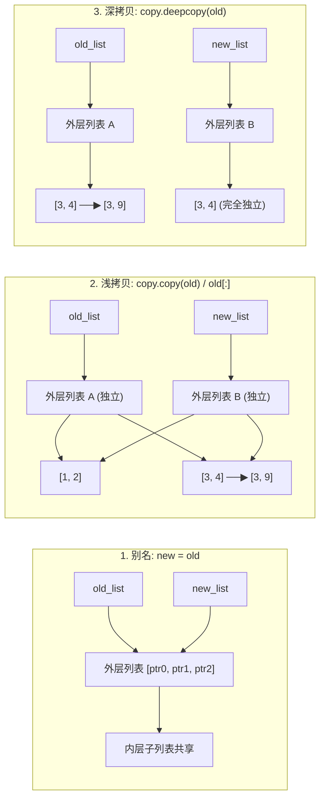

# L11 别名与拷贝（Aliasing & Cloning）

%% learning-vault-navigation:v1 %%
> [!abstract]- 笔记导航
> 目录：[[CS Learning/Python MIT6.100L/MIT Python导航|MIT Python 导航]]
> 上一章：[[CS Learning/Python MIT6.100L/Lecture 10 Lists, Mutability/L10 列表与可变性（Mutability）|L10 列表与可变性（Mutability）]] · 下一章：[[CS Learning/Python MIT6.100L/Lecture 12 List Comprehension, Functions as Objects, Testing, Debugging/L12 列表推导、高阶函数与测试调试|L12 列表推导、高阶函数与测试调试]]

> [!abstract] 本讲核心概览
> 本讲（MIT 6.100L Lecture 11）围绕可变对象在内存中的**引用机制**展开：首先补全列表删除操作（`del` / `pop` / `remove`）并剖析第 4 个经典迭代陷阱——**边遍历边删除导致漏删**；随后系统区分==别名（Aliasing）==、==浅拷贝（Shallow Copy）==与==深拷贝（Deep Copy）==在嵌套列表中的内存结构差异，并阐明函数传参本质上是创建形参别名，以及如何在 `list` 与 `tuple` 之间做出工程权衡。

---

## 1. 列表的三种删除操作

假设 `L = [2, 1, 3, 6, 3, 7, 0]`，依次执行以下操作：

| 操作 | 语法 | 按索引还是按值 | 返回值 | 特性与异常 |
| --- | --- | --- | --- | --- |
| `del` 语句 | `del(L[index])` 或 `del L[i:j]` | 按索引/切片 | 无（语句，非表达式） | 越界报 `IndexError`；支持切片批量删除 |
| `pop` 方法 | `L.pop()` 或 `L.pop(index)` | 按索引（默认末尾 `-1`） | **返回被删除的元素** | 空列表或越界报 `IndexError` |
| `remove` 方法 | `L.remove(element)` | **按元素值** | 返回 `None` | 仅删除**第一个匹配项**；元素不存在时直接抛出 `ValueError` |

```python
L = [2, 1, 3, 6, 3, 7, 0]
L.remove(2)    # L -> [1, 3, 6, 3, 7, 0]
L.remove(3)    # L -> [1, 6, 3, 7, 0]（只删了第一个 3！）
del(L[1])      # L -> [1, 3, 7, 0]
a = L.pop()    # a = 0, L -> [1, 3, 7]
```

---

## 2. Tricky Example 4：边遍历边删除的经典陷阱与解法

接续 [[CS Learning/Python MIT6.100L/Lecture 10 Lists, Mutability/L10 列表与可变性（Mutability）|L10]] 的前三个陷阱，当我们在 `for e in L` 循环中原地删除元素时，会发生隐蔽的**漏元素（Skipping Elements）**错误。

### 2.1 错误示范：`remove_all` 与 `remove_dups`
```python
def remove_dups_buggy(L1, L2):
    for e in L1:
        if e in L2:
            L1.remove(e)

L1 = [10, 20, 30, 40]
L2 = [10, 20, 50, 60]
remove_dups_buggy(L1, L2)
print(L1)   # 错误地输出 [20, 30, 40]，20 被跳过了！
```

**底层原因追踪**：
1. Python 迭代器内部维护索引计数器 `idx = 0`，取出 `L1[0] = 10`。
2. `10 in L2` 为真，执行 `L1.remove(10)`，此时列表整体左移，变为 `[20, 30, 40]`——**`20` 移动到了下标 `0` 的位置**！
3. 进入下一轮循环，迭代器并不知道列表已左移，照常递增 `idx = 1`，取出 `L1[1] = 30`。
4. **`20` 永远被跳过**！同理，`remove_all([1, 2, 2, 2], 2)` 会错误残留 `[1, 2]`。

### 2.2 三种正确的原地删除方案

| 方案 | 代码模式 | 核心思路与适用场景 |
| --- | --- | --- |
| **方案 A：遍历克隆，修改原列表** | `L1_copy = L1[:]`<br>`for e in L1_copy:`<br>`    if e in L2: L1.remove(e)` | 迭代器绑定在不变的副本 `L1_copy` 上，索引步进与元素一一对应；修改作用于原 `L1` |
| **方案 B：先克隆再 `clear()` 重填** | `L_save = L[:]`<br>`L.clear()`<br>`for x in L_save:`<br>`    if x != e: L.append(x)` | 保持 `id(L)` 不变，且避免了反复调用 `L.remove()` 带来的 $O(n^2)$ 移位开销，时间复杂度降至 $O(n)$ |
| **方案 C：`while e in L` 循环删除** | `while e in L:`<br>`    L.remove(e)` | 适合删除单个特定值 `e` 的所有出现次数（代码最简，但最坏复杂度 $O(n^2)$） |

> [!warning] 避坑：`L1_copy = L1` 不是拷贝！
> 如果写成 `L1_copy = L1` 再遍历 `L1_copy`，它只是创建了指向同一内存对象的**别名（Alias）**，修改 `L1` 时 `L1_copy` 同步收缩，照样漏删 `20`！必须使用 `L1[:]` 或 `L1.copy()` 创建独立副本。

---

## 3. 别名（Aliasing）、浅拷贝与深拷贝的内存模型

在 Python 中，必须严格区分**对象本身（Object in memory）**与**变量名（Name / Reference）**。

> [!important] Big Idea：函数传参也是创建别名！
> 当把列表 `La` 作为实参（actual parameter）传给函数形参（formal parameter）`L1` 时，Python **不会拷贝列表**，而是让形参 `L1` 成为 `La` 的一个**别名**。
> - 如果函数内部原地修改 `L1`（如 `L1.append(...)`、`L1.clear()`），调用方的 `La` 同步变化。
> - 如果函数内部对形参重新赋值 `L1 = Lnew`（如课后题 `repeat` 的反例），只是把局部变量 `L1` 改指向了新对象，调用方的 `La` **完全不会改变**！

### 三种“复制”行为的彻底对比

设原嵌套列表为 `old_list = [[1, 2], [3, 4], [5, 6]]`，随后依次执行顶层追加 `old_list.append([7, 8])` 与内层修改 `old_list[1][1] = 9`：



| 方式 | 写法 | 顶层容器是否独立 | 内层可变子对象是否独立 | `old.append([7,8])` 后 `new` | `old[1][1] = 9` 后 `new` | 适用场景 |
| --- | --- | --- | --- | --- | --- | --- |
| **别名（Alias）** | `new = old` | 否（同一 `id`） | 否（共享） | 受影响（多出 `[7,8]`） | 受影响（变为 `9`） | 确实希望共享状态/原地修改 |
| **浅拷贝（Shallow Copy）** | `old[:]` / `old.copy()` / `copy.copy(old)` | **是**（新外层列表） | **否**（元素指针直接复制，子列表仍共享） | **不受影响** | **受影响**（变为 `9`！） | 列表中只装不可变元素（如 `int`、`str`、`tuple`） |
| **深拷贝（Deep Copy）** | `copy.deepcopy(old)` | **是** | **是**（递归克隆每一层嵌套结构） | **不受影响** | **不受影响**（保持 `4`） | 包含任意层级嵌套可变对象，需要彻底隔离 |

---

## 4. `homework.py` 嵌套列表内存追踪实战

在 `homework.py` 中，通过对比 `colors1` 与 `colors2` 可以直观验证嵌套别名与独立字面量的区别：

```python
cool = ['blue', 'green']
warm = ['red', 'yellow', 'orange']

colors1 = [cool]
colors1.append(warm)                 # colors1 持有 cool 与 warm 的引用（别名！）
colors2 = [['blue', 'green'],
           ['red', 'yellow', 'orange']]  # colors2 创建了两个全新的内层列表

warm.remove('red')                   # 原地修改 warm -> ['yellow', 'orange']
# colors1 -> [['blue', 'green'], ['yellow', 'orange']]  (受副作用影响!)
# colors2 -> [['blue', 'green'], ['red', 'yellow', 'orange']] (不受影响!)

flat = cool + warm                   # + 拼接创建全新平铺列表 ['blue','green','yellow','orange']
cool[1] = 'black'                    # colors1 随之变为 [['blue','black'], ['yellow','orange']]
                                     # 但 flat 不受影响（因为 flat 中存的是不可变 str 的引用）
```

---

## 5. 设计权衡：为什么 Python 同时保留 `list` 与 `tuple`？

1. **为什么不全部用 `tuple`？**
   - **效率（Efficiency）**：处理大规模动态序列时，如果每次增删改一个元素都要复制整个序列，时间与内存开销不可接受；可变列表支持 $O(1)$ 索引原地修改与均摊 $O(1)$ 尾部追加。
2. **为什么不全部用 `list`？**
   - **安全性（Safety）**：不可变元组能从语言层面防止下游代码通过别名意外修改关键数据（防副作用保护）。
   - **哈希性与结构需求**：不可变性是作为字典键（[[CS Learning/Python MIT6.100L/Lecture 14 Dictionaries/L14 字典与哈希映射（Dictionaries）|L14]]）的前提条件，且元组在内存占用与访问速度上略优于列表。

---

## 6. 练习与 Finger Exercise 复盘

> [!warning] Finger Exercise 11 (`mit6_100l_f22_ex11.py`) 关键复盘
> 题目要求 `remove_and_sort(Lin, k)` **原地删除 `Lin` 的前 `k` 个元素**，并将剩余元素升序排列；若 `len(Lin) <= k` 则原地清空为空列表。
> - **原代码中的隐蔽问题**：你在 `mit6_100l_f22_ex11.py` 中写了 `Lin.remove(k)`，它按**值**删除了等于 `k` 的元素，而不是按**位置**删除前 `k` 个元素！它之所以碰巧通过了示例 `L = [1, 6, 3], k = 1`，仅仅是因为 `L[0]` 恰好等于 `1`。若测试 `L = [5, 6, 3], k = 2`，`Lin.remove(2)` 会直接抛出 `ValueError`！
> - **标准解法（官方参考 + 切片原地写法）**：
>   ```python
>   def remove_and_sort(Lin, k):
>       if len(Lin) <= k:
>           Lin.clear()
>           return
>       for _ in range(k):      # 或直接写 del Lin[:k]（O(n) 一步到位）
>           del Lin[0]
>       Lin.sort()
>   ```

> [!example] At Home 练习：`repeat(L, n)` 原地重复
> 要把 `L` 原地重复 `n` 次，不能写 `L = Lnew`（那只是重新绑定局部变量），而应先记录原长度 `rep = len(L)`（防止边遍历边 `append` 死循环！），再循环 `n - 1` 次依次 `L.append(L[j])`，或者直接用 `L.extend(L[:] * (n - 1))` / `L *= n`（列表的 `*=` 为原地操作）。

---

## 7. 自测检验

> [!question]- 自测 1：给函数传入列表 `L`，函数内执行 `L = []` 与 `L.clear()` 对调用方的原列表有什么不同影响？
> - `L = []` 只是让形参局部变量 `L` 指向一个新建的空列表，调用方的原列表**完好无损**。
> - `L.clear()` 通过别名对内存中的原列表对象执行**原地清空**，调用方的原列表也会变成 `[]`。

> [!question]- 自测 2：什么时候用浅拷贝 `L[:]` 就足够了，什么时候必须用 `copy.deepcopy(L)`？
> - 当列表中的所有元素都是**不可变对象**（如 `int`、`float`、`str`、`tuple`）时，浅拷贝 `L[:]` 或 `L.copy()` 就足够安全且高效。
> - 当列表中包含**嵌套的可变对象**（如二维列表 `[[1,2],[3,4]]`、字典列表）且需要修改内层元素而不影响原数据时，必须使用 `copy.deepcopy(L)`。

---

## 8. 配套资料

| 资料名称 | 说明 | 仓库路径 |
| --- | --- | --- |
| Lecture 11 课件 | 删除操作、Tricky Example 4、别名与深浅拷贝内存图 | [[CS Learning/Python MIT6.100L/Lecture 11 Aliasing, Cloning/mit6_100l_f22_lec11.pdf\|mit6_100l_f22_lec11.pdf]] |
| Lecture 11 课堂代码 | `remove_all`、`remove_dups`、`copy` 演示与 `repeat` | [[CS Learning/Python MIT6.100L/Lecture 11 Aliasing, Cloning/mit6_100l_f22_lec11_code.py\|mit6_100l_f22_lec11_code.py]] |
| 课后内存追踪练习 | `colors1` / `colors2` / `flat` 别名追踪注释 | [[CS Learning/Python MIT6.100L/Lecture 11 Aliasing, Cloning/homework.py\|homework.py]] |
| Finger Exercise 11 | `remove_and_sort(Lin, k)` 练习与官方解答 | [[CS Learning/Python MIT6.100L/Lecture 11 Aliasing, Cloning/mit6_100l_f22_ex11.py\|mit6_100l_f22_ex11.py]] · [[CS Learning/Python MIT6.100L/Lecture 11 Aliasing, Cloning/mit6_100l_f22_ex11_sol.pdf\|官方解答 PDF]] |
