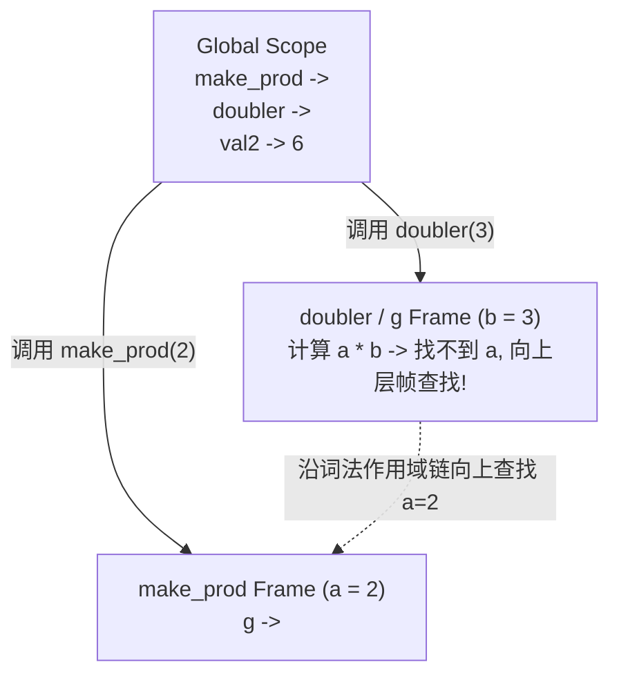

# L12 列表推导、高阶函数与测试调试

%% learning-vault-navigation:v1 %%
> [!abstract]- 笔记导航
> 目录：[[CS Learning/Python MIT6.100L/MIT Python导航|MIT Python 导航]]
> 上一章：[[CS Learning/Python MIT6.100L/Lecture 11 Aliasing, Cloning/L11 别名与拷贝（Aliasing & Cloning）|L11 别名与拷贝（Aliasing & Cloning）]] · 下一章：[[CS Learning/Python MIT6.100L/Lecture 13 Exceptions, Assertions/L13 异常处理与断言（Exceptions & Assertions）|L13 异常处理与断言（Exceptions & Assertions）]]

> [!abstract] 本讲核心概览
> 本讲（MIT 6.100L Lecture 12）包含四大工程核心主题：**列表推导式（List Comprehension）**、**默认/关键字参数（Keyword & Default Parameters）**、**函数返回函数与闭包作用域（Functions Returning Functions）**，以及**系统化的软件测试与调试方法论**（单元测试/回归测试/集成测试、黑盒测试 vs 白盒测试、二分法打印调试）。配套包含 Recitation 06 练习与 **Problem Set 3（文档相似度与 TF-IDF）** 项目复盘。

---

## 1. 列表推导式（List Comprehension）

将“遍历可迭代对象 → 可选条件过滤 → 对每个元素做变换 → 收集到新列表”的模式压缩为一行简洁表达：

```python
[expression for elem in iterable if test]
```

它严格等价于以下高阶函数模板（Lecture 12 Slide 9）：

```python
def f(expr, old_list, test=lambda x: True):
    new_list = []
    for e in old_list:
        if test(e):
            new_list.append(expr(e))
    return new_list
```

### 典型模式与拆解三步法
读懂复杂列表推导式的三步法：**① 明确源序列的所有值 → ② 找出 `if` 保留的子集 → ③ 对保留元素求 `expression`**。

```python
[e**2 for e in range(6)]                                   # [0, 1, 4, 9, 16, 25]
[e**2 for e in range(8) if e % 2 == 0]                     # [0, 4, 16, 36]
[[e, e**2] for e in range(4) if e % 2 != 0]                # [[1, 1], [3, 9]]
[len(x) for x in ['xy', 'abcd', 7, '4.0'] if type(x) == str]  # [2, 4, 3]
```

> [!tip] 实操亮点：短路求值保护（`homework.py` 复盘）
> 题目要求从 `L = ['abc', 'm', 'p', 'xyz', '123', 57]` 提取长度为 3 的字符串的中间字符：
> - 你在 `homework.py` 中写的是 `[e[1] for e in L if type(e) == str and len(e) == 3]`，利用 `and` 的**短路求值（Short-circuit Evaluation）**先验证 `type(e) == str`，遇到整数 `57` 时直接跳过 `len(57)`，安全输出 `['b', 'y', '2']`！
> - 反观 `lec12.py` 末尾注释中写的 `[e[1] for e in L if len(e) == 3 and type(e) == str]`，因为把 `len(e)` 放在前面，在 `57` 上反而会触发 `TypeError: object of type 'int' has no len()`。条件筛选中==永远把类型检查放在前面==。

---

## 2. 默认参数与关键字参数（Default & Keyword Parameters）

以二分法求平方根 `bisection_root(x, epsilon=0.01)` 为例：与其把精度 `epsilon` 写死在函数内或依赖全局变量（Global variables are bad），不如将其设为带默认值的参数。

```python
def bisection_root_new(x, epsilon=0.01):
    low, high = 0, x
    guess = (high + low) / 2.0
    while abs(guess**2 - x) >= epsilon:
        if guess**2 < x:
            low = guess
        else:
            high = guess
        guess = (high + low) / 2.0
    return guess
```

### 定义与调用的硬性规则

| 规则场景 | 合法写法 | 非法 / 陷阱写法 |
| --- | --- | --- |
| **函数定义** | 默认参数必须排在所有位置参数**之后**：`def f(x, epsilon=0.01):` | `def f(epsilon=0.01, x):` $\rightarrow$ `SyntaxError` |
| **函数调用** | `bisection_root_new(123)`<br>`bisection_root_new(123, 0.001)`<br>`bisection_root_new(123, epsilon=0.001)`<br>`bisection_root_new(x=123, epsilon=0.1)`<br>`bisection_root_new(epsilon=0.1, x=123)` | `bisection_root_new(epsilon=0.001, 123)` $\rightarrow$ `SyntaxError`（位置实参不能跟在关键字实参后面）<br>`bisection_root_new(0.001, 123)` $\rightarrow$ **不报错但逻辑完全错误**（把 `x` 当成了 `0.001`！） |

---

## 3. 函数作为一等对象与返回函数（Closures）

在 Python 中，函数与整数、列表一样都是内存中的**对象**：可以赋值给其他变量名（`my_func = is_even`），可以作为参数传入，也可以**作为返回值从外层函数中返回**。

```python
def make_prod(a):
    def g(b):
        return a * b
    return g

# 方式 1：链式直接调用
val1 = make_prod(2)(3)    # 6

# 方式 2：保存返回的函数对象（部分求值 / 柯里化思想）
doubler = make_prod(2)
val2 = doubler(3)         # 6
```

### 嵌套作用域与栈帧查找机制（Scope Hierarchy）



- 内部函数 `g` 定义在 `make_prod` 的局部作用域内，**无法在全局作用域直接通过名字 `g` 访问**；每次调用 `make_prod` 都会创建一个全新的内部函数对象。
- 当 `doubler(3)` 执行 `return a * b` 时，解释器在 `g` 的帧中找到 `b = 3`，并沿作用域层级向上在创建它的父帧中找到 `a = 2`（即**闭包 Closure**）。
- **工程意义**：支持**部分执行（Partial Execution）**与更好的模块抽象——先固定一部分配置参数生成定制函数，再在其他位置完成剩余计算。

---

## 4. 软件测试（Testing & Validation）

防御性编程（Defensive Programming）、测试（Testing）与调试（Debugging）构成软件可靠性的三大支柱：
- **防御性编程**：编写清晰规约（Specification）、模块化拆分、用断言检查输入输出约束。
- **测试/验证**：“这段代码有没有坏？我怎样能把它测崩？”（将实际输入输出与规约比对）。
- **调试**：“为什么它坏了？怎样定位并修复它？”（追踪导致错误的事件链）。

### 4.1 测试的三大阶段（Classes of Tests）
1. **单元测试（Unit Testing）**：独立验证每个函数/模块是否符合自身规约（最先进行）。
2. **回归测试（Regression Testing）**：每修复一个 Bug，就把触发该 Bug 的用例永久加入测试集，防止后续改动把旧 Bug 重新引入。
3. **集成测试（Integration Testing）**：验证所有模块组合后的整体程序能否协同工作（初学者常急于跳过单元测试直接做集成测试，导致定位困难）。

### 4.2 黑盒测试 vs 白盒测试（Black-Box vs Glass-Box）

| 维度 | 黑盒测试（Black-Box Testing） | 白盒测试（Glass-Box Testing） |
| --- | --- | --- |
| **设计依据** | **只看函数规约（Docstring）**，不看内部实现代码 | **直接阅读源代码**，针对代码控制流路径设计用例 |
| **核心优势** | 避免实现者思维盲区（Implementer Bias）；代码重构后测试集可直接复用 | 能精准覆盖内部隐藏分支与循环路径 |
| **设计原则** | 按输入空间的自然分区（Natural Partitions）与**边界条件**（空列表、单元素、极值）构造用例 | 追求**路径完备（Path-Complete）**：每个 `if/elif/else` 分支都走到；`for` 循环覆盖 0 次、1 次、多次；`while` 循环覆盖不进入、进入后各退出条件 |
| **典型盲区** | 可能遗漏特定实现路径才触发的缺陷 | 路径完备 $\neq$ 无 Bug！且无法发现“代码里**漏写**的路径” |

> [!example] 两个经典测试案例（Lecture 12 Slides 39 & 41）
> 1. **黑盒测试 `sqrt(x, eps)`**：覆盖边界 `x=0`、完全平方数 `25`、小于 1 的小数 `0.05`（二分上界若只设 `high = x` 会出错！）、无理根 `2`，以及极值组合 $x, \varepsilon \in \{2^{-64}, 2^{64}\}$。
> 2. **白盒测试的局限性**：
>    ```python
>    def abs_buggy(x):
>        if x < -1:
>            return -x
>        else:
>            return x
>    ```
>    测试集 `{2, -2}` 已经做到了 **100% 路径完备（Path-Complete）**，却漏掉了边界值 `abs_buggy(-1)` 返回 `-1` 的致命 Bug！因此**黑盒边界测试必须与白盒路径测试结合使用**。

---

## 5. 系统化调试方法（Systematic Debugging）

### 5.1 常见错误分类
- **显性运行/语法错误（容易定位）**：`SyntaxError`（少括号/引号）、`IndexError`（列表越界）、`TypeError`（类型不匹配如 `int(list)` 或 `'3'/4`）、`NameError`（变量未定义）。善用 Python 的 **Stack Trace（调用栈追踪）** 直接定位行号。
- **逻辑错误（最难定位）**：程序能跑完但结果不对。不要问“哪里错了”，而要问**“我的代码是如何一步步算出这个意外结果的？”**。

### 5.2 科学调试流程与二分法打印
1. **研究数据 → 提出假设 → 用最简输入做可复现实验 → 验证并缩小范围**。
2. **二分法插入 `print`（Bisection Debugging）**：在函数入口、关键中间点、返回前打印参数与中间变量，像二分查找一样把 Bug 锁定在越来越小的代码区间内。
3. **小黄鸭调试法（Rubber Duck Debugging）**：逐行向别人（或小黄鸭）解释代码的意图，往往讲到一半就能自己发现逻辑漏洞。

### 5.3 课堂调试实战：`is_pal(x)` 的五步排错与 Wordle 修复
- **`is_pal(x)` 双重 Bug 案例（`lec12.py`）**：
  ```python
  # 初始 Bug 版：对 ['a', 'b'] 竟然返回 True！
  def is_pal(x):
      temp = x          # Bug 2: 别名！没有克隆 x
      temp.reverse      # Bug 1: 漏写括号 ()，只是引用了方法对象而未调用！
      return temp == x
  ```
  在中间加入 `print('before/after reverse', temp, x)` 后：① 发现 `temp` 根本没反转 $\rightarrow$ 补全 `temp.reverse()`；② 再次打印发现 `temp` 和 `x` 竟然**同时反转**了（`['b', 'a'] == ['b', 'a']` 依旧为 `True`！） $\rightarrow$ 改用 `temp = x[:]` 克隆，彻底修复。
- **`lec12_wordle.py` 调试要点**：通过检查游戏循环中 `n_guesses` 递减、胜利条件 `win or guess == secret` 与字母重复追踪列表 `guessed`，系统验证边界输入（最后一次猜中、重复字母等）。

---

## 6. 配套实践复盘：Rec06 与 Problem Set 3（Document Distance）

### 6.1 Recitation 06 关键技巧（`R06_problems.py`）
- 列表推导过滤与映射：`[i for i in original_list if i % 5 != 0]`、`[i / 2 for i in original_list]`。
- **定长分块（Chunking）经典一行写法**：`[lst[i:i+n] for i in range(0, len(lst), n)]`（切片越界自动截断，最后一块长度不足 `n` 时自然保留剩余元素）。
- 隔 `n` 个元素插入 `x`：新建列表法（无副作用，`if (i + 1) % n == 0`） vs 原地 `lst.insert(i, x)`（需跳步 `i += n + 1` 以补偿插入导致的索引右移）。

### 6.2 Problem Set 3：`document_distance.py` 核心算法与代码复盘

PS3 以信息检索（Information Retrieval）中的**文档相似度**为背景，串联了文件读取、词频字典（为 [[CS Learning/Python MIT6.100L/Lecture 14 Dictionaries/L14 字典与哈希映射（Dictionaries）|L14 字典]] 预热）、模块化辅助函数复用与单元测试（`test_ps3_student.py`）：

1. **词频相似度（Similarity Score）**：
   设 $U$ 为两文档/单词中出现的所有不重复元素集合，对每个 $u \in U$ 定义频次差 $\delta(u) = |\text{count}(u, L_1) - \text{count}(u, L_2)|$ 与频次和 $\sigma(u) = \text{count}(u, L_1) + \text{count}(u, L_2)$，则相似度为：
   $$\text{Similarity}(L_1, L_2) = \text{round}\!\left(1 - \frac{\sum_{u \in U} \delta(u)}{\sum_{u \in U} \sigma(u)},\; 2\right)$$
   完全相同得 `1.0`，完全无交集得 `0.0`；你在 `calculate_similarity_score` 中妥善处理了空字典分母 `all == 0` 返回 `0.0` 的边界情况。

2. **TF-IDF（词频-逆文档频率）**：
   衡量词语 $w$ 在单篇文档 $d$ 相对于语料库（共 $N$ 篇文档）中的**区分重要度**：
   $$\text{TF}(w, d) = \frac{\text{count}(w, d)}{|d|}, \qquad \text{IDF}(w) = \log_{10}\!\left(\frac{N}{\text{df}(w)}\right)$$
   $$\text{TF-IDF}(w, d) = \text{TF}(w, d) \times \text{IDF}(w)$$
   - 若词 $w$ 在所有文档中都出现（如停用词 `"hello"`），$\text{df}(w) = N \Rightarrow \text{IDF}(w) = \log_{10}(1) = 0$，得分归零。
   - 若词 $w$ 仅在少数文档高频出现，则 TF 与 IDF 均高，得分显著增大。
   - 在 `get_tfidf` 中你用 `tfidf_list.sort(key=lambda item: (item[1], item[0]))` 优雅地实现了“先按 TF-IDF 升序、同分按字典序升序”的双关键字排序！

> [!tip] PS3 模块复用小提醒（`document_distance.py`）
> - `get_letter_frequencies(word)`：讲义要求直接复用 Problem 1 的 `get_frequencies(word)`（因为 `str` 本身就是可迭代字符序列，`return get_frequencies(word)` 一行即可），可以进一步消除重复代码。
> - `calculate_similarity_score` 中变量名尽量避免命名为 `all`（避免遮蔽 Python 内置函数 `all()`），可改为 `total_count`。

---

## 7. 自测检验

> [!question]- 自测 1：为什么白盒测试做到 100% 路径完备（Path-Complete）仍然可能漏掉 Bug？
> 1. **边界值遗漏**：例如 `if x < -1` 误写（本应为 `x < 0`），用例 `2` 和 `-2` 覆盖了所有分支，却漏掉了边界 `-1`。
> 2. **缺失路径（Missing Paths）**：如果代码本来就漏写了某个特判分支（如除数为 0 或空列表），顺着已有代码找路径永远测不到这条缺失的分支。
> 3. **循环次数无限组合**：循环体内的状态累积错误往往在特定迭代次数下才会暴露。

> [!question]- 自测 2：`def make_adder(k): return lambda x: x + k` 返回的函数为何在 `make_adder` 执行结束后仍记得 `k`？
> 因为返回的函数对象构成了一个**闭包（Closure）**：它不仅保存函数体代码，还持有指向其定义时所在外层作用域（Enclosing Frame）的引用，从而在后续调用时仍能沿着作用域链读取捕获的自由变量 `k`。

---

## 8. 配套资料

| 资料名称 | 说明 | 仓库路径 |
| --- | --- | --- |
| Lecture 12 课件 | 列表推导、默认参数、闭包作用域、测试与调试方法论 | [[CS Learning/Python MIT6.100L/Lecture 12 List Comprehension, Functions as Objects, Testing, Debugging/mit6_100l_f22_lec12.pdf\|mit6_100l_f22_lec12.pdf]] |
| Lecture 12 课堂代码 | 推导式、二分法默认参数、`make_prod` 与 `is_pal` 五步调试 | [[CS Learning/Python MIT6.100L/Lecture 12 List Comprehension, Functions as Objects, Testing, Debugging/mit6_100l_f22_lec12_code/lec12.py\|lec12.py]] · [[CS Learning/Python MIT6.100L/Lecture 12 List Comprehension, Functions as Objects, Testing, Debugging/mit6_100l_f22_lec12_code/lec12_wordle.py\|lec12_wordle.py]] |
| 课后作业与 Finger Exercise | 短路过滤推导式与 `count_sqrts` | [[CS Learning/Python MIT6.100L/Lecture 12 List Comprehension, Functions as Objects, Testing, Debugging/homework.py\|homework.py]] · [[CS Learning/Python MIT6.100L/Lecture 12 List Comprehension, Functions as Objects, Testing, Debugging/mit6_100l_f22_ex12.py\|mit6_100l_f22_ex12.py]] · [[CS Learning/Python MIT6.100L/Lecture 12 List Comprehension, Functions as Objects, Testing, Debugging/mit6_100l_f22_ex12_sol.pdf\|官方解答 PDF]] |
| Problem Set 3（Document Distance） | 题面 PDF、个人实现代码与学生测试套件 | [[CS Learning/Python MIT6.100L/Lecture 12 List Comprehension, Functions as Objects, Testing, Debugging/mit6_100l_f22_ps3/mit6_100l_f22_ps3.pdf\|mit6_100l_f22_ps3.pdf]] · [[CS Learning/Python MIT6.100L/Lecture 12 List Comprehension, Functions as Objects, Testing, Debugging/mit6_100l_f22_ps3/mit6_100l_f22_ps3_code/document_distance.py\|document_distance.py]] · [[CS Learning/Python MIT6.100L/Lecture 12 List Comprehension, Functions as Objects, Testing, Debugging/mit6_100l_f22_ps3/mit6_100l_f22_ps3_code/test_ps3_student.py\|test_ps3_student.py]] |
| Recitation 06 总结与习题 | 别名/推导式/测试复盘与分块练习 | [[CS Learning/Python MIT6.100L/Lecture 12 List Comprehension, Functions as Objects, Testing, Debugging/mit6_100l_f22_rec06/1_rec6/R06_summary.docx\|R06_summary.docx]] · [[CS Learning/Python MIT6.100L/Lecture 12 List Comprehension, Functions as Objects, Testing, Debugging/mit6_100l_f22_rec06/1_rec6/R06_problems.py\|R06_problems.py]] · [[CS Learning/Python MIT6.100L/Lecture 12 List Comprehension, Functions as Objects, Testing, Debugging/mit6_100l_f22_rec06/1_rec6/R06_solutions.py\|R06_solutions.py]] |
