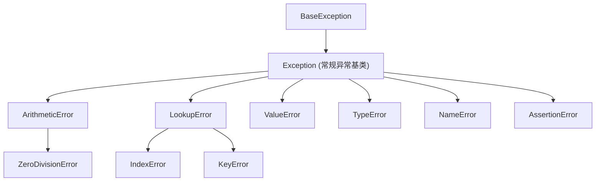
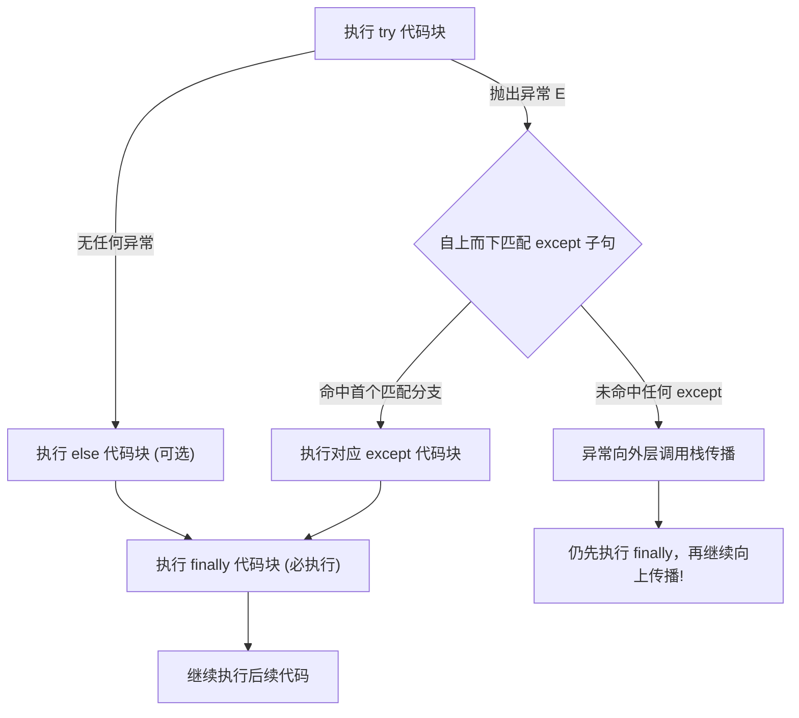

# L13 异常处理与断言（Exceptions & Assertions）

%% learning-vault-navigation:v1 %%
> [!abstract]- 笔记导航
> 目录：[[CS Learning/Python MIT6.100L/MIT Python导航|MIT Python 导航]]
> 上一章：[[CS Learning/Python MIT6.100L/Lecture 12 List Comprehension, Functions as Objects, Testing, Debugging/L12 列表推导、高阶函数与测试调试|L12 列表推导、高阶函数与测试调试]] · 下一章：[[CS Learning/Python MIT6.100L/Lecture 14 Dictionaries/L14 字典与哈希映射（Dictionaries）|L14 字典与哈希映射（Dictionaries）]]

> [!abstract] 本讲核心概览
> 本讲（MIT 6.100L Lecture 13）聚焦**防御性编程（Defensive Programming）**的两大语言机制：==异常处理（Exceptions）==与==断言（Assertions）==。内容涵盖 Python 常见内建异常类型与层级、`try / except / else / finally` 完整执行流、主动抛出异常 `raise` 与“避免静默失败”、`assert` 契约校验机制，以及通过“学生成绩均值统计（`get_stats` + `avg1~4`）”对比四种错误处理策略的工程取舍。

---

## 1. 意外条件与 Python 常见内建异常

当程序在运行期遇到不符合预期的状态（如用户输入字母而非数字、除数为 0、索引越界）时，Python 会抛出（raise）一个**异常对象（Exception）**。若未被捕获，程序将立即终止并打印异常类型与堆栈信息。

| 异常类型 | 触发原因 | 典型例子 |
| --- | --- | --- |
| `SyntaxError` | 语法错误（解析期触发，无法被同块 `try` 捕获） | `a = len([1, 2, 3]`（缺右括号） |
| `NameError` | 访问未定义的变量名 | `print(undefined_var)` |
| `IndexError` | 序列索引超出合法范围 | `test = [1, 7, 4]; test[4]` |
| `TypeError` | 对不支持的类型执行操作或类型混用 | `int([1, 7, 4])`、`'a' / 4` |
| `ValueError` | 类型正确但值不合法 | `int('abc')`、`L.remove(not_found)` |
| `ZeroDivisionError` | 除法或取模运算的分母为 0 | `10 / 0` |
| `KeyError` | 访问字典中不存在的键（见 [[CS Learning/Python MIT6.100L/Lecture 14 Dictionaries/L14 字典与哈希映射（Dictionaries）\|L14]]） | `d['missing']` |
| `AssertionError` | `assert` 断言条件求值为 `False` | `assert len(s) != 0, "s is empty"` |



---

## 2. 异常捕获：`try / except / else / finally` 完整流程

使用 `try / except` 可以拦截指定异常并接管控制流，避免程序非预期崩溃；针对不同异常类型可编写多个独立的 `except` 分支。

```python
try:
    a = int(input("Tell me one number: "))
    b = int(input("Tell me another number: "))
    print("a/b =", a / b)
    print("a+b =", a + b)
except ValueError:
    print("Could not convert to a number.")
except ZeroDivisionError:
    print("Can't divide by zero")
    print("a/b = infinity")
    print("a+b =", a + b)
except:
    print("Something went very wrong.")
else:
    print("Everything succeeded with no exceptions!")
finally:
    print("Cleanup always runs (e.g. close files).")
```

### 控制流图与各子句职责



- **精确匹配优先**：按从具体到宽泛的顺序编写 `except` 子句；应优先捕获特定异常（如 `ValueError`、`ZeroDivisionError`），尽量避免不加区分的裸 `except:` 吞掉真正的编程 Bug（如 `NameError`）。
- **`else` 子句**：仅在 `try` 块**完全无异常**结束时运行，适合放“依赖 `try` 成功但本身不想被同一组 `except` 误捕”的后续逻辑。
- **`finally` 子句**：无论 `try` 是否成功、是否触发 `except`、甚至里面执行了 `return` / `break` / `continue` 或抛出了新异常，==`finally` 都保证一定会执行==，最常用于释放外部资源（如关闭文件句柄、断开网络连接）。

---

## 3. 遇到异常时的三种应对策略与 `raise`

当函数遇到非法状态时，程序员有三种选择（Lecture 13 Slide 9）：

| 策略 | 做法 | 评价与风险 |
| --- | --- | --- |
| **1. 静默失败（Fail Silently）** | 用默认值顶替或直接跳过继续执行 | **极差！** 用户与调用方得不到任何警告，错误数据悄悄污染下游计算 |
| **2. 返回特殊错误码** | 例如返回 `-1` 或 `None` | **较繁琐**：什么值才能保证不与合法结果冲突？且每个调用点都必须层层写 `if res is None:` 检查 |
| **3. 主动抛出异常（`raise`）** | `raise ValueError("清晰错误信息")` | **推荐！** 立即中止当前错误计算，向上层显式发出故障信号，彻底阻断坏结果传播 |

### 课堂演变案例：`sum_digits(s)` 的四层防御升级
在 `mit6_100l_f22_lec13_code.py` 中，同一个“求字符串中数字字符之和”函数经历了四步演化：
1. **朴素条件判断**（`if char in '0123456789'`）：忽略非数字字符。
2. **`try / except` 打印警告并跳过**：发现错误但不中断，返回部分和。
3. **捕获并 `raise ValueError("string contained a character")`**：主动将底层转换异常包装成语义清晰的 `ValueError`，拒绝传播脏结果。
4. **入口加 `assert len(s) != 0, "s is empty"`**：先用断言检验前置条件（非空字符串），再用 `try / raise` 处理字符合法性。

---

## 4. 断言（Assertions）：防御性编程的“契约卫士”

```python
assert <必须为真的布尔表达式>, "断言失败时的提示信息"
```

- 若条件为 `True`，`assert` 什么都不做，程序继续执行。
- 若条件为 `False`，立即抛出 `AssertionError` 并附带提示信息，**强制终止执行**。
- 与 `try/except` 不同，断言**不提供恢复控制流的能力**；它的目标是在 Bug 刚出现的现场第一时间拉响警报，防止错误状态向下游扩散而难以追踪。

### 经典案例对比：成绩统计 `get_stats(class_list, avg_func)`
当学生列表出现某位无成绩学生（`[['deadpool'], []]`）时，通过向 `get_stats` 传入不同版本的 `avg_func` 展示了四种策略：

| 版本 | 实现方式 | 遇到 `grades = []` 时的结果 | 工程语义 |
| --- | --- | --- | --- |
| `avg1` | `return sum(grades) / len(grades)` | 直接崩溃：`ZeroDivisionError` | 未做防御 |
| `avg2` | `except ZeroDivisionError: print('warning...')` | 打印警告，函数隐式返回 `None`（结果中混入 `None`） | 标记缺失但继续生成报表（下游需兼容 `None`） |
| `avg3` | `except ZeroDivisionError: print(...); return 0.0` | 打印警告，按业务规则记 `0.0` 分 | **显式修改业务策略**（无成绩视作 0 分） |
| `avg4` | `assert len(grades) != 0, 'no grades data'` | 立即抛出 `AssertionError` 停止整个统计 | **严格契约检查**（不允许脏数据进入统计流程） |

> [!important] 什么时候用 `assert`，什么时候用 `Exception`？（Lecture 13 Slide 23）
> - **使用 `try / except / raise`（异常处理）**：处理**外部不可控输入**或运行期可预见的异常状况（用户输入错误、文件不存在、除零、接口输入不合法），需要向调用方报告错误或在不崩溃的前提下优雅恢复。
> - **使用 `assert`（断言）**：作为**程序员之间的内部契约与测试补充**，用于校验：
>   1. 函数前置条件（参数类型、非空、长度一致等）；
>   2. 数据结构不变量（Invariants，例如“列表已排序”“无重复元素”）；
>   3. 函数后置条件（检查返回值满足约束，防止把错误结果传出去）。

---

## 5. 课堂代码、作业与 Finger Exercise 复盘

### 5.1 `pairwise_div(Lnum, Ldenom)`（`homework.py` & `lec13_code.py`）
你在 `homework.py` 与课堂练习中将断言和异常完美结合：

```python
def pairwise_div(Lnum, Ldenom):
    assert len(Lnum) == len(Ldenom) and len(Lnum) != 0
    L = []
    for i in range(len(Lnum)):
        try:
            L.append(Lnum[i] / Ldenom[i])
        except:
            raise ValueError
    return L
```

> [!tip] 进阶写法与细节提示
> - **结合列表推导式（挑战题）**：可以先做 `assert`，再用 `try: return [Lnum[i] / Ldenom[i] for i in range(len(Lnum))] except (ZeroDivisionError, TypeError): raise ValueError("cannot divide")`，既简洁又比裸 `except:` 更精准！
> - **细心观察官方代码中的一个小笔误**：`mit6_100l_f22_lec13_code.py` 第 1 个参考答案（第 229 行）误把形参 `Ldenom` 写成了全局变量 `if 0 in L2:`，这再次印证了 L10 Rec05 中的教训——函数体内切勿引用外部测试变量名。

### 5.2 Finger Exercise 13：`sum_str_lengths(L)`（`mit6_100l_f22_ex13.py`）
题目要求统计非空列表 `L` 中所有顶层字符串及一层子列表中字符串的总长度；若顶层元素不是 `str`/`list`，或子列表中存在非 `str` 元素，则 `raise ValueError`。
- 你的实现逻辑与官方参考答案完全一致，结构清晰地覆盖了外层与内层的类型校验；若需进一步满足规约中的“non-empty list / non-empty sublist”，还可以补充 `assert len(L) > 0`（或针对空子列表校验）。

---

## 6. 自测检验

> [!question]- 自测 1：在 `try` 块中执行了 `return 42`，那么紧随其后的 `finally` 块还会执行吗？
> **会执行！** Python 保证在函数真正把控制权和返回值交还给调用方之前，必定先执行 `finally` 块中的清理语句。

> [!question]- 自测 2：为什么不建议到处写裸的 `except:` 来捕获所有异常？
> 裸 `except:` 会把**真正的编程错误**（如拼错变量名引发的 `NameError`、键盘中断 `KeyboardInterrupt`）一并吞掉并掩盖成普通业务错误，极大增加调试难度。应当显式指明预期处理的异常类型（如 `except (ValueError, ZeroDivisionError):`）。

---

## 7. 配套资料

| 资料名称 | 说明 | 仓库路径 |
| --- | --- | --- |
| Lecture 13 课件 | 异常捕获流程、`raise` 策略、断言与成绩案例对比 | [[CS Learning/Python MIT6.100L/Lecture 13 Exceptions, Assertions/mit6_100l_f22_lec13.pdf\|mit6_100l_f22_lec13.pdf]] |
| Lecture 13 课堂代码 | `sum_digits` 四版本、`divide_nums`、`pairwise_div` 与 `avg1~4` | [[CS Learning/Python MIT6.100L/Lecture 13 Exceptions, Assertions/mit6_100l_f22_lec13_code.py\|mit6_100l_f22_lec13_code.py]] |
| 课后作业代码 | `pairwise_div` 断言 + 异常实现 | [[CS Learning/Python MIT6.100L/Lecture 13 Exceptions, Assertions/homework.py\|homework.py]] |
| Finger Exercise 13 | `sum_str_lengths(L)` 类型校验与 `ValueError` | [[CS Learning/Python MIT6.100L/Lecture 13 Exceptions, Assertions/mit6_100l_f22_ex13.py\|mit6_100l_f22_ex13.py]] · [[CS Learning/Python MIT6.100L/Lecture 13 Exceptions, Assertions/mit6_100l_f22_ex13_sol.pdf\|官方解答 PDF]] |
