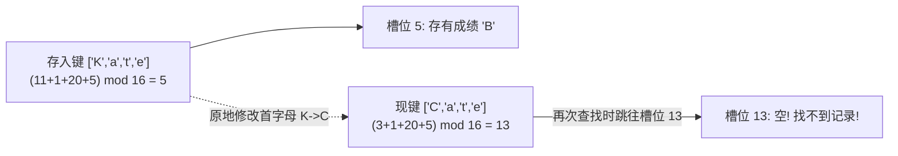

# L14 字典与哈希映射（Dictionaries）

%% learning-vault-navigation:v1 %%
> [!abstract]- 笔记导航
> 目录：[[CS Learning/Python MIT6.100L/MIT Python导航|MIT Python 导航]]
> 上一章：[[CS Learning/Python MIT6.100L/Lecture 13 Exceptions, Assertions/L13 异常处理与断言（Exceptions & Assertions）|L13 异常处理与断言（Exceptions & Assertions）]] · 下一章：[[CS Learning/Python MIT6.100L/Lecture 15 Recursion/L15 递归基础（Recursion）|L15 递归基础（Recursion）]]

> [!abstract] 本讲核心概览
> 本讲（MIT 6.100L Lecture 14）系统引入 Python 最核心的关联容器——==字典（`dict`）==。内容涵盖为何用字典取代“平行列表”和嵌套列表、键值对增删改查与视图迭代（`.keys()` / `.values()` / `.items()`）、**键必须不可变/可哈希（Hashable）的底层哈希表原理**、嵌套字典结构，以及完整实战案例——**歌词词频统计与高频词提取**（并为 [[CS Learning/Python MIT6.100L/Lecture 16 Recursion on Non-Numerics/L16 非数值对象的递归|L16 记忆化递归]] 奠定数据结构基础）。

---

## 1. 为什么需要字典？从“平行列表”到键值映射

如果用多个平行列表（`names`、`grades`、`microquizzes`、`psets`）或嵌套列表存储学生成绩，存在三大痛点：
1. 必须手动维持多个列表间的下标同步，增删任意一人容易错位；
2. 只能通过整数下标访问，想按姓名查找必须先做 $O(n)$ 线性扫描 `name_list.index(student)`；
3. 嵌套列表多层遍历代码冗长且难以维护。

**字典（Dictionary）** 将数据组织为**键-值对（`key: value`）**的集合，支持通过任意有意义的键直接索引对应的值：

> [!important] Big Idea：直接索引，无需循环
> 1. **“Dict value”** 指与某个 key 关联的值，不要与普通变量的值混淆。
> 2. **Getting a dict value is just a matter of indexing with a key — No. Need. To. Loop.**（平均时间复杂度 $O(1)$）。

### `list` vs `dict` 核心对比

| 特性 | 列表（`list`） | 字典（`dict`） |
| --- | --- | --- |
| 组织方式 | 有序元素序列 | 键到值的映射表（`key -> value`） |
| 索引类型 | 仅限连续整数下标 `0, 1, 2, ...` | **任意可哈希（不可变）类型**（`str`, `int`, `tuple` 等） |
| 元素顺序 | 严格按位置有序 | 逻辑上视为无序映射（课程原则：不要依赖顺序） |
| 查找复杂度 | 按值查找 $O(n)$；按下标 $O(1)$ | 按键查找平均 **$O(1)$** |
| 反向查找 | — | 没有内建的“按 value 反查 key”快捷语法（因 value 允许重复） |

---

## 2. 字典常用操作速查

```python
grades = {'Ana': 'B', 'Matt': 'A', 'John': 'B', 'Katy': 'A'}

grades['John']          # 查找 -> 'B'；键不存在则抛出 KeyError
grades['Grace'] = 'A'   # 新增条目
grades['Grace'] = 'C'   # 修改已有键的值（键唯一，覆盖旧值）
del(grades['Ana'])      # 删除条目（原地修改）

'John' in grades        # True（仅测试键！平均 O(1)）
'B' in grades           # False（'B' 是 value 不是 key！）
```

### 遍历与视图对象（`.keys()` / `.values()` / `.items()`）

| 方法 | 返回类型 | 典型用法 | 说明 |
| --- | --- | --- | --- |
| `for k in d:` | 遍历键 | `if k in d:` | Rec07 强调：成员测试直接写 `k in d`，无需写 `k in list(d.keys())` |
| `d.keys()` | `dict_keys` 视图 | `list(d.keys())` | 类元组的可迭代视图，包含所有键 |
| `d.values()` | `dict_values` 视图 | `max(d.values())` | 包含所有值（可含重复项）；`v in d.values()` 为 $O(n)$ 线性查找 |
| `d.items()` | `dict_items` 视图 | `for k, v in d.items():` | **最常用遍历方式**：一次解包 `(key, value)` 元组 |
| `d.copy()` | 新 `dict` | `d2 = d.copy()` | 字典同样是**可变对象**，`d2 = d` 只是别名，`d.copy()` 才是浅拷贝 |

---

## 3. 为什么字典的键必须不可变/可哈希？（Hash Table 原理）

### 键与值的类型约束
- **Value（值）**：可以是**任意 Python 对象**（可变或不可变，如 `list`、嵌套 `dict`），且允许重复。
- **Key（键）**：必须**唯一（Unique）**且**可哈希（Hashable）**。在基础阶段可等价理解为不可变类型：`int`、`str`、`bool`、`tuple`（且元组内部元素也必须全不可变）。
  - 注意：尽量避免使用 `float` 作为字典键，因浮点精度误差可能导致预期相同的键无法命中（如 `0.1 + 0.2 != 0.3`）。

### 哈希定位原理与“可变键灾难”（Lecture 14 Slides 18–20）

字典底层通过**哈希函数（Hash Function）**将键映射为整数槽位（内存数组下标），直接在该位置存取对应的值。
假设一个玩具哈希函数为：把名字各字母在字母表中的序号相加，再对槽位数 $16$ 取模：

- `"Ana"` $\rightarrow (1 + 14 + 1) \bmod 16 = 0$，存入槽位 `0`；
- `"Eric"` $\rightarrow (5 + 18 + 9 + 3) \bmod 16 = 3$，存入槽位 `3`；
- `"John"` $\rightarrow (10 + 15 + 8 + 14) \bmod 16 = 15$，存入槽位 `15`。

**假如允许可变列表作为键会发生什么？**



如果把列表 `['K','a','t','e']` 作为键存入槽位 `5`，之后外部将其原地修改为 `['C','a','t','e']`，再次用它查表时哈希值变成了 `13`，去槽位 `13` 查找将一无所获，而原记录永远遗失在槽位 `5`！因此 Python 禁止将 `list`、`dict` 等可变对象作为键，尝试插入会立即抛出 `TypeError: unhashable type: 'list'`。

---

## 4. 嵌套字典与典型应用模式

### 4.1 多层嵌套字典（Structured Records）
```python
grades = {
    'Ana': {'mq': [5, 4, 4], 'ps': [10, 9, 9], 'fin': 'B'},
    'Bob': {'mq': [6, 7, 8], 'ps': [8, 9, 10], 'fin': 'A'},
}
grades['Ana']['mq'][0]   # -> 5（外层 dict -> 内层 dict -> list 索引）
```

> [!example] 课堂选择题复盘（Slide 25：`get_average(data, what)`）
> 给定 `my_d = {'Ana': {'mq': [10], 'ps': [10, 10]}, ...}`，想收集所有学生的 `'mq'` 分数列表求均值，循环体内应选 **A**：
> - **正确 A**：`all_data = all_data + data[stud][what]`（或 `all_data.extend(data[stud][what])`），将每个学生的分数列表**展平拼接**到 `all_data`。
> - 错误 B：`all_data.append(...)` 会造出嵌套列表 `[[10], [8], [3]]`，导致 `sum(all_data)` 报 `TypeError`。
> - 错误 C/D：`data[stud[what]]` 把字符串 `stud` 当成了字典去索引。

### 4.2 实战模式一：词频统计与分层提取（Song Lyrics 案例）
字典最经典的两大算法用途是**频次统计（Frequency Counting）**与**记忆化缓存（Memoization，将在 [[CS Learning/Python MIT6.100L/Lecture 16 Recursion on Non-Numerics/L16 非数值对象的递归|L16]] 配合递归大显身手）**。

课堂歌词分析由三个模块化函数组成：
1. **`generate_word_dict(song)`**：`str -> lower() -> split()` 后遍历计数（若 `w in word_dict` 则 `+= 1`，否则初始化为 `1`）。
2. **`find_frequent_word(word_dict)`**：先用 `highest = max(word_dict.values())` 找最高频次，再遍历 `.items()` 收集所有并列最高频的词，返回 `(words_list, highest)`。
3. **`occurs_often(word_dict, x)`**：利用字典的**可变性**，在 `while` 循环中反复调用 `find_frequent_word`，记录当前最高频组并用 `del(word_dict[word])` 从字典中剥离，直到剩余最高频次 $\le x$。

> [!warning] `occurs_often` 的两个工程细节提醒
> 1. **副作用警告**：`occurs_often` 直接 `del` 原字典条目，调用后会破坏调用方的 `word_dict`！若不希望破坏原数据，应先 `d = word_dict.copy()`。
> 2. **空字典边界**：当阈值 `x = 0` 时，删空字典后再次调用 `find_frequent_word` 执行 `max(word_dict.values())` 会抛出 `ValueError`；实际工程中循环条件应加 `while word_dict:` 保护，并且把更新判断放在循环末尾避免首次重复调用。

---

## 5. 作业、Finger Exercise 与 Rec07 复盘

### 5.1 `homework.py` 深度复盘：`is_inverse` 与 `add_to_d`
- **`add_to_d(d, L)`**：遍历元组列表 `L`，若键 `t[0]` 不在 `d` 中则插入 `d[t[0]] = t[1]`；用 `try / except` 捕获插入不可哈希键（如 `([1, 2, 3], 5)`）引发的 `TypeError` 并转换为 `raise ValueError`，实现干净利落。
- **`is_inverse(d1, d2)` 的一个微妙逻辑陷阱**：

> [!warning] 思考题：`is_inverse` 的“集合匹配” vs “严格一一逆映射”
> 在 `homework.py`（以及官方参考答案）中，`is_inverse(d1, d2)` 检查了 `d1` 的所有 key 是否都在 `d2.values()` 且所有 value 是否都在 `d2.keys()`（反之亦然）。
> 请考虑反例：`d1 = {1: 2, 3: 4}` 与 `d2 = {2: 3, 4: 1}`！
> - 按“集合包含”检查会返回 `True`（因为键集合与值集合确实互换了）；
> - 但作为数学意义上的**严格逆映射**（$d_2[d_1[k]] = k$），$d_1[1] = 2$ 而 $d_2[2] = 3 \neq 1$，应当返回 `False`！
> - 更严谨且更高效（$O(n)$ 而非 $O(n^2)$，避免了反复线性扫描 `.values()`）的严格逆映射写法为：
>   ```python
>   def is_strict_inverse(d1, d2):
>       if len(d1) != len(d2):
>           return False
>       return all(v in d2 and d2[v] == k for k, v in d1.items())
>   ```

### 5.2 Finger Exercise 14 与 Rec07 亮点
- **`mit6_100l_f22_ex14.py`**：`keys_with_value(aDict, target)` 与 `all_positive(d)` 均通过 `for k, v in d.items()` 筛选并 `return sorted(out)`，简洁准确（也可用列表推导式一行写成 `sorted([k for k, v in d.items() if sum(v) > 0])`）。
- **`R07_problems.py`**：四道字典实战题全部完成无误，尤其是 Problem 3 `dict_to_sorted_list` 用 `sorted(out, key=lambda x: x[1], reverse=True)` 按值降序排序，以及 Problem 4 `combine_dicts` 对字典列表按 `'item'` 聚合累加 `'amount'`（非常贴近真实 JSON/日志数据处理场景）。

---

## 6. 自测检验

> [!question]- 自测 1：元组 `(1, [2, 3])` 可以作为 Python 字典的键吗？为什么？
> **不可以！** 虽然外层 `tuple` 本身不可变，但它内部包含了一个可变的 `list` 元素 `[2, 3]`，整体不再可哈希（`hash((1, [2, 3]))` 会抛出 `TypeError: unhashable type: 'list'`）。只有当元组自身及其所有嵌套元素均不可变时，才能作为字典键。

> [!question]- 自测 2：检查元素是否存在时，`x in my_dict` 和 `x in my_list` 在性能上有何差异？
> - `x in my_dict` 通过哈希函数直接定位内存槽位，平均时间复杂度为 **$O(1)$**（常数时间，与字典规模几乎无关）。
> - `x in my_list`（以及 `x in my_dict.values()`）需要从头到尾逐个比对，时间复杂度为 **$O(n)$**（线性时间）。

---

## 7. 配套资料

| 资料名称 | 说明 | 仓库路径 |
| --- | --- | --- |
| Lecture 14 课件 | 字典操作、哈希原理图解、嵌套字典与歌词词频案例 | [[CS Learning/Python MIT6.100L/Lecture 14 Dictionaries/mit6_100l_f22_lec14.pdf\|mit6_100l_f22_lec14.pdf]] |
| Lecture 14 课堂代码 | 平行列表对比、You Try It 与流行歌曲词频分析 | [[CS Learning/Python MIT6.100L/Lecture 14 Dictionaries/mit6_100l_f22_lec14_code.py\|mit6_100l_f22_lec14_code.py]] |
| 课后作业代码 | `is_inverse` 与 `add_to_d` | [[CS Learning/Python MIT6.100L/Lecture 14 Dictionaries/homework.py\|homework.py]] |
| Finger Exercise 14 | `keys_with_value` 与 `all_positive` 练习与解答 | [[CS Learning/Python MIT6.100L/Lecture 14 Dictionaries/mit6_100l_f22_ex14.py\|mit6_100l_f22_ex14.py]] · [[CS Learning/Python MIT6.100L/Lecture 14 Dictionaries/mit6_100l_f22_ex14_sol.pdf\|官方解答 PDF]] |
| Recitation 07 总结与习题 | L13/L14 复习总结与 4 道字典聚合/排序题 | [[CS Learning/Python MIT6.100L/Lecture 14 Dictionaries/mit6_100l_f22_rec07/1_rec7/R07_summary.pdf\|R07_summary.pdf]] · [[CS Learning/Python MIT6.100L/Lecture 14 Dictionaries/mit6_100l_f22_rec07/1_rec7/R07_problems.py\|R07_problems.py]] · [[CS Learning/Python MIT6.100L/Lecture 14 Dictionaries/mit6_100l_f22_rec07/1_rec7/R07_solutions.py\|R07_solutions.py]] |
