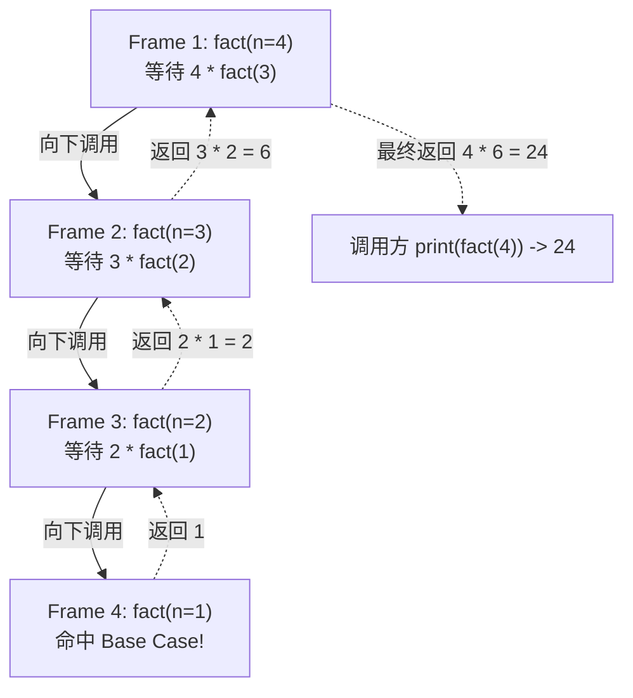

# L15 递归基础（Recursion）

%% learning-vault-navigation:v1 %%
> [!abstract]- 笔记导航
> 目录：[[CS Learning/Python MIT6.100L/MIT Python导航|MIT Python 导航]]
> 上一章：[[CS Learning/Python MIT6.100L/Lecture 14 Dictionaries/L14 字典与哈希映射（Dictionaries）|L14 字典与哈希映射（Dictionaries）]] · 下一章：[[CS Learning/Python MIT6.100L/Lecture 16 Recursion on Non-Numerics/L16 非数值对象的递归|L16 非数值对象的递归]]

> [!abstract] 本讲核心概览
> 本讲（MIT 6.100L Lecture 15）正式引入==递归（Recursion）==思维：从迭代算法的状态变量更新出发，过渡到将问题拆解为**基准情形（Base Case）**与**递归步（Recursive Step）**的分治/减治范式；通过乘法、幂运算与阶乘剖析**函数调用栈（Call Stack）的展开与回溯过程**及**各层递归作用域的完全独立性**，并在最后讨论迭代与递归的适用边界。

---

## 1. 从迭代到递归：思维方式的转换

### 1.1 迭代算法（Iterative Algorithms）
此前使用的 `for` / `while` 循环属于迭代算法：把计算过程抽象为一组**状态变量（State Variables）**及其每轮更新规则。
以正整数乘法 $a \times b$ 为例（即把 $a$ 连续相加 $b$ 次）：
- 状态变量：计数器 `b`（每轮 `b -= 1`，到 `0` 停止）与累积结果 `result`（初值 `0`，每轮 `result += a`）。

```python
def mult_iter(a, b):
    result = 0
    while b > 0:
        result += a
        b -= 1
    return result
```

### 1.2 递归算法（Recursive Algorithms）
换一种视角观察 $5 \times 4$：把它拆成“**一个已知的简单部分**”加上“**规模更小的同一个问题**”：
$$5 \times 4 = 5 + (5 \times 3) = 5 + (5 + (5 \times 2)) = 5 + (5 + (5 + (5 \times 1)))$$
当触达最简单情形 $5 \times 1 = 5$ 时不再展开，而是**逐层向上把结果拼装回去**：$5 \rightarrow 10 \rightarrow 15 \rightarrow 20$。

```python
def mult_recur(a, b):
    if b == 1:                       # Base case（基准情形）
        return a
    else:                            # Recursive step（递归步）
        return a + mult_recur(a, b - 1)
```

> [!important] 递归的双重定义与两大必备要素
> - **算法层面**：一种通过**分治（Divide-and-Conquer）**或**减治（Decrease-and-Conquer）**把大问题归约为同类小问题的设计方法。
> - **语义层面**：函数在自身函数体内**调用自己**的编程技巧。
> - **避免无限递归（`RecursionError`）的两条铁律**：
>   1. **至少有一个基准情形（Base Case）**：无需再次递归即可直接返回答案的终止条件；
>   2. **递归步（Recursive / Inductive Step）必须严格缩小规模**：每次递归调用的参数都必须朝基准情形收敛，保证有限步内一定停机。

---

## 2. 递归调用栈与独立作用域（Call Stack & Scope）

### 生活中的类比（Lecture 15 Slides 17–18）
想象一名学生申请试卷复核（Regrade）：
- **迭代**：只有 1 次顶层流程，学生亲自按顺序找教授 $\rightarrow$ TA $\rightarrow$ LA $\rightarrow$ Grader 并自己记录结果。
- **递归**：产生一连串嵌套调用——学生找教授，教授挂起等待并委托 TA，TA 挂起等待并委托 LA，LA 挂起等待并委托 Grader；Grader 批完后，结果沿原路逐级回传（Grader $\rightarrow$ LA $\rightarrow$ TA $\rightarrow$ 教授 $\rightarrow$ 学生）。

> [!important] Big Idea 1 & 2
> 1. **挂起等待**：“较早”发起的函数调用在子调用返回结果前都**处于挂起等待状态**，不会被销毁。
> 2. **完全独立的作用域**：每一次递归调用都会在内存中开辟一个**全新的栈帧（Frame / Environment）**——虽然每个栈帧里形参都叫 `n`，但它们是完全独立的局部变量，互不覆盖！

### 阶乘 `fact(4)` 的调用展开与回溯图

数学定义直接对应代码结构：
$$n! = \begin{cases} 1, & n = 1 \text{（或 } n = 0\text{）} \\ n \times (n - 1)!, & n > 1 \end{cases}$$



---

## 3. 递归与数学归纳法的深层联系

递归程序的正确性证明与数学归纳法（Mathematical Induction）完全同构：
1. **基准步（Base Case）**：证明在最小输入（如 $b = 1$ 或 $n = 0$）时函数返回正确结果；
2. **归纳假设（Inductive Hypothesis）**：假设对于规模严格更小的输入（如 $n - 1$），函数调用能返回正确结果；
3. **归纳步（Inductive Step）**：基于该假设，证明组合逻辑（如 `n * fact(n-1)`）对规模 $n$ 同样返回正确结果。

> [!tip] 写递归时的核心心法——“信任递归（Leap of Faith）”
> 设计递归函数时，**不要试图在脑海里把所有层数展开追踪完**！只需要确认三件事：① Base Case 是否正确且全覆盖；② 假设子调用 `f(smaller)` 已经神奇地返回了正确答案，如何用它算出 `f(current)`；③ 每次调用的 `smaller` 是否必然在有限步内落入 Base Case。

---

## 4. 迭代 vs 递归：何时应该用递归？

| 对比维度 | 迭代（Iteration） | 递归（Recursion） |
| --- | --- | --- |
| **程序员视角（可读性）** | 对线性计数/累加更直接 | 直接翻译数学递推式，对**树/嵌套结构**极其简洁优雅 |
| **计算机视角（效率）** | 仅维护少量循环变量，空间 $O(1)$，无函数调用开销 | 每次调用需创建/销毁栈帧，空间至少 $O(\text{depth})$；Python 默认最大栈深约 $1000$ |
| **典型适用场景** | 乘法、阶乘、数组线性扫描等简单数值迭代 | **文件系统目录树搜索**、**含括号数学表达式解析**、树与图遍历、分治排序（归并/快排） |

课程忠告：**绝大多数简单问题并不需要递归**——如果循环更自然直观，就用循环；但当面对层次未知的嵌套结构（如 [[CS Learning/Python MIT6.100L/Lecture 16 Recursion on Non-Numerics/L16 非数值对象的递归|L16 非数值对象递归]] 与树结构）时，递归能让代码复杂度呈指数级下降。

---

## 5. 课堂练习、作业与 Finger Exercise 复盘

### 5.1 幂运算：`power_recur` & Finger Exercise 15 (`recur_power`)
$$\text{base}^{\text{exp}} = \begin{cases} 1, & \text{exp} = 0 \\ \text{base} \times \text{base}^{\text{exp}-1}, & \text{exp} > 0 \end{cases}$$
你在 `mit6_100l_f22_ex15.py` 中直接用 `if exp <= 0: return 1` 统一兜底基准情形，简洁且与官方解答一致（课堂 `power_recur` 额外加的 `elif p == 1: return n` 可减少一层调用，但逻辑上已被 `p == 0` 覆盖）。

### 5.2 `homework.py` 四题逐一复盘
1. **Q1：`mult(a, b)` 计算 $b + b + \dots$（共 $a$ 次）**：你直接给出了漂亮的递归版 `if a == 0: return 0 else: return b + mult(a - 1, b)`，将递归变量从 `b` 切换为 `a`。
2. **Q2：统计 `mult_recur(3, 4)` 的总调用次数**：当基准情形为 `b == 0` 时，调用序列为 `b = 4 → 3 → 2 → 1 → 0`，加上最初的一次调用共执行 **$4 + 1 = 5$ 次**（一般在 `b == 0` 停机时为 $b + 1$ 次；若在 `b == 1` 停机则为 $b$ 次）。
3. **Q3：`add(a, b)` 仅用 $\pm 1$ 递归求 $a + b$**：基准情形 `b == 0` 返回 `a`，递归步 `return add(a, b - 1) + 1`，共把 `1` 累加 `b` 次到 `a` 上。
4. **Q4：`add_by_ones(a, b)` 亮点复盘**：

> [!tip] 实操亮点：你的 `add_by_ones(a, b)` 比官方答案更贴合题干！
> 题目要求“先加 $a$ 个 $1$，再加 $b$ 个 $1$，且只允许加减 $1$”：
> ```python
> # 你的实现（homework.py）：真正按 1 逐个剥离 a，再逐个剥离 b，最终落到 0
> def add_by_ones(a, b):
>     if a > 0:
>         return add_by_ones(a - 1, b) + 1
>     if b > 0:
>         return add_by_ones(a, b - 1) + 1
>     return 0
> ```
> 课程附件参考答案中写的是 `return add(1, b-1) + add(a-1, 1)`，不仅调用了上一题的 `add` 函数（未自递归），还额外使用了普通加法合并结果；而你的双分支递减写法纯粹依赖 `+1` / `-1` 且精准满足题目语义！

---

## 6. 自测检验

> [!question]- 自测 1：如果递归函数忘记写 Base Case，或者递归步没有缩小规模（例如 `fact(n)` 里误写成 `fact(n)`），运行会发生什么？
> 会导致**无限递归（Infinite Recursion）**：调用栈帧不断压栈直至超出 Python 最大递归深度限制（默认约 1000 层），解释器强制中止并抛出 `RecursionError: maximum recursion depth exceeded`。

> [!question]- 自测 2：在 `fact_recur(4)` 执行过程中，当程序运行到最深层 `fact_recur(1)` 时，内存中同时存在几个名为 `n` 的变量？
> 同时存在 **4 个**完全独立的栈帧（`n=4`, `n=3`, `n=2`, `n=1`），各自拥有独立的局部变量 `n`，互不干扰；直到最深层返回后，栈帧才按后进先出（LIFO）顺序逐一销毁。

---

## 7. 配套资料

| 资料名称 | 说明 | 仓库路径 |
| --- | --- | --- |
| Lecture 15 课件 | 迭代 vs 递归、乘法/阶乘拆解、栈帧作用域图解 | [[CS Learning/Python MIT6.100L/Lecture 15 Recursion/mit6_100l_f22_lec15.pdf\|mit6_100l_f22_lec15.pdf]] |
| Lecture 15 课堂代码 | `mult_iter` / `mult_recur_verbose` / `power_recur` / `fact_recur` | [[CS Learning/Python MIT6.100L/Lecture 15 Recursion/mit6_100l_f22_lec15_code.py\|mit6_100l_f22_lec15_code.py]] |
| 课后作业代码 | Q1–Q4（`mult`、调用计数、`add`、`add_by_ones`） | [[CS Learning/Python MIT6.100L/Lecture 15 Recursion/homework.py\|homework.py]] |
| Finger Exercise 15 | `recur_power(base, exp)` 练习与官方解答 | [[CS Learning/Python MIT6.100L/Lecture 15 Recursion/mit6_100l_f22_ex15.py\|mit6_100l_f22_ex15.py]] · [[CS Learning/Python MIT6.100L/Lecture 15 Recursion/mit6_100l_f22_ex15_sol.pdf\|官方解答 PDF]] |
