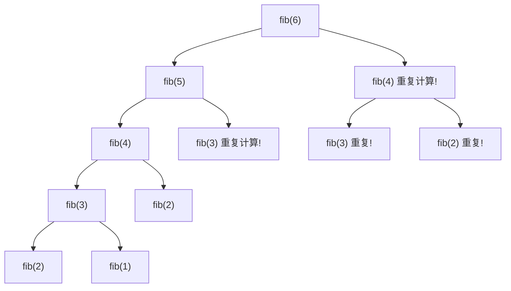

# L16 非数值对象的递归

%% learning-vault-navigation:v1 %%
> [!abstract]- 笔记导航
> 目录：[[CS Learning/Python MIT6.100L/MIT Python导航|MIT Python 导航]]
> 上一章：[[CS Learning/Python MIT6.100L/Lecture 15 Recursion/L15 递归基础（Recursion）|L15 递归基础（Recursion）]] · 下一章：[[CS Learning/Python MIT6.100L/Lecture 17 Python Classes/L17 Python 类与面向对象基础|L17 Python 类与面向对象基础]]

> [!abstract] 本讲核心概览
> 本讲（MIT 6.100L Lecture 16）将递归从单分支数值计算拓展到**多分支递归与记忆化（Memoization）**，并重点攻克==非数值有序序列与任意深度嵌套结构==的递归（列表、嵌套列表、字符串、元组及二叉树）。内容覆盖斐波那契数列重复计算瓶颈与字典缓存优化、篮球得分组合数、列表头尾拆解（`L[0]` + `L[1:]`）、递归返回类型一致性铁律、`deep_rev` / `flatten` / `my_deepcopy` 任意深度嵌套递归、汉诺塔，以及 **Recitation 08** 与 **Problem Set 4（二叉树递归 + 一次性密码本加密）** 深度复盘。

---

## 1. 多分支递归与记忆化优化（Fibonacci & Memoization）

### 1.1 朴素斐波那契数列的指数级冗余
兔子繁殖模型给出了带**两个基准情形**和**两次自调用**的递推关系：
$$F(1) = 1, \quad F(2) = 1, \quad F(n) = F(n - 1) + F(n - 2)\;\;(n \ge 3)$$

```python
def fib(x):
    if x == 1 or x == 2:
        return 1
    return fib(x - 1) + fib(x - 2)
```

观察 `fib(6)` 的调用树就会发现严重的**重叠子问题（Overlapping Subproblems）**：`fib(4)` 被算了 2 次，`fib(3)` 被算了 3 次，`fib(2)` 被算了 5 次！



### 1.2 结合 L14 字典实现记忆化（Memoization）
每次递归前先查字典 `d`：若已算过则直接 $O(1)$ 返回缓存值；否则递归计算并将结果写入 `d[n]` 供后续共享。

```python
def fib_efficient(n, d):
    if n in d:
        return d[n]
    else:
        ans = fib_efficient(n - 1, d) + fib_efficient(n - 2, d)
        d[n] = ans
        return ans

d = {1: 1, 2: 1}
fib_efficient(34, d)
```

| 指标（计算 `fib(34)`） | 朴素递归 `fib(34)` | 记忆化 `fib_efficient(34, d)` |
| --- | --- | --- |
| 递归调用总次数 | **11,405,773 次**（$O(\varphi^n)$ 指数级） | **65 次**（$O(n)$ 线性级） |
| 加速比 | 1× | **超过 175,000 倍！** |

> [!warning] 记忆化的前提条件（Lecture 16 Slide 9）
> 字典记忆化==仅适用于无副作用的纯函数（Pure Functions）==——即对同一输入参数，函数永远返回完全相同的结果，不依赖也不改变外部可变状态。

### 1.3 三分支递归扩展：篮球得分方式 `score_count(x)`
每次投篮可得 1、2 或 3 分，凑出总分 $x$ 的方案数（含 3 个基准情形 `1:1, 2:2, 3:3`）：
$$S(x) = S(x - 1) + S(x - 2) + S(x - 3)$$
在 `homework.py` Q1 中，你用同一套字典记忆化模板轻松实现了 `score_count(x, d)`。

---

## 2. 序列递归通用模板：头尾拆解（`L[0]` 与 `L[1:]`）

列表、字符串和元组都是**天然递归的数据结构**：任何非空序列都可以拆解为“**首个元素 `L[0]`**”与“**长度减 1 的剩余子序列 `L[1:]`**”。

| 问题 | Base Case | Recursive Step | 关键注意点 |
| --- | --- | --- | --- |
| 列表求和 `total_recur(L)` | `L == []` 返回 `0`（或 `len(L)==1` 返回 `L[0]`） | `L[0] + total_recur(L[1:])` | 空列表基例更通用，支持 `[]` 输入 |
| 字符串总长 `total_len_recur(L)` | `len(L) == 1` 返回 `len(L[0])` | `len(L[0]) + total_len_recur(L[1:])` | 基准与递归步均返回 `int` |
| 元素查找 `in_list(L, e)` | `len(L) == 0` 返回 `False`；`L[0] == e` 返回 `True` | `in_list(L[1:], e)` | **易错**：若递归步不先检查 `L[0] == e`，就只会检查最后一个元素！ |
| 单层展平 `flatten_1lvl(L)` | `len(L) == 1` 返回 `L[0]` | `L[0] + flatten_1lvl(L[1:])` | 用列表拼接 `+` 合并各子列表 |
| 顶层反转 `my_rev(L)` | `len(L) == 1` 返回 `L` | `my_rev(L[1:]) + [L[0]]` | 把 `L[0]` 包装成单元素列表 `[L[0]]` 拼到尾部 |

> [!important] Big Idea 1 & 2（Lecture 16 Slides 44 & 82）
> 1. **返回类型一致性铁律**：递归函数的==所有分支（每一个 Base Case 与 Recursive Step）必须返回相同类型的对象==！因为上层栈帧会直接用下层返回值参与运算（例如若基例返回 `[]` 而递归步做 `len(L[0]) + recur(...)`，运行期必然触发 `TypeError`）。
> 2. **序列通用性**：上述头尾切片递归思想对任何可索引有序序列（`list`、`str`、`tuple`）完全通用。

---

## 3. 递归真正的威力：任意深度嵌套结构（Arbitrary Nesting）

> [!note] 为什么循环搞不定任意深度的嵌套列表？（Zelda 迷失森林类比）
> - 当初之所以引入 `while` 循环取代无限嵌套的 `if/else`，是因为**事先不知道需要重复多少次**。
> - 如今面对“列表里套列表、子列表里还可能继续套任意层列表”的数据结构，用 `for` 循环根本不知道要写多少层嵌套 `for i / for j / for k ...`；而递归只需区分 **`type(elem) == list`（继续下钻）** 与 **非列表（直接处理）** 两种情况，就能以短短几行代码通吃任意深度！

### 三大任意深度嵌套列表模板对比

1. **深度反转 `deep_rev(L)`**（Lecture 16 Slide 81 精简版）：
   ```python
   def deep_rev(L):
       if L == []:
           return []
       elif type(L[0]) != list:
           return deep_rev(L[1:]) + [L[0]]
       else:
           return deep_rev(L[1:]) + [deep_rev(L[0])]   # 子列表自身也递归反转，再用 [] 保留嵌套层级!
   ```
2. **任意深度展平 `flatten(L)`**（Finger Exercise 16 `mit6_100l_f22_ex16.py`）：
   ```python
   def flatten(L):
       out = []
       for i in L:
           if type(i) == list:
               out.extend(flatten(i))   # 注意是 extend（展平），不是 append!
           else:
               out.append(i)
       return out
   ```
3. **手写递归深拷贝 `my_deepcopy(L)`**（`homework.py` Q3）：
   ```python
   def my_deepcopy(L):
       if len(L) == 0:
           return []
       elif type(L[0]) != list:
           return [L[0]] + my_deepcopy(L[1:])
       else:
           return [my_deepcopy(L[0])] + my_deepcopy(L[1:])
   ```
   对比 [[CS Learning/Python MIT6.100L/Lecture 11 Aliasing, Cloning/L11 别名与拷贝（Aliasing & Cloning）|L11]] 学的 `copy.deepcopy`，这正是其背后的递归本质！

### 拓展经典：汉诺塔（Towers of Hanoi）
将 $n$ 个圆盘从柱 `fr` 经由辅助柱 `spare` 移到 `to`：
1. 把上面 $n - 1$ 个盘从 `fr` 移到 `spare`；
2. 把最底下的第 $n$ 个盘直接从 `fr` 移到 `to`；
3. 把 `spare` 上的 $n - 1$ 个盘移到 `to`。
递推步数 $T(n) = 2T(n - 1) + 1$，闭式解为 $T(n) = 2^n - 1$。

---

## 4. 作业 Debug 与隐藏深坑复盘（`homework.py` Q4）

在 `homework.py` Q4 的三个改错题中，你修复了 `f`、`g`、`h` 的原始错误，同时有两处非常值得深入复盘的细节：

> [!warning] 两个极隐蔽的细节陷阱（其中第 2 个连官方答案都中招了！）
> 1. **`g(L, e)` 的返回类型一致性**：在 `len(L) == 1` 分支你写了 `return e == L[0]`（返回 `bool`），在 Python 里因为 `bool` 继承自 `int`（`True == 1`）所以 `1 + True` 碰巧算出了正确整数；但为严格遵守 Slide 44 的“所有分支返回相同类型”原则，应明确写成 `return 1`。
> 2. **`h(L, e)`（任意深度嵌套计数）的 `if e in L[0]:` 致命盲区**：
>    ```python
>    # homework.py 与课程官方参考答案中的写法：
>    elif type(L[0]) == list:
>        if e in L[0]:                      # BUG! in 只检查 L[0] 的顶层元素！
>            return h(L[0], e) + h(L[1:], e)
>        else:
>            return h(L[1:], e)
>    ```
>    测试 `h([[[1, 1]], 2], 1)`：`L[0]` 是 `[[1, 1]]`，而 `1 in [[1, 1]]` 为 **`False`**！于是整棵嵌套子列表被直接跳过，错误返回 `0` 而非 `2`！
>    **正确写法**：直接删去 `if e in L[0]:` 判断，无条件递归进入子列表：`return h(L[0], e) + h(L[1:], e)`。

---

## 5. 配套项目复盘：Problem Set 4 与 Recitation 08

### 5.1 PS4 Part A：二叉树递归（`ps4a.py` + `tree.py`）
二叉树由 `Node(value, left_child=None, right_child=None)` 递归定义（每棵子树本身又是一个 `Node` 对象；`tree.py` 中连 `__eq__` 都是递归比较左右子树的！）：

1. **求树高 `find_tree_height(tree)`**（树高定义为根到最远叶子的**边数**，单个叶子高度为 `0`）：
   - 你在 `ps4a.py` 中采用了极其优雅的空节点基例设计：
     ```python
     def find_tree_height(tree):
         if tree is None:
             return -1       # 妙处：叶子节点 max(-1, -1) + 1 恰好等于 0！
         return max(find_tree_height(tree.get_left_child()),
                    find_tree_height(tree.get_right_child())) + 1
     ```
2. **判断最大/最小堆 `is_heap(tree, compare_func)`**：
   - 将比较规则抽象为高阶函数 `compare_func(child_value, parent_value)`（最大堆为 `<`，最小堆为 `>`），用同一套递归逻辑同时支持两种堆！
   - 若某节点的左/右子节点存在，则必须同时满足：① `compare_func(child.val, parent.val)` 为真；② 该子树本身也是合法堆（由 `<` / `>` 的传递性，局部父子满足 + 子树为堆 $\Leftrightarrow$ 根为整棵子树最值）。

### 5.2 PS4 Part B & C：一次性密码本与 OOP 预演（`ps4b.py` & `ps4c.py`）
Part B/C 将列表、模运算与即将学习的 [[CS Learning/Python MIT6.100L/Lecture 17 Python Classes/L17 Python 类与面向对象基础|L17–L19 面向对象与继承]] 融为一体：
- **可打印 ASCII 环形移位（范围 $[32, 126]$，共 95 个字符）**：
  $$\text{shifted} = ((\text{ord}(c) - 32 + \text{shift}) \bmod 95) + 32$$
  利用 Python 中负数取模 `% 95` 恒落在 $[0, 94]$ 的性质，加密（正位移）与解密（负位移 `[-s for s in pad]`）复用同一个 `apply_pad` 方法！
- **面向对象封装与防御性拷贝**：
  - 类继承结构：`Message` $\rightarrow$ `PlaintextMessage`、`EncryptedMessage`（子类均用 `super().__init__(input_text)` 复用父类初始化）。
  - 在 `PlaintextMessage.__init__`、`get_pad()` 和 `change_pad()` 中，你都严格使用 `pad[:]` 保存和返回副本，彻底防止外部代码通过列表别名篡改内部密钥（呼应 [[CS Learning/Python MIT6.100L/Lecture 11 Aliasing, Cloning/L11 别名与拷贝（Aliasing & Cloning）|L11]]！）。
- **密文破解（`ps4c.py`）**：`decrypt_message_try_pads` 枚举候选密钥本，借助 `is_word` 统计合法英文词数量，用 `valid_word_count >= most_valid_words` 实现平局取最后一个匹配 pad，且全程通过 `plaintext_message.get_text()` 访问属性，确保可与官方 `ps4b` 实现无缝替换。

### 5.3 Recitation 08 经典递归题（`R08_problems.py`）
- 隔步等差和 `sum_series(n)`：$n + (n - 2) + \dots$（`n <= 0` 返回 `0`）。
- 调和级数 `harmonic(n)`：$H_n = \frac{1}{n} + H_{n-1}$，基例 `H_1 = 1`。
- **欧几里得最大公约数 `gcd(a, b)`**：基于 $\gcd(a, b) = \gcd(b, a \bmod b)$，基例 `b == 0` 返回 `a`，对数级收敛！

---

## 6. 自测检验

> [!question]- 自测 1：为什么在 `deep_rev(L)` 中，当 `L[0]` 是列表时要写 `deep_rev(L[1:]) + [deep_rev(L[0])]`，外层为什么要套一层方括号 `[...]`？
> 因为 `deep_rev(L[0])` 返回的是反转后的子列表（例如 `[2, 1]`）。如果直接写 `deep_rev(L[1:]) + deep_rev(L[0])`，`+` 会把 `[2, 1]` 拆开拼平，丢失原本的嵌套结构；套上 `[deep_rev(L[0])]` 才能把反转后的子列表作为一个整体元素放回外层列表中。

> [!question]- 自测 2：在 `ps4a.py` 的 `find_tree_height(tree)` 中，为什么给空子树 `None` 定义高度 `-1` 比定义 `0` 更方便？
> 按题面定义，树的高度是根到最远叶子的**边数**，单个叶子节点（左右孩子均为 `None`）的高度应为 `0`。令 `height(None) = -1` 后，叶子节点无需单独特判，直接套用递推式 `max(-1, -1) + 1 = 0` 即可自然得到正确结果，单分支节点（一边为空、一边有子树）同样统一成立。

---

## 7. 配套资料

| 资料名称 | 说明 | 仓库路径 |
| --- | --- | --- |
| Lecture 16 课件 | 斐波那契记忆化、序列递归、任意深度嵌套与 `deep_rev` | [[CS Learning/Python MIT6.100L/Lecture 16 Recursion on Non-Numerics/mit6_100l_f22_lec16.pdf\|mit6_100l_f22_lec16.pdf]] |
| Lecture 16 课堂代码 | 记忆化、序列查找/展平/反转与汉诺塔 | [[CS Learning/Python MIT6.100L/Lecture 16 Recursion on Non-Numerics/mit6_100l_f22_lec16_code.py\|mit6_100l_f22_lec16_code.py]] |
| 课后作业与 Finger Exercise | 记忆化得分、`my_deepcopy`、排错题与任意深度 `flatten` | [[CS Learning/Python MIT6.100L/Lecture 16 Recursion on Non-Numerics/homework.py\|homework.py]] · [[CS Learning/Python MIT6.100L/Lecture 16 Recursion on Non-Numerics/mit6_100l_f22_ex16.py\|mit6_100l_f22_ex16.py]] · [[CS Learning/Python MIT6.100L/Lecture 16 Recursion on Non-Numerics/mit6_100l_f22_ex16_sol.pdf\|官方解答 PDF]] |
| Problem Set 4（树与加密） | 题面 PDF、`Node` 树类、`ps4a/b/c` 个人实现 | [[CS Learning/Python MIT6.100L/Lecture 16 Recursion on Non-Numerics/mit6_100l_f22_ps4/mit6_100l_f22_ps4.pdf\|mit6_100l_f22_ps4.pdf]] · [[CS Learning/Python MIT6.100L/Lecture 16 Recursion on Non-Numerics/mit6_100l_f22_ps4/mit6_100l_f22_ps4_code/1_ps4/tree.py\|tree.py]] · [[CS Learning/Python MIT6.100L/Lecture 16 Recursion on Non-Numerics/mit6_100l_f22_ps4/mit6_100l_f22_ps4_code/1_ps4/ps4a.py\|ps4a.py]] · [[CS Learning/Python MIT6.100L/Lecture 16 Recursion on Non-Numerics/mit6_100l_f22_ps4/mit6_100l_f22_ps4_code/1_ps4/ps4b.py\|ps4b.py]] · [[CS Learning/Python MIT6.100L/Lecture 16 Recursion on Non-Numerics/mit6_100l_f22_ps4/mit6_100l_f22_ps4_code/1_ps4/ps4c.py\|ps4c.py]] |
| Recitation 08 总结与习题 | 递归设计指南与 `sum_series` / `harmonic` / `gcd` | [[CS Learning/Python MIT6.100L/Lecture 16 Recursion on Non-Numerics/mit6_100l_f22_rec08/1_rec8/R08_summary.pdf\|R08_summary.pdf]] · [[CS Learning/Python MIT6.100L/Lecture 16 Recursion on Non-Numerics/mit6_100l_f22_rec08/1_rec8/R08_problems.py\|R08_problems.py]] · [[CS Learning/Python MIT6.100L/Lecture 16 Recursion on Non-Numerics/mit6_100l_f22_rec08/1_rec8/R08_solutions.py\|R08_solutions.py]] |
