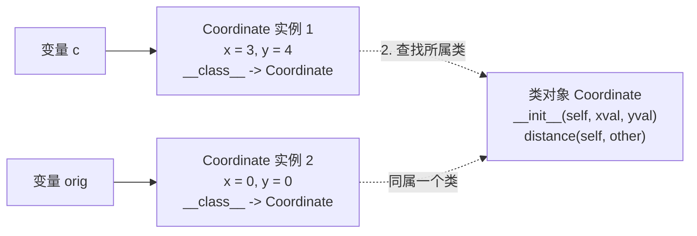

# L17 Python 类与面向对象基础

%% learning-vault-navigation:v1 %%
> [!abstract]- 笔记导航
> 目录：[[CS Learning/Python MIT6.100L/MIT Python导航|MIT Python 导航]]
> 上一章：[[CS Learning/Python MIT6.100L/Lecture 16 Recursion on Non-Numerics/L16 非数值对象的递归|L16 非数值对象的递归]] · 下一章：[[CS Learning/Python MIT6.100L/Lecture 18 More Python Class Methods/L18 Python 类的特殊方法与进阶设计|L18 Python 类的特殊方法与进阶设计]]

> [!abstract] 本讲核心概览
> 本讲（MIT 6.100L Lecture 17）开启**面向对象编程（Object-Oriented Programming, OOP）**核心模块。内容涵盖 Python “万物皆对象”与垃圾回收（Garbage Collection）、**数据抽象（内部表示 vs 交互接口）**、定义自定义类型（`class` 蓝图）与创建实例（Instance）的本质区别、构造初始化方法 `__init__` 与 `self` 参数绑定机制，以及通过 `Coordinate` 案例透视方法调用 `c.distance(orig)` 在内存中的底层解析流程。

---

## 1. 面向对象编程（OOP）与数据抽象

Python 中**一切皆对象（Everything is an object）**——整数 `1234`、字符串 `"Hello"`、列表 `[1, 5, 7]`、字典乃至函数本身，都是某个特定**类型（Type / Class）**的**实例（Instance）**。对象可被创建、操作与销毁（显式 `del` 或失去所有引用后由 Python **垃圾回收机制 Garbage Collection** 自动回收内存）。

### 对象的两大组成部分（Data Abstraction）
一个对象把**数据**与**操作数据的行为**打包在一起，形成数据抽象：
1. **内部数据表示（Data Attributes）**：描述“这个对象**是什么**”（例如列表底层的存储结构、电梯的尺寸/最大载重/当前楼层、员工的姓名/生日/薪资）。
2. **外部交互接口（Methods / Procedural Attributes）**：描述“外界**如何使用**这个对象”（例如列表的 `append` / `sort`、电梯的上下楼/进出乘客）。接口对外暴露行为规范，同时**隐藏内部实现细节**（封装 Encapsulation），避免用户直接篡改底层结构导致不变量被破坏。

### OOP 的四大工程优势
- **封装与模块化**：数据与专属方法绑定在一起，天然支持分治开发与独立单元测试。
- **命名空间隔离**：每个类拥有独立的作用域，不同类里定义同名方法（如 `sort`、`distance`）互不冲突。
- **高度可复用**：通过自定义类与后续的继承（Inheritance），可基于已有类型快速扩展新类型。
- **设计自主权（Big Idea, Slide 8）**：类作者决定用什么数据属性表示对象，以及对外开放哪些合法操作。

---

## 2. 定义类（蓝图） vs 创建实例（实体）

> [!important] Big Idea：类定义 $\neq$ 实体对象
> 定义类就像**定义函数**或画**房间设计蓝图**——此时内存中还没有任何具体的实体对象，仅仅向 Python 注册了一种新数据类型的规格；
> 实例化类（如 `c = Coordinate(3, 4)`）就像**调用函数**或按蓝图盖出具体房间——在内存中分配独立空间并填充具体的实例变量值。

| 视角 | 角色 | 典型操作 | 与函数的类比 |
| --- | --- | --- | --- |
| **实现类（Implementing the class）** | 类型设计者 | 使用 `class Name(object):` 定义 `__init__`、数据属性（`self.x`）与方法 | `def func(...):` 定义过程 |
| **使用类（Using the class）** | 类型调用者 | `c = Coordinate(3, 4)` 创建实例；`c.x` 访问属性；`c.distance(orig)` 调用方法 | `func(arg1, arg2)` 调用过程 |

### `Coordinate` 类的完整定义

```python
class Coordinate(object):
    """二维平面上的坐标点，由 x 和 y 两个数值组成"""

    def __init__(self, xval, yval):
        """初始化实例的数据属性（instance variables）"""
        self.x = xval
        self.y = yval

    def distance(self, other):
        """返回 self 与另一个 Coordinate 实例 other 之间的欧氏距离"""
        x_diff_sq = (self.x - other.x) ** 2
        y_diff_sq = (self.y - other.y) ** 2
        return (x_diff_sq + y_diff_sq) ** 0.5
```

- **`(object)` 的含义**：表示 `Coordinate` 继承自 Python 顶层基类 `object`（Python 3 中省略括号也默认继承 `object`，但在 6.100L 中常显式写出以强调继承关系）。
- **`__init__` 的作用**：在实例化 `Coordinate(3, 4)` 时由 Python 自动触发的特殊方法，负责为新创建的实例绑定初始数据属性。
- **`self` 到底是什么？**
  - 在写类定义时还没有具体实例，因此用形参 `self` 作为**当前实例的占位符**（类似蓝图里写“`self` 有一把椅子”）。
  - 只有挂在 `self` 上的 `self.x = xval` 才会成为持久存活于该对象生命周期内的**实例变量（Instance Variable）**；如果漏写 `self.`（只写 `x = xval`），那仅仅是 `__init__` 里的普通局部变量，初始化一结束就被销毁！

---

## 3. 方法调用的内存模型与解析步骤

创建两个实例并调用方法：
```python
c = Coordinate(3, 4)
orig = Coordinate(0, 0)
print(c.distance(orig))             # 常规点号调用 -> 5.0
print(Coordinate.distance(c, orig)) # 完全等价的显式类调用 -> 5.0
```



### Python 解析 `c.distance(orig)` 的 5 个步骤（Lecture 17 Slide 26）
1. 识别点号 `.` 左侧的实例对象 `c`；
2. 查找 `c` 所属的类型（类对象 `Coordinate`）；
3. 识别点号 `.` 右侧的方法名 `distance`；
4. 在 `Coordinate` 类对象中找到 `distance` 对应的方法定义；
5. **自动把点号左侧的 `c` 作为第一个实参传给 `self`**，把括号里的 `orig` 传给 `other`，即执行 `Coordinate.distance(c, orig)` 并返回结果 $\sqrt{(3-0)^2 + (4-0)^2} = 5.0$。

> [!important] Big Idea：点号运算符 `.` 的统一职责
> 点号 `.` 既用于访问**数据属性**（由 `self.attr` 定义，如 `c.x`），也用于调用**方法**（在类内定义且首个形参为 `self` 的函数，如 `c.distance(orig)`）。调用实例方法时**永远不要手动传入 `self`**，Python 会自动绑定点号前的对象。

---

## 4. 课后作业与 Finger Exercise 深度复盘

### 4.1 `homework.py`：`Vehicle` 类与“先校验、后修改”原则

> [!warning] `homework.py` Question 4 & 5 的状态一致性隐蔽 Bug！
> 题目要求：`add_n_occupants(self, n)` 如果加上 `n` 名乘客后超过 `max_occupancy = 5`，则**① 不执行人数增加（do not perform the increase），② 抛出 `ValueError`**。
> - **原代码中的问题**：
>   ```python
>   def add_n_occupants(self, n):
>       self.occ += n                 # 危险！先原地修改了 self.occ！
>       if self.occ <= self.max_occ:
>           return self.occ
>       else:
>           raise ValueError("exceeded max occupancy")
>   ```
>   如果调用方用 `try / except ValueError:` 捕获了异常并继续使用 `v1`，会发现 `v1.occ` 已经被悄悄改成了 `6`（破坏了“最多 5 人”的对象不变量！）。
> - **正确 OOP 原子性写法（先算临时值校验，通过后再提交修改）**：
>   ```python
>   def add_n_occupants(self, n):
>       new_occ = self.occ + n
>       if new_occ > self.max_occ:
>           raise ValueError("exceeded max occupancy")
>       self.occ = new_occ
>       return self.occ
>   ```
> - **Question 5 默认参数亮点**：`def __init__(self, w, o, c='black'):` 结合 L12 默认参数，使 `Vehicle(2, 1)` 自动获得默认颜色 `'black'`。

### 4.2 Finger Exercise 17：`Circle` 类（`mit6_100l_f22_ex17.py`）
实现了 `Circle` 的 `__init__`、`get_radius`、`set_radius`、`get_area`、`equal` 与 `bigger` 方法：
- **亮点**：在 `bigger(self, c)` 中你使用了 `if self.r >= c.r: return self else: return c`，当两圆半径相等时安全返回 `self`；而官方解答 PDF 中写的是 `if c.r > self.r ... elif c.r < self.r ...`，在两圆等半径时反而会隐式返回 `None`！
- **封装提示**：`get_radius()` / `set_radius()` 就是典型的 **Getter / Setter** 接口，为下一讲与继承中保护内部表示奠定基础。

---

## 5. 自测检验

> [!question]- 自测 1：在 `class Foo` 的 `__init__(self, x)` 中，写 `self.x = x` 和直接写 `x = x` 有什么区别？
> - `self.x = x` 在当前实例对象的属性字典中创建了一个**实例变量**，在对象的整个生命周期内都可以通过 `obj.x` 及其他方法中的 `self.x` 访问。
> - 直接写 `x = x` 只是操作 `__init__` 的**函数局部变量**，初始化返回后立刻销毁，实例对象上根本不会留下 `x` 属性，后续访问 `obj.x` 会报 `AttributeError`。

> [!question]- 自测 2：为什么定义方法时写成 `def distance(self, other):`（2 个形参），但调用 `c.distance(orig)` 时括号里只传了 1 个实参？
> 因为通过实例用点号调用方法时，Python 会自动把点号左侧的实例 `c` 隐式绑定为第一个参数 `self`，括号中的 `orig` 则对应第二个参数 `other`；若改用类名显式调用 `Coordinate.distance(c, orig)`，就需要手动传入全部 2 个参数。

---

## 6. 配套资料

| 资料名称 | 说明 | 仓库路径 |
| --- | --- | --- |
| Lecture 17 课件 | OOP 数据抽象、类与实例对比、`self` 与点号调用内存图 | [[CS Learning/Python MIT6.100L/Lecture 17 Python Classes/mit6_100l_f22_lec17.pdf\|mit6_100l_f22_lec17.pdf]] |
| Lecture 17 课堂代码 | `Coordinate` 类实现与 `Vehicle` 课后题参考答案 | [[CS Learning/Python MIT6.100L/Lecture 17 Python Classes/mit6_100l_f22_lec17_code.py\|mit6_100l_f22_lec17_code.py]] |
| 课后作业代码 | `Vehicle` Q1–Q5 个人实现 | [[CS Learning/Python MIT6.100L/Lecture 17 Python Classes/homework.py\|homework.py]] |
| Finger Exercise 17 | `Circle` 类 getter/setter/比较方法实现与解答 | [[CS Learning/Python MIT6.100L/Lecture 17 Python Classes/mit6_100l_f22_ex17.py\|mit6_100l_f22_ex17.py]] · [[CS Learning/Python MIT6.100L/Lecture 17 Python Classes/mit6_100l_f22_ex17_sol.pdf\|官方解答 PDF]] |
